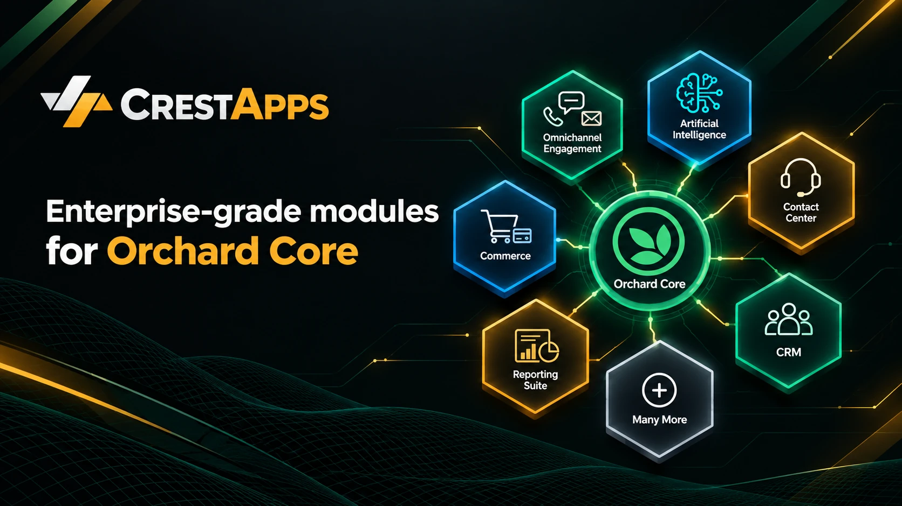

# Orchard Core Modules by CrestApps

[](https://github.com/sponsors/MikeAlhayek)



`CrestApps.OrchardCore` is a suite of modules and extensions that extends the Orchard Core framework with production-ready capabilities for building modern, enterprise applications. Each module targets a problem that real organizations face at scale, such as AI orchestration, omnichannel customer engagement, contact center operations, commerce, and multi-tenant administration, and solves it with the reliability, security, and extensibility that enterprise software demands.

At CrestApps, our focus is building enterprise-level solutions on top of Orchard Core. We follow industry standards and proven engineering practices so teams can adopt our modules with confidence, compose only what they need, and ship complex systems faster than they could build them from scratch.

## Why CrestApps

- **Enterprise-ready by design:** multi-tenancy, granular permissions, auditing, and concurrency-safe data access are built in, not bolted on.
- **Built on open standards:** interoperable protocols and formats, including the Model Context Protocol (MCP), Agent-to-Agent (A2A), SIP and WebRTC, OpenXML, and REST and webhook integrations.
- **Modular and composable:** every capability is an Orchard Core feature that can be enabled per tenant and extended through well-defined abstractions.
- **Vendor-flexible:** pluggable providers for AI models, vector stores, telephony carriers, payment gateways, and cloud storage, so you avoid lock-in.
- **Production-proven quality:** automated unit, integration, and end-to-end tests, public API baselines, and continuous integration on every change.

## What We Build

| Solution Area | Capabilities |
| --- | --- |
| **Artificial Intelligence** | AI chat and agents, retrieval-augmented generation over documents, data sources, and web crawlers, long-term memory, prompt management, MCP and A2A, with OpenAI, Azure OpenAI, Azure AI Inference, Ollama, and more |
| **Omnichannel Engagement** | Unified messaging across SMS and voice, with AI-assisted conversations, automated follow-ups, and business hours |
| **CRM** | Contacts, leads, accounts, and opportunities with pipeline stages, imports, and activity tracking tied to every conversation |
| **Contact Center** | Queues and routing, outbound dialer, soft phone, supervision, call recording, dispositions, and reporting, with Telnyx, Asterisk, and Azure telephony providers |
| **Commerce** | Products, carts, checkout, orders, subscriptions, installment plans, taxation, receipts, and Stripe payments |
| **Reporting** | Operational and business reports with filtering and OpenXML (Excel) export |
| **Platform and Administration** | Tenant hierarchy, users and roles, content access control, content import and export, recipes, wizards, and time zones |

## Documentation

- **CrestApps Orchard Core Documentation:** https://orchardcore.crestapps.com
- **CrestApps Core Documentation:** https://core.crestapps.com
- **Orchard Core Documentation:** https://docs.orchardcore.net

Use the CrestApps Orchard Core documentation for module installation, feature configuration, administration, and application development guidance.

Refer to the Orchard Core documentation for framework concepts, CMS features, and core platform documentation.

The CrestApps Core documentation covers shared infrastructure, reusable APIs, orchestration components, and cross-platform libraries used across the CrestApps ecosystem.

## Repository Scope

This repository includes:

- Orchard Core modules and features
- Framework extensions and enhancements
- Orchard Core integration libraries
- Startup applications and reference implementations
- Package targets and module bundles
- Tests, benchmarks, and documentation

## Solution Structure

```text
src/
├── Abstractions/
├── Common/
├── Core/
├── CrestApps.Docs/
├── Modules/
├── Startup/
└── Targets/

tests/
├── CrestApps.OrchardCore.Benchmarks/
└── CrestApps.OrchardCore.Tests/
```

## Project Areas

| Area | Description |
| --- | --- |
| `src/Abstractions` | Shared abstractions for Orchard Core integrations |
| `src/Common` | Common utilities and supporting components |
| `src/Core` | Core Orchard Core integration libraries |
| `src/Modules` | Orchard Core modules and framework extensions |
| `src/Startup` | Sample applications, CMS hosts, and development environments |
| `src/Targets` | Package targets that simplify module installation and composition |
| `src/CrestApps.Docs` | Documentation source for Orchard Core modules and extensions |

## Getting Started

```powershell
git clone https://github.com/CrestApps/CrestApps.OrchardCore.git
cd CrestApps.OrchardCore

npm install
npm run rebuild

dotnet build .\CrestApps.OrchardCore.slnx -c Release /p:NuGetAudit=false
dotnet test .\tests\CrestApps.OrchardCore.Tests\CrestApps.OrchardCore.Tests.csproj -c Release /p:NuGetAudit=false
```

> Note: Some builds may restore preview packages from the CrestApps Cloudsmith feed. Ensure the required NuGet sources are configured and accessible.

## Package Feeds

### Stable Packages

- https://www.nuget.org/

### Preview Packages

- https://cloudsmith.io/~crestapps/repos/crestapps-orchardcore
- https://nuget.cloudsmith.io/crestapps/crestapps-orchardcore/v3/index.json

## ❤️ Sponsor

This project is free and open source, built and maintained alongside full-time work. If it saves you time or powers something you ship, please consider [sponsoring on GitHub](https://github.com/sponsors/MikeAlhayek). Sponsorship funds new features, faster fixes, documentation and long-term maintenance, and companies using it in production are especially encouraged to sponsor.

[](https://github.com/sponsors/MikeAlhayek)

## License

MIT
