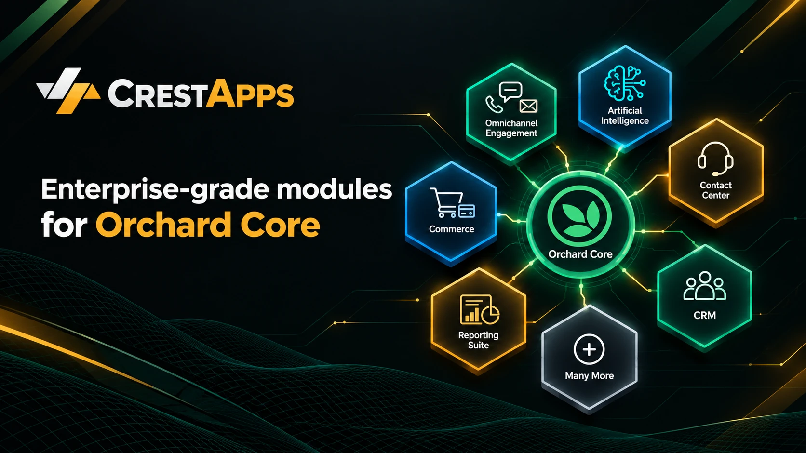

# Orchard Core Modules by CrestApps

[](https://github.com/sponsors/MikeAlhayek)



`CrestApps.OrchardCore` is a suite of modules and extensions that extends the Orchard Core framework with production-ready capabilities for building modern, enterprise applications. Each module targets a problem that real organizations face at scale, such as AI orchestration, omnichannel customer engagement, contact center operations, service desks, learning, workforce management, finance, commerce, and multi-tenant administration, and solves it with the reliability, security, and extensibility that enterprise software demands.

At CrestApps, our focus is building enterprise-level solutions on top of Orchard Core. We follow industry standards and proven engineering practices so teams can adopt our modules with confidence, compose only what they need, and ship complex systems faster than they could build them from scratch.

## Why CrestApps

- **Enterprise-ready by design:** multi-tenancy, granular permissions, auditing, and concurrency-safe data access are built in, not bolted on.
- **Built on open standards:** interoperable protocols and formats, including the Model Context Protocol (MCP), Agent-to-Agent (A2A), SIP and WebRTC, OpenXML, and REST and webhook integrations.
- **Modular and composable:** every capability is an Orchard Core feature that can be enabled per tenant and extended through well-defined abstractions.
- **Vendor-flexible:** pluggable providers for AI models, vector stores, telephony carriers, payment gateways, and cloud storage, so you avoid lock-in.
- **Production-proven quality:** automated unit, integration, and end-to-end tests, public API baselines, and continuous integration on every change.

## What We Build

Each area links to its documentation.

| Solution Area | Capabilities |
| --- | --- |
| **[Artificial Intelligence](https://orchardcore.crestapps.com/docs/ai)** | AI chat and agents, personas, realtime voice, retrieval-augmented generation over documents, data sources, file sources, and web crawlers, long-term memory, prompt templates, tools, usage analytics, MCP, A2A, and WebMCP, with OpenAI, Azure OpenAI, Azure AI Inference, Claude, Copilot, Ollama, and more |
| **[Omnichannel Engagement](https://orchardcore.crestapps.com/docs/omnichannel)** | Unified messaging across SMS and voice, a [messaging workspace](https://orchardcore.crestapps.com/docs/omnichannel/messaging-workspace) where agents answer every conversation in one place, cadences and automated follow-ups, AI-assisted conversations, [business hours](https://orchardcore.crestapps.com/docs/modules/business-hours), and Azure Communication Services and Event Grid integration |
| **[CRM](https://orchardcore.crestapps.com/docs/omnichannel/crm)** | Contacts, leads, [accounts](https://orchardcore.crestapps.com/docs/modules/accounts) (including B2B), and opportunities with pipeline stages, imports, a [timeline](https://orchardcore.crestapps.com/docs/modules/timeline) of every interaction, and a [do-not-call registry](https://orchardcore.crestapps.com/docs/modules/dnc-registry) |
| **[Contact Center](https://orchardcore.crestapps.com/docs/contact-center)** | Agent desktop and soft phone, queues and skills-based routing, IVR entry points, campaigns and outbound dialer, supervision, call recording, dispositions, live dashboards, and reporting, with [Telnyx, Asterisk, and Azure telephony](https://orchardcore.crestapps.com/docs/telephony) providers |
| **[Service Desk](https://orchardcore.crestapps.com/docs/modules/tickets)** | Help desk tickets with desks, types, boards, assignment, [service levels](https://orchardcore.crestapps.com/docs/modules/service-levels), approvals, a customer portal and web form, e-mail notifications, AI, and a [knowledge base](https://orchardcore.crestapps.com/docs/modules/knowledge-base) with AI search and article feedback |
| **[Learning (LMS)](https://orchardcore.crestapps.com/docs/modules/learning)** | Courses, enrollments, and progress, with [assessments and quizzes](https://orchardcore.crestapps.com/docs/modules/learning-assessments), [certifications](https://orchardcore.crestapps.com/docs/modules/learning-certifications) and [credentials](https://orchardcore.crestapps.com/docs/modules/learning-credentials), classes, programs, coursework, SCORM [packages](https://orchardcore.crestapps.com/docs/modules/learning-packages), [LTI](https://orchardcore.crestapps.com/docs/modules/learning-lti), [xAPI](https://orchardcore.crestapps.com/docs/modules/learning-xapi), course surveys, selling courses, and AI assistance for authors and learners |
| **[Workforce and Scheduling](https://orchardcore.crestapps.com/docs/modules/workforce)** | [Staff](https://orchardcore.crestapps.com/docs/modules/staff), [teams](https://orchardcore.crestapps.com/docs/modules/teams), and [skills](https://orchardcore.crestapps.com/docs/modules/skills), shift planning, time off, labor rules, time clock, and a My Work portal, [time tracking](https://orchardcore.crestapps.com/docs/modules/time-tracker), shared [calendars](https://orchardcore.crestapps.com/docs/modules/calendars), appointment [scheduling](https://orchardcore.crestapps.com/docs/modules/scheduling), contact center workforce management, and [OR-Tools](https://orchardcore.crestapps.com/docs/modules/or-tools) optimization |
| **[Field Service](https://orchardcore.crestapps.com/docs/modules/work-orders)** | Work orders, [dispatch](https://orchardcore.crestapps.com/docs/modules/dispatch) of technician visits, customer and company [assets](https://orchardcore.crestapps.com/docs/modules/assets), and [geo](https://orchardcore.crestapps.com/docs/modules/geo) services with Azure Maps, Google Maps, and OSRM |
| **Finance** | [Payroll](https://orchardcore.crestapps.com/docs/modules/payroll), [invoicing and billing](https://orchardcore.crestapps.com/docs/modules/invoicing), a [transactions](https://orchardcore.crestapps.com/docs/modules/transactions) ledger of what is owed, [banking](https://orchardcore.crestapps.com/docs/modules/banking) with checks, direct deposit, and Plaid bank linking, [approvals](https://orchardcore.crestapps.com/docs/modules/approvals), printable [business documents](https://orchardcore.crestapps.com/docs/modules/business-documents), and [exchange rates](https://orchardcore.crestapps.com/docs/modules/exchange-rates) |
| **[Commerce](https://orchardcore.crestapps.com/docs/modules/commerce)** | Products, carts, checkout, orders, customers, subscriptions, installment plans, pay later, [taxation](https://orchardcore.crestapps.com/docs/modules/taxation), shipping, inventory, fulfillment, receipts, markets, B2B, point of sale, marketplace, bookings, memberships, fundraising, digital downloads, classifieds, reviews, marketing, [agentic commerce](https://orchardcore.crestapps.com/docs/modules/agentic-commerce) (UCP, ACP, and AP2), and Stripe payments |
| **[Reporting and Data](https://orchardcore.crestapps.com/docs/modules/reports)** | Operational and business reports with CSV, Excel, and PDF export, a visual [report builder](https://orchardcore.crestapps.com/docs/modules/report-builder) with interactive dashboards, and [data connectors](https://orchardcore.crestapps.com/docs/modules/data-connectors) to external systems such as SQL Server |
| **Web and SEO** | [Advanced SEO](https://orchardcore.crestapps.com/docs/modules/advanced-seo) and structured data, and [NLWeb](https://orchardcore.crestapps.com/docs/modules/nlweb) so agents can ask a site questions in natural language |
| **Platform and Administration** | [Tenant hierarchy](https://orchardcore.crestapps.com/docs/modules/tenant-hierarchy), users and roles, content access control, [content import and export](https://orchardcore.crestapps.com/docs/modules/content-transfer), recipes, wizards, time zones, [agreements](https://orchardcore.crestapps.com/docs/modules/agreements), attachments and protected files, [webhooks](https://orchardcore.crestapps.com/docs/modules/webhooks), SignalR and WebSockets, a bulk-send [outreach](https://orchardcore.crestapps.com/docs/modules/outreach) engine, and [observability](https://orchardcore.crestapps.com/docs/observability) |

## Documentation

- **CrestApps Orchard Core Documentation:** https://orchardcore.crestapps.com
- **CrestApps Core Documentation:** https://core.crestapps.com
- **Orchard Core Documentation:** https://docs.orchardcore.net

Use the CrestApps Orchard Core documentation for module installation, feature configuration, administration, and application development guidance.

Refer to the Orchard Core documentation for framework concepts, CMS features, and core platform documentation.

The CrestApps Core documentation covers shared infrastructure, reusable APIs, orchestration components, and cross-platform libraries used across the CrestApps ecosystem.

## Repository Scope

This repository includes:

- Orchard Core modules and features
- Framework extensions and enhancements
- Orchard Core integration libraries
- Startup applications and reference implementations
- Package targets and module bundles
- Tests, benchmarks, and documentation

## Solution Structure

```text
src/
├── Abstractions/
├── Common/
├── Core/
├── CrestApps.Docs/
├── Modules/
├── Startup/
└── Targets/

tests/
├── CrestApps.OrchardCore.Benchmarks/
└── CrestApps.OrchardCore.Tests/
```

## Project Areas

| Area | Description |
| --- | --- |
| `src/Abstractions` | Shared abstractions for Orchard Core integrations |
| `src/Common` | Common utilities and supporting components |
| `src/Core` | Core Orchard Core integration libraries |
| `src/Modules` | Orchard Core modules and framework extensions |
| `src/Startup` | Sample applications, CMS hosts, and development environments |
| `src/Targets` | Package targets that simplify module installation and composition |
| `src/CrestApps.Docs` | Documentation source for Orchard Core modules and extensions |

## Getting Started

```powershell
git clone https://github.com/CrestApps/CrestApps.OrchardCore.git
cd CrestApps.OrchardCore

npm install
npm run rebuild

dotnet build .\CrestApps.OrchardCore.slnx -c Release /p:NuGetAudit=false
dotnet test .\tests\CrestApps.OrchardCore.Tests\CrestApps.OrchardCore.Tests.csproj -c Release /p:NuGetAudit=false
```

> Note: Some builds may restore preview packages from the CrestApps Cloudsmith feed. Ensure the required NuGet sources are configured and accessible.

## Package Feeds

### Stable Packages

- https://www.nuget.org/

### Preview Packages

- https://cloudsmith.io/~crestapps/repos/crestapps-orchardcore
- https://nuget.cloudsmith.io/crestapps/crestapps-orchardcore/v3/index.json

## ❤️ Sponsor

This project is free and open source, built and maintained alongside full-time work. If it saves you time or powers something you ship, please consider [sponsoring on GitHub](https://github.com/sponsors/MikeAlhayek). Sponsorship funds new features, faster fixes, documentation and long-term maintenance, and companies using it in production are especially encouraged to sponsor.

[](https://github.com/sponsors/MikeAlhayek)

### Our Sponsors

Thank you to the companies that sponsor CrestApps.OrchardCore and make its continued development possible.

<p>
  <a href="https://lombiq.com" title="Lombiq Technologies">
    
  </a>
</p>

## License

MIT
