# PSA Platform Blueprint — Orchard Core + CrestApps

Status: proposal, 27 November 2026. Planning document only; no implementation is included. The step-by-step task list for implementing this plan is in [`psa-implementation-guide.md`](psa-implementation-guide.md).

## How to read this document

This is a planning and architecture blueprint only: it adds no code and changes no module. It is written for an AI coding agent that will implement the platform module by module, and for the people reviewing that agent's work.

**Evidence labels.** Every important claim carries one of these labels:

| Label | Meaning |
| --- | --- |
| **\[V-Repo\]** | Verified by reading the CrestApps.OrchardCore source at commit `9b276b34` (main, 25 Nov 2026): projects, models, interfaces, manifests, READMEs and `docs/engineering`. |
| **\[V-Web\]** | Verified from a vendor's own documentation or another public source linked in the text and in the Sources appendix. |
| **\[Rec\]** | An architectural recommendation by the author of this blueprint. |
| **\[Asm\]** | An assumption that must be confirmed before the dependent work starts. |

**Research limits.**

- Competitor research used public help centers, guides, release notes and marketing pages. ConnectWise's detailed help (docs.connectwise.com) is mostly behind partner sign-in, so several ConnectWise details come from partner and integrator documentation; those rows are marked as such. No competitor product was used hands-on.
- The Orchard Core docs search tool returned no results in this session, so Orchard Core facts come from docs.orchardcore.net pages and from how CrestApps uses Orchard Core in its source. CrestApps targets **Orchard Core 4.0.0-preview-19240** on **.NET SDK 11.0.100** \[V-Repo\] (`Directory.Packages.props`, `global.json`).
- The repository was read, not built or run. "Implemented" below means the code, tests and docs exist; production readiness was not load-tested.
- Line counts are C# lines including blank lines and comments, used only as a rough size signal.

**Naming.** Module identifiers follow the repository convention `CrestApps.OrchardCore.<Name>` with `<Name>.Abstractions` and `<Name>.Core` projects. The PSA product modules use `CrestApps.OrchardCore.Psa.*`.

## 1. Executive Summary

**The PSA platform should be built mostly by composing what CrestApps already has: 42 of the 55 capabilities traced against the three market leaders (76%) rest on building blocks that exist and are tested today, and the work left is five new building blocks (two more deferred), twelve enhancements and three thin PSA modules.** \[V-Repo\] \[Rec\]

**What already exists \[V-Repo\].** CrestApps.OrchardCore is far larger than its README suggests: 119 modules and 331 features (per its own November 2026 audit), with a written building-block catalog (`docs/engineering/building-blocks.md`), enforced layering rules (`LayeringRatchetTests`) and a completed reusability audit. The PSA-relevant blocks that are implemented and tested include:

- **Service desk:** Tickets (desks, statuses, priorities, impact/urgency matrix, boards, merge, parent/child and problem links, portal, web form, approvals, CSAT, API, AI tools, \~35k lines, \~11k test lines), Service Levels (business-hours timers, pause/resume, warnings, breaches), Business Hours, Knowledge Base.
- **Contracts:** Agreements (block-of-hours and monthly allowance, rounding, 80%/100% warnings, expiry), with Tickets and Work Orders attaching their own terms.
- **Field service:** Work Orders (checklists, signatures, parts, SLA, recurring service schedules), Dispatch (skills, territory, shifts, travel, optimizer seam, live board, technician mobile), Scheduling, Calendars, Geo, OrTools, Assets, Inventory with Purchase Orders.
- **People:** Staff (with cost and pay rates), Teams (assignment by load, turn and skills), Skills and certifications, Workforce (shifts, time clock, timesheets, time off, labor rules), Payroll, Time Tracker.
- **Money:** Invoicing (estimates, billable charges, time billing, usage meters, recurring plans, statements, deposits, late fees, approvals, credit notes), Transactions ledger, Payment Terms, Taxation, Business Documents, Exchange Rates.
- **CRM and communication:** Accounts (members, team, locations, e-mail domains), Omnichannel CRM (leads, opportunities, stages, campaigns), Messaging (SMS, chat), Contact Center, Outreach, Consent.
- **Platform:** Approvals (multi-stage policies), Timeline, Attachments, Reports (designer, subscriptions, 24 data sets), Webhooks (in and out), Data Connectors, Personal Data, AI (agents, MCP, data sources with permission filters), Tenant Hierarchy, signed links, sensitive-value protection, telemetry, leased work queues and retention.

**What is missing for a competitive PSA \[V-Repo\] \[Rec\].** Five concepts have no owner today and become new building blocks: **Projects** (phases, tasks, dependencies, baselines, budgets), **Resource Planning** (capacity versus demand across projects, tickets and visits), **Rates** (work roles, work types and rate cards that decide billing and cost), **Expenses** (reports, policies, receipts, reimbursement, rebilling)** and Boards (extracted from Tickets, as the catalog already plans). Inbound e-mail, which no module handles today, becomes an E-mail channel of Omnichannel Messaging rather than a new block**. Two more are deferred: **Revenue Recognition** and **accounting/RMM integration connectors**.

**What must be enhanced \[Rec\].** Agreements must grow from hours-only into the full contract model (recurring service with additions, block hours, retainer, per-incident, time and materials, fixed price with milestones, coverage rules and billing). Tickets needs change management with CAB approval, recurring tickets, ticket templates, a service catalog and configuration-item links. Time Tracker needs work role, work type, billable status and approval. Assets needs configuration-item relationships. Estimates must become a full quote with recurring lines and conversion to agreements and projects. Invoicing Billing needs one "approve and post" review across every billable source.

**What the PSA product itself is \[Rec\].** Three thin modules: `Psa` (setup recipe, role templates, navigation, role dashboards, settings), `Psa.Portal` (one client portal composed from existing portal pages) and `Psa.Analytics` (cross-module KPIs: utilization, agreement profitability, project margin, SLA attainment). PSA modules may reference every building block; no building block may reference PSA.

**Key decisions \[Rec\].**

1. **Modular monolith on Orchard Core**, one Orchard tenant per service provider; the provider's customers are Accounts inside the tenant, isolated by row-level scope services, not by tenants.
2. **Persistence stays on YesSql** catalogs and content items, as every CrestApps block does, with distributed locks and indexed tables for transactional integrity. No second ORM.
3. **In-process domain events** through the existing observer interfaces, plus Orchard Workflows and outbound Webhooks for automation and integration. No message broker until a measured need appears.
4. **Security by default**: every endpoint needs a named permission, every list goes through a scope filter, portal users see only their parties' records, and secrets live in Orchard Core Secrets.

**Roadmap shape.** Ten phases, from platform hardening to enterprise readiness; Projects, Rates and the Agreements enhancement are the critical path because billing, profitability and resource planning all depend on them (section 22).

## 2. Competitive Product Research

**All three leaders are built on the same spine: a ticket or task carries time, the time is judged against a contract, and the contract decides what is billed; they differ mainly in how configurable that spine is and how much sits in add-on products.** \[V-Web\] \[Rec\]

### 2.1 Datto Autotask PSA (Kaseya)

Autotask's public help center is the most detailed of the three, so its business model is the best documented.

- **Contracts are the billing engine.** \[V-Web\] Autotask has six contract types: [Time and Materials, Fixed Price, Block Hours, Retainer, Incident (per ticket) and Recurring Service](https://ww1.autotask.net/help/Developerhelp/Content/APIs/REST/Entities/ContractsEntity.htm); the UI also lists an Umbrella type ([creating a contract](https://autotask.net/help/Content/3_Features/6_Contracts/CreateManageContract/CreateEDITContract.htm)). Only T&M and Recurring Service are active by default ([configuring contracts](https://autotask.net/help/Content/3_Features/6_Contracts/AdminGeneral/ContractsConfigure.htm)).
  - Recurring Service contracts bill defined services and bundles per unit each period, and unit costs feed contract profitability ([business cases](https://autotask.net/help/Content/3_Features/6_Contracts/AdminGeneral/BusinessCaseContracts.htm)).
  - Block Hours are debited by approved labor until zero; Retainers hold money, and ticket and project charges (not contract charges) are deducted from them ([time to money](https://autotask.net/help/content/6_EO/TimeToMoney/TimeMoneyContracts.htm)).
  - Notification rules can warn or automatically repurchase a retainer when the balance drops to a threshold ([business cases](https://ww15.autotask.net/help/content/3_Features/6_Contracts/AdminGeneral/BusinessCaseContracts.htm)).
  - Fixed Price contracts bill by milestones while labor is still tracked for cost.
  - Roles and work types can be excluded from a recurring contract so the labor rolls to a block-hour or T&M contract ([about contracts](https://ww1.autotask.net/help/Content/6_EO/MSPPlaybook/Entities/AboutContracts.htm)).
- **SLAs measure four events.** \[V-Web\] First Response, Resolution Plan, Waiting Customer and Resolved, each mapped to ticket statuses ([service level management](https://autotask.net/help/Content/3_Features/7_ServiceDeskAutomation/ServiceLevelManagement/SLAMAIN.htm)). An SLA can set the ticket due date from its Resolved objective within business hours, and carries goal percentages reported against actuals ([adding SLAs](https://autotask.net/help/Content/4_Admin/2FeaturesSettings/ServiceDeskTickets/SLAAdmin/SLAAddEdit.htm)).
- **ITIL change management.** \[V-Web\] Change Request is its own ticket type with Problems, Incidents, Change Info and Approvals tabs; change advisory boards are reusable approver groups, approval can need all approvers or one, and workflow rules support multi-tier boards ([change management](https://autotask.net/help/content/3_Features/7_ServiceDeskAutomation/ITIL/ChangeManagement.htm), [CABs](https://autotask.net/help/Content/4_Admin/2FeaturesSettings/ServiceDeskTickets/ChangeManagement/ChangeAdvisoryBoards.htm), [approvals tab](https://autotask.net/help/Content/3_Features/1_SharedFeatures/AccessoryTabs/Approvals_Tab.htm)). Client contacts can approve, and approvals can be given by e-mail ([entity rules](https://ww16.autotask.net/help/content/4_Admin/3Automation/EmailSurvey/EMAILS/IncomingEmailProcessing/What_Entity.htm)).
- **E-mail is a first-class intake.** \[V-Web\] Incoming Email Processing turns e-mails into tickets, notes and time entries, attributes them by sender address, threads replies by ticket number and handles duplicates and loops; the advanced version allows up to 15 mailboxes ([incoming email processing](https://ww1.autotask.net/help/content/4_Admin/3Automation/EmailSurvey/EMAILS/IncomingEmailProcessing/INCOMINGEMAILPROCESSING.htm), [loops and dupes](https://autotask.net/help/Content/4_Admin/3Automation/EmailSurvey/EMAILS/IncomingEmailProcessing/Loops_Dupes.htm)).
- **Automation** is an event-condition-action workflow rule engine that evaluates tickets, opportunities and other items on every triggering event ([basic ticket workflow](https://autotask.net/help/Content/3_Features/7_ServiceDesk/Workflows/Basic_Ticket_Workflow.htm)). \[V-Web\]
- **Planning.** \[V-Web\] A Resource Planner that combines tickets, service calls and calendar availability entered early access in April 2026 ([Kaseya](https://www.kaseya.com/platform/innovations/autotask-resource-planner-early-access/)); release 2026.3 extended it and moved AI ticket-triage rules into one settings page ([2026.3 release](https://www.kaseya.com/blog/autotask-2026-3-release/)).
- **Packaging.** \[V-Web\] Email-to-ticket, time and expense, SLAs and projects appear across Essentials, Premium and Ultimate editions, with quoting through Kaseya Quote Manager ([edition sheet](https://www.datto.com/product-assets/autotask-psa/Autotask-Edition-Sheet.pdf)). Some features (change management, advanced e-mail processing) are excluded from Essentials.

### 2.2 HaloPSA

Halo positions itself as one product with no per-module billing, and its guides show unusually deep billing configuration.

- **All-inclusive scope.** \[V-Web\] Ticketing, SLAs, contracts, assets and self-service are sold as one product ([usehalo.com](https://usehalo.com/halopsa)). The feature list includes e-mail and social ticketing, round-robin routing, deal pipeline, quotes, sales orders and purchase orders ([pricing page](https://halopsa.com/?p=1698)).
- **Contracts are recurring invoices.** \[V-Web\] Halo treats contract value as a recurring invoice linked to the contract ([guide 1113](https://halopsa.com/guides/article/?kbid=1113)). Recurring lines can take quantities from billing profiles and imports, prices from products, pro-rata lines, creation periods (licenses in arrears, support in advance), automatic percentage increases, approvals and meter billing ([recurring invoice guides](https://usehalo.com/faq-list/recurring-invoices-billing-2/), [automating prices](https://halopsa.com/guides/article/?kbid=2302)).
- **Prepay and deferred revenue.** \[V-Web\] Prepay amounts are invoiced to a deferred revenue item and drawn down as time becomes ready for invoicing ([guide 2175](https://halopsa.com/guides/article/?kbid=2175)). Billing rules combine pay-as-you-go, prepay and all-you-can-eat clients; charge types, surcharges, travel time and contract signing are configurable ([billing guides](https://usehalo.com/?p=845)). A "Ready for Invoicing" dashboard is where invoices are created from all waiting items ([creating invoices](https://usehalo.com/faq-list/creating-invoices/)).
- **ITIL processes.** \[V-Web\] Ticket types can be nominated as ITIL change or problem types; change requests get a Change Management tab ([guide 950](https://halopsa.com/guides/article?kbid=950)). Halo describes change management as risk assessment, CAB governance, implementation and post-implementation review ([change management](https://www.usehalo.com/platform/change-management)); CABs can be imported from Entra and added to approval processes ([academy](https://usehalo.com/faq-list/halopsa-academy/page/11/)).
- **AI.** \[V-Web\] AI auto-categorises, prioritises and routes tickets and suggests resolutions, included for every user ([MSP solution page](https://usehalo.com/halopsa/solutions/msp/)); guides also list AI article creation, translation, emotion detection and change optimisation ([HaloITSM guides](https://usehalo.com/haloitsm/guides/887)).
- **Guides also cover** appointments and appointment types, approval delegation, asset relationships, budgets, call scripts, canned text, e-mail rules, Azure mailbox scanning, PDF templates and custom tables ([guides index](https://halopsa.com/guides)). \[V-Web\]

### 2.3 ConnectWise PSA (formerly Manage)

ConnectWise PSA is the deepest in procurement and the most dependent on companion products (CPQ, RPA, marketplace add-ons).

- **Agreements, work roles and work types.** \[V-Web, partner docs\] Agreement types are templates that list covered and not-covered work roles and work types, can cap employee compensation, and can copy roles and types onto each agreement ([agreement type setup](https://betterinvoice-website.pages.dev/docs/connectwise/setup-tables/agreement-type)). Agreements carry additions (recurring products and services) and role-specific rate overrides ([using agreements](https://betterinvoice-website.pages.dev/docs/connectwise/agreements/using-agreements)). Work roles set an hourly rate and, together with work types, determine the billing rate ([N-able](https://documentation.n-able.com/N-central/userguide/Content/Administration/PSA_Integration/ConnectWise/PSA_ConnectWise_Work_Roles_vs_Work_Types.htm)). Agreements also support custom response plans and resolution times by calendar and matrix ([ConnectWise SLAs](https://www.connectwise.com/platform/psa/slas)).
- **Service boards** route tickets with their own SLAs, workflows and statuses ([internal IT page](https://www.connectwise.com/en-au/solutions/software-for-internal-it/manage)); workflow rules move tickets between boards and ticket templates standardise escalation ([escalation blog](https://www.connectwise.com/blog/best-practices-for-escalating-tickets)). \[V-Web\]
- **Procurement and CPQ.** \[V-Web\] PSA Procurement covers requisitions, purchase orders, vendors, receiving and inventory with ship sets ([procurement](https://www.connectwise.com/Software/Manage/Procurement)). ConnectWise CPQ (formerly Sell) builds quotes, sends them to the PSA opportunity when signed, and places electronic orders with distributors such as Ingram Micro, TD Synnex and D&H ([CPQ electronic orders](https://www.connectwise.com/en-au/platform/business-management/cpq/electronic-orders), [integration e-book](https://www.connectwise.com:443/globalassets/media/assets/ebook/theunparalleledintegrationconnectwisemanageandconnectwisesell.pdf)).
- **Projects** use templates, phases, Gantt and Kanban views, and resource scheduling by availability and skills ([project management](https://www.connectwise.com/platform/psa/project-management), [webinar](https://www.connectwise.com/webinars/psa--managing-projects)). Advanced dependency and capacity planning is sold by a certified partner (Moovila Perfect Project) ([marketplace](https://marketplace.connectwise.com/moovila-perfect-project)). \[V-Web\]
- **AI.** \[V-Web\] Sidekick for PSA summarises, categorises and triages tickets, scores sentiment, suggests resolutions from past tickets and drafts e-mail replies, including from Microsoft Teams ([Sidekick for PSA](https://www.connectwise.com/platform/ai/sidekick-psa), [AI page](https://connectwise.com/platform/ai)). Third-party reporting says ConnectWise acquired zofiQ in January 2026 to build separate AI Agents ([Atera comparison](https://www.atera.com/blog/robin-vs-connectwise-sidekick/)); this was not confirmed on a ConnectWise page.

### 2.4 Functional anatomy of the shared PSA spine

The table answers the ten questions of the brief for each major capability, as the three products implement it. \[V-Web\] for behaviour cited above; entity lists and states are normalized by the author \[Rec\].

| Capability | Business problem and users | Primary entities | Lifecycle states | Depends on / interacts with | Automation, security, metrics |
| --- | --- | --- | --- | --- | --- |
| Ticketing / incident | Capture and resolve requests; technicians, dispatchers, end users | Ticket, queue/board, status, priority, type/sub-type, note, time entry, attachment | New, In progress, Waiting customer, Waiting vendor, Resolved, Closed (configurable per board) | Accounts, contacts, assets, SLA, contracts, KB, time | Workflow rules, e-mail intake, routing; board-level permissions; volume, backlog, first-contact resolution |
| Problem | Remove root causes of repeated incidents; problem managers | Problem, linked incidents, known error, workaround | Open, Investigating, Known error, Resolved | Tickets, changes, KB | Resolving a problem resolves incidents; recurrence metrics |
| Change | Approve and schedule risky changes; change managers, CAB | Change request, risk/impact, plan, backout, CAB, approval vote | Draft, Submitted, Awaiting approval, Approved/Rejected, Scheduled, Implemented, Reviewed, Closed | Tickets, assets/CIs, approvals, calendar | Multi-tier CAB rules, e-mail approval; approval status report |
| SLA | Make response promises measurable; service managers | SLA, objective per priority, business hours, holiday set, event | Running, Paused, Met, Breached | Tickets, contracts, calendars | Warning and breach escalation; attainment % against goals |
| Contracts | Decide what is covered and what is billed; account managers, finance | Contract, service/bundle, unit, block, retainer purchase, milestone, exclusion, rate override | Draft, Active, Expired, Renewed, Cancelled | Accounts, products, rates, time, invoicing | Renewal and threshold notices, auto-repurchase; profitability |
| Quoting | Price and win deals; sales | Opportunity, quote, line (one-time, recurring, labor), template, signature | Draft, Sent, Accepted, Lost, Converted | Products, pricing, CRM, procurement, contracts, projects | Approval of discounts, e-sign, conversion to orders, projects, agreements |
| Projects | Deliver fixed-scope work on time and budget; PMs, engineers | Project, phase, task, dependency, milestone, template, budget, baseline | Planning, Active, On hold, Complete, Cancelled | Opportunities, contracts, resources, time, invoicing | Templates, Gantt and Kanban, budget burn alerts; margin, schedule variance |
| Resource planning | Match demand to capacity; dispatchers, resource managers | Resource, role, skill, availability, allocation, service call | Proposed, Booked, Completed | Workforce, calendars, tickets, projects | Utilization, overbooking warnings |
| Field service | Send the right technician on site; dispatchers, technicians | Work order, appointment/service call, route, part, signature | Scheduled, Dispatched, En route, On site, Completed, Signed off | Tickets, assets, inventory, contracts | Optimised scheduling, mobile; first-time fix rate |
| Time and expense | Capture billable effort and costs; everyone | Time entry, timesheet, expense report, expense item, receipt | Draft, Submitted, Approved, Rejected, Posted/Billed | Tickets, projects, contracts, payroll, invoicing | Approval chains; utilization, unbilled WIP |
| Billing | Turn approved work into invoices; finance | Billing item, invoice, batch, credit note, recurring invoice | Ready, Approved & posted, Invoiced, Paid | Contracts, time, expenses, products, accounting | Approve and post, batching, accounting sync; AR aging, revenue |
| Procurement and inventory | Buy and track hardware; purchasing | Requisition, purchase order, receipt, stock item, serial, location | Requested, Ordered, Received, Delivered, Installed | Quotes, projects, tickets, assets | Distributor ordering, back-order tracking |
| Portal and KB | Self-service; end users and client admins | Portal user, request form, article | Draft, Published, Retired | Tickets, catalog, approvals | Article feedback; deflection rate |
| AI | Faster triage and resolution; technicians | Summary, category suggestion, sentiment, draft reply | n/a | Tickets, KB, history | Human approval of AI writes; time saved per ticket |

## 3. Detailed Competitor Feature Comparison

**The three products are at parity on the core ticket-to-invoice spine; the differences that matter are Halo's billing configurability, Autotask's documented contract types and e-mail processing, and ConnectWise's procurement and partner ecosystem.**

Key: **Y** = verified in a source cited in section 2 or below · **P** = verified only in partner or integrator documentation · **C** = claimed on marketing pages only · **—** = not found in the sources read (not proof of absence).

| Capability | ConnectWise PSA | HaloPSA | Autotask PSA | Difference or advanced aspect |
| --- | --- | --- | --- | --- |
| Ticket queues / boards with own statuses and SLAs | Y | Y | Y (queues) | CW boards carry their own workflows and statuses |
| E-mail to ticket, threading, duplicate handling | — | Y (e-mail rules, Azure mailbox scan) | Y (up to 15 mailboxes, loops and dupes) | Autotask also creates time entries and approvals from e-mail |
| Workflow rules (event, condition, action) | Y | C | Y | Autotask documents the engine in detail |
| SLA with business hours and priority matrix | Y | Y | Y (4 events, goal %) | Autotask's "Resolution Plan" event is distinctive |
| Problem management | C | Y | Y | Halo and Autotask link problems, incidents and changes |
| Change management with CAB | — | Y (CAB, Entra import) | Y (CAB, one or all approvers, contact approvers) | Autotask supports e-mail approval |
| Parent/child and related tickets | C | C | Y (incidents tab) | — |
| Recurring / scheduled tickets | C | Y (scheduled tickets) | Y (via workflow rules creating tickets) | — |
| Customer portal | C | Y | Y (Client Portal, Taskfire) | — |
| Knowledge base | C | Y | Y | Halo has AI article creation |
| Service catalog / request forms | C | Y (forms) | Y (form templates) | — |
| Contract types: recurring, block, retainer, per incident, T&M, fixed price | P (agreement types with additions) | Y (pay as you go, prepay, all you can eat) | Y (all six documented) | Autotask auto-repurchases retainers at a threshold |
| Covered and excluded roles and work types | P | Y (charge type overrides) | Y (exclusions roll labor to another contract) | — |
| Recurring billing with quantity sync (devices, licenses) | P (additions synced by RMM vendors) | Y (billing profiles, pro-rata, creation periods) | Y (service units) | Halo has the deepest recurring invoice engine |
| Deferred revenue for prepaid work | — | Y | — | — |
| Opportunities and pipeline | Y | Y | C | — |
| Quotes with recurring lines, e-sign | Y (via ConnectWise CPQ) | Y (built in) | Y (via Kaseya Quote Manager) | Halo includes it; the others use companion products |
| Sales orders | P | Y | — | — |
| Procurement: requisitions, POs, receiving, distributors | Y (PSA Procurement + CPQ e-orders) | Y (POs, stock) | Y (inventory; procurement via Quote Manager) | CW's distributor e-ordering is the most mature |
| Projects: templates, phases, tasks | Y | Y | Y | — |
| Gantt, Kanban, dependencies | Y (Gantt, Kanban) | C | C | CW sells advanced critical path via Moovila |
| Resource / capacity planning | Y | C | Y (Resource Planner, 2026) | — |
| Dispatch / scheduling of service calls | Y | Y (appointments) | Y | — |
| Time and expense capture with approvals | Y | Y (expenses, approvals) | Y | — |
| Approve-and-post / ready-for-invoicing review | C | Y | Y | — |
| Accounting package sync | Y (accounting sync) | Y | Y | — |
| RMM / security alert to ticket | Y (many vendors) | Y | Y | All rely on vendor integrations |
| Asset / configuration management with relationships | Y (configurations) | Y (asset relationships) | Y (devices) | — |
| AI triage, summary, suggested resolution | Y (Sidekick) | Y (included) | Y (Ticket Triage) | CW adds sentiment scoring and a Teams bot |
| Dashboards and reports | Y | Y | Y | — |
| REST API and webhooks | Y | Y | Y (REST) | — |
| Multi-tenant per customer separation | — | C | — | Halo markets clean per-customer separation |

### 3.1 Common, unique and missing

- **Common to all three (industry baseline):** ticketing with queues, SLAs with business hours, contracts that decide billing, time capture, invoicing with accounting sync, projects with templates, dispatch, assets, portal, KB, opportunities, quoting (built in or companion), RMM integrations, REST API and AI ticket assistance.
- **Particularly advanced:** Autotask's six documented contract types with exclusions and retainer auto-repurchase; Autotask's e-mail processing (time and approvals by e-mail); Halo's recurring invoice engine (quantity sync, creation periods, pro-rata, deferred revenue); ConnectWise's distributor e-ordering and its marketplace.
- **Unique:** Autotask's Resolution Plan SLA event; Halo's all-inclusive pricing with AI for every user; ConnectWise's work role and work type matrix as the billing-rate key.
- **Gaps in competitors (opportunities for us) \[Rec\]:** advanced project scheduling (critical path, baselines, what-if capacity) is an add-on for ConnectWise and not documented for the others; deferred revenue is documented only for Halo; strong per-customer data isolation is not documented by ConnectWise or Autotask. A platform with native critical-path projects, native revenue recognition and provable account-level isolation would be differentiated.

### 3.2 Industry-standard capability set

A complete PSA must provide the 32 capabilities in the comparison table, plus three platform qualities none of them can skip: configurable permissions by queue and customer, an audit trail of every change that affects money, and an API that covers every entity. Section 21 traces these 35 items, split finer and extended with the brief's workforce, finance and platform items, as 55 rows. \[Rec\]

## 4. Orchard Core Architecture Assessment

**Orchard Core supplies the whole application platform the PSA needs (modules, tenancy, identity, permissions, content, workflows, background work, search, localization, recipes); the PSA should add business modules on top and never replace any of these.** \[Rec\]

CrestApps pins Orchard Core **4.0.0-preview-19240** \[V-Repo\]. Orchard Core is a modular, multi-tenant application framework on ASP.NET Core; each tenant ("shell") has its own service container, enabled features, settings and database configuration. Orchard Core stores documents and indexes in a relational database through YesSql, and provider, connection string, table prefix and schema are tenant settings ([Data docs](https://docs.orchardcore.net/en/main/reference/modules/Data/)); when tenants share a database, the table prefix isolates each tenant's tables, and `RequireTablePrefix` can enforce it ([Tenants docs](https://docs.orchardcore.net/en/main/reference/modules/Tenants/)). \[V-Web\]

| Orchard Core capability | What it gives | How CrestApps already uses it \[V-Repo\] | Role in the PSA \[Rec\] | Limits to plan for \[Rec\] |
| --- | --- | --- | --- | --- |
| Modules and features | Manifest-declared features with dependencies, enabled per tenant | 119 modules, 331 features, feature IDs as constants (`FeatureIdLiteralRatchetTests`) | Each building block and PSA module is a feature; editions are feature sets | Feature dependency graphs must stay acyclic (section 14) |
| Shell tenancy | Isolated container, settings and DB per tenant | Tenant Hierarchy provisions child tenants and their databases | One tenant per service provider (MSP); SaaS provisioning via Tenant Hierarchy | Not a customer-of-customer boundary; account isolation is row-level (section 17) |
| YesSql data | Documents plus map/reduce index tables, per-tenant session (unit of work) | `DocumentCatalog`, `ICatalog` managers, index providers, `ResumableSteps` for long upgrades | All PSA records | No relational foreign keys; integrity by services, locks and indexes (ADR-02) |
| Content management | Content types, parts, fields, drivers, handlers, versioning | Tickets, opportunities, KB articles, accounts are content items with parts | Records that admins extend with fields (tickets, articles, CRM) | Content items are heavier than catalog records; not for high-volume ledgers |
| Display management | Shapes, display drivers, placement | Editors built from drivers so other modules add cards (`IDisplayManager<T>`) | Every PSA editor is driver-based so modules extend it | Plain controller forms block extension (audit section 5) |
| Workflows | Event-activity graphs, tasks, timers, HTTP triggers | Tickets, Invoicing, Approvals, Payroll publish workflow events and tasks | Customer-configured automation (Autotask-style rules) | Long-running graphs need care; keep money logic in services, not workflows |
| Background tasks | Scheduled per-tenant tasks with distributed lock | SLA monitor, agreements expiry, recurring invoices, auto-close | Timers, recurring generation, sync jobs | Must use `BackgroundTaskTelemetry` and idempotent work |
| Distributed locks and cache | `IDistributedLock`, Redis option | `LockAllAsync`, ticket lock, sequence lock | Every state change of money or capacity | Multi-node requires Redis (section 24) |
| Users, roles, permissions | Identity, roles, permission providers, authorization handlers | Per-desk permission templates, `SearchUsers`, role grants | Role templates per PSA persona | Roles alone cannot express "this customer's records" (scope services do) |
| OpenId (OpenIddict) | OAuth 2.0 / OIDC server and client | API auth scheme for module APIs, LTI and xAPI clients | API clients, SSO (Entra ID, Okta), mobile app tokens | Token lifetimes and scopes per client to configure |
| Notifications | In-app notifications with types | `AddNotificationType`, approval and ticket notices | Assignee, approver and SLA warning notices | E-mail and push are separate channels |
| E-mail / SMS | Outbound e-mail and SMS providers | `ITemplatedEmailSender`, Omnichannel SMS | Requester e-mails, invoices, reminders | Inbound e-mail is not provided (gap) |
| Audit Trail | Audited events with diff | Tickets and Time Tracker write audit events | Financial and permission changes | Retention must be configured |
| Indexing and search | Lucene, Elasticsearch, Azure AI Search | AI data sources, product search | Global search over tickets, KB, accounts | Search indexes must honour scope (CrestApps `IIndexedDocumentVisibility`) |
| GraphQL | Read API over content | Not central in CrestApps | Optional read API for content types | Catalog records are not exposed by default; prefer module REST APIs |
| Localization | Cultures, PO files, `IStringLocalizer`, `ILocalClock` | Dates converted with `ILocalClock` (repository rule) | Multi-language UI, per-user time zones | Money and tax localization by CrestApps blocks |
| Media | Media library, file stores | Attachments uses an encrypted tenant file store instead | Logos and public media only | Customer files go to Attachments / protected files |
| Recipes and deployment | Declarative setup, import/export | Recipe and deployment steps for every catalog record | PSA setup recipe, demo data, environment promotion | Schemas must be kept current (`ConfigurationSchema.json`) |
| Settings | Site settings, settings drivers, shell configuration | Protected settings for secrets (`ProtectedSettingExtensions`) | PSA settings pages | Secrets belong in Orchard Core Secrets |
| Secrets | Secret store abstraction | Signing keys (`RsaKeySecret`) | Integration credentials, API keys | Key vault backing per deployment |
| Admin UI | Admin theme, `AdminList`, action bars | Required `<admin-list>` and `action-bar-bottom` patterns | All PSA lists and editors | Dense operational boards need custom views (Boards) |
| Logging and telemetry | ILogger; OpenTelemetry via ASP.NET Core | `CrestAppsOrchardCoreTelemetry` meters and activity sources | Business metrics and traces | Tag cardinality rules (`BannedMetricTagKeys`) |

**Verdict \[Rec\].** Nothing in Orchard Core needs replacing. Two capabilities need additions in CrestApps rather than in Orchard Core: inbound e-mail (an Omnichannel Messaging channel) and customer-scoped authorization (already solved per module by scope services, to be standardised in section 16).

## 5. CrestApps.OrchardCore Repository Audit

**The repository is a disciplined building-block library, not an application: each concept has one owner, extension is by drivers, observers and registration helpers, and the layering rules are enforced by tests.** \[V-Repo\]

### 5.1 Structure and engineering rules \[V-Repo\]

- **Layout:** `src/Abstractions` (73 projects), `src/Core` (85), `src/Modules` (\~190 module folders), `src/Startup` (CMS host, Aspire AppHost, samples), `src/Targets` (one package that pulls the CMS core set), `tests` (unit tests, integration tests for Commerce, Learning and Tenant Hierarchy, distributed tests for Contact Center, Playwright tests for Telephony, benchmarks).
- **Layering:** `.Abstractions` holds contracts and records; `.Core` holds implementations, stores and indexes; the module holds manifests, drivers, controllers, views, migrations, recipes and endpoints. A module never uses a type from another module's assembly; `.Core` never references a module. `LayeringRatchetTests` enforce this with empty allowlists (`docs/engineering/reusability-audit-2026-11.md`, section 0).
- **Reuse ladder:** use, extend, add the missing extension point to the owner, extract a building block when a second module needs a concept, keep private only when unique (`docs/engineering/building-blocks.md`, section 1). This blueprint follows the same ladder.
- **Shared primitives:** `RecordRef { Kind, Id }` links any record; `PartyRef` names who a record belongs to; `TransitionTable<TEnum>` for state machines; `ConditionRule` for "show or apply when"; `INumberSeries` for gap-free numbering; `Money` and `CurrencyScale`; `CatalogAdminController<T>`; `ILeasedWorkQueue<T>`; `IRetentionPolicy`; `ISensitiveValueProtector`; `SignedTokenService`; `MapModuleApi` with idempotency filters.
- **Quality gates:** ratchet tests for duplicated patterns, feature-ID literals, empty catches, time-zone pickers; all 23 defects from the November 2026 audit fixed with regression tests; every module has a README.
- **Known open items** (audit section 0, still open): Customer not yet linked to Account, Vendor not an Account, contacts abstraction (D3) not started, Messaging first-response timer not on Service Levels, Contact Center routing still reads a skills mirror, a few in-memory paging lists, `Omnichannel.Core` still references `AI.Core`.

### 5.2 Audit of PSA-relevant modules

Status key: **Implemented** = code, tests, docs and recipe steps exist · **Partial** = works but lacks capabilities the PSA needs · **Absent** = no owner. Size = approximate C# lines in module + Core + Abstractions / test lines. \[V-Repo\]

| Module (feature) | Responsibility and main entities | Services and extension points | Persistence | UI, API, permissions, automation | Status, size | Strengths / weaknesses for PSA |
| --- | --- | --- | --- | --- | --- | --- |
| **Tickets** (+ Portal, Web Form, Approvals, API) | Help desk. `TicketPart` on any ticket content type: number, desk, status and category (New, Open, Pending, OnHold, Solved, Closed), priority, impact, urgency, requester `PartyRef`, account, team, assignee, participants, links (Related, Parent, Child, Duplicate, FollowUpOf, Problem), merge, CSAT, escalation level, agreement. `TicketDesk` (hours, SLA policy, assignment strategy, priority matrix, auto-close), `TicketBoard`, `TicketView` | `ITicketService`, `ITicketAccessService` + `TicketScopeFilter`, `ITicketObserver`, `ITicketActionSource`, `ITicketReplyTemplateSource`, `ITicketAgreementResolver`, `ITicketCategoryService` | Content items + `TicketIndex`, `TicketLinkIndex`, `TicketBacklogIndex` | Lists, boards, planning, portal, web form widget; `api/tickets/v1`; per-desk permissions with all / my teams / mine scopes; workflow events and tasks, webhooks, audit, 5 reports, AI tools | Implemented, \~34.8k / 11.3k | Strong, ITIL-shaped. Missing: inbound e-mail, change records, recurring tickets, ticket templates, service catalog, CI links, work role/type on time |
| **Service Levels** | Policies (targets per metric and priority, hours schedule, warning %) and timers on any `RecordRef` | `IServiceLevelTracker` (start, pause, resume, complete, reopen, cancel, retarget), `IServiceLevelObserver`, scope providers, timer access providers | Catalog + indexes | Policy editor, `ServiceLevelTimers` data set | Implemented, \~3.7k / 1.3k | Generic and correct. Missing: goal % attainment, escalation chains (observer-based, to add) |
| **Business Hours** | Weekly hours and holidays (`HoursSchedule`) | `IOpenHoursService`, `IHoursScheduleSource`, workflow task | Catalog | Content > Business Hours | Implemented, \~2.3k / 1.1k | Shared by Tickets, Service Levels, Contact Center |
| **Agreements** | `Agreement`: number, status, account, start/end, time zone, hours (block or monthly allowance, rounding 0/6/15/30 min), expiring notice, warnings, `Properties` for modules' terms | `IAgreementManager`, `IAgreementUsageProvider`, `IAgreementBalanceService`, `IAgreementObserver`, `IAgreementTermsValidator` | Catalog | Admin pages, account tab, recipe/deployment, background expiry | Implemented, \~2.8k / 0.4k | Right owner, too narrow: hours only; no money, incidents, recurring lines, coverage rules, renewals, billing link |
| **Work Orders** (+ Service Agreements) | Jobs: types, lines, checklists (`ConditionRule`), signatures, notes, follow-ups, sub-statuses, SLA scope, recurring schedules on Agreements | `IWorkOrderHandler`, `IWorkOrderObserver`, `IWorkOrderBilling` | Catalog + indexes | Admin, workflow events; parts from Inventory; invoices via Invoicing | Implemented, \~11.2k / 2.2k | Legacy service agreements migrated onto Agreements (`ServiceAgreementUpgrade`) |
| **Dispatch** (+ Technician Mobile, API) | Visits per work order, candidate search by skills, certifications, territory, shifts, time off, travel; assignment under per-technician lock; live board | `IDispatchOptimizer`, `IDispatchCandidateFinder`, `IVisitObserver` | Catalog + calendar jobs | Board with timeline, queue, map (SignalR) | Implemented, \~13.6k / 5.8k | OrTools plugs in as optimizer |
| **Time Tracker** | Stages, categories, clock in/out, entries with manager edits and reasons | `ITimeTrackerService`, `IExternalTimeClock`, `ITimeEntryObserver` | Catalog | My time, Hours by Category report | Implemented, \~4.9k / 1.2k | Missing: work role, work type, billable status, approval, agreement attribution, timesheet submission |
| **Workforce** (+ Shift Planning, Time Off, Labor Rules, Time Clock, Portal, API) | Shifts, coverage, punches, timesheets, attendance, pay periods/codes, payroll export, time off with accrual | `IShiftScheduleSolver`, `ILaborRule`, `ITimeOffApprovalHandler`, `IPayrollExportProvider`, `IWorkedTimeSource` | Catalog, quantity ledger | /my-work portal, kiosk, API | Implemented, \~53.9k / 12.4k | Attendance and pay oriented; not project time |
| **Staff** (+ Compensation, Badges, Org Chart) | `StaffMember` with or without user; pay rates (hourly, salary, cost, commission, by activity code and date) | `IStaffMemberManager`, `IStaffDirectory`, `IStaffHierarchy`, `IStaffScopeService`, `IStaffLifecycleObserver` | Catalog | Staff profile with page sections | Implemented, \~9.1k / 2.2k | Gives cost rates; no billing rates |
| **Teams / Skills** | Team tree, assignment (round robin, least loaded, skills); skills, proficiencies, certifications, certificates | `ITeamAssignmentService`, `ITeamMemberLoadSource`, `ISkillAssignmentService`, `SkillRequirement` | Catalog | Pickers, editors | Implemented, \~3.0k / 0.6k and \~9.7k / 2.6k | Reusable for project staffing |
| **Calendars / Scheduling** | Events, recurrence (RRULE), free/busy, reminders, feeds; bookable appointments and resources | `AddCalendarType`, `ICalendarBusyTimeSource`, `ICalendarAvailabilityService`, `IAppointmentSlotFilter` | Catalog | Team, resource, office calendars; self-service booking | Implemented, \~23.6k / 3.8k and \~11.4k / 3.5k | Capacity source for resource planning |
| **Accounts** (+ Members, Team, E-mail Domains, Locations; B2B) | Organizations as `AccountPart` content items, child records via `ListPart` | `IAccountMemberService`, `IAccountContactFinder`, `IAccountChildTypeRule` | Content items | Account page with sections, picker | Implemented, \~5.5k / 2.0k | Owner of "company"; hierarchy rules exist |
| **Omnichannel CRM** (Managements, Activities, CRM) | Contacts, leads, opportunities (`OpportunityPart`: stage, probability, amount, close date, owner, campaign, primary contact), stages, campaigns, activities, dispositions | `IOmnichannelContactTypeProvider`, opportunity stage handlers | Content items | Admin screens, pipeline report | Implemented, \~44.1k (tests in the Omnichannel suite) | Contact contracts not in an Abstractions project (D3 open); no opportunity-to-quote link |
| **Invoicing** (+ Estimates, Billing, Recurring, Collections, API) | Invoices, credit notes, estimates, billable items, usage meters, recurring plans, statements, deposits, late fees | `IInvoiceManager`, `IInvoiceCommandService`, `IEstimateCommandService`, `IBillableSource`, `IBillingService`, `IRecurringPlanService`, `IUsageService`, `IInvoiceObserver` | Catalog on Transactions ledger | Commerce > Invoices etc.; API; 9 workflow events; 6 reports; AI tools | Implemented, \~30.4k / 7.6k | Very strong. Missing: agreement-driven billing, one approve-and-post queue, quote conversion to agreements/projects |
| **Transactions / Taxation / Business Documents / Payment Terms** | Ledger, payments, terms; tax engine; printable documents | `Transaction`, `IPaymentTermCalculator`, `IDocumentTaxProvider`, `IBusinessDocumentPdfRenderer` | Catalog | Admin | Implemented, \~19.9k / 10.3k, \~25.3k / 7.1k, \~4.1k / 1.3k | Reuse as is |
| **Assets** (+ Fleet) | Asset types (attributes, meters), assets owned by business/customer/company, hierarchy, location, warranty, documents, meter readings | `Asset`, `IAssetOwnerSource` | Catalog | Admin, equipment calendar | Implemented, \~4.0k / 0.8k | Missing: CI relationships, ticket links, discovery sync |
| **Inventory** (+ Purchase Orders, API) | Stock per product/variant and location, history, purchase orders and receiving | `IInventoryService`, `IStockLevelObserver`, `IPurchaseOrderStore` | Catalog | Commerce > Inventory | Implemented, \~10.0k / 3.3k | Depends on the Commerce feature; no requisitions from projects or tickets; serial tracking to verify |
| **Products** | Sellable products, prices, bundles | `ProductPart`, `IPriceResolver`, `IBuyerPriceProvider` | Content items | Catalog API | Implemented, \~20.6k / 5.0k | Service/labor items and recurring pricing to model |
| **Approvals** | Approval types, policies by amount and scope, up to 10 stages, approver rules (permission, role, users, manager, staff) | `AddApprovalType`, `IApprovalService`, `IApprovalObserver`, `AddApproverRuleProvider` | Catalog | Waiting for me, notifications, workflow events | Implemented, \~6.6k / 2.2k | CAB = policy with stages; add team-based approver rule |
| **Knowledge Base** | `KnowledgeArticle` content type, `/help` center, suggest API, role-restricted via Content Access Control | Suggest endpoint | Content items | Help center | Implemented, \~2.8k / 0.9k | Missing: ticket-to-article, article lifecycle (review dates), internal/external split beyond roles |
| **Reports** (+ Subscriptions, Builder) | Report designer, data sets, exports (CSV, OpenXml, PDF), subscriptions, widgets | `IReport`, `IReportRunner`, `IndexedReportDataSet`, `IReportExportFormat` | Indexed data sets | Designer, widgets | Implemented, \~30.8k / 25.8k | Basis for PSA analytics and dashboards |
| **AI suite** | Profiles, tools, agents, MCP, A2A, data sources with result filters, memory, documents | `AddCoreAITool`, `IAIDataSourceResultFilter`, `ITemplateService` | Catalog + vector stores | Chat, admin widget, MCP server | Implemented, \~53.3k / 26.7k | Tickets and Invoicing already ship AI tools |
| **Platform blocks** | Timeline, Attachments, Webhooks, Data Connectors, Personal Data, Tenant Hierarchy, Content Access Control, Wizard, Conditional Fields | See catalog | Catalog / file stores | Shared editors and endpoints | Implemented | Reuse as is |
| **Projects, Resource Planning, Rates, Expenses, inbound e-mail, Revenue Recognition** | — | — | — | — | **Absent** (searched by name and meaning) | New building blocks (section 8) |

Repository files supporting the table: module READMEs under `src/Modules/*/README.md`; models under `src/Abstractions/CrestApps.OrchardCore.{Tickets,ServiceLevels,Agreements,Invoicing,Staff}.Abstractions/Models`; `src/Core/CrestApps.OrchardCore.Omnichannel.Core/Models/OpportunityPart.cs`; `src/CrestApps.Docs/docs/modules/tickets/*.md`; `docs/engineering/building-blocks.md`; `docs/engineering/reusability-audit-2026-11.md`.

## 6. Existing Building Block Inventory

**For the PSA, 51 existing building blocks are reused: 39 as they are and 12 with enhancements.** \[Rec\]

| Group | Reuse as is | Reuse with enhancement |
| --- | --- | --- |
| Platform | Orchard Core (all of section 4), CrestApps Core primitives, Timeline, Attachments, Webhooks, Data Connectors, Personal Data, Tenant Hierarchy, Content Access Control, Conditional Fields, Wizard, Numbering, Business Documents | Approvals (team approver rule, e-mail decisions), Reports (PSA data sets and role dashboards) |
| People and organizations | Users, Parties, Staff, Teams, Skills, Addresses, PhoneNumbers, Geo | Accounts (health score provider, account hierarchy roll-ups), Omnichannel CRM (contacts abstraction D3, opportunity-to-quote) |
| Time | Calendars, Business Hours, Scheduling, Workforce, Service Levels | Time Tracker (work role, work type, billable, approval) |
| Service and field work | Work Orders, Dispatch, OrTools | Tickets (changes, recurring, templates, catalog, CI links, e-mail bridge), Knowledge Base (lifecycle, ticket-to-article), Assets (CI relationships), Agreements (full contract model) |
| Money | Transactions, Taxation, Payment Terms, Exchange Rates, Payroll | Invoicing (quote conversions, approve-and-post), Inventory (requisitions, decouple from Commerce feature) |
| Communication and AI | Notifications, Templated e-mails, Outreach, Consent, AI suite | Omnichannel Messaging (e-mail channel) |

## 7. Reusable Building Block Assessment

**Every gap was put through the repository's reuse ladder; only five concepts truly lack an owner, and seven cross-cutting abstractions are needed so PSA work does not leak PSA rules into shared blocks.** \[Rec\]

### 7.1 Assessment criteria

Each candidate was scored against the brief's ten building-block tests (single responsibility, coherent capability, clear entities, reusable services, no application dependency, extensibility, permissions, integration points, testable alone, reusable elsewhere). A concept becomes a **new block** only if (a) no module owns it by name or meaning, and (b) at least two consumers exist or are planned. Otherwise it is an **enhancement** of the owner, a **PSA module** concern, or a **platform** capability.

### 7.2 Cross-cutting abstractions to introduce

Each one solves a named reuse problem; none is added for its own sake.

| # | Abstraction | Owner | Problem it solves | Consumers |
| --- | --- | --- | --- | --- |
| A1 | **Work item source** `IWorkItemSource` (open `Kind`): title, account, assignee(s), planned start/end, estimate, status category, `RecordRef` | `ResourcePlanning.Abstractions` | Resource planning, time entry and AI must read tickets, project tasks, visits and work orders without referencing their modules | Tickets, Projects, Dispatch, Work Orders, Scheduling |
| A2 | **Coverage service** `IAgreementCoverageService.ResolveAsync(CoverageRequest)` returning agreement, covered/not covered, entitlement to draw, rate override | `Agreements.Abstractions` | Today Tickets has a private `ITicketAgreementResolver`; Work Orders and Projects need the same decision. Second copy is the trigger (building-blocks.md §1.4) | Tickets, Work Orders, Projects, Time Tracker, Expenses, Invoicing Billing |
| A3 | **Rate resolution** `IRateResolver.ResolveAsync(RateRequest)` returning bill rate, cost rate and source (rate card, agreement override, staff cost) | `Rates.Abstractions` | Bill rates are entered by hand in Invoicing Billing today; cost rates sit on Staff; competitors key both on work role and work type | Time Tracker, Invoicing Billing, Projects, Estimates, Analytics |
| A4 | **Entitlement ledger** on Agreements, built on the existing `IQuantityLedger<TLedger>` | `Agreements.Core` | Hours, money (retainer) and incident counts must be drawn down exactly once per source, with expiry; the quantity ledger already does posting by key and balances by date | Agreements, Tickets (per-incident), Invoicing (retainer purchases) |
| A5 | **Billable work attribution** `TimeEntry` gains `Subject: RecordRef`, `WorkRoleId`, `WorkTypeId`, `Billable`, `AgreementId`, `ApprovalState` | `TimeTracker.Abstractions` | Time must be judged once for coverage, rate and approval, regardless of which module produced it | All time-producing modules |
| A6 | **Boards** (columns of statuses, cards, move endpoint) | New `Boards` block (planned in building-blocks.md) | Tickets has the only board; Projects (task Kanban) and CRM (pipeline) need one | Tickets, Projects, CRM, Work Orders |
| A7 | **Record links** for CI and ticket relations: a generic `IRecordLinkService` (kind-typed links between two `RecordRef`s, indexed both ways) | `CrestApps.OrchardCore.Abstractions` / `Core` (platform) | Tickets has its own `TicketLinkIndex`; tickets-to-assets, changes-to-CIs and projects-to-tickets need the same mechanism | Tickets, Assets, Projects, Changes |

### 7.3 Improvements to existing blocks

- **Agreements:** generalize `AgreementHours` into a list of entitlements (hours, money, incidents, units), add agreement kinds, coverage rules, additions, renewals and amendments, and billing through Invoicing Recurring Plans. Keep modules' terms in `Properties` with display drivers (existing pattern).
- **Tickets:** move `ITicketAgreementResolver` logic behind A2; move ticket-to-ticket links onto A7 while keeping `TicketLinkKinds`; add the Change, Recurring, Template and Catalog features as separate features of the Tickets module so a plain help desk stays light.
- **Time Tracker:** adopt A5; add timesheet periods and submission through Approvals; publish approved entries to Invoicing Billing as an `IBillableSource` and to Payroll as an `IPayInputSource` where configured.
- **Invoicing:** add `IEstimateConversionTarget` so an accepted estimate can create an agreement, a project, an order or purchase requisitions; add recurring and optional lines to estimates; one approve-and-post review over all `IBillableSource`s.
- **Inventory:** remove the hard dependency on the Commerce *feature* for stock and purchase orders (depend on Products and Commerce Foundation only) so a PSA without a storefront can use it \[Asm: verify which Commerce services Inventory uses\]; add requisitions linked to `RecordRef` demand.
- **Omnichannel CRM:** finish D3 (contacts contracts in an Abstractions project) because the portal, e-mail intake and quotes all need contacts; add `EstimateId` links and forecast categories to opportunities.
- **Assets:** add CI relationships through A7, software and license attributes, and a discovery sync seam for RMM tools.
- **Approvals:** add a Team approver rule (members of a team, e.g. a CAB) and decisions by signed e-mail link.
- **Knowledge Base:** add review dates and owners, "create article from ticket", and an internal-only audience default.

## 8. Architectural Gaps and Opportunities

**Each competitive capability without an owner is classified below; the classification decides where code goes.** \[Rec\]

| Gap | Classification | Proposed home | Why there |
| --- | --- | --- | --- |
| Projects, phases, tasks, dependencies, milestones, baselines, templates, budgets | New reusable building block | `CrestApps.OrchardCore.Projects` | Used by PSA, internal IT, agencies, construction; no owner today |
| Capacity vs demand across projects, tickets, visits | New reusable building block | `CrestApps.OrchardCore.ResourcePlanning` | Workforce plans shifts, Dispatch plans visits; nobody plans hours of demand per role over weeks |
| Work roles, work types, rate cards, cost rates | New reusable building block | `CrestApps.OrchardCore.Rates` | Needed by time billing, quotes, projects and analytics; useful to any services business |
| Expense reports, policies, reimbursement, rebilling | New reusable building block | `CrestApps.OrchardCore.Expenses` | Payroll, Banking and Invoicing exist, but no expense record |
| Kanban boards | Extract and generalize | `CrestApps.OrchardCore.Boards` (from Tickets) | Catalog rule: second consumer triggers extraction |
| Contract types, entitlements, coverage, recurring additions | Enhancement | Agreements (+ `Agreements.Billing` bridge feature) | Agreements already owns the concept |
| Change management, CAB, change calendar | Enhancement | Tickets feature `Tickets.Changes` + Approvals + Calendars | Changes are tickets of a change type in all three competitors |
| Problem / known error records | Enhancement | Tickets (problem links exist) + Knowledge Base (known-error articles) | Reuses existing problem link |
| Recurring tickets, ticket templates | Enhancement | Tickets features `Tickets.Recurring`, `Tickets.Templates` | Uses Calendars `RecurrenceRule` |
| Service catalog | Enhancement | Tickets feature `Tickets.ServiceCatalog` (ticket types + conditional fields + approvals) | Catalog items map to ticket types |
| E-mail to ticket | Enhancement | Omnichannel Messaging channel `Omnichannel.Messaging.Email` + bridge `Tickets.Email` | Messaging owns channels (`IMessagingChannel`) |
| CI relationships, ticket-asset links | Enhancement + platform | Assets + A7 record links | — |
| Quote with recurring lines, conversions | Enhancement | Invoicing Estimates | Estimates already send, accept, revise and convert |
| Approve-and-post billing review | Enhancement | Invoicing Billing | Already holds `IBillableSource` and unbilled work |
| Timesheet submission and approval for billable time | Enhancement | Time Tracker + Approvals | Workforce timesheets stay attendance and pay |
| Account health score | Enhancement | Accounts (`IAccountHealthSignalProvider`) | Signals from tickets, CSAT, AR, renewals |
| Requisitions and procurement demand | Enhancement | Inventory Purchase Orders | — |
| Client portal | PSA module | `Psa.Portal` composing My Account, Tickets Portal, My invoices, Scheduling self-service | Composition only |
| Role dashboards, setup, role templates | PSA module | `Psa` | Product-specific |
| Utilization, agreement profitability, project margin | PSA module | `Psa.Analytics` (Reports data sets) | Crosses many blocks |
| Revenue recognition (deferred revenue schedules) | New reusable building block (deferred) | `CrestApps.OrchardCore.RevenueRecognition` | Only Halo documents it; needs an accounting decision \[Asm\] |
| RMM, security tool and accounting connectors | Platform integration capability (deferred) | `Integrations.Rmm.*`, `AccountingSync.*` on Data Connectors and Webhooks inbox | Vendor-specific adapters behind one seam |
| Distributor e-ordering | Optional future enhancement | Inventory Purchase Orders providers | ConnectWise-specific strength; not core |
| Automation rules (event-condition-action) | Reuse | Orchard Workflows + module workflow events | Already available; add PSA activities only |

## 9. Target PSA Architecture

**The target is a modular monolith in four layers: Orchard Core, CrestApps platform primitives, business building blocks, and thin PSA composition modules; dependencies only point downward.** \[Rec\]

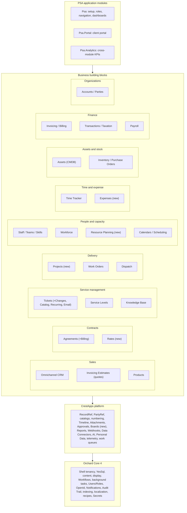

### 9.1 Runtime shape

- **One deployable** ASP.NET Core host (the CMS web startup) with the PSA feature set enabled per tenant through the `Psa` setup recipe. \[Rec\]
- **One tenant per service provider.** The provider's customers are Accounts; customer users are portal users linked to Accounts through Parties membership. Large providers that require physical isolation get a dedicated database (tenant setting), not a different code path. \[Rec\]
- **Synchronous in-process calls** across blocks go through `.Abstractions` interfaces; **asynchronous** work (recurring generation, sync, notifications, webhooks) goes through background tasks and leased work queues. \[Rec\]
- **Integration edges:** REST module APIs (`MapModuleApi`, OpenId client credentials), outbound webhooks (signed, retried), inbound provider webhook inbox (durable, de-duplicated), Data Connectors for credentials, MCP/A2A for AI agents. \[V-Repo\] \[Rec\]

### 9.2 Persistence strategy (content versus transactional)

| Kind of data | Store as | Why | Examples |
| --- | --- | --- | --- |
| Records admins extend with fields and that need versioning, drafts or rich display | Orchard **content items** with parts and fields | Field extensibility, editors, Liquid, search indexing, access control by role | Tickets (existing), KB articles, accounts, opportunities, service catalog items, project templates' descriptions |
| High-volume transactional records with strict invariants | CrestApps **catalog records** (YesSql documents) with **map indexes** and **distributed locks** | Fast, typed, validated by handlers; the ecosystem's proven pattern for invoices and ledgers | Agreements, entitlement ledger, time entries, expenses, projects, tasks, allocations, rate cards, invoices |
| Balances that change by dated postings | `IQuantityLedger<T>` and the Transactions ledger | Posting once by key, balance as of a date, no recomputation drift | Agreement hours/money/incidents, time-off, AR |
| Reporting reads | `IndexedReportDataSet` over index tables; optional export to a warehouse later | Reports already runs 24 data sets; avoids a second store until volume demands it | Utilization, profitability, SLA attainment |
| Files | Attachments (encrypted tenant file store) and protected files with signed links | One upload policy and access check | Receipts, signed work orders, change plans |

**Integrity rules without foreign keys \[Rec\]:** every cross-record reference is a `RecordRef` or a typed ID validated by the owner's service on write; deletes go through "usage" guards (pattern of `ITeamDeletionGuard`, `IPaySetupUsage`); every money-affecting command runs inside one YesSql session under a named distributed lock and is idempotent by key.

## 10. Domain-Driven Design and Bounded Contexts

**Twelve bounded contexts, each owned by one module group; contexts talk through published interfaces and observer events, never by reading another context's indexes.** \[Rec\]

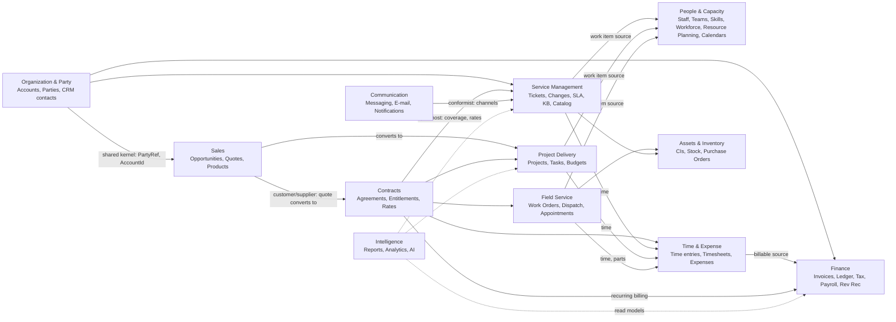

### 10.1 Context catalog

| Context | Aggregates (root → members) | Key value objects | Domain events (published through observers) | Owns data |
| --- | --- | --- | --- | --- |
| Organization & Party | Account → locations, members, e-mail domains; Contact | `PartyRef`, `ContactInfo`, `Address`, `PhoneNumber` | AccountCreated, MemberAdded, ContactMerged | Accounts, contacts, membership |
| Sales | Opportunity; Estimate (Quote) → sections, lines, options | `Money`, `PriceTier`, `RecurringTerm` | OpportunityStageChanged, QuoteSent, QuoteAccepted, QuoteConverted | Opportunities, quotes, product prices |
| Contracts | Agreement → entitlements, coverage rules, additions, milestones; RateCard → rates; WorkRole; WorkType | `Entitlement`, `CoverageRule`, `RateKey`, `BillingSchedule` | AgreementActivated, EntitlementDrawn, EntitlementThresholdReached, AgreementRenewed, AgreementExpiring | Agreements, entitlement ledger, rate cards |
| Service Management | Ticket → replies, links, approval, satisfaction; ChangeRequest (ticket with `ChangePart`); CatalogItem; RecurringTicketSchedule | `TicketLevel`, `TicketLink`, `ChangeWindow`, `RiskScore` | TicketCreated, StatusChanged, Assigned, Solved, ChangeApproved, ChangeImplemented | Tickets, desks, catalog |
| Project Delivery | Project → phases, tasks, dependencies, milestones, baselines, budget lines; ProjectTemplate | `DateRange`, `Effort`, `Dependency(type, lag)` | ProjectCreated, TaskCompleted, MilestoneReached, BudgetThresholdReached, ProjectClosed | Projects, templates |
| Field Service | WorkOrder → lines, checklist, signatures; Visit | `GeoPoint`, `TimeWindow` | WorkOrderCompleted, VisitStatusChanged | Work orders, visits |
| People & Capacity | StaffMember; Team; Allocation; CapacityProfile | `SkillRequirement`, `Availability` | AllocationBooked, OverallocationDetected | Staff, teams, allocations |
| Time & Expense | TimeEntry; Timesheet → entries; ExpenseReport → items, receipts | `Duration`, `RateSnapshot`, `CoverageDecision` | TimeEntryApproved, TimesheetSubmitted, ExpenseReportApproved | Time entries, timesheets, expenses |
| Assets & Inventory | Asset (CI) → relationships, meter readings; StockItem; PurchaseOrder → lines | `SerialNumber`, `Warranty` | AssetCreated, WarrantyExpiring, StockReceived | Assets, stock, POs |
| Finance | Invoice → lines; CreditNote; RecurringPlan; Transaction; RevenueSchedule | `Money`, `TaxBreakdown` | InvoiceIssued, PaymentRecorded, InvoiceOverdue | Invoices, ledger |
| Communication | Conversation → messages; Mailbox | `EmailAddress`, `MessageId` | MessageReceived, ConversationLinked | Conversations, mailboxes |
| Intelligence | ReportDefinition; Dashboard | — | — | Report definitions only (reads others' data sets) |

**Domain versus application services \[Rec\].** Domain services hold rules that span aggregates inside one context (coverage resolution, rate resolution, critical-path scheduling, entitlement draw). Application services orchestrate a use case across contexts through interfaces (convert quote, bill a ticket, close a project) and own the unit of work and lock. **Integration events** leave the process only through outbound webhooks and are derived from observer events; their payload contract is versioned (section 18).

## 11. Complete Module Catalog

**Twenty-three modules or features are built or changed (codes M01–M23); every other capability is used as it is.** Specification codes are used in the dependency matrix, roadmap and traceability matrix. \[Rec\]

| Code | Module / feature (technical ID) | Classification | Kind of work | Responsibility | Phase |
| --- | --- | --- | --- | --- | --- |
| M01 | Platform record links (`CrestApps.OrchardCore.Records` in Abstractions/Core) | Infrastructure | Extract and generalize | Kind-typed links between any two `RecordRef`s, indexed both ways (A7) | 1 |
| M02 | Boards (`CrestApps.OrchardCore.Boards`) | Shared building block | Extract and generalize | Column/card boards for any record with statuses (A6) | 1 |
| M03 | Approvals enhancement | Shared building block | Reuse with enhancement | Team approver rule; signed e-mail decision links | 1 |
| M04 | Accounts + CRM enhancement (`Omnichannel.Abstractions` for contacts) | Shared building block | Reuse with enhancement | Contacts abstraction (D3), account health signals, opportunity-to-quote link | 2 |
| M05 | Rates (`CrestApps.OrchardCore.Rates`) | Shared building block | Create new | Work roles, work types, rate cards, bill and cost rate resolution (A3) | 2 |
| M06 | Omnichannel Messaging E-mail channel (`Omnichannel.Messaging.Email`) | Shared building block | Reuse with enhancement | Mailboxes (Microsoft Graph, IMAP), inbound and outbound e-mail as conversations | 3 |
| M07 | Tickets enhancements (`Tickets.Email`, `Tickets.Changes`, `Tickets.Recurring`, `Tickets.Templates`, `Tickets.ServiceCatalog`, `Tickets.Assets`) | Shared building block | Reuse with enhancement | E-mail intake, change management, recurring tickets, templates, service catalog, CI links | 3 |
| M08 | Knowledge Base enhancement | Shared building block | Reuse with enhancement | Article lifecycle, ticket-to-article, known errors | 3 |
| M09 | Agreements enhancement (+ `Agreements.Billing`) | Shared building block | Reuse with enhancement | Contract kinds, entitlements ledger, coverage service (A2), additions, renewals, billing | 4 |
| M10 | Estimates as quotes (Invoicing Estimates enhancement) | Shared building block | Reuse with enhancement | Recurring/optional lines, sections, e-sign, conversion targets | 4 |
| M11 | Projects (`CrestApps.OrchardCore.Projects`, + `Projects.Billing`) | Shared building block | Create new | Projects, phases, tasks, dependencies, milestones, baselines, templates, budgets | 5 |
| M12 | Resource Planning (`CrestApps.OrchardCore.ResourcePlanning`) | Shared building block | Create new | Work item sources (A1), capacity, allocations, utilization | 5 |
| M13 | Time Tracker enhancement (+ `TimeTracker.Timesheets`) | Shared building block | Reuse with enhancement | Billable attribution (A5), timesheets, approval, billing and pay outputs | 5 |
| M14 | Expenses (`CrestApps.OrchardCore.Expenses`) | Shared building block | Create new | Expense reports, policies, receipts, approval, reimbursement, rebilling | 7 |
| M15 | Assets as CMDB (Assets enhancement) | Shared building block | Reuse with enhancement | CI relationships, software/licenses, discovery seam | 6 |
| M16 | Inventory and procurement enhancement | Shared building block | Reuse with enhancement | Requisitions from demand, decoupling from Commerce feature, serials | 6 |
| M17 | Invoicing Billing approve-and-post | Shared building block | Reuse with enhancement | One review of all billable sources; batching by account and agreement | 7 |
| M18 | Revenue Recognition (`CrestApps.OrchardCore.RevenueRecognition`) | Shared building block | Create new (deferred) | Deferred revenue schedules for prepaid and recurring revenue | 7 |
| M19 | Integration connectors (`Integrations.Rmm`, `AccountingSync` + providers) | Infrastructure | Create new (deferred) | Device/alert sync to Assets and Tickets; invoice/payment sync to accounting | 7–8 |
| M20 | Reports enhancement (PSA data sets, dashboard pages) | Shared building block | Reuse with enhancement | Data sets owned by each block; role dashboard page type | 8 |
| M21 | Psa (`CrestApps.OrchardCore.Psa`) | PSA application module | Create PSA-specific | Setup recipe, role templates, navigation, dashboards, settings, get-started | 2 → 9 |
| M22 | Psa.Portal (`CrestApps.OrchardCore.Psa.Portal`) | PSA application module | Create PSA-specific | One client portal composed from existing portal pages | 3 → 7 |
| M23 | Psa.Analytics (`CrestApps.OrchardCore.Psa.Analytics`) | PSA application module | Create PSA-specific | Utilization, profitability, margin, SLA attainment, AI insights | 8 |

**Reused as is for the PSA (no work beyond configuration):** Orchard Core modules of section 4; Users, Roles, Parties, Staff, Teams, Skills, Addresses, PhoneNumbers, Geo, Calendars, Business Hours, Scheduling, Service Levels, Workforce, Work Orders, Dispatch, OrTools, Products, Transactions, Taxation, Payment Terms, Exchange Rates, Business Documents, Payroll, Timeline, Attachments, Webhooks, Data Connectors, Personal Data, Tenant Hierarchy, Content Access Control, Conditional Fields, Wizard, Notifications, Templated e-mails, Consent, Outreach, AI suite.

**Deliberately excluded \[Rec\]:** Commerce storefront, Carts, Checkout, Marketplace, Learning, Fundraising, Point of Sale, Classifieds and other verticals: they are not PSA capabilities. They remain compatible because PSA modules never require them.

## 12. Detailed Module Specifications

**Each specification follows the A–O template of the brief; together they fix architecture and business behaviour so the implementing agent does not invent either.** \[Rec\]

Specifications appear in order of business weight (contracts and money first, platform pieces last); codes match section 11. Rules that apply to every module below, stated once:

- **Layout:** `X.Abstractions` (contracts, records, constants, permissions, feature IDs), `X.Core` (implementations, stores, indexes, handlers), `X` module (manifest, startups, drivers, controllers, views, migrations, recipe and deployment steps, endpoints). Optional integrations live in `[RequireFeatures]` startups or bridge features.
- **Records** are CrestApps catalog records managed through catalog managers with `AuditedCatalogEntryHandlerBase`; admin CRUD uses `CatalogAdminController<T>`, `<admin-list>` and `action-bar-bottom`.
- **State machines** use `TransitionTable<TEnum>`; numbers use `INumberSeries`; money uses `Money`, `CurrencyScale` and `IMoneyFormatter`; dates shown to people use `ILocalClock`.
- **Every record type** has a recipe step, a deployment step, a personal-data contributor if it holds personal data, a `ConfigurationSchema.json` entry for options, telemetry through `CrestAppsOrchardCoreTelemetry`, and an entry in `docs/engineering/building-blocks.md`.
- **Testing** follows the repository's test-first rule: a failing test before each behaviour; unit tests per rule; integration tests on SQLite and SQL Server for indexes and locks.

### M05 Rates

**A. Identity.** Rates · `CrestApps.OrchardCore.Rates` (+ `.Abstractions`, `.Core`) · Shared building block. Objective: one answer to "what do we charge, and what does it cost, for this hour of this kind of work". In scope: work roles, work types, rate cards, scoped overrides, cost-rate lookup, resolution and snapshots. Out of scope: product prices (Products `IPriceResolver`), pay rates (Staff, Payroll), tax.

**B. Existing functionality.** Reuse `StaffPayRates.CostOn(date)` and `RateOn(date, activityCode)` for cost; `Money`, `CurrencyScale`, Exchange Rates; catalog managers and admin controller. Invoicing Billing today prices Time Tracker time at an hourly rate entered on the billing card and `BillableItem` carries `UnitCost` and `MarkupPercent` \[V-Repo\]. Do not duplicate product pricing or pay rates.

**C. Missing functionality.** Work role and work type catalogs; rate cards with lines and effective dates; precedence-based resolution; immutable rate snapshots on time entries and billable items; Invoicing Billing calls `IRateResolver` for time (manual override kept).

**D. Functional requirements.**

- Features: work roles, work types (billable flag, multiplier or fixed override, counts toward utilization), rate cards (default, party, agreement, project, via an open scope kind), rate preview tool, staff default work role.
- User stories: as a finance admin I define a default rate card per currency; as an account manager I give a customer a discounted card; as a project manager I fix a blended rate for a project; as a technician I never see cost rates.
- Business rules: resolution precedence is (1) explicit override on the entry, (2) project scope, (3) agreement scope, (4) party (account) scope, (5) default card; within a card, a line matching role and type beats role only, beats type only, beats the card default. A work type with a multiplier multiplies the role rate; a fixed work-type rate replaces it. Non-billable work types resolve a bill rate of 0 but still a cost rate. Rates are in the card's currency; conversion uses Exchange Rates on the work date. Effective ranges of cards in the same scope and currency must not overlap.
- Admin: CRUD, activate, retire, copy card, bulk import (ContentTransfer record importer).
- Reporting: rate card register; realization lives in M23.

**E. Domain model.** `WorkRole {Id, Code, Name, DefaultBillRate?, Active}` · `WorkType {Id, Code, Name, Billable, Multiplier?, FixedRate?, CountsAsUtilization, Active}` · aggregate `RateCard {Id, Name, Currency, Scope: RecordRef?, ScopeKind, EffectiveFrom, EffectiveTo?, Status(Draft, Active, Retired), Lines[]}` · `RateLine {WorkRoleId?, WorkTypeId?, BillRate}` · value object `RateSnapshot {BillRate, CostRate?, Currency, SourceKind, SourceId, ResolvedUtc}`. Events: RateCardActivated, RateCardRetired. Invariants: non-negative rates; no overlap; a card or role in use cannot be deleted (usage guard).

**F. Services and interfaces.** `IWorkRoleManager`, `IWorkTypeManager`, `IRateCardManager` (catalog managers) · `IRateResolver.ResolveAsync(RateRequest {Date, Party, AgreementId?, Project: RecordRef?, WorkRoleId, WorkTypeId, StaffMemberId?, Currency?})` → `RateSnapshot` · `IRateScopeProvider` (`AddRateScope(kind, displayName)`) so Agreements and Projects register scopes without Rates naming them · `IRateUsage` (usage guard).

**G. Workflows.** Card: Draft → Active → Retired (TransitionTable). Changing rates mid-period never changes snapshots already taken; re-rating an unbilled entry is an explicit, audited command.

**H. User interface.** Admin lists for roles, types and cards; card editor as an editable grid of role × type; rate preview (pick account, agreement, role, type, date); a Rates card on the Staff editor (default role) and on the Account page (assigned card) through display drivers.

**I. Security.** Permissions `ManageRates`, `ViewBillRates`, `ViewCostRates` (separate; cost visible only to finance and managers). Every rate change is an Audit Trail event. Cost rates are stripped from API responses, exports and AI tool outputs unless the caller holds `ViewCostRates`.

**J. Integrations.** Consumers: Time Tracker (M13), Invoicing Billing (M17), Estimates (M10), Projects (M11), Agreements (M09, scope provider), Analytics (M23). API: `GET api/rates/v1/resolve` (`ViewBillRates`). Recipe and deployment steps for roles, types and cards.

**K. Persistence.** Catalog collection `Rates`; `RateCardIndex(ScopeKind, ScopeId, Currency, EffectiveFrom, EffectiveTo, Status)`; `WorkRoleIndex`, `WorkTypeIndex`. Resolved cards cached per request scope only.

**L. Reporting.** Rate card register data set; effective-rate inputs for M23.

**M. Testing.** A precedence test matrix (5 scopes × 4 line specificities × multiplier/fixed); effective-date boundaries in several time zones; currency conversion; overlap refusal; permission tests proving cost never leaks through UI, API, export or AI tools.

**N. Dependencies and order.** Needs Staff, Parties, Exchange Rates. Needed by M09, M10, M11, M13, M17, M23. Phase 2.

**O. Acceptance criteria.** (1) All precedence cases resolve as specified. (2) Editing a card changes no existing snapshot. (3) No response to a user without `ViewCostRates` contains a cost value (automated test over every endpoint and data set that exposes rates). (4) Recipe export and import round-trip byte-identical records.

### M09 Agreements enhancement (+ Agreements.Billing)

**A. Identity.** Agreements · `CrestApps.OrchardCore.Agreements` with new features `Agreements.Entitlements`, `Agreements.Coverage`, `Agreements.Billing` · Shared building block. Objective: the full service-contract model used by all three competitors. Out of scope: invoice documents (Invoicing), SLA timers (Service Levels).

**B. Existing functionality \[V-Repo\].** `Agreement` (number, status, account, dates, time zone, `AgreementHours` block or monthly allowance with rounding 0/6/15/30, expiring notice, 80/100% warnings, `Properties`), `IAgreementUsageProvider`, `IAgreementBalanceService`, `IAgreementObserver`, background expiry task, recipe/deployment steps, account page tab; Tickets' `TicketAgreementTerms` (desks, ticket types, SLA policy); Work Orders' recurring service schedules. Reuse `IQuantityLedger<T>` for balances and Invoicing `IRecurringPlanService` for recurring invoices. Must not duplicate: recurring invoice engine, ledger, SLA.

**C. Missing functionality.**

- Agreement **kinds** (open string, registered): `RecurringService`, `BlockHours`, `Retainer` (money), `PerIncident`, `TimeAndMaterials`, `FixedPrice` (milestones), `Umbrella` (parent of others).
- **Entitlements** replacing the single `AgreementHours` (migrated by a resumable step): hours, money, incidents or units, each with period (whole term, monthly, quarterly, yearly), rollover rule, expiry, threshold notices and optional auto-repurchase.
- **Coverage rules** (A2): covered and excluded work roles, work types, ticket desks/types, project kinds, time windows (business hours vs after hours), sites; per-rule rate override (scope for Rates).
- **Additions** (recurring lines): product or service, quantity (fixed or from a quantity source such as Assets counts or contact counts), unit price, unit cost, billing frequency, start/end, pro-rata policy, in advance or in arrears.
- **Milestones** for fixed price: amount, due condition (date, project milestone reached), status.
- **Lifecycle:** draft, pending signature, active, suspended, expired, cancelled, renewed; renewal (manual, auto, with price uplift %), amendments as versioned change records.
- **Profitability:** revenue (billed additions, milestones, overage) versus cost (time at cost rate, expenses, parts).

**D. Functional requirements.**

- User stories: account manager creates a managed-services agreement from a template with additions per device; time logged on a covered ticket draws included hours, overage bills at the agreement rate; finance sees agreements expiring in 60 days; a retainer is topped up automatically at 10% balance; a fixed-price milestone becomes billable when its project milestone is reached.
- Business rules: (1) coverage is evaluated per time entry, expense or charge on its work date; (2) when several agreements cover the same work, the most specific wins (umbrella last), then the earliest start; a configured default agreement per account catches the rest; (3) entitlements draw in the order of the entitlement list, each posting is keyed by the source record so it happens once; (4) rounding applies before drawing; (5) excluded work falls through to the next agreement or to T\&M; (6) quantities from sources are read at the billing run and frozen on the invoice line; (7) a renewed agreement is a new agreement version linked to the old one; (8) amendments never alter posted entitlement draws.
- Admin: agreement types (templates of kind, entitlements, coverage, additions, SLA policy); bulk renewal; uplift; suspend.
- Automation: background tasks for expiry, threshold notices, auto-repurchase, renewal creation; workflow events for each lifecycle change and threshold.

**E. Domain model.** Aggregate `Agreement` → `Entitlement[] {Id, Kind(Hours, Money, Incidents, Units), Amount, Period, Rollover, ExpiresAfter, Thresholds[], AutoRepurchase?}`, `CoverageRule[] {Includes/Excludes: WorkRoleIds, WorkTypeIds, Desk/TicketTypes, ProjectKinds, TimeWindow, Sites; RateOverride?}`, `Addition[] {ProductRef, QuantitySource?, Quantity, UnitPrice, UnitCost, Frequency, BillingTiming, ProRata, Start, End}`, `Milestone[] {Name, Amount, DueRule, Status}`, `TypeId`, `Version`, `ParentAgreementId?`, `RenewalPolicy`. Ledger `AgreementEntitlementLedger` on `IQuantityLedger`. Events: Activated, Suspended, Expiring, Expired, Renewed, Amended, EntitlementDrawn, EntitlementThresholdReached, EntitlementExhausted, MilestoneBillable. Invariants: one active version per agreement number; draws never exceed amount unless overage is allowed; cancelled agreements accept no new draws.

**F. Services and interfaces.** `IAgreementCoverageService.ResolveAsync(CoverageRequest {Account, WorkDate, Subject: RecordRef, WorkRoleId, WorkTypeId, SiteId?, Minutes or Amount})` → `CoverageDecision {AgreementId?, Covered, EntitlementId?, RateOverride?, Reason}` · `IEntitlementService` (draw, reverse, balance, repurchase) · `IAgreementKind` (`AddAgreementKind<T>`) · `IAdditionQuantitySource` (`AddAdditionQuantitySource<T>`; Assets and Accounts implement) · `IAgreementRenewalService` · `IAgreementAmendmentService` · existing usage, balance and observer interfaces kept (balance now reads the ledger).

**G. Workflows.**

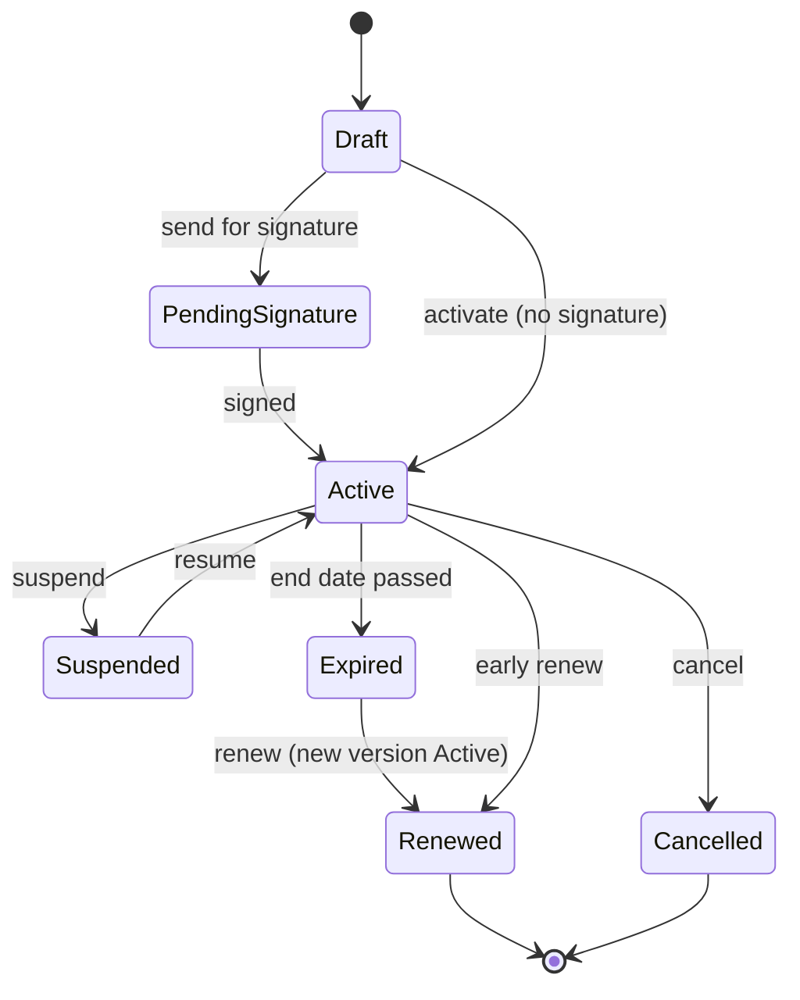

Exceptions: a draw against an exhausted entitlement either posts overage (if allowed) or returns "not covered"; a failed auto-repurchase creates a payment issue and notifies the account manager.

**H. User interface.** Agreement page sections (Summary, Entitlements with balances, Coverage, Additions, Milestones, Usage, Invoices, Renewals, Timeline); agreement type editor; account page Agreements section (exists, extended); expiring and threshold widgets; portal view of balances (read-only).

**I. Security.** Existing Agreements permissions plus `ManageAgreementTypes`, `RenewAgreements`, `ViewAgreementFinancials` (profitability, costs). Portal users see agreements of their own parties only, without costs. Every entitlement posting and amendment is audited.

**J. Integrations.** Tickets, Work Orders, Projects, Time Tracker, Expenses call coverage; Invoicing Recurring Plans bill additions (`Agreements.Billing` creates and syncs one recurring plan per agreement); Invoicing Billing posts overage and milestones; Rates registers `Agreement` scope; Assets and Accounts provide quantity sources; webhooks `agreement.*`.

**K. Persistence.** Catalog `Agreements` (existing) extended; `AgreementIndex` adds Kind, TypeId, Version, ParentAgreementId; `AgreementCoverageIndex` (AgreementId, AccountId, WorkRoleId, WorkTypeId, Include) for fast resolution; ledger collection `AgreementEntitlements`. Migration: resumable step converts `AgreementHours` into one Hours entitlement and Tickets terms into coverage rules.

**L. Reporting.** Agreement register, entitlement balances, expiring agreements, overage, agreement profitability (with M23), recurring revenue by agreement type.

**M. Testing.** Coverage decision table tests (overlaps, exclusions, umbrella, default); ledger idempotency under concurrent draws; rollover and expiry at period boundaries; renewal uplift rounding; migration tests from existing data.

**N. Dependencies and order.** Needs M05, Invoicing, Transactions, Accounts, Parties. Needed by M07 (coverage on tickets), M11, M13, M14, M17, M23. Phase 4.

**O. Acceptance criteria.** (1) The six competitor contract types can each be configured and billed end to end in an integration test. (2) A draw posted twice with the same source key changes the balance once. (3) Existing hours agreements migrate with identical balances. (4) Coverage resolution p95 under 20 ms for an account with 20 agreements \[Asm: target to confirm\].

### M10 Estimates as quotes (Invoicing Estimates enhancement)

**A. Identity.** Invoicing Estimates · `CrestApps.OrchardCore.Invoicing.Estimates` · Shared building block. Objective: a PSA-grade quote and proposal that converts into the records that deliver it.

**B. Existing \[V-Repo\].** `IEstimateCommandService`: send, accept, decline, revise, cancel, convert to invoice or deposit invoice, partial invoicing by percent, expiry; public accept page `estimates/view/{token}`; e-mail; workflow events; webhooks; data set; Orders quotes are sent as estimates. Products for items; Taxation for tax.

**C. Missing.** Sections and optional/alternative lines; recurring lines (monthly/annual) separate from one-time totals; labor lines priced by Rates (role × type × hours); margin view (cost from products and rates) with approval when margin or discount crosses a threshold (Approvals type `Estimate`); e-signature capture on accept (typed name, signed timestamp, IP, document hash); opportunity link; `IEstimateConversionTarget` extension point; proposal templates (cover, terms) via Business Documents.

**D. Functional.** Rules: totals are shown as one-time and recurring separately; accepting creates conversions selected per section (e.g. hardware → order or requisitions, services → agreement additions, labor → project from template, deposit → deposit invoice); conversions run once per estimate version and are idempotent; an expired estimate cannot be accepted; a revised estimate supersedes the old one.

**E. Domain.** `Estimate` (existing) + `Sections[] {Title, Lines[], Optional, Selected}`, line `Kind` adds `Labor`, `Recurring {Frequency, TermMonths}`, `CostSnapshot`; `Signature {Name, SignedUtc, IpHash, DocumentSha256}`; `OpportunityId`; `Conversions[] {TargetKind, TargetRef, CreatedUtc}`. Events: EstimateAccepted (existing), EstimateConverted.

**F. Services.** `IEstimateConversionTarget { Kind; CanConvert; ConvertAsync(estimate, section) }` registered by Agreements.Billing, Projects, Orders and Inventory; `IEstimateMarginService`.

**G. Workflows.** Draft → (Approval if thresholds) → Sent → Viewed → Accepted → Converted; Declined, Expired, Superseded as terminals.

**H. UI.** Section editor with drag ordering, product and labor pickers, margin panel (cost visible with `ViewCostRates`), proposal preview PDF, public accept page with optional-line selection and signature.

**I. Security.** Existing estimate permissions + `ApproveEstimateMargins`; public page by signed token only, rate-limited, shows no cost.

**J–K.** Integrations as in F; CRM opportunity shows quotes; `EstimateIndex` adds OpportunityId and RecurringTotal.

**L. Reporting.** Quote conversion rate, average margin, recurring value quoted vs won.

**M. Testing.** Conversion idempotency; optional-line acceptance; signature integrity hash; margin approval thresholds.

**N.** Needs M05, M09 (agreement target), M11 (project target, later), Products, Approvals. Phase 4.

**O. Acceptance.** An accepted quote with hardware, recurring services and labor creates one order, one agreement with additions and one project from a template, exactly once, in one integration test.

### M11 Projects (+ Projects.Billing)

**A. Identity.** Projects · `CrestApps.OrchardCore.Projects` (+ `.Abstractions`, `.Core`); features `Projects`, `Projects.Templates`, `Projects.Billing` (bridge to Agreements and Invoicing), `Projects.Portal` · Shared building block. Objective: plan and deliver fixed-scope work on schedule and on budget, natively with dependencies and baselines (the area competitors leave to add-ons). Out of scope: capacity across all work (M12), time capture (M13), invoices (Invoicing).

**B. Existing to reuse.** Accounts (customer), Parties, Staff/Teams/Skills (staffing), Calendars (milestone and task dates on a project calendar type, holidays via Business Hours), Approvals (change orders, budget approval), Timeline (notes and history), Attachments, Boards (M02, task Kanban), Record links (M01, task-to-ticket), Rates (M05, budget pricing), Agreements (M09, fixed-price milestones), Estimates conversion target (M10), Reports. Do not build another calendar, notes list, approval status, numbering or board.

**C. Missing.** Everything project-specific: project, phase, task, dependency, milestone, baseline, budget, template, change order, status report.

**D. Functional requirements.**

- Features: project types (open kind with default template); projects from templates (copy phases, tasks, dependencies, budget, role demands); phases and nested tasks (max depth 5); dependencies FS, SS, FF, SF with lag; milestones (zero-duration, optionally billing triggers); schedule calculation (forward pass from start date, critical path, slack) respecting the project calendar; baselines (snapshot of dates, effort, cost; up to 10 per project); task assignment to staff or to a work role (placeholder demand for M12); effort estimate, remaining effort, percent complete (effort-based); budget by phase and category (labor hours and amount, expenses, materials) with burn tracking from time, expenses and parts; change orders (scope, effort, amount; approval; updates budget and optionally an agreement); project status (RAG health with comment) and status reports; project team with roles; project portal view for customer contacts (milestones, status, documents, approvals).
- User stories: a PM creates a project from the "M365 migration" template when a quote is accepted; dates recalculate when a predecessor slips; the customer approves a change order in the portal; the PM sees budget at 80% and a margin forecast; an engineer sees assigned tasks in My Work and logs time against them.
- Business rules: (1) a task cannot start before its FS predecessors finish plus lag, unless manually pinned (pin is flagged); (2) dependency cycles are refused; (3) summary (phase) dates and effort roll up from children; (4) completing a phase requires all tasks complete or cancelled; (5) budget overrun above a configurable percent raises an event and optional approval for further time; (6) closing a project requires no open tasks, no unapproved time, and no unbilled billable items unless overridden with a reason; (7) templates never reference real people, only roles.
- Automation: workflow events (created, status changed, task completed, milestone reached, budget threshold, closed); recurring projects (yearly audits) via Calendars recurrence on a template.

**E. Domain model.**

| Entity | Kind | Key fields | Relationships |
| --- | --- | --- | --- |
| Project | Aggregate root (catalog) | Number, Name, TypeId, AccountId, Status, Health, StartDate, TargetEndDate, CalendarId, ManagerStaffId, AgreementId?, EstimateId?, Currency, BillingMethod (FixedPrice, TimeAndMaterials, Retainer, NonBillable), Properties | Account, Agreement, Estimate, Staff |
| ProjectPhase | Entity (in project document or own record \[Asm: volume test\]) | Name, Order, ParentPhaseId?, dates, rollups | Project |
| ProjectTask | Aggregate root (catalog, own record for concurrency) | ProjectId, PhaseId, Number, Title, Status, AssigneeStaffId?, WorkRoleId?, EstimateMinutes, RemainingMinutes, Start, Finish, Pinned, PercentComplete, SkillRequirements | Project, Staff, WorkRole, linked tickets via M01 |
| TaskDependency | Value object on successor task | PredecessorTaskId, Type, LagMinutes | Task |
| Milestone | Task with zero duration | BillingTrigger?, Achieved | Agreement milestone |
| Baseline | Entity | Name, CapturedUtc, per-task dates, effort, cost | Project |
| BudgetLine | Entity | Phase?, Category, Hours, Amount, Currency | Project |
| ChangeOrder | Aggregate root | Number, Description, EffortDelta, AmountDelta, Status, ApprovalRequestId | Project, Approvals |
| ProjectTemplate | Aggregate root | Phases, tasks (roles not people), dependencies, budget lines, default type | — |

States: Project Planning → Active → OnHold → Active → Completed → Closed; Cancelled from Planning/Active/OnHold. Task NotStarted → InProgress → Completed; Blocked; Cancelled. ChangeOrder Draft → Submitted → Approved/Rejected → Applied. Events: ProjectCreated, ProjectStatusChanged, TaskStatusChanged, TaskRescheduled, MilestoneAchieved, BudgetThresholdReached, ChangeOrderApproved, ProjectClosed. Invariants: acyclic dependencies; rollups consistent after each command; closed projects reject time.

**F. Services.** `IProjectService` (create from template, change status, close), `IProjectTaskService` (create, assign, reschedule, complete), `IProjectScheduler` (forward/backward pass, critical path; pure and unit-testable; an optional `IProjectScheduleOptimizer` seam like `IDispatchOptimizer`), `IProjectBudgetService` (actuals from `IProjectCostSource` registered by Time Tracker, Expenses, Inventory), `IProjectTemplateService`, `IChangeOrderService`, `IProjectObserver`, `IProjectAccessService` + `ProjectScopeFilter` (manager, team member, all, account portal). Implements `IWorkItemSource` (M12) for tasks and `IEstimateConversionTarget` (M10). Registers `Project` record source, Rates scope, Service Levels scope (optional task SLAs), Timeline access provider, Attachments access provider.

**G. Workflows.** Quote accepted → project from template (Planning) → PM assigns roles and people → baseline 1 → Active → time and expenses accumulate → milestone achieved → `Projects.Billing` marks the agreement milestone billable or posts T&M items → change order → approval → budget update → completion checks → Closed. Exceptions: rescheduling conflict with pinned task (warn, keep pin); budget threshold (notify, optional approval to continue); close refused with listed blockers.

**H. User interface.** Project list (AdminList, saved views); project page sections (Overview with health and KPIs, Schedule: Gantt with dependencies and critical path highlighting, Tasks: list and Kanban via Boards, Team, Budget: plan vs actual vs forecast, Change orders, Documents, Timeline, Billing); template editor; My Work (assigned tasks across projects, reused by Workforce portal through a page section); portal view; mobile: task list and time entry (responsive, no native app in v1 \[Rec\]).

**I. Security.** Permissions `ManageProjects`, `ViewAllProjects`, `ViewOwnProjects` (manager or team member), `ManageProjectTemplates`, `ApproveChangeOrders`, `ViewProjectFinancials`. Scope filter in every list, data set, search index and AI tool. Portal users see projects of their parties and only fields marked customer-visible. Audit: status, budget, baseline and change-order events.

**J. Integrations.** Estimates (conversion), Agreements (milestones, coverage, scope), Rates (budget pricing), Time Tracker and Expenses (actuals, `IProjectCostSource`), Tickets (task-to-ticket links; a ticket can be converted into a project), Resource Planning (demand), Calendars (project calendar type), Approvals (change orders), Webhooks (`project.*`), API `api/projects/v1` (projects, tasks, time summary).

**K. Persistence.** Catalog collection `Projects`: `ProjectIndex(Number, AccountId, Status, ManagerStaffId, TypeId, TargetEndDate)`, `ProjectTaskIndex(ProjectId, PhaseId, Status, AssigneeStaffId, WorkRoleId, Start, Finish)`, `ProjectDependencyIndex(PredecessorTaskId, SuccessorTaskId)`. Tasks are separate documents so two people can edit different tasks without document conflicts; schedule recalculation runs under a project lock and writes changed tasks in one session. Numbers via `INumberSeries` (`PRJ-`, `T-`).

**L. Reporting.** Project portfolio (status, health, dates), budget vs actual, earned value (PV, EV, AC, SPI, CPI), schedule variance vs baseline, milestones due, project margin (M23), task aging.

**M. Testing.** Scheduler property tests (random DAGs: no task starts before predecessors; critical path has zero slack); cycle refusal; rollups; concurrency of task edits during recalculation; template copy fidelity; permission scope tests for list, API, search and AI; performance: recalculate 2,000-task project in under 2 s \[Asm\].

**N. Dependencies and order.** Needs M01, M02, M05, Accounts, Staff, Calendars, Approvals; M09 and M10 for billing and conversion (can follow). Needed by M12, M13, M23. Phase 5.

**O. Acceptance criteria.** (1) A template-based project schedules correctly with all four dependency types and lags. (2) Critical path matches a reference implementation on 20 test networks. (3) Budget actuals equal the sum of approved time at cost plus approved expenses. (4) No user without project scope can read a project through any channel (UI, API, data set, search, AI tool). (5) Quote-to-project conversion creates exactly one project.

### M12 Resource Planning

**A. Identity.** Resource Planning · `CrestApps.OrchardCore.ResourcePlanning` · Shared building block. Objective: show and balance demand (hours of work by role, skill and person) against capacity (working time minus absences and other bookings) over days to months. Out of scope: minute-level dispatch routing (Dispatch), shift rostering (Workforce).

**B. Existing to reuse.** Capacity: Workforce shifts and availability (`IWorkedTimeSource`, shift schedules), Calendars busy time (`ICalendarBusyTimeSource`, absences with `MarksAbsence()`), Business Hours, Staff (employment, hours), Skills (`SkillRequirement`, `HoldsAllAsync`), Teams (`ITeamMemberAvailabilitySource`, `ITeamMemberLoadSource`). Demand: Tickets, Work Orders, Dispatch visits, Scheduling appointments, Projects tasks through A1.

**C. Missing.** `IWorkItemSource` contract (A1), `Allocation` (soft and hard bookings of hours to a person or role for a work item over a date range), capacity profiles, utilization targets, the planning board.

**D. Functional.** Capacity per person per day = contracted hours from Staff/Workforce minus time off, holidays and calendar absences; demand = allocations plus scheduled work items; heat-map board by person or role per day/week/month; drag to reassign or move allocations; find people by skill, role, team, availability; overallocation warnings; tentative (soft) vs confirmed (hard) bookings; what-if scenario (unsaved plan with comparison) \[Rec: phase 2 of the module\]; utilization target per person (billable % goal). Rules: hard allocations over 100% capacity require a reason or permission; allocations on cancelled work items are released automatically; time-off approval re-evaluates affected allocations and raises conflicts.

**E. Domain.** `Allocation {Id, WorkItem: RecordRef, StaffMemberId?, WorkRoleId?, Start, End, MinutesPerDay or TotalMinutes, Kind(Soft, Hard), Status}` (aggregate); `CapacityProfile {StaffMemberId, WeeklyMinutes, UtilizationTargetPercent}`; value objects `WorkItemSummary` (from A1), `CapacityCell {Date, CapacityMinutes, DemandMinutes}`. Events: AllocationBooked, AllocationReleased, OverallocationDetected.

**F. Services.** `IWorkItemSource` (`AddWorkItemSource<T>(kind)`), `IWorkItemDirectory`, `ICapacityService.GetCapacityAsync(staffIds, range)`, `IAllocationService` (book, move, release), `IResourceFinder` (skills, role, availability ranking; reuses `ITeamAssignmentService` concepts), `IResourcePlanningObserver`.

**G. Workflows.** PM requests a role for a project phase → resource manager finds candidates → soft booking → confirmation → hard booking → tasks assigned → allocations consumed by time entries (actuals) → released on completion.

**H. UI.** Planning board (people × time heat map, role demand rows for unassigned placeholders), person drill-down, request queue for role demands, filters by team, skill, account, project.

**I. Security.** `ViewResourcePlans` (scoped by `IStaffScopeService`: managers see their teams), `ManageAllocations`, `OverrideOverallocation`. Work item titles shown only if the viewer can see the item; otherwise "busy".

**J. Integrations.** Projects (role demands → allocations), Tickets and Work Orders (scheduled work as demand), Dispatch (visits as demand; Dispatch keeps its own minute-level assignment), Workforce and Calendars (capacity), Time Tracker (actuals), Analytics (utilization).

**K. Persistence.** Catalog `ResourcePlanning`; `AllocationIndex(StaffMemberId, WorkRoleId, WorkItemKind, WorkItemId, Start, End, Kind)`; daily capacity computed on read and cached per request; optional nightly materialized `CapacityDayIndex` for reports \[Rec\].

**L. Reporting.** Capacity vs demand by role and week, forecast utilization, bench (unallocated capacity), overallocation list.

**M. Testing.** Capacity math with time zones and DST; absences; overlapping allocations; permission masking of titles; performance for 200 people × 12 weeks under 1.5 s \[Asm\].

**N.** Needs Staff, Workforce, Calendars, Skills, Teams; M11 for project demand. Needed by M23. Phase 5.

**O. Acceptance.** Capacity for a person with a shift pattern, a holiday and a half-day absence equals a hand-computed fixture; a role demand can be filled and the task assignment follows; viewers without access see "busy" not titles.

### M13 Time Tracker enhancement (+ TimeTracker.Timesheets)

**A. Identity.** Time Tracker · `CrestApps.OrchardCore.TimeTracker` with new feature `TimeTracker.Timesheets` · Shared building block. Objective: one billable-time ledger for tickets, tasks, work orders and internal work, with approval. Workforce timesheets stay the attendance and pay record; the two are linked, not merged \[Rec\].

**B. Existing \[V-Repo\].** Stages, categories, clock in/out, entries with audited manager edits, `ITimeTrackerService`, `IExternalTimeClock`, `ITimeEntryObserver`, Ticket time logging (`TicketTime.LogAsync` writing through `ITimeTrackerService` with a billable flag), Invoicing Billing pricing time at an hourly rate, Hours by Category report.

**C. Missing.** A5 attributes on entries; notes visible to customers vs internal; timesheet periods (weekly or by pay schedule from Payroll Pay Setup), submission, approval via Approvals (approval type `Timesheet`, approver rules: manager, project manager of entries' projects); coverage decision and rate snapshot at approval; outputs: `IBillableSource` for Invoicing Billing, `IProjectCostSource` for Projects, `IAgreementUsageProvider` for Agreements, optional `IPayInputSource` for hourly staff.

**D. Functional.** Rules: (1) an entry needs a subject (`RecordRef`) or an internal work type; (2) work role defaults from staff, work type from the subject's default; (3) entries in a submitted or approved timesheet are locked; corrections after approval are reversing entries; (4) on approval: coverage (M09) and rate (M05) are resolved and snapshotted, agreement entitlements drawn, billable items created for non-covered billable minutes; (5) minimum increments come from the agreement's rounding; (6) a timesheet cannot be submitted with entries over 24 h per day or overlapping clock intervals unless flagged; (7) future-dated entries are refused beyond a configurable horizon.

**E. Domain.** `TimeEntry` + `Subject`, `WorkRoleId`, `WorkTypeId`, `Billable`, `CustomerVisibleNote`, `InternalNote`, `AgreementId?`, `CoverageDecision?`, `RateSnapshot?`, `TimesheetId?`, `ApprovalState(Draft, Submitted, Approved, Rejected, Posted)`; aggregate `Timesheet {StaffMemberId, PeriodStart, PeriodEnd, Status, ApprovalRequestId, Totals}`. Events: TimeEntryApproved, TimesheetSubmitted, TimesheetApproved, TimesheetRejected.

**F. Services.** `ITimesheetService` (open period, submit, recall, approve via Approvals handler, reject), `ITimeEntryPostingService` (approval-time coverage, rating, draws, billable items; idempotent by entry ID), `ITimeEntryDefaultsProvider` (subject modules supply defaults).

**G. Workflows.** See workflow W7 in section 15.

**H. UI.** Weekly timesheet grid (rows = subject × work type, columns = days), timer from any work item, approval inbox (Approvals' Waiting for me), mobile-friendly entry.

**I. Security.** Existing permissions + `SubmitTimesheets` (own), `ApproveTimesheets` (scoped by staff hierarchy and project management), `ViewAllTime`, `EditApprovedTime` (reversal only). Rates and costs follow M05 permissions.

**J–K.** Integrations as in C. `TimeEntryIndex` adds SubjectKind, SubjectId, WorkRoleId, WorkTypeId, Billable, ApprovalState, TimesheetId, AgreementId; `TimesheetIndex(StaffMemberId, PeriodStart, Status)`. Migration: existing entries get `Subject` from their stage/ticket link where known; others become internal.

**L. Reporting.** Timesheet compliance (missing or late), billable vs non-billable hours, utilization inputs, unapproved time.

**M. Testing.** Posting idempotency; lock after submit; reversal flows; approval routing with multiple projects; DST days.

**N.** Needs M05, M09, Approvals, Payroll Pay Setup (periods). Needed by M11, M17, M23. Phase 5.

**O. Acceptance.** Approving a timesheet with covered, uncovered and non-billable entries produces exactly the right entitlement draws and billable items once, and re-approval after recall produces no duplicates.

### M06 Omnichannel Messaging E-mail channel

**A. Identity.** `CrestApps.OrchardCore.Omnichannel.Messaging.Email` (feature of the Messaging module family; provider features `...Email.MicrosoftGraph`, `...Email.Imap`) · Shared building block (enhancement). Objective: receive and send e-mail as Messaging conversations so any module can act on inbound mail. Out of scope: marketing e-mail (Outreach), transactional templates (`ITemplatedEmailSender`).

**B. Existing.** `IMessagingChannel` and the channel skill (`.agents/skills/crestapps-messaging-channel`), conversations, messaging workspace with "Open a ticket", `IProviderWebhookInbox` (durable, de-duplicated) for push notifications, `ILeasedWorkQueue` for polling work, Attachments with byte-sniffing and scanner, Data Connectors and Orchard Core Secrets for credentials, Consent for opt-outs \[V-Repo\].

**C. Missing.** Mailbox record and providers; inbound parsing (MIME, inline images, attachments), threading (Message-ID, In-Reply-To, References, subject token), loop and auto-reply detection (Auto-Submitted, Precedence, X-Auto-Response-Suppress), sender-to-party resolution; outbound sending with threading headers and per-mailbox from address.

**D. Functional.** Mailboxes per tenant with provider, address, polling interval or push subscription, routing tag; rules: (1) each provider message is processed once (key = mailbox + provider message ID); (2) messages over a size limit are stored with attachments rejected and a note; (3) loops: a sender exceeding N messages per M minutes is throttled and flagged; (4) auto-replies never create conversations; (5) attachments pass the Attachments upload policy or are quarantined.

**E. Domain.** `Mailbox {Id, Address, Provider, ConnectionId, Mode(Poll, Push), RoutingTag, Enabled, Cursor}`; `EmailMessage` as a Messaging message with headers value object `EmailHeaders`. Events: MessageReceived (existing messaging event with channel = e-mail).

**F. Services.** `IEmailMailboxProvider` (fetch since cursor, subscribe, send, mark processed), `IEmailThreadResolver`, `IEmailLoopGuard`, `IEmailSenderResolver` (uses Parties/Accounts e-mail domains).

**G–H.** Polling background task per mailbox on the leased queue; push via provider inbox; admin pages for mailboxes with connection test and last-sync status; message view in the workspace.

**I. Security.** `ManageMailboxes`; credentials only through Data Connectors/Secrets; HTML sanitized on display; remote images blocked by default; attachments scanned; SPF/DKIM/DMARC verdict headers stored and shown as a trust badge.

**J–K.** Consumed by M07 `Tickets.Email`; catalog `Messaging` collection for mailboxes; `EmailMessageIndex(MailboxId, ProviderMessageId, MessageIdHeader)`.

**L–M.** Mailbox health report; tests for threading fixtures, loop detection, duplicate delivery, large messages, malicious attachments.

**N.** Needs Omnichannel Messaging, Attachments, Data Connectors. Needed by M07. Phase 3.

**O. Acceptance.** A reply e-mail with the ticket token threads to its ticket; a duplicate delivery creates nothing; an out-of-office reply creates nothing; a mail with a disguised executable is quarantined.

### M07 Tickets enhancements

**A. Identity.** Tickets module, new features: `Tickets.Email` (bridge to M06), `Tickets.Changes`, `Tickets.Recurring`, `Tickets.Templates`, `Tickets.ServiceCatalog`, `Tickets.Assets` (CI links) · Shared building block. Objective: close the ITSM gaps against all three competitors while keeping a plain help desk light (each is an optional feature).

**B. Existing \[V-Repo\].** All of Tickets (section 5.2), Approvals, Calendars `RecurrenceRule`, Conditional Fields and Wizard, Knowledge Base, Service Levels, Assets, Agreements coverage (M09), Record links (M01).

**C–D. Missing functionality and requirements, by feature.**

- **Tickets.Email:** each mailbox maps to a desk and ticket type; new thread → new ticket with requester from sender (unknown sender: create contact if desk allows, else mark `RequesterUnverified`); reply with ticket token or thread header → public reply on that ticket; reply from an agent's address → agent reply; replies to closed tickets beyond the reopen window create a follow-up ticket (`FollowUpOfId`, existing); outbound requester e-mails carry the token and thread headers. Rules: no ticket from auto-replies; CC addresses become participants only if they resolve to parties of the same account.
- **Tickets.Changes:** a ticket type flagged as change carries `ChangePart {ChangeType(Standard, Normal, Emergency), Risk(Low..Critical) from a risk questionnaire (ConditionRule-scored), Impact, Reason, ImplementationPlan, BackoutPlan, TestPlan, PlannedStart, PlannedEnd, ActualStart, ActualEnd, AffectedCIs (M01 links), CabPolicyId, ReviewOutcome}`; lifecycle Draft → Assessment → Awaiting approval → Approved/Rejected → Scheduled → Implementing → Implemented/Failed/Backed out → Review → Closed (TransitionTable, mapped onto ticket status categories); approval through Approvals type `Change` with policies by change type and risk (CAB = approval policy whose stages use the Team approver rule, M03); standard changes are pre-approved templates; emergency changes allow post-implementation approval; change calendar as a Calendars type with conflict warnings for overlapping changes on the same CI; links to incidents and problems via existing link kinds plus `CausedBy` and `Implements`.
- **Tickets.Recurring:** `RecurringTicketSchedule {TemplateId, RecurrenceRule, TimeZone, Account?, Desk, Assignee/Team, LeadDays, NextRunUtc, EndRule}`; a background task creates each occurrence once (key = schedule + occurrence date), skipping or queuing when the previous occurrence is still open (configurable).
- **Tickets.Templates:** `TicketTemplate {TicketType, field values, checklist items, child-ticket definitions, default work type, estimated minutes}`; used by agents ("new from template"), recurring schedules, service catalog items and changes (standard change templates).
- **Tickets.ServiceCatalog:** `ServiceCatalogItem` content type (title, description, icon, category taxonomy, audience by role/account, ticket type, template, form fields via Conditional Fields, approval policy, fulfilment SLA policy, cost/price shown to requester, child tasks) published in the portal; requesting creates a ticket from the template with answers stored on the ticket; approvals (manager, cost threshold) before work begins (uses existing Ticket Approvals feature).
- **Tickets.Assets:** link tickets to assets/CIs (M01 kind `AffectsAsset`); asset page lists tickets; ticket page shows the asset's coverage, warranty and recent tickets; when created from an RMM alert (M19) the asset link is set automatically.
- **Coverage:** replace `ITicketAgreementResolver` internals with `IAgreementCoverageService` (A2); keep the interface as a thin adapter for compatibility.
- **Work role and type on ticket time:** the ticket time panel captures them (M13).

**E. Domain.** New records: `ChangePart` (content part), `RecurringTicketSchedule` (catalog), `TicketTemplate` (catalog), `ServiceCatalogItem` (content type with `ServiceCatalogItemPart`). Events: ChangeSubmitted, ChangeApproved, ChangeRejected, ChangeImplemented, ChangeFailed, RecurringTicketCreated, CatalogRequestSubmitted.

**F. Services.** `IChangeService` (submit, schedule, implement, review), `IChangeRiskCalculator`, `IChangeCalendar`, `IRecurringTicketService`, `ITicketTemplateService` (apply template), `IServiceCatalogService` (visible items for a requester, submit request), `ITicketEmailIntake` (from M06 conversations).

**G. Workflows.** Change flow:

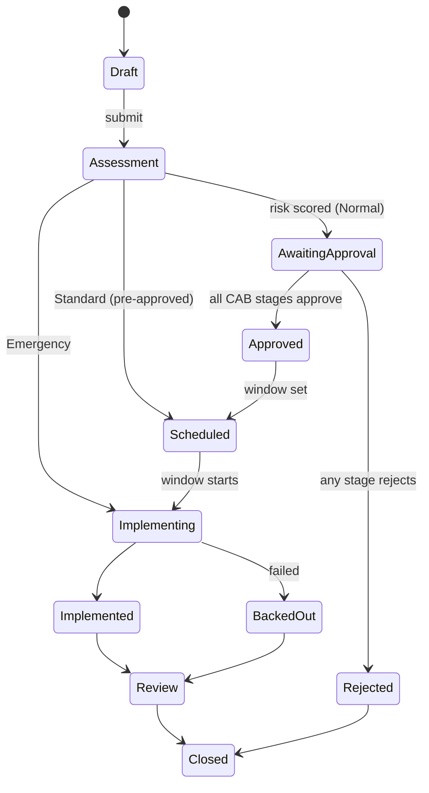

**H. UI.** Change tab on change tickets (plans, risk questionnaire, CIs, CAB status); change calendar; CAB view ("Waiting for me" filtered to changes); recurring schedules list; template editor; catalog in the portal (cards by category, search) and admin catalog editor; asset panel on tickets.

**I. Security.** New permissions per desk where relevant: `ManageChanges`, `ApproveChanges` (also via approval policy), `ManageRecurringTickets`, `ManageTicketTemplates`, `ManageServiceCatalog`, `ManageMailboxRouting`. Catalog item audience enforced server-side on submit. All approval decisions audited (Approvals already records who, when, why).

**J. Integrations.** M01, M03, M06, M09, M13, M15, Calendars, Approvals, Knowledge Base ("create article from ticket"), Webhooks (`ticket.change.*`), API additions under `api/tickets/v1` (changes, catalog requests).

**K. Persistence.** `TicketIndex` adds IsChange, ChangeType, PlannedStart, Risk; `RecurringTicketScheduleIndex(NextRunUtc, Enabled)`; `ServiceCatalogItemIndex(Category, Published)`.

**L. Reporting.** Change success rate, emergency change ratio, changes by risk, CAB approval time; recurring ticket compliance; catalog request volume and fulfilment time; tickets by CI.

**M. Testing.** E-mail intake fixtures (threading, unknown sender, CC, closed-ticket reply); change state machine and policy selection; recurring occurrence idempotency across DST and restarts; catalog audience enforcement; regression tests for existing Tickets behaviour.

**N.** Needs M01, M03, M06 (for Email), M09 (coverage), M15 (CI links can start with existing Assets). Phase 3 (Email, Templates, Recurring, Catalog), Phase 4 (coverage), Phase 6 (CI links, Changes with CIs).

**O. Acceptance.** Each feature can be enabled alone; an end-to-end test covers e-mail → ticket → reply → solve; a normal change needs both CAB stages; a standard change skips approval; a recurring schedule creates exactly one ticket per occurrence after a node restart.

### M08 Knowledge Base enhancement

**A. Identity.** `CrestApps.OrchardCore.KnowledgeBase` · Shared building block. Objective: an ITSM-grade knowledge lifecycle.

**B. Existing \[V-Repo\].** `KnowledgeArticle` content type, `/help` center with search and feedback, `help/api/suggest`, role restriction via Content Access Control, articles linkable as `Content` records.

**C–D. Missing and requirements.** Article owner, review date and review reminders (Calendars reminder or background task); states Draft → In review → Published → Retired with Approvals for publishing in governed categories; audience presets (internal, all customers, specific accounts via Content Access Control roles or an account audience \[Rec: add an account-audience condition to Content Access Control\]); "create article from ticket" (prefilled from the solved ticket, linked both ways); known-error article type linked to problem tickets; article usage metrics (views, linked tickets, helpfulness, deflection: portal searches followed by no ticket within 24 h); AI draft from ticket thread (draft only, human publishes).

**E–F.** `KnowledgeArticlePart` gains Owner, ReviewDate, KnownErrorFor (RecordRef), Audience; `IKnowledgeArticleService` (publish, retire, link to ticket); observer for article events.

**I. Security.** `PublishArticles`, `ManageArticles`; AI data source indexing obeys `IIndexedDocumentVisibility` so restricted articles never reach a public AI profile \[V-Repo\].

**L–O.** Reports: articles due for review, deflection rate, top linked articles. Tests: audience enforcement in help center, suggest API, search and AI retrieval. Acceptance: an internal article is never returned to a portal user through any channel; review reminders fire once. Needs Approvals, Content Access Control. Phase 3.

### M14 Expenses

**A. Identity.** Expenses · `CrestApps.OrchardCore.Expenses` (+ `.Abstractions`, `.Core`), features `Expenses`, `Expenses.Reimbursement` (bridge to Payroll/Banking), `Expenses.Billing` (bridge to Invoicing) · Shared building block. Objective: capture, approve, reimburse and rebill business expenses. Out of scope: supplier invoices (accounts payable stays in the accounting system), corporate card feeds (later, via Plaid/Banking \[Rec\]).

**B. Existing to reuse.** Approvals (policies by amount and scope), Attachments (receipts), Payroll pay inputs (`IPayInputSource`) and Banking disbursements for reimbursement, Invoicing `BillableItem` (kind `Expense` exists with markup) and `IBillableSource`, Taxation (recoverable tax), Exchange Rates, Agreements coverage (M09), Projects cost sources (M11), AI documents for receipt OCR \[Rec\].

**C. Missing.** Expense categories, policies, reports, items, mileage, per diem, receipt capture, approval routing, reimbursement export, rebilling.

**D. Functional.** Categories (GL code, tax category, billable default, receipt required above amount, mileage/per-diem kinds); policies (limits per item and per day by category and role, receipt rule, allowed currencies); report lifecycle Draft → Submitted → Approved/Rejected (per item or whole) → Reimbursed/Paid; items carry date, category, amount, currency, converted amount, tax, merchant, payment method (personal, company card), subject (`RecordRef`: ticket, project, work order, account), billable flag, receipt attachment. Rules: (1) policy violations require a justification and route to an extra approval stage; (2) approved billable items create `BillableItem`s once (key = item ID) after coverage evaluation; (3) personal-paid items create reimbursement lines; (4) currency converts on the expense date; (5) duplicate detection on same amount, merchant and date warns.

**E. Domain.** Aggregate `ExpenseReport {Number, StaffMemberId, Period, Status, Items[], Totals, ApprovalRequestId}`; `ExpenseItem {Date, CategoryId, Amount: Money, ConvertedAmount, Tax, Merchant, PaymentMethod, Subject: RecordRef?, Billable, ReceiptAttachmentId?, PolicyFlags[], Justification?}`; `ExpenseCategory`; `ExpensePolicy`; `MileageRate {EffectiveFrom, RatePerUnit, Unit}`. Events: ExpenseReportSubmitted, Approved, Rejected, Reimbursed.

**F. Services.** `IExpenseReportService`, `IExpensePolicyEvaluator`, `IExpenseReimbursementProvider` (Payroll pay input, Banking disbursement, export file), `IReceiptExtractor` (optional AI seam: extracts merchant, date, total; human confirms).

**G–H.** Mobile-friendly capture (photo upload through Attachments), report editor, approval inbox (Approvals), finance review list, policy editor, category editor.

**I. Security.** `SubmitExpenses` (own), `ApproveExpenses` (via policies, scoped by staff hierarchy), `ViewAllExpenses`, `ManageExpensePolicies`. Receipts are protected files with access through `IAttachmentAccessProvider`. Personal data contributor for expense data.

**J–K.** Billing via `IBillableSource`; Projects via `IProjectCostSource`; Payroll via `IPayInputSource`. Catalog `Expenses`; `ExpenseReportIndex(StaffMemberId, Status, SubmittedUtc)`, `ExpenseItemIndex(SubjectKind, SubjectId, Billable, Billed, CategoryId, Date)`.

**L–M.** Reports: expenses by category, project, account; policy exceptions; unreimbursed. Tests: policy evaluation, multi-currency, billing idempotency, duplicate detection, receipt access control.

**N.** Needs Approvals, Attachments, Invoicing, Payroll Pay Setup; M09, M11 for coverage and cost. Phase 7.

**O. Acceptance.** An approved report with mixed billable, non-billable, company-card and personal items produces the right billable items, reimbursement lines and project costs exactly once.

### M15 Assets as CMDB

**A. Identity.** `CrestApps.OrchardCore.Assets` with new features `Assets.Relationships`, `Assets.Software`, `Assets.Discovery` · Shared building block. Objective: configuration items with relationships that service, change and billing can rely on.

**B. Existing \[V-Repo\].** Asset types with attributes and meters; owners (business, customer, company) through `IAssetOwnerSource`; hierarchy; location; warranty; documents; append-only meter readings; Fleet equipment calendars.

**C–D. Missing and requirements.** Relationship kinds (DependsOn, RunsOn, ConnectedTo, InstalledOn, Contains, BackedUpBy) via M01; impact view (what depends on this CI); software and license records (product, version, seats, expiry) linked to assets and accounts; lifecycle states (Ordered, In stock, Deployed, In repair, Retired, Disposed); warranty and license expiry notices; discovery seam: `IAssetDiscoverySource` that upserts assets by external key (RMM device ID, serial number) without overwriting fields marked manual; quantity source for agreement additions (count of active assets by type per account).

**E–F.** `Asset` gains `ExternalKeys[] {Source, Key}`, `LifecycleState`, `ManualFields[]`; `SoftwareLicense` catalog record; `IAssetRelationshipService`, `IAssetDiscoverySource`, `IAssetImpactService`; implements `IAdditionQuantitySource` (M09).

**I. Security.** Existing Assets permissions; portal users see their account's assets read-only if enabled; discovery credentials in Data Connectors.

**K–O.** `AssetExternalKeyIndex(Source, Key)` unique per tenant; relationship links indexed both ways (M01). Reports: assets by account and type, warranties expiring, licenses expiring, assets without coverage. Tests: upsert idempotency, manual-field protection, relationship cycles allowed but impact traversal bounded (depth 10). Acceptance: syncing the same device twice changes nothing; agreement addition quantity equals active assets of the configured types. Phase 6.

### M16 Inventory and procurement enhancement

**A. Identity.** `CrestApps.OrchardCore.Inventory` (+ Purchase Orders) · Shared building block. Objective: buy and track the hardware and parts the PSA sells, installs and consumes.

**B. Existing \[V-Repo\].** Stock per product/variant and location with history, `IInventoryService`, `IStockLevelObserver`, purchase orders and receiving, Inventory API; Work Orders take parts off Inventory; Fleet vans as stock locations.

**C–D. Missing and requirements.** (1) Remove the hard dependency on the storefront Commerce feature, keeping Products and Commerce Foundation \[Asm: confirm with a dependency spike\]; (2) requisitions (`PurchaseRequisition {Lines, Demand: RecordRef (estimate, project, ticket, work order), Status}`) aggregated into purchase orders by supplier; (3) supplier as an Account with a supplier part (the audit already plans Vendor as an Account); (4) serial and lot tracking on receipt and issue, linking serialized items to Assets on delivery; (5) reservations of stock for a demand; (6) supplier price lists and lead times; (7) distributor ordering providers as an optional seam `IPurchaseOrderTransmitter` (future).

**I.** `ManageRequisitions`, `ApprovePurchaseOrders` (Approvals type `PurchaseOrder` by amount). **N.** Needs Products, Accounts; M10 for quote demand. Phase 6. **O.** A quote's hardware lines become requisitions, a PO, a receipt with serials, and assets at the customer, traceable through record links.

### M17 Invoicing Billing approve-and-post

**A. Identity.** `CrestApps.OrchardCore.Invoicing.Billing` · Shared building block. Objective: one place where finance reviews all billable work and turns it into invoices, the equivalent of Autotask's Approve and Post and Halo's Ready for Invoicing.

**B. Existing \[V-Repo\].** `IBillableSource`, `IBillingService`, `BillableItem` (unbilled charges with markup), Time Tracker time at an hourly rate, Unbilled work card on drafts, usage meters, recurring plans billing charges, invoice approvals threshold, revisions, batching by `PartyRef` through drafts.

**C–D. Missing and requirements.** A billing review queue across sources (time, expenses, parts, milestones, agreement overage, ad-hoc charges) filterable by account, agreement, project, period, source; per-line actions: approve, adjust (quantity, rate, description, with reason), mark non-billable, defer; posting creates or appends to draft invoices grouped by bill-to party, agreement and currency (grouping policy per account: one invoice per agreement, per project, per ticket, or combined); automatic posting rules for trusted sources (e.g. recurring additions); a cut-off date; reversal of a posted line before issue. Rules: posting is idempotent per billable item; an issued invoice locks its items; adjustments are audited with before/after.

**E–F.** `BillableItem` gains `ReviewState(Pending, Approved, NonBillable, Deferred, Posted)`, `Adjustments[]`, `SubjectRef`, `AgreementId`; `IBillingReviewService`, `IInvoiceGroupingPolicy`.

**I.** `ReviewBilling`, `PostBilling`, `AdjustBillableRates`. **N.** Needs M09, M13, M14. Phase 7. **O.** Month-end for a fixture tenant with 3 accounts, 5 agreements and 400 entries posts the expected invoices with no item posted twice.

### M18 Revenue Recognition (deferred)

**A. Identity.** `CrestApps.OrchardCore.RevenueRecognition` · Shared building block (deferred). Objective: schedule recognition of prepaid and recurring revenue (deferred revenue) for reporting and accounting export. \[Asm\] Whether the platform posts journal entries or only feeds the accounting system must be decided with finance stakeholders (ADR-09).

**D–E.** `RevenueSchedule {SourceRef (invoice line), Method(StraightLine, AsDelivered by entitlement draw, Milestone), Lines[] {Period, Amount, Recognized}}`; recognition run per period, idempotent; reversal on credit notes. Reports: deferred revenue balance, recognized by period. Needs Invoicing, M09. Phase 7 (optional).

### M19 Integration connectors (deferred)

**A. Identity.** `CrestApps.OrchardCore.Integrations.Rmm` (abstractions + providers per vendor, e.g. `...Rmm.NinjaOne`, `...Rmm.DattoRmm`) and `CrestApps.OrchardCore.AccountingSync` (+ `...QuickBooksOnline`, `...Xero`) · Infrastructure. Objective: bring device inventory and alerts in, push invoices and payments out.

**D.** RMM: device sync to Assets via `IAssetDiscoverySource`; alerts to tickets through the provider webhook inbox (`IProviderWebhookInbox`) with alert-key de-duplication, auto-resolve when the alert clears (configurable), account mapping table; device counts as agreement quantity sources. Accounting: customer and item mapping, invoice and credit note export on issue, payment import, sync log with retry through the leased work queue, never two-way edits of issued invoices. Credentials: Data Connectors and Secrets; outbound calls through `EgressNetwork` \[V-Repo\].

**I.** `ManageIntegrations`; per-connection scopes; inbound webhooks signature-validated (`IWebhookSignatureValidator`). **N.** Needs M15, Invoicing, Webhooks, Data Connectors. Phase 7–8. **O.** Replaying the same alert webhook twice creates one ticket; an issued invoice exports once and its payment imports once.

### M01 Platform record links

**A.** `CrestApps.OrchardCore.Records` (in `CrestApps.OrchardCore.Abstractions` and `.Core`/`YesSql.Core`) · Infrastructure · Extract and generalize. **B.** `RecordRef`, `IRecordSource`, `IRecordDirectory`, `RecordPicker` exist \[V-Repo\]; Tickets has a private `TicketLinkIndex`. **C–D.** `RecordLink {From: RecordRef, To: RecordRef, Kind, CreatedBy, CreatedUtc, Properties}`; open link kinds registered with `AddRecordLinkKind(kind, inverseKind, displayName)`; link and unlink require view permission on both ends through each kind's `IRecordSource`; a `RecordLinks` view component lists links on any page. **F.** `IRecordLinkService` (link, unlink, list both directions, exists). **K.** `RecordLinkIndex(FromKind, FromId, ToKind, ToId, Kind)` unique per triple. **M–O.** Tickets' existing links migrate by a resumable step with identical behaviour (problem solving its incidents still works). Phase 1.

### M02 Boards

**A.** `CrestApps.OrchardCore.Boards` · Shared building block · Extract from Tickets as `building-blocks.md` prescribes \[V-Repo\]. **C–D.** Column model (columns = sets of status values of a board source), cards from an `IBoardSource` (kind-specific query and move rules), WIP limits per column, swimlanes by a field, saved boards per user/team/all, move endpoint calling the source's transition service (never writing status directly); the script moves to Resources. **F.** `IBoardSource { Kind; GetColumnsAsync; GetCardsAsync(filter, viewer); MoveAsync(card, toColumn) }`. **I.** A card is shown only if the source's access service allows it. **O.** Tickets boards behave identically after extraction (existing tests pass); Projects tasks and CRM opportunities get boards by registering sources. Phase 1.

### M03 Approvals enhancement

**A.** Approvals · Shared building block. **C–D.** (1) `Team` approver rule (members of a Teams team, optionally a minimum number) so a CAB is a team plus a policy; (2) decision by signed e-mail link (`SignedTokenService`, single use, expiry, requires the approver to be signed in for high-risk types \[Rec\]); (3) delegation (approver out of office → delegate for a date range); (4) policy simulation ("who would approve this?"). **I.** Existing built-in rules stay: requester cannot approve; nobody decides about themselves \[V-Repo\]. **O.** A two-stage CAB policy routes to the right members and records each vote. Phase 1.

### M04 Accounts and CRM enhancement

**A.** Accounts, Omnichannel CRM · Shared building blocks. **C–D.** (1) Finish D3: move contact contracts into `Omnichannel.Abstractions` (or a new `Contacts.Abstractions` \[Rec: decide in ADR-07\]) so Tickets, Portal and e-mail intake resolve contacts without referencing `Omnichannel.Core`; (2) account health: `IAccountHealthSignalProvider` (open tickets, SLA breaches, CSAT, overdue AR, renewal due, utilization of entitlements) combined into a 0–100 score with weights in settings; (3) opportunity gains `EstimateIds`, forecast category (Pipeline, Best case, Commit, Closed), recurring and one-time amounts; (4) account hierarchy roll-ups (child accounts' tickets and AR shown on the parent with permission); (5) account manager and account team (Account Team feature exists) used for routing notifications. **I.** Health signals are computed only from data the viewer may see when displayed. **O.** Portal, Tickets.Email and Estimates compile without any reference to `Omnichannel.Core`. Phase 2.

### M20 Reports enhancement

**A.** Reports · Shared building block. **C–D.** Each new block registers its own `IndexedReportDataSet`s (owner rule); a **dashboard page** type composed of report widgets with role-based default dashboards; KPI tile and trend widgets; drill-through from a widget to the filtered admin list; scheduled report subscriptions (exist) for PSA reports. **I.** Data sets enforce the source's scope filter (`SourceAccessFilter` or the module's own filter); widgets of reports a user cannot run are hidden. **O.** No data set returns rows outside the viewer's scope (tested per data set). Phase 8.

### M21 Psa (application module)

**A.** `CrestApps.OrchardCore.Psa` · PSA application module. Objective: turn the building blocks into a product. **D.** (1) `Psa` setup recipe enabling the PSA feature set and creating defaults: desks (Service Desk, Projects, Changes), ticket types (Incident, Service Request, Problem, Change), statuses mapped to categories, priorities with impact × urgency matrix, SLA policies (Gold, Silver, Bronze), business hours, work roles and types, a default rate card, agreement types (Managed Services, Block Hours, Retainer, Per Incident, T&M, Fixed Price), project templates (onboarding, migration), expense categories, report dashboards; (2) **role templates** (permission sets) for Service Desk Agent, Service Manager, Dispatcher, Field Technician, Project Manager, Resource Manager, Account Manager, Sales, Finance, Executive, PSA Administrator, Portal User, Portal Administrator; (3) PSA admin navigation grouping (Service, Projects, Field, Sales, Finance, Resources, Insights, Setup); (4) role dashboards (M20); (5) Get Started checklist (company profile, mailboxes, business hours, SLA, rates, agreement types, import accounts and contacts, invite staff); (6) demo-data recipe for trials; (7) PSA settings (default work type per desk, billing grouping policy, timesheet period). **Rule:** PSA contains no business logic that another product could need; anything reusable goes to its block. **O.** A fresh tenant set up with the recipe passes an end-to-end smoke test of every workflow in section 15. Phase 2 (skeleton) to Phase 9.

### M22 Psa.Portal

**A.** `CrestApps.OrchardCore.Psa.Portal` · PSA application module. **B.** Composes Users My Account, Tickets Portal (with ratings and web form), Service Catalog (M07), Invoicing My invoices (pay online), Scheduling self-service, Agreements balances (M09), Projects portal (M11), Knowledge Base help center, Estimates accept page. **D.** One branded portal shell with a menu built from registered sections (Resources `PageSections` pattern); **portal administrator** role per customer account who can manage that account's portal users, approve catalog requests and see all the account's tickets; regular portal users see their own tickets unless the account setting shares all; MFA option for portal sign-in; per-account branding is out of scope v1. **I.** Every portal query is scoped through `UserParties` and `IPartyMembershipService` \[V-Repo\]; portal users never receive internal notes, costs or other accounts' data; rate limits on public and portal endpoints (Orchard Rate Limits, already a Tickets Portal dependency \[V-Repo\]). **O.** A security test suite proves a portal user of account A cannot read, guess or enumerate any record of account B through pages, APIs, search, attachments or AI chat. Phase 3 (tickets) to Phase 7 (invoices, agreements, projects).

### M23 Psa.Analytics

**A.** `CrestApps.OrchardCore.Psa.Analytics` · PSA application module (crosses many blocks, so it lives in PSA). **D.** KPI definitions (section 19), data sets that join block data sets by IDs (no direct index reads of other modules: it uses their published data sets and services), nightly snapshots for trend KPIs (backlog, utilization, MRR), AI insight cards (anomalies in ticket volume, at-risk agreements) as drafts for humans. **I.** Financial KPIs require `ViewPsaFinancials`; all inputs are scope-filtered. **O.** KPI values on a fixture tenant equal hand-computed expectations. Phase 8.

## 13. Domain Entity and Relationship Catalog

**The core model hangs off two anchors, the Account and the work item, and every cross-context reference is a typed ID or a `RecordRef`.** \[Rec\]

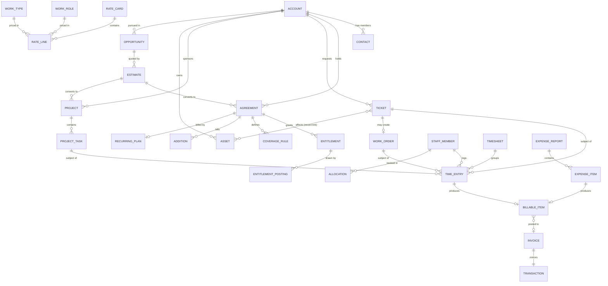

| Entity | Context / owner module | Store | Identity and key fields | Lifecycle |
| --- | --- | --- | --- | --- |
| Account | Organization / Accounts | Content item | ContentItemId; name, parent, account manager, rate card ID | Active, Inactive |
| Contact | Organization / Omnichannel CRM (after D3) | Content item | ContentItemId; `ContactInfo`, account membership via Parties | Active, Inactive, Merged |
| Opportunity | Sales / Omnichannel CRM | Content item | Stage, probability, amounts, close date, estimates | Open stages → Won/Lost |
| Estimate (Quote) | Sales / Invoicing Estimates | Catalog | Number, sections, lines, signature, conversions | Draft → Sent → Accepted → Converted; Declined, Expired, Superseded |
| Agreement | Contracts / Agreements | Catalog | Number, kind, type, version, account, dates | Draft → Active → Expired/Renewed/Cancelled; Suspended |
| Entitlement / posting | Contracts / Agreements | Catalog + quantity ledger | Agreement ID + entitlement ID; posting key = source record | Balance by date |
| Coverage rule, Addition, Milestone | Contracts / Agreements | Inside agreement document | Positional IDs | Follows agreement; milestone Pending → Billable → Billed |
| Work role, Work type, Rate card | Contracts / Rates | Catalog | Code; card scope and effective range | Draft → Active → Retired |
| Ticket (incl. change) | Service / Tickets | Content item + `TicketIndex` | Number, desk, status category, priority, requester `PartyRef` | New, Open, Pending, OnHold, Solved, Closed; change sub-states |
| Service level timer | Service / Service Levels | Catalog | Subject `RecordRef`, metric | Running, Paused, Completed, Cancelled; Breached flag |
| Service catalog item | Service / Tickets | Content item | Category, audience, ticket type, template | Draft, Published, Retired |
| Recurring ticket schedule, Ticket template | Service / Tickets | Catalog | RRULE, next run | Enabled, Disabled, Ended |
| Knowledge article | Service / Knowledge Base | Content item | Category, audience, owner, review date | Draft → In review → Published → Retired |
| Project, Project task, Change order, Template | Delivery / Projects | Catalog | Number; task dependencies | See M11 |
| Work order, Visit | Field / Work Orders, Dispatch | Catalog | Number; type; field status | Existing |
| Staff member, Team, Skill | People / Staff, Teams, Skills | Catalog | Optional user ID | Existing |
| Allocation | People / Resource Planning | Catalog | Work item `RecordRef`, person or role, range | Soft, Hard; Released |
| Time entry, Timesheet | Time & Expense / Time Tracker | Catalog | Subject `RecordRef`, role, type, approval state | Draft → Submitted → Approved → Posted; Rejected |
| Expense report, Expense item | Time & Expense / Expenses | Catalog | Number; subject; receipt | Draft → Submitted → Approved → Reimbursed |
| Asset (CI), Software license | Assets / Assets | Catalog | External keys, owner `PartyRef` | Ordered → Deployed → Retired → Disposed |
| Stock item, Purchase requisition, Purchase order | Assets / Inventory | Catalog | Product, location, serials | Existing + Requested → Ordered → Received |
| Billable item | Finance / Invoicing Billing | Catalog | Source `RecordRef`, party, agreement | Pending → Approved → Posted; NonBillable, Deferred |
| Invoice, Credit note, Recurring plan | Finance / Invoicing | Catalog | Number; transaction ID | Existing |
| Transaction | Finance / Transactions | Catalog | Ledger keys | Existing |
| Mailbox, Conversation | Communication / Messaging | Catalog | Address; provider message ID | Enabled, Disabled |
| Record link | Platform | Catalog | From, To, Kind | Created, Removed |

## 14. Module Dependency Matrix

**Dependencies run one way: PSA → business blocks → platform → Orchard Core; among business blocks the order is Organization → Contracts → work blocks → Time & Expense → Finance, with reverse needs met by registered extension points.** \[Rec\]

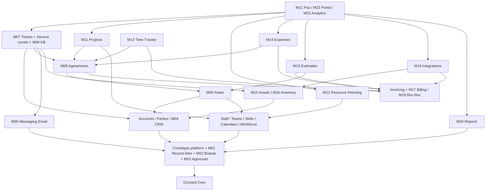

Arrows mean "depends on". Where a lower block must react to a higher one (for example Agreements needing usage from Tickets, Projects needing costs from Time Tracker, Resource Planning needing work items from Projects), the lower block defines the interface and the higher block registers an implementation in a `[RequireFeatures]` startup. This is the existing pattern (`IAgreementUsageProvider`, `IBillableSource`) and it keeps the graph acyclic.

| Module | Depends on (Abstractions only) | Registers implementations into | Must stay independent of |
| --- | --- | --- | --- |
| M01 Record links | Platform | — | All business modules |
| M02 Boards | Platform, Resources | — | Tickets, Projects, CRM |
| M05 Rates | Staff, Parties, Exchange Rates | — | Agreements, Projects, Invoicing |
| M09 Agreements | Rates, Accounts, Parties, Invoicing (in `Agreements.Billing` only), quantity ledger | Rates (scope), Invoicing (`IRecurringPlan` sync) | Tickets, Projects, Time Tracker |
| M06 Messaging Email | Messaging, Attachments, Data Connectors, Parties | Messaging (`IMessagingChannel`) | Tickets |
| M07 Tickets | Accounts, Service Levels, Agreements, Messaging, Assets, Approvals, Calendars, Record links | Agreements (usage), Resource Planning (work items), Boards (source), Time Tracker defaults | Projects, Invoicing internals |
| M10 Estimates | Invoicing, Products, Rates, Approvals | — | Agreements, Projects (they register conversion targets) |
| M11 Projects | Accounts, Staff, Calendars, Approvals, Rates, Agreements, Record links, Boards | Estimates (target), Resource Planning (work items), Agreements (usage), Rates (scope) | Time Tracker, Expenses (they register cost sources) |
| M12 Resource Planning | Staff, Teams, Skills, Calendars, Workforce | — | Projects, Tickets, Dispatch (they register work item sources) |
| M13 Time Tracker | Agreements, Rates, Approvals, Payroll Pay Setup | Invoicing (`IBillableSource`), Projects (cost source), Agreements (usage), Payroll (pay input) | Tickets, Projects internals |
| M14 Expenses | Agreements, Approvals, Attachments, Invoicing, Payroll | Invoicing, Projects, Payroll | Tickets, Projects internals |
| M15/M16 Assets, Inventory | Accounts, Products, Record links | Agreements (quantity source), Estimates (target for requisitions) | Tickets |
| M17 Billing | Invoicing, Transactions (an agreement is only a stored ID here; Agreements.Billing registers the grouping policy, which avoids a cycle) | — | Every source module (they register sources) |
| M19 Integrations | Assets, Tickets, Invoicing, Webhooks, Data Connectors | Assets (discovery), Tickets (alert intake) | — |
| M21–M23 PSA | Any block | Reports, navigation, recipes | Nothing depends on PSA |

**Enforcement \[Rec\].** Extend `LayeringRatchetTests` with a rule that no assembly outside `CrestApps.OrchardCore.Psa*` references a `Psa` assembly, and add a feature-dependency cycle test over all manifests.

## 15. End-to-End Business Workflow Specifications

**Nine workflows cover the PSA lifecycle; each runs as application-service commands under a lock, publishes observer events after commit, and is idempotent so a retry never doubles money or work.** \[Rec\]

### 15.1 W2 Customer request to resolution to billing (reference sequence)

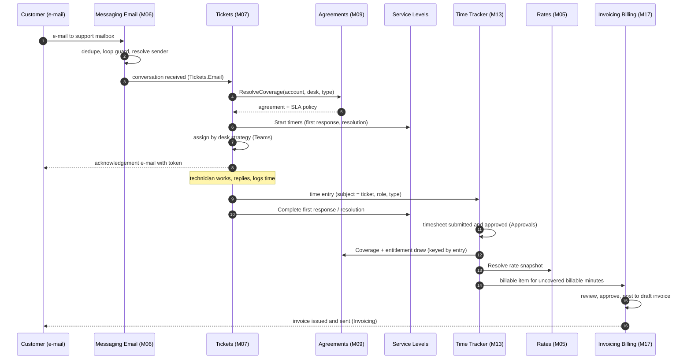

### 15.2 W1 Lead → opportunity → quote → agreement → onboarding

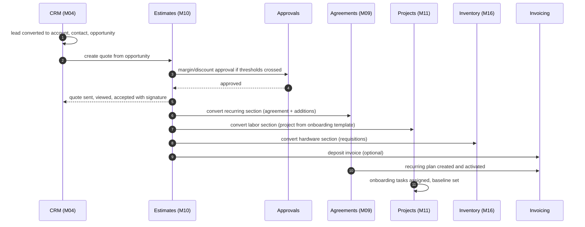

### 15.3 Workflow specifications

| ID | Workflow | Participating modules | Commands → events | State transitions | Key business rules | Permissions | Failure and retry | Audit | Notifications | Financial implications |
| --- | --- | --- | --- | --- | --- | --- | --- | --- | --- | --- |
| W1 | Lead → opportunity → quote → contract → onboarding | CRM, Estimates, Approvals, Agreements, Projects, Inventory, Invoicing | ConvertLead, CreateEstimate, SendEstimate, AcceptEstimate → EstimateAccepted; ConvertEstimate → EstimateConverted, AgreementActivated, ProjectCreated | Opportunity → Won; Estimate Sent → Accepted → Converted; Agreement Draft → Active; Project Planning | Conversion once per estimate version; expired quotes cannot be accepted; margin below threshold needs approval | Sales: manage opportunities and estimates; approvers: approve margins; PM: receives project | Each conversion target runs in its own unit of work keyed by (estimate, section); a failed target is retried by a resumable step and shown on the estimate | Acceptance signature hash, approvals, conversions | Account manager on acceptance; PM on project creation; finance on deposit invoice | Deposit invoice, recurring revenue starts at agreement start date |
| W2 | Request → ticket → resolution → billing | Messaging, Tickets, Agreements, Service Levels, Teams, Time Tracker, Rates, Billing, Invoicing | ReceiveEmail → TicketCreated; Assign → Assigned; Reply; LogTime; Solve → Solved; ApproveTimesheet → TimeEntryApproved; Post → InvoiceIssued | Ticket New → Open → Pending → Solved → Closed; timers Running → Completed | Coverage on work date; rounding before draw; reopen within window else follow-up ticket | Desk permissions with scope; time submit/approve; billing review | Duplicate e-mail ignored by key; timer jobs idempotent; posting idempotent per entry | Status, assignment, time edits, billing adjustments | Requester acknowledgement, replies, solved and CSAT; assignee; SLA warnings | Entitlement draws; billable items; invoice |
| W3 | Contract creation → entitlement allocation → service delivery | Agreements, Rates, Tickets, Work Orders, Projects, Time Tracker | CreateAgreement, Activate → AgreementActivated; DrawEntitlement → EntitlementDrawn, ThresholdReached, Exhausted; Repurchase | Agreement Draft → Active; entitlement balance | Most specific agreement wins; exclusions fall through; posting once per source key; overage per agreement setting | Manage agreements; view financials | Concurrent draws under agreement lock; failed auto-repurchase → payment issue | Every posting and reversal | Account manager at 80%/100% and expiry; customer optional | Prepaid revenue consumed; overage billable |
| W4 | Ticket → SLA evaluation → escalation → resolution | Tickets, Service Levels, Business Hours, Teams, Notifications, Workflows | StartTimer; Pause (Pending); Resume; Warn → SLA warning; Breach → SLA breached; Escalate → EscalationLevel+1 | Timer Running ↔ Paused → Completed; Breached flag | Business-hours clock; pause in Pending/OnHold status categories; retarget on priority change; escalation chain per desk (observer: reassign to team lead, notify manager, raise priority) | Desk managers configure; agents see timers | Monitor task idempotent per timer and threshold | Breaches, escalations, retargets | Assignee, team lead, service manager; optional customer | SLA credits if contractually defined (future: credit note rule) \[Asm\] |
| W5 | Project creation → resource allocation → time → invoicing | Estimates, Projects, Resource Planning, Time Tracker, Expenses, Agreements, Billing | CreateFromTemplate → ProjectCreated; RequestRole; BookAllocation → AllocationBooked; LogTime; AchieveMilestone → MilestoneAchieved → MilestoneBillable; Close → ProjectClosed | Project Planning → Active → Completed → Closed; Allocation Soft → Hard → Released | Fixed price: bill by milestones; T&M: bill approved time; budget threshold alerts; close blockers | PM, resource manager, finance | Recalculation under project lock; milestone billing once | Baselines, change orders, budget changes | PM on threshold; resource on booking; finance on milestone | Milestone invoices or T&M invoices; margin |
| W6 | Work order → dispatch → field execution → sign-off → billing | Tickets, Work Orders, Dispatch, Calendars, Inventory, Assets, Agreements, Invoicing | CreateWorkOrder (from ticket) → WorkOrderCreated; Dispatch → VisitScheduled; status En route/On site; ConsumePart; CaptureSignature; Complete → WorkOrderCompleted; Bill (`IWorkOrderBilling`) | Visit Scheduled → En route → On site → Completed; Work order Open → Completed → Billed | No double booking (per-technician lock); parts reduce stock at location; coverage decides labor billing; signature required by type | Dispatcher, technician (own visits), billing | Offline mobile actions replayed idempotently \[Asm: offline support scope\] | Status, parts, signature | Customer appointment confirmation and on-the-way; dispatcher on exceptions | Labor and parts invoice; stock valuation |
| W7 | Timesheet submission → approval → payroll or invoicing | Time Tracker, Approvals, Agreements, Rates, Billing, Payroll | Submit → TimesheetSubmitted; Approve → TimesheetApproved → posting; Reject → TimesheetRejected; Recall | Draft → Submitted → Approved → Posted; Rejected → Draft | Locked after submit; reversal after approval; approver by manager and project roles | Submit own; approve scoped; edit approved = reversal only | Posting idempotent per entry; partial failure leaves entries Approved but unposted and retried | Submissions, decisions, reversals | Reminders before period close; approver inbox | Billable items; pay inputs for hourly staff |
| W8 | Recurring agreement → invoice creation → payment tracking | Agreements.Billing, Invoicing Recurring Plans, Assets/Accounts quantity sources, Transactions, Collections | RunBillingPeriod → quantities frozen → RecurringPlan run → InvoiceIssued → PaymentRecorded / InvoiceOverdue → late fee | Plan occurrence Due → Invoiced; invoice Issued → Paid/Overdue | Occurrence once each; pro-rata per policy; uplift on renewal; arrears vs advance lines | Finance; recurring billing permission | Catch-up within limit (existing); quantity source failure blocks only that line and alerts | Quantities used per line | Invoice e-mail; reminders; overdue notices | MRR, AR, late fees |
| W9 | Expense submission → approval → project or customer billing | Expenses, Approvals, Agreements, Projects, Billing, Payroll/Banking | SubmitReport → ExpenseReportSubmitted; Approve → Approved → billable items, project costs, reimbursement lines; Reimburse → Reimbursed | Draft → Submitted → Approved → Reimbursed; Rejected | Policy limits and receipts; currency on expense date; markup per category or agreement | Submit own; approve scoped; finance reimburse | Idempotent per item; reimbursement export retried | Policy exceptions, approvals | Approver inbox; submitter on decision | Reimbursement liability; rebilled revenue; project cost |

## 16. Security and Authorization Architecture

**Authorization is three checks in a fixed order on every request: the tenant (Orchard shell), the permission (role-based), and the record scope (attribute-based, by account, team, desk, project or ownership); any failed check returns not-found for records and forbidden for actions.** \[Rec\]

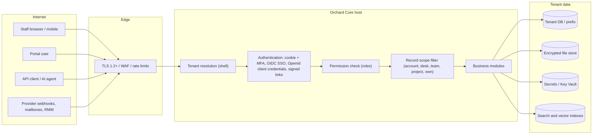

### 16.1 Identity and authentication

- **Staff:** Orchard Users with mandatory MFA for roles holding financial, admin or cross-account permissions \[Rec\]; SSO through OpenID Connect (Entra ID, Okta, Google) with just-in-time provisioning mapped to staff records; session cookies `Secure`, `HttpOnly`, `SameSite=Lax`, idle timeout 30 min for admin \[Asm: confirm\], absolute timeout 12 h.
- **Portal users:** Orchard Users linked to parties; sign in by password, e-mail code (Users "Sign in with an email code" feature \[V-Repo\]) or customer SSO; optional MFA per account; self-registration only by verified e-mail domain of an account (Accounts E-mail Domains \[V-Repo\]) or invitation.
- **APIs:** OpenId client credentials or authorization code with PKCE; scopes per module (`tickets.read`, `tickets.write`, `billing.read` ...); module APIs use `MapModuleApi` (Api scheme, no antiforgery, idempotency keys on writes) \[V-Repo\]; API keys are never long-lived bearer secrets in URLs.
- **AI agents:** MCP and A2A endpoints act as the signed-in user or as a client with explicit scopes; AI tools call the same services and scope filters as the UI (existing pattern: Invoicing AI tools "act as the signed-in user with their permissions" \[V-Repo\]); AI writes are drafts unless the user confirms.

### 16.2 Authorization model

- **RBAC:** each module defines permissions in its `.Abstractions` permissions class; PSA role templates (M21) bundle them. Administrative privilege is split: tenant administrator (features, settings), security administrator (roles, users), finance administrator (rates, billing, payroll), service administrator (desks, SLAs).
- **ABAC / record scope:** one scope service per record family, all following the Tickets pattern (`ITicketAccessService` + `TicketScopeFilter` applied in SQL) \[V-Repo\]: tickets by desk and all/teams/mine; projects by manager, team membership, account; agreements and invoices by account manager or finance; staff data by `IStaffScopeService` hierarchy; payroll by employer (`PayrollScope`); approvals by `SourceAccess`. Portal scope: `UserParties` + `IPartyMembershipService` \[V-Repo\].
- **Standardisation \[Rec\]:** introduce an `IRecordScopeFilter<TIndex>` convention (not a new framework) documented in `building-blocks.md`, and a test helper that runs every list endpoint, data set, search query and AI tool for a set of fixture users and asserts no out-of-scope IDs. This is the single most important security test of the platform.
- **Field-level:** cost rates, margins, pay data, bank data and personal data have their own permissions and are removed server-side, not hidden in views.

### 16.3 Protection controls

| Area | Control \[Rec unless marked\] |
| --- | --- |
| Secrets | Orchard Core Secrets (Key Vault backed in cloud) for integration credentials; `ProtectedSettingExtensions` for settings; `ISensitiveValueProtector` for values in records (bank and tax numbers) \[V-Repo\]; no secrets in recipes, logs or exports |
| Encryption | TLS 1.2+ everywhere; database encryption at rest (TDE / managed disk); encrypted tenant file store for attachments \[V-Repo\]; backups encrypted |
| Uploads | Attachments policy: size limits, type detection by bytes (`FileFormats`), scanner hook, never served from the site origin without an access check, signed time-limited links \[V-Repo\] |
| Web vulnerabilities | Orchard antiforgery on forms; Razor/Liquid encoding; HTML sanitizer for rich text and e-mail bodies; CSP with nonces; parameterized YesSql queries only; CSV formula-injection guard (`CsvWriter`) \[V-Repo\]; SSRF guard for outbound calls (`EgressNetwork`) \[V-Repo\]; OData/filter escaping (audit defect 11 fixed) \[V-Repo\] |
| Rate limiting | ASP.NET Core rate limiting per tenant, per user and per IP on sign-in, portal, public pages (estimates, invoices, web form) and APIs |
| Session | Rotation on privilege change; sign-out everywhere on password reset; concurrent session listing for admins |
| Audit | Orchard Audit Trail for configuration, security, money and record lifecycle events; Timeline for record history; approvals record decision, who, when, why \[V-Repo\]; audit records immutable to tenant admins and retained per policy |
| Logging and monitoring | Structured logs with `SanitizeLogValue()` \[V-Repo\]; no personal data in metrics (`BannedMetricTagKeys`) \[V-Repo\]; security events (failed sign-ins, permission denials, export of large data sets) to a SIEM |
| Privacy | `IPersonalDataContributor` in every new module; erasure keeps financial records with personal fields cleared (Invoicing pattern) \[V-Repo\]; consent through Consent block; data processing records per tenant |
| Retention | `IRetentionPolicy` per record family (e-mail bodies, attachments, audit, timeline) \[V-Repo\] configurable per tenant |
| Backup and recovery | Point-in-time restore of tenant databases; file store versioning; quarterly restore drills (section 24) |

### 16.4 Public endpoints (explicit allow-list)

All other routes require authentication and a named permission.

| Endpoint | Purpose | Protection |
| --- | --- | --- |
| Sign-in, password reset, e-mail code | Authentication | Rate limited, lockout, generic errors |
| `estimates/view/{token}` | Accept or decline a quote | Signed token, expiry, rate limited, no costs \[V-Repo\] |
| `invoices/view/{token}` | View and pay an invoice | Signed token, viewed tracking \[V-Repo\] |
| Ticket web form widget | Anonymous ticket submission where enabled | CAPTCHA, rate limit, unverified requester flag \[V-Repo\] |
| `help` center and suggest API | Public knowledge articles only | Content Access Control filters \[V-Repo\] |
| Provider webhook endpoints (mail push, RMM, payments) | Inbound events | Signature validation, durable inbox, replay protection \[V-Repo\] |
| OpenId discovery and JWKS | Token validation | Standard |

### 16.5 Compliance readiness (controls, not claims)

The platform will support assessments; it does not make a tenant compliant. OWASP ASVS 5.0.0 was released in May 2025 with 17 chapters and three cumulative levels ([arc42 summary](https://quality.arc42.org/standards/owasp-asvs), [OWASP ASVS](https://github.com/OWASP/ASVS)). \[V-Web\]

| Framework | Target and evidence the platform must produce \[Rec\] |
| --- | --- |
| OWASP ASVS 5.0 | Level 2 for the whole application, Level 3 for authentication, session, access control and cryptography chapters; requirements cited with version (e.g. `v5.0.0-x.y.z`) in tests and threat models |
| OWASP Top 10 | Covered by ASVS L2 controls above; tracked in CI with SAST, dependency scanning and DAST against a staging tenant |
| SOC 2 (Security, Availability, Confidentiality) | Evidence exports: access reviews (users, roles, permissions per tenant), audit trail exports, change history of configuration (recipes and deployments), backup/restore logs, incident records |
| ISO/IEC 27001:2022 | Annex A support: access control, logging and monitoring, secure development, supplier (integration) management, cryptography, backup; the PSA itself can be the ISMS's asset and incident register |
| GDPR / UK GDPR / CCPA | Data subject export and erasure, retention policies, consent, records of processing, data residency by tenant database location, sub-processor list for AI providers |

## 17. Multi-Tenancy and Data Isolation Strategy

**Two isolation layers: Orchard tenants separate service providers physically or by prefix; inside a tenant, scope filters separate the provider's customers logically, and both are tested on every data path.** \[Rec\]

| Layer | Boundary | Mechanism | Risk | Mitigation |
| --- | --- | --- | --- | --- |
| L1 Tenant (service provider) | Orchard shell | Own container, settings, features; own database (recommended for SaaS) or shared database with required table prefix (`RequireTablePrefix`) \[V-Web\]; own file store folder or container; own search indexes; own secrets scope | Cross-tenant leakage via shared caches, background tasks, search indexes, file paths | Cache keys include tenant name (Orchard default); background tasks are per shell; index names include tenant; Tenant Hierarchy provisions dedicated databases (`IChildTenantDatabaseProvisioner`) \[V-Repo\]; automated test that creates two tenants and checks every store for foreign rows |
| L2 Customer account (inside a provider) | Account and its parties | Scope filters on every query; portal membership via Parties; `RecordRef` access via each kind's `IRecordSource` permission | A list, export, search, attachment link or AI answer returning another account's data | Scope filter convention + fixture test helper (16.2); attachments by access providers and signed links; AI data sources wrapped by `IAIDataSourceResultFilter` and `IIndexedDocumentVisibility` \[V-Repo\] |
| L3 Internal teams | Desks, teams, projects, employers | Desk permissions and view scopes, staff hierarchy, payroll scope \[V-Repo\] | HR or payroll data visible to service staff | Separate permissions and data sets; payroll tenant option for very sensitive employers |
| L4 Field-level | Costs, margins, pay, bank, personal data | Separate permissions; server-side removal | Leakage through exports and APIs | Serializer-level filtering in API DTOs and data sets |

**Tenant models \[Rec\].** (1) **Hosted SaaS:** one database per provider tenant, provisioned by Tenant Hierarchy; regional placement for data residency. (2) **Self-hosted enterprise:** one tenant per legal entity or business unit, shared database with prefixes allowed. (3) **Internal IT (no external customers):** one tenant; accounts become departments.

**Cross-tenant operations** (platform support, usage metering) run only from the Default tenant through Tenant Hierarchy APIs and never read another tenant's database directly.

## 18. API and Integration Architecture

**Each block exposes its own versioned REST API on the shared module-API conventions, emits signed webhooks for its events, and receives provider events through the durable inbox; no shared "integration hub" is introduced.** \[Rec\]

- **REST APIs.** Route groups per module `api/{module}/v{n}` via `MapModuleApi` (Api auth scheme, problem details through `ApiProblems`, `IdempotencyEndpointFilter` with `Idempotency-Key` on POST/PUT/PATCH) \[V-Repo\]. Existing: `api/tickets/v1`, `api/workforce/v1`, Invoicing, Inventory and Catalog APIs on the commerce API \[V-Repo\]. New: `api/agreements/v1`, `api/rates/v1`, `api/projects/v1`, `api/resource-planning/v1`, `api/time/v1`, `api/expenses/v1`, `api/assets/v1` (extend), `api/psa/v1` (portal aggregation only).
- **Versioning.** URL major version; additive changes within a version; deprecation header and 12-month overlap for breaking changes \[Rec\]; OpenAPI documents per module through the OpenAPI feature (Inventory README already references it \[V-Repo\]).
- **Pagination and filtering.** Cursor pagination on index-backed lists; filter parameters mapped to index columns only (no free-form queries); maximum page size 200.
- **Webhooks (outbound).** Event providers per module (`IWebhookEventProvider`), signed with `IWebhookSigner`, retried by the outbox, egress-guarded, with retention \[V-Repo\]. Event names `{entity}.{verb}` (`ticket.created`, `agreement.entitlement.threshold`, `project.milestone.achieved`, `timesheet.approved`, `invoice.issued`). Payloads carry IDs, numbers and changed fields, never full personal data by default.
- **Inbound.** `IProviderWebhookInbox` for mail push, RMM alerts, payment providers and e-signature callbacks: durable, de-duplicated, processed on the leased work queue \[V-Repo\].
- **Connections.** Data Connectors hold endpoints and credentials (`IDataConnector`, `DataConnection`) \[V-Repo\]; every connector declares its egress hosts.
- **Import/export.** ContentTransfer record importers for accounts, contacts, assets, agreements, rate cards, projects (templates) and opening balances; recipes and deployment plans for configuration.
- **AI protocols.** MCP server tools and A2A agents reuse module services with user permissions \[V-Repo\].

**Integration contract rule \[Rec\].** An integration event contract (webhook payload or API DTO) is owned by the publishing module's `.Abstractions`, versioned with the API, covered by contract tests, and never exposes an internal document shape.

## 19. Reporting and Analytics Architecture

**Operational reports read each block's own data sets; PSA analytics joins them by ID and snapshots the trend KPIs nightly; no separate warehouse until data volume requires it.** \[Rec\]

- **Layer 1, operational:** lists with saved views and exports (AdminList), boards, and module data sets (`IndexedReportDataSet`) owned by each block.
- **Layer 2, analytical:** Report designer and dashboards (M20) over data sets; Psa.Analytics (M23) adds cross-module KPIs and nightly snapshots.
- **Layer 3, optional:** export of data sets to a customer warehouse (Parquet or SQL) through Reports export formats or a scheduled pipeline \[Rec, Phase 9\].

| KPI | Definition | Source modules | Primary audience |
| --- | --- | --- | --- |
| SLA attainment % | Timers completed within target ÷ timers completed, per metric and priority | Service Levels | Service manager, customer reports |
| First response / resolution time (median, p90) | Business-hours elapsed seconds on completed timers | Service Levels, Tickets | Service manager |
| Backlog and aging | Open tickets by age bucket (exists: daily backlog snapshot) | Tickets | Service manager |
| First-contact resolution % | Tickets solved with one agent reply and no reopen | Tickets | Service manager |
| CSAT | Average rating and response rate | Tickets satisfaction | Service, account managers |
| Reopen rate | Reopened ÷ solved | Tickets | Service manager |
| Utilization % | Billable approved hours ÷ capacity hours (work types that count) | Time Tracker, Resource Planning | Resource manager, executive |
| Billable realization % | Billed amount ÷ (billable hours × standard rate) | Time Tracker, Rates, Invoicing | Finance |
| Effective hourly rate (per agreement) | Agreement revenue ÷ hours worked under it | Agreements, Time Tracker, Invoicing | Account manager, finance |
| Agreement profitability | Revenue − (labor at cost + expenses + parts) per agreement and period | Agreements, Time Tracker, Expenses, Inventory, Invoicing | Finance, executive |
| Entitlement consumption | Used ÷ granted per period, forecast exhaustion date | Agreements | Account manager |
| MRR / ARR and churn | Active recurring additions and plans; lost MRR from cancelled agreements | Agreements, Invoicing | Executive |
| Project margin and EAC | Budget, actual, estimate at completion; CPI, SPI vs baseline | Projects, Time Tracker, Expenses | PM, finance |
| Unbilled WIP | Approved billable items not posted, by age | Invoicing Billing | Finance |
| DSO and AR aging | Existing receivables aging report | Invoicing, Transactions | Finance |
| Timesheet compliance | Submitted on time ÷ expected | Time Tracker | Managers |
| Change success rate | Implemented without backout ÷ implemented | Tickets.Changes | Change manager |
| First-time fix rate (field) | Work orders completed on first visit | Work Orders, Dispatch | Dispatcher |
| Account health score | Weighted signals (M04) | Accounts + signal providers | Account manager |

**Dashboards by role (M21):** Technician (my queue, SLA due, my time today), Service manager (SLA, backlog, CSAT, workload by agent), Dispatcher (board, unscheduled, first-time fix), PM (portfolio health, budgets, milestones), Resource manager (capacity heat map, bench), Account manager (health, renewals, entitlement consumption), Finance (unbilled WIP, AR, MRR, profitability), Executive (MRR, utilization, margin, CSAT). Customer-facing service reports (monthly SLA and ticket summary per account) are Reports subscriptions with account scope.

## 20. AI Integration Strategy

**Use the existing CrestApps AI suite for every AI feature; AI suggests and drafts, people decide, and AI never sees data its user could not see.** \[Rec\]

| Use case | Mechanism | Existing pieces \[V-Repo\] | Guardrails |
| --- | --- | --- | --- |
| Ticket triage (category, priority, desk, assignee suggestion) | AI tool on ticket creation; result shown as suggestion or auto-applied above a confidence threshold set per desk | AI tools pattern (Tickets has AI tools), profiles, prompts as templates | Auto-apply logged in audit with model and confidence; easy undo |
| Ticket summary and next step | On demand and on handoff | AI chat, data sources | Summaries never include internal notes for portal users |
| Suggested resolution and KB articles | Retrieval over solved tickets and articles | AI data sources with `IAIDataSourceResultFilter`, `IIndexedDocumentVisibility` | Retrieval filtered by the viewer's scope |
| Draft reply | Draft in composer with sources cited | Reply templates, AI chat | Agent must send; tone and language settings |
| Sentiment and escalation risk | Classifier on inbound messages | AI profiles | Signal only; feeds account health |
| Time entry assistant | Suggest entries from the day's ticket and calendar activity | Time Tracker, Calendars | Suggestions only; user confirms |
| Receipt extraction | OCR to expense fields | AI Documents (PDF, OpenXml), Azure AI | User confirms; image kept as evidence |
| Article from ticket | Draft article from resolved thread | AI article prompt | Draft state; human publishes |
| Project plan draft | Draft phases and tasks from a quote's scope | AI agent with Projects tools | Draft project in Planning only |
| Natural-language reporting | Ask questions over data sets | Reports + AI tools | Runs as the user; financial data sets need permissions |
| Agentic operations | MCP/A2A tools for external agents (e.g. RMM remediation agents updating tickets) | MCP, A2A modules | Client scopes; rate limits; audit every tool call |

**Data and model governance \[Rec\].** Provider choice per tenant (OpenAI, Azure OpenAI, Ollama, Azure AI Inference, Claude are existing provider modules \[V-Repo\]); tenant setting to disable AI or restrict to self-hosted models; no customer data used for training by contract with the provider; prompts stored as templates (`Templates/Prompts/*.md`) with version history; evaluation sets per use case (triage accuracy, summary faithfulness) run in CI with recorded baselines; cost metering per tenant through existing AI usage analytics.

## 21. Feature-to-Module Traceability Matrix

**55 capabilities are traced: 17 are reused as they are, 25 are reused with an enhancement or extraction, 8 need a new building block, 2 are PSA-specific and 3 are optional future work; none is dropped.** \[Rec\]

Key — Competitors: CW = ConnectWise PSA, HA = HaloPSA, AT = Autotask (per section 3; lower-case = partner or marketing source only). Importance: **C** critical, **H** high, **M** medium. Priority = roadmap phase (section 22). OC = Orchard Core support. Acceptance = the module's criterion O in section 12 (or the workflow ID).

| # | Capability | Competitors | Business purpose | Imp. | OC support | CrestApps support today \[V-Repo\] | Required enhancement | Building block | PSA module | Classification | Phase | Depends on | Acceptance |
| --- | --- | --- | --- | --- | --- | --- | --- | --- | --- | --- | --- | --- | --- |
| T01 | Queues/boards with own statuses and SLAs | CW HA AT | Route and work requests | C | Content, permissions | Tickets desks, statuses, boards | — | Tickets | Psa recipe | Reuse as-is | 3 | — | W2 |
| T02 | E-mail to ticket, threading, loops | HA AT | Capture requests from mail | C | Email (outbound only) | Messaging (no e-mail channel), workspace "Open a ticket" | E-mail channel, Tickets.Email | Messaging, Tickets | — | Reuse with enhancement | 3 | M06 | M06-O, M07-O |
| T03 | Workflow rules (event, condition, action) | CW AT ha | Automate routine steps | H | Workflows | Ticket, invoice, approval workflow events and tasks | PSA activities only | Orchard Workflows | Psa templates | Reuse as-is | 3 | — | W4 |
| T04 | SLA with business hours and priority matrix | CW HA AT | Measurable response promises | C | Background tasks | Service Levels, Business Hours, desk priority matrix | — | Service Levels | — | Reuse as-is | 3 | — | W4 |
| T05 | SLA goal % and escalation chains | AT | Prove and enforce SLAs | H | Notifications | Warnings, breaches, observers | Escalation observer rules; attainment KPI | Service Levels, Tickets | Psa.Analytics | Reuse with enhancement | 3, 8 | M23 | W4, M23-O |
| T06 | Problem management, known errors | HA AT | Remove root causes | H | — | Problem link, solving problem solves incidents | Known-error articles | Tickets, KB | — | Reuse with enhancement | 3 | M08 | M08-O |
| T07 | Change management with CAB | HA AT | Control risky changes | H | — | Ticket Approvals, Approvals stages | Tickets.Changes, Team approver rule | Tickets, Approvals | — | Reuse with enhancement | 6 | M03, M01 | M07-O |
| T08 | Parent/child and related tickets | AT cw ha | Group related work | M | — | Link kinds Parent, Child, Related, Duplicate, merge | — | Tickets | — | Reuse as-is | 3 | — | existing tests |
| T09 | Recurring / scheduled tickets | HA AT | Planned maintenance | M | Background tasks | — (work orders recur) | Tickets.Recurring | Tickets, Calendars | — | Reuse with enhancement | 3 | — | M07-O |
| T10 | Ticket templates | CW | Consistent intake | M | — | Reply templates | Tickets.Templates | Tickets | — | Reuse with enhancement | 3 | — | M07-O |
| T11 | Customer portal | CW HA AT | Self-service | C | Users | Tickets Portal, My invoices, Scheduling self-service, help center | One composed portal | Several | Psa.Portal | Create PSA-specific functionality | 3–7 | M04 | M22-O |
| T12 | Knowledge base | HA AT | Deflect and speed resolution | H | Content, search | Knowledge Base, Content Access Control | Lifecycle, ticket-to-article | KB | — | Reuse with enhancement | 3 | — | M08-O |
| T13 | Service catalog, request forms | HA AT | Standardise requests | H | Content | Ticket types, Conditional Fields, Web Form, Ticket Approvals | Tickets.ServiceCatalog | Tickets | Psa.Portal | Reuse with enhancement | 3 | — | M07-O |
| T14 | CSAT surveys | cw ha | Measure satisfaction | M | — | `TicketSatisfaction`, rating requests | — | Tickets | — | Reuse as-is | 3 | — | existing tests |
| T15 | Contract types (recurring, block, retainer, incident, T&M, fixed price) | AT HA cw | Bill by contract | C | — | Agreements hours only | Kinds, entitlements, milestones | Agreements | — | Reuse with enhancement | 4 | M05 | M09-O |
| T16 | Work roles, work types, rate cards | cw AT | Price labor consistently | C | — | Staff cost rates; manual hourly rate in Billing | All | Rates (new) | — | Create new reusable building block | 2 | — | M05-O |
| T17 | Covered and excluded work | CW HA AT | Decide what is billable | C | — | Ticket agreement terms (desks, types) | Coverage service | Agreements | — | Reuse with enhancement | 4 | M05 | M09-O |
| T18 | Recurring billing with quantity sync and pro-rata | HA AT cw | Bill managed services | C | — | Invoicing Recurring Plans, usage meters | Additions and quantity sources | Agreements, Invoicing | — | Reuse with enhancement | 4 | M15 | W8 |
| T19 | Retainers, prepay, auto-repurchase | AT HA | Prepaid revenue | H | — | Deposits, quantity ledger | Money entitlements, repurchase | Agreements | — | Reuse with enhancement | 4 | — | M09-O |
| T20 | Deferred revenue | HA | Accurate revenue | M | — | — | All | Revenue Recognition | — | Optional future enhancement | 7 | M09 | M18 |
| T21 | Opportunities and pipeline | CW HA | Forecast sales | H | Content | Omnichannel CRM opportunities and stages | Quote links, forecast categories | CRM | — | Reuse with enhancement | 2 | M04 | M04-O |
| T22 | Quotes with recurring lines, e-sign, conversion | CW HA AT | Win and hand off deals | C | — | Estimates with accept page, conversion to invoice | Sections, recurring, signature, targets | Invoicing Estimates | — | Reuse with enhancement | 4 | M05, M09 | M10-O, W1 |
| T23 | Sales orders | HA cw | Fulfil product sales | M | — | Orders (draft orders, quotes) | — | Orders | — | Reuse as-is | 6 | — | existing tests |
| T24 | Procurement: requisitions, POs, receiving | CW HA AT | Buy what was sold | H | — | Purchase Orders, receiving | Requisitions, suppliers as accounts, serials | Inventory | — | Reuse with enhancement | 6 | M10 | M16-O |
| T25 | Distributor e-ordering | CW | Faster procurement | M | — | — | Transmitter seam | Inventory | — | Optional future enhancement | 9+ | M16 | — |
| T26 | Stock and parts consumption | HA AT | Track materials | H | — | Inventory, Work Orders parts, Fleet vans | — | Inventory | — | Reuse as-is | 6 | — | W6 |
| T27 | Projects with templates, phases, tasks | CW HA AT | Deliver fixed-scope work | C | — | — | All | Projects (new) | — | Create new reusable building block | 5 | M01, M02 | M11-O |
| T28 | Gantt, dependencies, critical path, baselines | CW (add-on) | Predictable delivery | H | — | — | All | Projects | — | Create new reusable building block | 5 | — | M11-O |
| T29 | Project budgets, change orders, milestone billing | AT HA | Profitable projects | H | — | Approvals | All | Projects, Agreements | — | Create new reusable building block | 5 | M09 | M11-O, W5 |
| T30 | Kanban boards beyond tickets | CW | Visual work management | M | — | Ticket boards (private) | Extract | Boards | — | Extract and generalize | 1 | — | M02-O |
| T31 | Resource and capacity planning | CW AT | Match demand to capacity | H | — | Workforce, Calendars, Teams load | Allocations, work item sources | Resource Planning (new) | — | Create new reusable building block | 5 | M11 | M12-O |
| T32 | Dispatch of service calls | CW HA AT | Field scheduling | H | — | Dispatch board, optimizer, OrTools | — | Dispatch | — | Reuse as-is | 6 | — | W6 |
| T33 | Field mobile, checklists, signatures | ha | On-site execution | H | — | Technician Mobile, Work Orders checklists and signatures | — | Work Orders, Dispatch | — | Reuse as-is | 6 | — | W6 |
| T34 | Skills, certifications, technician scheduling | CW | Right person for the job | M | — | Skills, Workforce shifts, Teams assignment | — | Skills, Workforce | — | Reuse as-is | 2 | — | existing tests |
| T35 | Time capture on any work item | CW HA AT | Capture billable effort | C | — | Time Tracker, ticket time | Role, type, subject, billable | Time Tracker | — | Reuse with enhancement | 5 | M05 | M13-O |
| T36 | Timesheet approval | CW HA AT | Control time before billing | H | — | Approvals; Workforce timesheets (attendance) | TimeTracker.Timesheets | Time Tracker, Approvals | — | Reuse with enhancement | 5 | M03 | W7 |
| T37 | Expenses with approval and rebilling | HA AT | Recover costs | H | — | BillableItem kind Expense | All | Expenses (new) | — | Create new reusable building block | 7 | M09, M11 | M14-O, W9 |
| T38 | Approve-and-post review | HA AT | Clean month-end | C | — | Unbilled charges, Unbilled work card | Review queue, grouping | Invoicing Billing | — | Reuse with enhancement | 7 | M13, M14 | M17-O |
| T39 | Invoices, credit notes, tax, payments, AR | CW HA AT | Get paid | C | — | Invoicing, Transactions, Taxation, Collections | — | Invoicing | — | Reuse as-is | 7 | — | existing tests |
| T40 | Accounting package sync | CW HA AT | Keep books aligned | H | — | Data Connectors, Webhooks | Connectors | AccountingSync (new) | — | Create new reusable building block | 7 | M17 | M19-O |
| T41 | RMM / security alerts and device sync | CW HA AT | Proactive service | H | — | Provider inbox, Assets | Connectors | Integrations.Rmm (new) | — | Create new reusable building block | 8 | M15 | M19-O |
| T42 | Assets / CIs with relationships | CW HA AT | Context for service and change | H | — | Assets (hierarchy, owners, warranty, meters) | Relationships, discovery, licenses | Assets, Record links | — | Reuse with enhancement | 6 | M01 | M15-O |
| T43 | AI triage, summary, suggested resolution | CW HA AT | Faster service | H | — | AI suite, Tickets AI tools, data source filters | Triage and summary tools | AI, Tickets | — | Reuse with enhancement | 8 | — | Section 20 |
| T44 | AI sentiment | CW | Spot unhappy customers | M | — | AI profiles | Classifier tool | AI | Psa.Analytics | Reuse with enhancement | 8 | M04 | Section 20 |
| T45 | Dashboards and reports | CW HA AT | Visibility | C | — | Reports designer, widgets, subscriptions, 24 data sets | Dashboard pages, new data sets | Reports | Psa | Reuse with enhancement | 8 | — | M20-O |
| T46 | Utilization and profitability analytics | CW HA AT | Run a profitable business | C | — | Inputs exist across blocks | KPIs and snapshots | — | Psa.Analytics | Create PSA-specific functionality | 8 | M05, M09, M13 | M23-O |
| T47 | REST API and webhooks | CW HA AT | Integrations | C | OpenId | `MapModuleApi`, idempotency, Webhooks in/out | APIs for new modules | Each block | — | Reuse as-is | all | — | Section 18 |
| T48 | Per-customer data separation | ha | Trust and compliance | C | Tenants | Scope filters per module, Parties membership | Convention + fixture test | Platform | Psa.Portal | Reuse with enhancement | 1 | — | M22-O, section 16.2 |
| T49 | Permissions by queue and customer | CW HA AT | Least privilege | C | Roles, permissions | Per-desk permission templates, scopes | — | Tickets, platform | Psa roles | Reuse as-is | 1 | — | Section 16 |
| T50 | Audit trail of money and configuration | CW HA AT | Accountability | C | Audit Trail | Audit events in Tickets, Time Tracker; approvals history | Events for new modules | Platform | — | Reuse as-is | all | — | Section 16.3 |
| T51 | Employee scheduling, leave, payroll export | brief | Workforce operations | M | — | Workforce, Time Off, Payroll | — | Workforce, Payroll | — | Reuse as-is | 2 | — | existing tests |
| T52 | Customer health score | brief | Retention | M | — | Signals exist (tickets, CSAT, AR) | Health signal providers | Accounts | Psa.Analytics | Reuse with enhancement | 2, 8 | M04 | M04-O |
| T53 | Multi-currency, tax, localization | CW HA AT | Operate internationally | H | Localization | Exchange Rates, Taxation, `ILocalClock` | — | Platform | — | Reuse as-is | all | — | existing tests |
| T54 | Data import and export | CW HA AT | Migration and onboarding | H | Recipes, deployment | ContentTransfer, recipe steps | Importers for new records | Each block | Psa | Reuse as-is | all | — | Section 18 |
| T55 | Native mobile apps | CW HA AT | Work on the move | M | — | Responsive admin, Technician Mobile, Workforce portal (installable) | Native apps later | — | — | Optional future enhancement | 9+ | APIs | — |

**Intentional exclusions \[Rec\].** None of the competitive capabilities is excluded. Deferred items (T20, T25, T55) are deferred because they depend on an accounting decision (T20), are vendor-specific (T25), or are served first by responsive and installable web apps (T55).

## 22. Implementation Roadmap

**Ten phases ordered by dependency: foundations and Rates first, then service operations and contracts, then projects and time, then field, finance, intelligence and hardening; Phases 3 and 4 and Phases 5 and 6 can run in parallel.** \[Rec\]

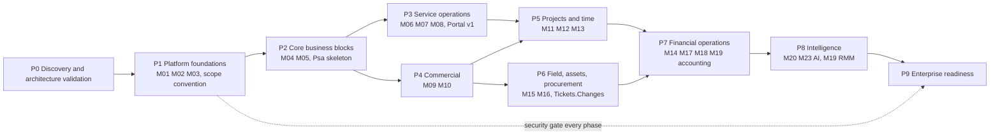

| Phase | Objectives | Modules | Prerequisites | Sequence inside the phase | Deliverables | Testing | Completion criteria | Risks and mitigation | Size |
| --- | --- | --- | --- | --- | --- | --- | --- | --- | --- |
| P0 Discovery and validation | Confirm assumptions; write ADRs; spike risky points | — | This blueprint | (1) Build and run the repo; (2) spike Inventory without Commerce feature; (3) spike YesSql volume for tasks and time entries (1M rows); (4) confirm contacts abstraction location (ADR-07); (5) confirm accounting stance (ADR-09) | ADRs 01–10 accepted; spike reports; updated estimates | Spike benchmarks | All \[Asm\] items in this document resolved or explicitly deferred | Hidden coupling found late → spikes first | S |
| P1 Platform foundations | Shared mechanisms every PSA block needs | M01, M02, M03; scope-filter convention and fixture test helper; PSA layering rule | P0 | M01 → migrate Tickets links; M02 extraction with Tickets regression; M03 rules | Record links, Boards, Approvals rules, isolation test harness | Regression suite of Tickets; isolation harness on existing modules | Tickets tests green; harness runs in CI over Tickets, Invoicing, Agreements | Regressions in Tickets → behaviour-preserving extraction with existing tests | M |
| P2 Core business blocks | Organizations, people and pricing ready | M04, M05, M21 skeleton (recipe, roles, navigation) | P1 | D3 contacts abstraction → Rates → PSA recipe and role templates | Rates block; contacts abstraction; PSA tenant setup | Rates precedence matrix; role-template permission snapshots | Fresh tenant set up by recipe; rates resolve; no `Omnichannel.Core` references from consumers | D3 touches CRM widely → do it behind adapters, module by module | M |
| P3 Service operations | Help desk competitive with leaders | M06, M07 (Email, Templates, Recurring, Catalog), M08, M22 v1 (tickets, catalog, KB) | P2 | M06 → Tickets.Email → Templates → Recurring → Catalog → KB → Portal v1 | E-mail intake; catalog; portal | W2 and W4 end-to-end; e-mail fixtures; portal isolation suite | W2 passes from e-mail to solved; portal isolation suite green | Mail provider throttling → push where available, backoff on queue | L |
| P4 Commercial management | Contracts and quotes drive service and billing | M09 (+Billing), M10, Tickets coverage switch | P2 (parallel with P3) | Entitlements + migration → coverage → kinds → additions → Agreements.Billing → Estimates enhancements | Full contract model; quotes with conversion | W1 (agreement target), W3, W8; migration tests | Six contract types billed end to end; existing agreements migrated | Billing errors → shadow-run billing against fixtures before enabling | L |
| P5 Projects and time | Project delivery and billable time | M11, M12, M13 | P3 (tickets as work items), P4 | M13 attribution → Timesheets → M11 core → scheduler → templates and billing → M12 | Projects, resource planning, timesheets | W5, W7; scheduler property tests; volume tests | Quote converts to project; timesheet approval posts once; capacity correct | Scheduler complexity → pure, property-tested component; optimizer seam later | XL |
| P6 Field, assets, procurement | CMDB, procurement and change management | M15, M16, Tickets.Changes and Tickets.Assets | P4 (parallel with P5) | M15 relationships → Tickets.Assets → Changes → M16 requisitions and serials | CMDB, change management, procurement | W6; change state machine; discovery upsert tests | Normal change needs CAB; quote hardware flows to assets | Inventory–Commerce coupling → resolved in P0 spike | L |
| P7 Financial operations | Clean month-end and accounting alignment | M14, M17, M18 (optional), M19 accounting, M22 v2 (invoices, agreements, projects) | P5, P6 | M17 review → M14 expenses → accounting sync → portal v2 → M18 if approved | Approve-and-post, expenses, accounting sync | W8, W9; month-end fixture; sync replay tests | Fixture month-end posts expected invoices exactly once | Accounting API limits → queue with retries, sync log | L |
| P8 Intelligence and automation | Insight and AI assistance | M20, M23, AI use cases (section 20), M19 RMM | P7 | Data sets per block → dashboards → KPIs and snapshots → AI triage/summary → RMM connectors | Role dashboards, KPIs, AI features, RMM integration | KPI fixtures; AI evaluation sets; alert replay | KPIs equal fixtures; AI baselines recorded; alerts de-duplicated | AI quality drift → evaluation in CI, confidence thresholds | L |
| P9 Enterprise readiness | Prove security, scale and recovery | All | P8 | Threat model review → ASVS L2 verification → pen test → load tests → DR drill → compliance evidence | Security report, performance report, runbooks, evidence exports | DAST, pen test, load and soak, restore drill | Section 23 targets met; no high findings open | Late findings → security gate in every phase (ASVS checks per module) | M |

**Parallel work \[Rec\].** Within P1, M01–M03 are independent. P3 and P4 run in parallel after P2. P5 and P6 run in parallel after P4. Inside P5, M12 can start once M11's work-item source contract exists. Integrations (M19) and analytics data sets can be built by a separate team once their source modules publish contracts.

**Sequential constraints.** M05 before M09, M10, M13; M09 before M13 posting, M14 billing and M17; M01 before Changes with CIs and Assets relationships; D3 (in M04) before M06/M07 e-mail intake and M22.

## 23. Testing and Quality Strategy

**Test-first per rule (the repository's own requirement), with four PSA-specific gates that block a release: money idempotency, data isolation, workflow end-to-end, and performance budgets.** \[Rec\]

| Level | Scope | Tools and conventions | Gate |
| --- | --- | --- | --- |
| Unit | Domain rules: rate precedence, coverage decisions, entitlement math, scheduler, SLA clocks, policy evaluation, state machines | Existing `tests/CrestApps.OrchardCore.Tests` project and Microsoft.Testing.Platform runner (`global.json`) \[V-Repo\]; property-based tests for scheduler and capacity | Every rule has a failing-first test |
| Integration | Stores, indexes, locks, migrations, resumable steps, recipes and deployment round-trips | Integration test projects like Commerce and Tenant Hierarchy \[V-Repo\]; SQLite and SQL Server (plus PostgreSQL in nightly) | Migrations up from previous release data |
| Functional / end-to-end | Workflows W1–W9 on a tenant built by the `Psa` recipe | Playwright (already used for Telephony \[V-Repo\]) | All nine workflows green |
| Isolation (security) | Every list, API, data set, search query, attachment link and AI tool for fixture users of two accounts and two tenants | Isolation harness from P1 (section 16.2) | Zero out-of-scope records |
| Money idempotency | Every posting path replayed, concurrently and after simulated crash | Integration tests with parallel tasks and fault injection | No duplicate draws, billable items, invoices or exports |
| Architecture | Layering, PSA isolation, feature-dependency cycles, duplicate patterns, feature-ID literals | Existing ratchet tests extended \[V-Repo\] | No new allowlist entries |
| Contract | API DTOs and webhook payloads per version | Snapshot tests of OpenAPI and payload schemas | No breaking change inside a version |
| Security | SAST, dependency audit, secrets scanning, DAST on staging, yearly pen test, ASVS L2 checklist per module | CI scanners; checklist in each module's README | No high findings |
| Performance | Budgets below on a reference data set (50 staff, 2,000 accounts, 500k tickets, 2M time entries, 300 projects) \[Asm\] | Benchmarks project exists \[V-Repo\]; k6 or NBomber load tests | Budgets met at p95 |
| AI evaluation | Triage accuracy, summary faithfulness, refusal of out-of-scope data | Evaluation sets with baselines | No regression beyond tolerance |

**Performance budgets \[Asm: to confirm in P0\].** Admin list pages p95 < 800 ms; ticket page p95 < 600 ms; coverage resolution p95 < 20 ms; timesheet approval of 60 entries < 3 s; project recalculation of 2,000 tasks < 2 s; resource board for 200 people × 12 weeks < 1.5 s; month-end posting of 10,000 billable items < 10 min as a background job.

**Engineering practices \[Rec\].** Trunk-based development with short-lived branches; every pull request runs unit, integration (SQLite), architecture and contract tests; nightly runs SQL Server/PostgreSQL integration, isolation harness, Playwright and load smoke; feature flags are Orchard features (enable per tenant) rather than a new flag system; database migrations are forward-only with resumable steps for data moves; observability through `CrestAppsOrchardCoreTelemetry` meters and activity sources exported with OpenTelemetry (OTLP) to the operator's backend.

## 24. Deployment and Operational Architecture

**Deploy as a stateless, horizontally scaled ASP.NET Core host with Redis for distributed locks and cache, a per-tenant SQL database, blob storage and a search service; the existing Aspire AppHost is the local and reference topology.** \[Rec\]

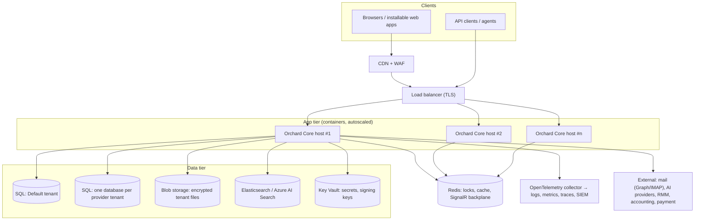

- **Hosting:** container image of the CMS web startup (`src/Startup/CrestApps.OrchardCore.Cms.Web`) with the PSA modules referenced; `src/Startup/CrestApps.Aspire.AppHost` as the reference composition for local and integration environments \[V-Repo\].
- **Background work:** Orchard background tasks run on every node under distributed locks; heavy queues (mail polling, month-end posting, sync) use leased work queues so any node can take work \[V-Repo\]. A dedicated worker node pool is optional for large SaaS installs \[Rec\].
- **Real-time:** SignalR hubs (dispatch board, ticket presence) with Redis backplane on multi-node \[Rec\].
- **Configuration:** shell configuration per tenant from environment and Key Vault; recipes for initial setup; deployment plans to promote configuration between staging and production.
- **Environments:** development (Aspire), CI ephemeral, staging (anonymised copy of a pilot tenant), production; blue-green or rolling deploys with database migrations that are backward compatible for one release.
- **Backup and DR \[Rec\]:** point-in-time restore 35 days; geo-redundant backups; targets RPO 15 min and RTO 4 h for SaaS tier \[Asm\]; quarterly restore drill of one tenant; documented tenant export (recipe + data) for exit.
- **Operations:** health checks per dependency; SLOs (availability 99.9% monthly \[Asm\], p95 latency budgets of section 23); alerting on background-task failure rates, queue age, mail sync lag, webhook delivery failures, lock contention; runbooks for mailbox re-authentication, stuck month-end, tenant restore, key rotation (`ISigningKeyRing.RotateIfDueAsync` daily task exists \[V-Repo\]).

## 25. Risks, Assumptions and Technical Decisions

**Ten architecture decisions fix the shape of the platform; each lists what was rejected and what it costs.** \[Rec\]

### 25.1 Architecture decision records

| ADR | Decision | Why | Alternatives considered | Trade-offs | Fit with Orchard Core / CrestApps |
| --- | --- | --- | --- | --- | --- |
| ADR-01 | Modular monolith, one deployable | One team owns many blocks with shared transactions; CrestApps is already built this way | Microservices; separate PSA app over CrestApps APIs | Scale by replicas, not per service; module discipline enforced by tests | Native: Orchard features are the modules |
| ADR-02 | YesSql catalogs + map indexes + distributed locks for transactional data; content items only for extensible records | Proven in Invoicing, Transactions, Payroll; one persistence model | EF Core for finance; event sourcing | No database foreign keys; integrity by services and tests; reporting through indexes | Same as every CrestApps block |
| ADR-03 | Domain events through in-process observer interfaces; integration events through outbound webhooks; durable work through leased queues | Simple, transactional, already implemented | Message broker (RabbitMQ, Azure Service Bus) and outbox per module | No cross-process pub/sub; add a broker only for a measured need (e.g. external consumers at high volume) | Uses `I*Observer`, Webhooks, `ILeasedWorkQueue` \[V-Repo\] |
| ADR-04 | CQRS-lite: commands via application services, reads via indexes and data sets; no separate read store | Read/write split where it pays (lists, reports) without dual stores | Full CQRS with projections | Some reports bounded by index design | Index providers and `IndexedReportDataSet` |
| ADR-05 | One Orchard tenant per service provider; customers are Accounts with row-level scope | Customers share staff, rates and boards inside one provider | Tenant per customer | Isolation relies on scope filters → mandatory isolation harness | Shell tenancy + scope services |
| ADR-06 | Agreements stays the single contract owner and grows; no separate "Contracts" module | Reuse ladder: owner exists; second copy would split coverage logic | New Contracts module; contracts inside Invoicing | Agreements becomes a larger module; split into features | Catalog rule: never build a concept twice |
| ADR-07 | Contacts contracts move to an Abstractions project before PSA work depends on them | D3 is open; portal, e-mail and quotes need contacts | Keep in `Omnichannel.Core` and reference it | Upfront refactor in P2 | Audit item D3 \[V-Repo\] |
| ADR-08 | Projects are catalog records with tasks as separate documents | Concurrency (many editors), volume, scheduling performance | Tasks as tickets (ConnectWise style); content items | Tasks are not tickets; a link (M01) and conversion bridge the two | Catalog managers, Boards, Record links |
| ADR-09 | The platform is a billing sub-ledger, not a general ledger; it exports to accounting; revenue recognition schedules are optional | Competitors integrate with accounting packages; GL is out of scope | Built-in GL | Some finance reports live in the accounting system | Transactions ledger stays the AR sub-ledger \[Asm: confirm with finance\] |
| ADR-10 | AI only through the existing AI suite, acting as the user, drafts by default | Permission-safe retrieval already exists; one governance point | Direct LLM calls per module | Feature velocity bound to AI suite capabilities | `AddCoreAITool`, data source filters \[V-Repo\] |

### 25.2 Risks

| Risk | Likelihood | Impact | Mitigation |
| --- | --- | --- | --- |
| Cross-account data leakage through a missed scope filter | Medium | Critical | Isolation harness in CI from P1; scope convention; security review per module |
| Billing defects (double or missed charges) | Medium | High | Idempotency keys everywhere; shadow billing runs on fixtures; approve-and-post review |
| YesSql index design limits at scale (time entries, tasks) | Medium | High | P0 volume spike; narrow indexes; archive closed periods; read-only replicas for reports |
| Agreements enhancement breaks Tickets/Work Orders integrations | Medium | High | Resumable migration with parity tests; adapters keep old interfaces |
| Orchard Core 4.0 is a preview dependency | Medium | Medium | Track releases; pin versions; upgrade tests in CI \[V-Repo: 4.0.0-preview-19240\] |
| Scope creep toward a full ERP | High | Medium | Exclusions in section 11; ADR-09 |
| Mail provider API changes and throttling | Medium | Medium | Provider abstraction; push and poll; backoff |
| AI cost and quality variance | Medium | Medium | Per-tenant metering; evaluation sets; confidence thresholds |
| Competitor feature detail unverified for ConnectWise | High | Low | Validate with MSP design partners in P0 |

### 25.3 Assumptions to confirm

- [ ] Target customers are MSPs and IT service providers first; internal IT second. \[Asm\]
- [ ] SaaS hosting with one database per provider tenant is the primary deployment. \[Asm\]
- [ ] Accounting stays in an external package (ADR-09). \[Asm\]
- [ ] Performance budgets and reference data volumes in section 23. \[Asm\]
- [ ] Offline support scope for field technicians (W6). \[Asm\]
- [ ] Inventory can run without the storefront Commerce feature after decoupling. \[Asm\]
- [ ] Session timeouts and MFA policy defaults (section 16.1). \[Asm\]
- [ ] RPO/RTO and availability targets (section 24). \[Asm\]

## 26. Final Implementation Checklist

The detailed, task-by-task version of this checklist (with files to read, steps, tests to write first and completion criteria for every task) is in [`psa-implementation-guide.md`](psa-implementation-guide.md).

**An implementing agent can work top to bottom; each item is done only when its acceptance criterion passes.** \[Rec\]

**Phase 0**

- [ ] Build and run the solution; run all existing tests and record baseline.
- [ ] Accept ADR-01 to ADR-10 or record changes.
- [ ] Spike: Inventory without storefront Commerce; YesSql volume (1M time entries, 100k tasks); contacts abstraction placement.

**Phase 1**

- [ ] M01 record links + Tickets link migration (M01-O).
- [ ] M02 Boards extraction with Tickets regression (M02-O).
- [ ] M03 Team approver rule, signed e-mail decisions, delegation (M03-O).
- [ ] Scope-filter convention documented in `building-blocks.md`; isolation harness in CI.
- [ ] Ratchet rule: nothing references `Psa*`; feature-dependency cycle test.

**Phase 2**

- [ ] M04 contacts abstraction (D3), health signals, opportunity links (M04-O).
- [ ] M05 Rates (M05-O).
- [ ] M21 skeleton: recipe, role templates, navigation.

**Phase 3**

- [ ] M06 e-mail channel with Graph and IMAP providers (M06-O).
- [ ] M07 Tickets.Email, Templates, Recurring, ServiceCatalog (M07-O).
- [ ] M08 Knowledge Base lifecycle (M08-O).
- [ ] M22 portal v1 with isolation suite (M22-O).

**Phase 4**

- [ ] M09 entitlements, migration, coverage, kinds, additions, renewals, Agreements.Billing (M09-O).
- [ ] Tickets coverage switched to `IAgreementCoverageService`.
- [ ] M10 quote sections, recurring lines, signature, conversion targets (M10-O).

**Phase 5**

- [ ] M13 attribution, timesheets, posting (M13-O).
- [ ] M11 projects, scheduler, templates, budgets, change orders, billing bridge (M11-O).
- [ ] M12 resource planning (M12-O).

**Phase 6**

- [ ] M15 CMDB relationships, licenses, discovery seam (M15-O).
- [ ] Tickets.Assets and Tickets.Changes (M07-O).
- [ ] M16 requisitions, suppliers, serials (M16-O).

**Phase 7**

- [ ] M17 approve-and-post (M17-O).
- [ ] M14 expenses (M14-O).
- [ ] M19 accounting sync (M19-O).
- [ ] M22 portal v2; M18 if ADR-09 requires it.

**Phase 8**

- [ ] M20 data sets and dashboard pages (M20-O).
- [ ] M23 KPIs and snapshots (M23-O).
- [ ] AI use cases of section 20 with evaluation baselines.
- [ ] M19 RMM connectors.

**Phase 9**

- [ ] Threat model, ASVS 5.0 L2 verification, penetration test, load and soak tests, DR drill, compliance evidence exports.
- [ ] All nine workflows pass on a fresh `Psa` tenant; no high security findings; performance budgets met.

## Appendix: Sources

All web pages retrieved on 27 November 2026.

**Repository (CrestApps.OrchardCore, commit `9b276b34`, main)**

- [github.com/CrestApps/CrestApps.OrchardCore](https://github.com/CrestApps/CrestApps.OrchardCore): `README.md`, `AGENTS.md`, `CLAUDE.md`, `Directory.Packages.props`, `global.json`
- `docs/engineering/building-blocks.md`, `docs/engineering/reusability-audit-2026-11.md`
- `src/Modules/*/README.md` and `Manifest.cs` (Tickets, Agreements, WorkOrders, Dispatch, TimeTracker, Invoicing, Assets, Inventory, Approvals, Omnichannel.Managements, Workforce, Staff, Accounts, Reports, Users)
- `src/Abstractions/CrestApps.OrchardCore.{Tickets,ServiceLevels,Agreements,Invoicing,Staff}.Abstractions/Models` and `/Services`
- `src/Core/CrestApps.OrchardCore.Omnichannel.Core/Models/OpportunityPart.cs`, `src/Core/CrestApps.OrchardCore.WorkOrders.Core/Legacy/ServiceAgreementUpgrade.cs`
- `src/CrestApps.Docs/docs/modules/tickets/*.md` and [Tickets documentation](https://orchardcore.crestapps.com/docs/modules/tickets)

**Orchard Core**

- [Data (YesSql) module](https://docs.orchardcore.net/en/main/reference/modules/Data/)
- [Tenants module](https://docs.orchardcore.net/en/main/reference/modules/Tenants/)

**Autotask PSA (Kaseya)**

- [Contracts entity (REST API)](https://ww1.autotask.net/help/Developerhelp/Content/APIs/REST/Entities/ContractsEntity.htm)
- [Creating a contract](https://autotask.net/help/Content/3_Features/6_Contracts/CreateManageContract/CreateEDITContract.htm)
- [Business cases and contract types](https://autotask.net/help/Content/3_Features/6_Contracts/AdminGeneral/BusinessCaseContracts.htm)
- [Time to Money: Contracts](https://autotask.net/help/content/6_EO/TimeToMoney/TimeMoneyContracts.htm)
- [Configuring contract features](https://autotask.net/help/Content/3_Features/6_Contracts/AdminGeneral/ContractsConfigure.htm)
- [About contracts](https://ww1.autotask.net/help/Content/6_EO/MSPPlaybook/Entities/AboutContracts.htm)
- [Introduction to service level management](https://autotask.net/help/Content/3_Features/7_ServiceDeskAutomation/ServiceLevelManagement/SLAMAIN.htm)
- [Adding and editing SLAs](https://autotask.net/help/Content/4_Admin/2FeaturesSettings/ServiceDeskTickets/SLAAdmin/SLAAddEdit.htm)
- [Change management](https://autotask.net/help/content/3_Features/7_ServiceDeskAutomation/ITIL/ChangeManagement.htm)
- [Managing change advisory boards](https://autotask.net/help/Content/4_Admin/2FeaturesSettings/ServiceDeskTickets/ChangeManagement/ChangeAdvisoryBoards.htm)
- [The Approvals tab](https://autotask.net/help/Content/3_Features/1_SharedFeatures/AccessoryTabs/Approvals_Tab.htm)
- [Incoming email processing](https://ww1.autotask.net/help/content/4_Admin/3Automation/EmailSurvey/EMAILS/IncomingEmailProcessing/INCOMINGEMAILPROCESSING.htm), [How we determine what entity to create](https://ww16.autotask.net/help/content/4_Admin/3Automation/EmailSurvey/EMAILS/IncomingEmailProcessing/What_Entity.htm), [Loops and dupes](https://autotask.net/help/Content/4_Admin/3Automation/EmailSurvey/EMAILS/IncomingEmailProcessing/Loops_Dupes.htm)
- [Basic ticket workflow](https://autotask.net/help/Content/3_Features/7_ServiceDesk/Workflows/Basic_Ticket_Workflow.htm)
- [Resource Planner (Kaseya)](https://www.kaseya.com/platform/innovations/autotask-resource-planner-early-access/), [Autotask 2026.3 release](https://www.kaseya.com/blog/autotask-2026-3-release/)
- [Autotask edition sheet](https://www.datto.com/product-assets/autotask-psa/Autotask-Edition-Sheet.pdf)

**HaloPSA**

- [Recurring invoices guide (kbid 1113)](https://halopsa.com/guides/article/?kbid=1113), [Prepay deferred revenue (kbid 2175)](https://halopsa.com/guides/article/?kbid=2175), [Automating prices (kbid 2302)](https://halopsa.com/guides/article/?kbid=2302), [Change Management (kbid 950)](https://halopsa.com/guides/article?kbid=950)
- [Recurring invoice guides](https://usehalo.com/faq-list/recurring-invoices-billing-2/), [Billing guides index](https://usehalo.com/?p=845), [Creating invoices](https://usehalo.com/faq-list/creating-invoices/), [HaloPSA Academy page 11](https://usehalo.com/faq-list/halopsa-academy/page/11/)
- [Guides index](https://halopsa.com/guides), [Pricing feature list](https://halopsa.com/?p=1698), [HaloPSA overview](https://usehalo.com/halopsa), [MSP solution page](https://usehalo.com/halopsa/solutions/msp/), [Change management](https://www.usehalo.com/platform/change-management), [HaloITSM guides](https://usehalo.com/haloitsm/guides/887)

**ConnectWise PSA**

- [SLAs and agreements](https://www.connectwise.com/platform/psa/slas), [Project management](https://www.connectwise.com/platform/psa/project-management), [Managing projects webinar](https://www.connectwise.com/webinars/psa--managing-projects), [Procurement](https://www.connectwise.com/Software/Manage/Procurement)
- [CPQ electronic orders](https://www.connectwise.com/en-au/platform/business-management/cpq/electronic-orders), [PSA + CPQ integration e-book](https://www.connectwise.com:443/globalassets/media/assets/ebook/theunparalleledintegrationconnectwisemanageandconnectwisesell.pdf)
- [Sidekick for PSA](https://www.connectwise.com/platform/ai/sidekick-psa), [ConnectWise AI](https://connectwise.com/platform/ai)
- [Escalation best practices](https://www.connectwise.com/blog/best-practices-for-escalating-tickets), [Internal IT](https://www.connectwise.com/en-au/solutions/software-for-internal-it/manage)
- Partner documentation: [Agreement type setup table](https://betterinvoice-website.pages.dev/docs/connectwise/setup-tables/agreement-type), [Using agreements](https://betterinvoice-website.pages.dev/docs/connectwise/agreements/using-agreements), [N-able: work roles vs work types](https://documentation.n-able.com/N-central/userguide/Content/Administration/PSA_Integration/ConnectWise/PSA_ConnectWise_Work_Roles_vs_Work_Types.htm), [Moovila Perfect Project](https://marketplace.connectwise.com/moovila-perfect-project), [Atera comparison (zofiQ report)](https://www.atera.com/blog/robin-vs-connectwise-sidekick/)

**Security standards**

- [OWASP ASVS repository](https://github.com/OWASP/ASVS), [ASVS summary (arc42)](https://quality.arc42.org/standards/owasp-asvs)
