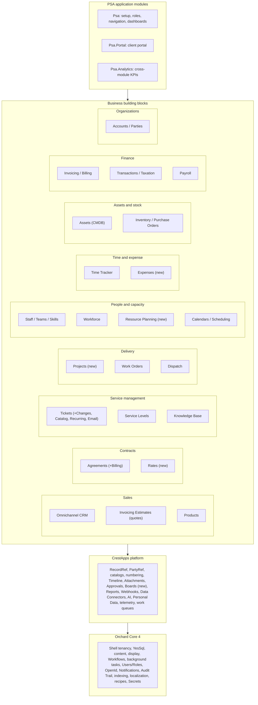
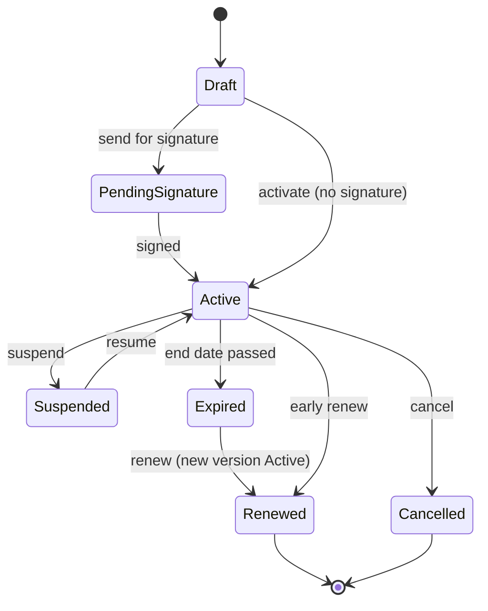
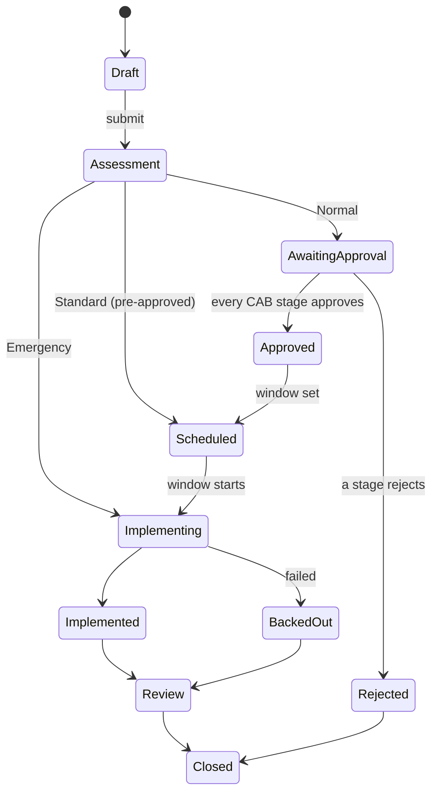
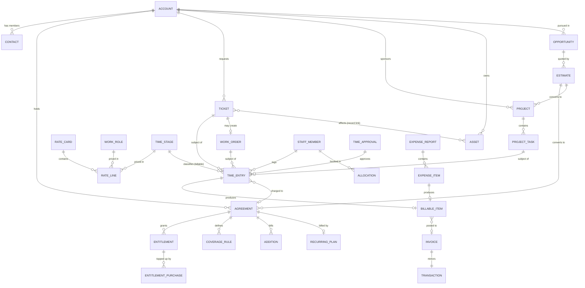
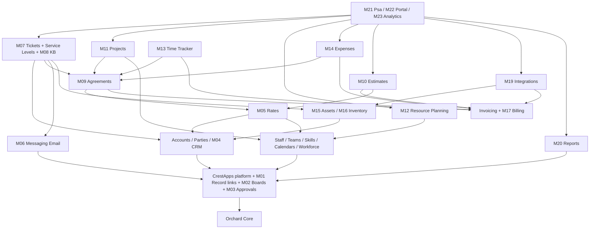
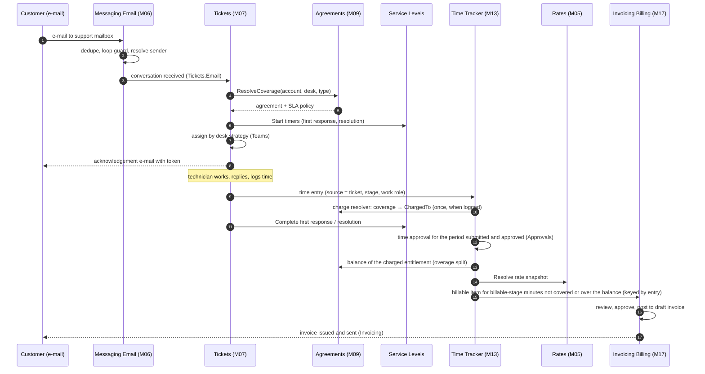
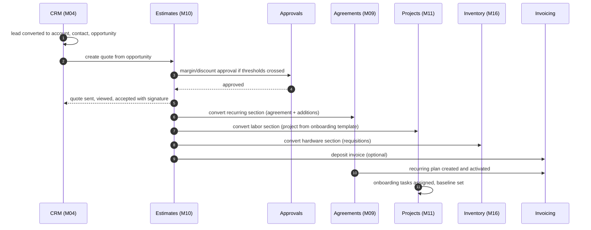
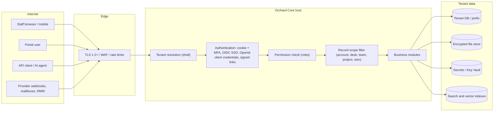
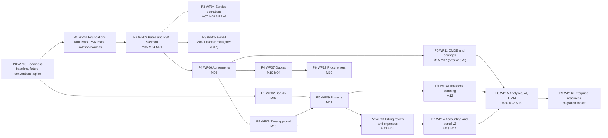
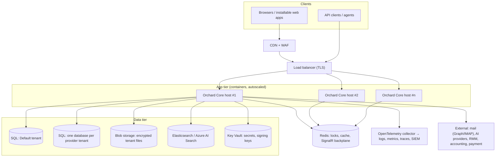

# PSA Platform Blueprint — Orchard Core + CrestApps

Status: proposal, revision 3 (27 November 2026). Every architecture decision is now taken (section 25), the plan builds on the existing ticket, agreement, time and e-mail plans and on open pull requests #817 and #1379 instead of competing with them, and competitor product names were removed as `AGENTS.md` requires. Planning document only; no implementation is included. The task-by-task guide for implementing this plan is [`psa-implementation-guide.md`](psa-implementation-guide.md).

## How to read this document

This is a planning and architecture blueprint only: it adds no code and changes no module. It is written for an AI coding agent that will implement the platform work package by work package, and for the people reviewing that agent's work.

**Evidence labels.** Every important claim carries one of these labels:

| Label | Meaning |
| --- | --- |
| **\[V-Repo\]** | Verified by reading the CrestApps.OrchardCore source at commit `9b276b34` (main, 25 Nov 2026), the engineering plans under `docs/engineering`, and open pull requests #817 and #1379. |
| **\[V-Ind\]** | Industry practice: verified in the public documentation of the leading PSA products reviewed (named only in the private research notes, see section 2), or a published standard named in the text. |
| **\[Dec\]** | A decision taken in this plan (section 25 lists every one, with its industry basis and the alternatives rejected). |

Earlier revisions used an "assumption" label. This one has none: each former assumption is now a decision in section 25.2, or a measured gate with a target the implementing agent checks (section 23).

**Research limits.**

- The product research behind sections 2 and 3 used public help centers, guides, release notes and product pages of the three leading PSA products for IT service providers. `AGENTS.md` forbids competitor product names in public docs, so this document calls them only "the leading products" and gives prevalence ("all three", "two of three"); the named research with its links is kept outside the repository.
- Orchard Core facts come from docs.orchardcore.net and from how CrestApps uses Orchard Core in its source. CrestApps targets **Orchard Core 4.0.0-preview-19240** on **.NET SDK 11.0.100** \[V-Repo\] (`Directory.Packages.props`, `global.json`).
- The repository was read, not built or run. "Implemented" below means the code, tests and docs exist; production readiness was not load-tested.
- Line counts are C# lines including blank lines and comments, used only as a rough size signal.

**Naming.** Module identifiers follow the repository convention `CrestApps.OrchardCore.<Name>` with `<Name>.Abstractions` and `<Name>.Core` projects. The PSA product modules use `CrestApps.OrchardCore.Psa.*`.

## 1. Executive Summary

**The PSA platform is built mostly by composing what CrestApps already has: 42 of the 55 capabilities traced against the leading products (76%) rest on building blocks that exist and are tested today; the work left is five new building blocks, thirteen enhancements to existing blocks, two integration blocks and three thin PSA modules, delivered as 17 work packages.** \[V-Repo\] \[Dec\]

**What already exists \[V-Repo\].** CrestApps.OrchardCore is a building-block library: 119 modules and 331 features (per its November 2026 audit), a building-block catalog (`docs/engineering/building-blocks.md`), layering rules enforced by 36 architecture tests, and approved engineering plans for the areas a PSA needs. PSA-relevant blocks that are implemented and tested:

- **Service desk:** Tickets (desks, statuses, priorities, impact and urgency matrix, boards, merge, parent/child and problem links, categories with routing, questions that follow the answers, a portal service catalog of customer-submittable types, web form, approvals, satisfaction, API, AI tools), Service Levels, Business Hours, Knowledge Base, Conditions and Conditional Fields.
- **Contracts and time:** Agreements (block of hours and monthly allowance, rounding, 80%/100% warnings, expiry, ticket and work-order coverage), Time Tracker (stages with categories such as Billable and Payable, insert over clocked time, time charged to an agreement when it is logged through `TimeEntry.ChargedTo`).
- **Field service:** Work Orders, Dispatch (with an offline technician app), Scheduling, Calendars, Geo, OrTools, Assets, Inventory with purchase orders.
- **People:** Staff (with cost and pay rates), Teams, Skills, Workforce (shifts, time clock, timesheets, time off, labor rules), Payroll.
- **Money:** Invoicing (estimates, billable charges, time billing, usage meters, recurring plans, statements, deposits, late fees, approvals, credit notes), Transactions, Taxation, Business Documents.
- **CRM and communication:** Accounts, Parties, Omnichannel CRM (leads, opportunities, contacts as parties), Messaging (SMS today; e-mail in open pull request #817).
- **Platform:** Approvals, Timeline, Attachments, Reports (with Admin Dashboard widgets), Webhooks, Data Connectors, Personal Data, AI, Tenant Hierarchy.

**What is missing \[V-Repo\] \[Dec\].** Five concepts have no owner and become new building blocks: **Projects**, **Resource Planning**, **Rates** (work roles and rate cards keyed by role and Time Tracker stage), **Expenses** and **Boards** (extracted from Tickets, as the catalog already plans). Two integration blocks follow later: **accounting sync** and **RMM connectors**. Revenue recognition stays in the accounting system (decision D-09).

**What is enhanced \[Dec\].** Agreements grows into the full contract model (recurring additions, block hours, retainer, per incident, time and materials, fixed price, unlimited) without changing how usage is counted today. Tickets gains change management, recurring tickets, ticket templates, configuration-item links, SLA attainment and escalation chains, and e-mail intake on the #817 channel; the service catalog extends the intake plan's categories instead of adding a parallel model. Time Tracker gains work roles and an approval step. Assets (after #1379) gains configuration-item relationships. Estimates become full quotes. Invoicing Billing gains one approve-and-post review.

**What the PSA product itself is \[Dec\].** Three thin modules: `Psa` (setup recipe, role templates, Get Started page, settings), `Psa.Portal` (one client portal composed from existing portal pages) and `Psa.Analytics` (cross-module KPIs). PSA adds no admin menu groups: work goes under the existing menus (section 25, D-16). Nothing outside PSA may reference PSA.

**Key decisions \[Dec\].** Modular monolith on Orchard Core; one tenant per service provider, customers isolated by scope filters; YesSql catalogs with locks and idempotency keys; in-process observers plus webhooks; billable decided by Time Tracker stage categories; time charged to an agreement when logged; contacts reached through Parties; one branch and one pull request per work package with a commit per task; additive migrations with dual-read and a verification report; golden test data authored independently of the implementation. Section 25 lists all 28 decisions with their industry basis.

**Roadmap shape.** Seventeen work packages in ten phases (section 22). Rates, the Agreements contract model and Time approval are the critical path, because billing, profitability and resource planning depend on them. E-mail intake waits for #817 and the CMDB work waits for #1379.

## 2. Industry Baseline

**The leading PSA products share one spine: a ticket or task carries time, the time is judged against a contract, and the contract decides what is billed; they differ in how configurable that spine is and how much of it sits in companion products.** \[V-Ind\]

The three products reviewed are the most widely used PSA products for managed IT service providers. Following `AGENTS.md`, they are not named here; "all three" or "two of three" gives how common a practice is. The findings below are the ones that shape this plan.

### 2.1 What the leading products do

- **Contracts are the billing engine (all three).** Six contract models recur: time and materials, fixed price with milestones, block of hours, retainer (prepaid money), per incident (prepaid tickets) and recurring service (fixed fee per unit, such as per device or per user). One product adds an umbrella contract that holds others. Work roles and work types can be excluded from a recurring contract so that labor falls through to a block-hour or time-and-materials contract. Retainers can be topped up automatically when the balance drops below a threshold.
- **Billing rate = work role × work type (all three, by different names).** A role (engineer, project manager) sets the hourly rate, a work type (remote, onsite, after hours, internal) adjusts it or makes it non-billable, and a contract can override both.
- **Recurring billing with quantity sync (all three).** Recurring lines take quantities from device or license counts, pro-rate mid-period changes, bill some lines in advance and others in arrears, and apply yearly price increases.
- **Prepaid revenue (one of three documents it).** Prepaid amounts are invoiced to a deferred-revenue item and drawn down as work is approved; recognition itself happens in the accounting package.
- **SLAs with business hours (all three).** Targets per priority for first response and resolution; one product adds a "resolution plan" event; goal percentages are reported against actuals.
- **ITIL processes (two of three document them).** Change requests are tickets of a change type with risk, plans, linked incidents and problems, and approval by a change advisory board (CAB) that can need every member or one; approvals can be given by e-mail.
- **E-mail is first-class intake (all three).** Mailboxes turn e-mail into tickets and notes, thread replies by a ticket token and message headers, ignore automatic mail and stop loops.
- **Event-condition-action workflow rules (all three).**
- **Approve and post (two of three).** Finance reviews every billable item before it becomes an invoice.
- **Procurement (all three, one natively deep).** Requisitions from quotes and projects, purchase orders, receiving with serial numbers, distributor ordering through companion products.
- **Projects (all three).** Templates, phases, tasks, Gantt and Kanban views; critical-path scheduling and capacity what-if are sold as add-ons by one product and not documented by the others.
- **Resource planning (two of three).** A planner that combines tickets, service calls and calendar availability; one product released it in 2026.
- **AI (all three).** Ticket triage (category, priority, routing), summaries, suggested resolutions from past tickets, drafted replies; one adds sentiment scoring.

### 2.2 Functional anatomy of the shared PSA spine

The table answers the brief's questions (problem, users, entities, states, interactions, automation, metrics) for each major capability as the leading products implement it. Entity lists and states are normalized by this plan.

| Capability | Business problem and users | Primary entities | Lifecycle states | Depends on / interacts with | Automation, security, metrics |
| --- | --- | --- | --- | --- | --- |
| Ticketing / incident | Capture and resolve requests; technicians, dispatchers, end users | Ticket, queue/desk, status, priority, category, note, time entry, attachment | New, Open, Pending, On hold, Solved, Closed (renameable) | Accounts, contacts, assets, SLA, contracts, KB, time | Workflow rules, e-mail intake, routing; desk permissions; volume, backlog, first-contact resolution |
| Problem | Remove root causes; problem managers | Problem, linked incidents, known error, workaround | Open, Investigating, Known error, Resolved | Tickets, changes, KB | Solving a problem solves its incidents; recurrence |
| Change | Approve and schedule risky changes; change managers, CAB | Change request, risk, plans, CAB, votes | Draft, Assessment, Awaiting approval, Approved/Rejected, Scheduled, Implementing, Implemented/Backed out, Review, Closed | Tickets, CIs, approvals, calendar | Multi-stage CAB, e-mail approval; change success rate |
| SLA | Measurable promises; service managers | Policy, target per priority, business hours, timer | Running, Paused, Completed; Breached flag | Tickets, contracts, calendars | Warning and breach escalation; attainment % |
| Contracts | Decide coverage and billing; account managers, finance | Contract, entitlement, coverage rule, addition, milestone, purchase | Draft, Active, Suspended, Expired, Renewed, Cancelled | Accounts, products, rates, time, invoicing | Renewal and threshold notices, auto top-up; profitability |
| Quoting | Price and win deals; sales | Opportunity, quote, section, line (one-time, recurring, labor), signature | Draft, Sent, Accepted, Declined, Converted | Products, rates, CRM, procurement, contracts, projects | Margin approval, e-sign, conversion |
| Projects | Fixed-scope delivery; PMs, engineers | Project, phase, task, dependency, milestone, baseline, budget, template | Planning, Active, On hold, Completed, Closed | Quotes, contracts, resources, time, invoicing | Templates, Gantt, Kanban, budget alerts; margin, variance |
| Resource planning | Match demand to capacity; resource managers | Person, role, skill, availability, allocation | Soft, Hard, Released | Workforce, calendars, tickets, projects | Utilization, over-allocation |
| Field service | Right technician on site; dispatchers | Work order, visit, route, part, signature | Scheduled, En route, On site, Completed | Tickets, assets, inventory, contracts | Optimised scheduling, offline mobile; first-time fix |
| Time and expense | Capture billable effort and cost; everyone | Time entry, approval period, expense report, receipt | Draft, Submitted, Approved, Posted | Tickets, projects, contracts, payroll, invoicing | Approval chains; utilization, unbilled WIP |
| Billing | Turn approved work into invoices; finance | Billable item, invoice, credit note, recurring plan | Pending, Approved, Posted, Invoiced, Paid | Contracts, time, expenses, products, accounting | Approve and post, grouping, accounting sync; AR |
| Procurement and inventory | Buy and track hardware; purchasing | Requisition, purchase order, receipt, stock, serial | Requested, Ordered, Received, Delivered | Quotes, projects, tickets, assets | Supplier ordering, reservations |
| Portal and KB | Self-service; end users, client admins | Portal user, catalog item, article | Draft, Published, Retired | Tickets, approvals | Deflection rate |
| AI | Faster service; technicians | Summary, suggestion, draft | n/a | Tickets, KB, history | Human approval of AI writes |

## 3. Capability Comparison

**The leading products are at parity on the ticket-to-invoice spine; the differences that matter are recurring-billing configurability, documented contract models with e-mail processing, and procurement depth.** \[V-Ind\]

Prevalence: **3/3** all three leading products document it · **2/3** two do · **1/3** one does · **companion** offered through a companion product or certified add-on.

| Capability | Prevalence | Advanced or distinctive aspect |
| --- | --- | --- |
| Queues/desks with own statuses and SLAs | 3/3 | Per-queue workflows and statuses |
| E-mail to ticket, threading, loop and duplicate handling | 3/3 | One product also creates time entries and approvals from e-mail |
| Workflow rules (event, condition, action) | 3/3 | — |
| SLA with business hours and priority matrix | 3/3 | Resolution-plan event (1/3) |
| Problem management | 2/3 | Problem solves its incidents |
| Change management with CAB | 2/3 | E-mail approval (1/3) |
| Parent/child and related tickets | 3/3 | — |
| Recurring / scheduled tickets | 2/3 | — |
| Customer portal | 3/3 | — |
| Knowledge base | 3/3 | AI article drafts (1/3) |
| Service catalog / request forms | 3/3 | — |
| Six contract models | 3/3 | Retainer auto top-up (1/3) |
| Covered and excluded roles and work types | 3/3 | Excluded labor rolls to another contract (1/3) |
| Recurring billing with quantity sync and pro-rata | 3/3 | Creation periods, advance and arrears lines (1/3) |
| Deferred revenue for prepaid work | 1/3 | — |
| Opportunities and pipeline | 3/3 | — |
| Quotes with recurring lines and e-sign | 3/3 (2 companion) | — |
| Sales orders | 2/3 | — |
| Procurement | 3/3 | Distributor e-ordering (companion) |
| Projects with templates, phases, tasks | 3/3 | — |
| Gantt, dependencies, critical path | 3/3 basic, critical path companion | — |
| Resource / capacity planning | 2/3 | — |
| Dispatch | 3/3 | — |
| Time and expense with approvals | 3/3 | — |
| Approve and post | 2/3 | — |
| Accounting package sync | 3/3 | — |
| RMM and security alerts to tickets | 3/3 | Vendor integrations |
| Assets / configuration items with relationships | 3/3 | — |
| AI triage, summary, suggestions | 3/3 | Sentiment (1/3) |
| Dashboards and reports | 3/3 | — |
| REST API and webhooks | 3/3 | — |
| Documented per-customer data separation | 1/3 | — |

### 3.1 Common, distinctive and missing

- **Industry baseline (3/3):** ticketing with queues, SLAs in business hours, contracts that decide billing, time capture, invoicing with accounting sync, projects with templates, dispatch, assets, portal, KB, opportunities, quoting, RMM integrations, REST API, AI ticket assistance.
- **Opportunities for this platform \[Dec\]:** native critical-path projects with baselines, documented and tested per-customer isolation, and recurring billing as configurable as the best of the three, all in one product without companion licences.

### 3.2 Industry-standard capability set

A complete PSA provides the 32 capabilities in the table plus three platform qualities: permissions by queue and customer, an audit trail of every change that affects money, and an API covering every entity. Section 21 traces these 35 items, split finer and extended with the brief's workforce, finance and platform items, as 55 rows.

## 4. Orchard Core Architecture Assessment

**Orchard Core supplies the whole application platform the PSA needs (modules, tenancy, identity, permissions, content, workflows, background work, search, localization, recipes); the PSA should add business modules on top and never replace any of these.** \[Dec\]

CrestApps pins Orchard Core **4.0.0-preview-19240** \[V-Repo\]. Orchard Core is a modular, multi-tenant application framework on ASP.NET Core; each tenant ("shell") has its own service container, enabled features, settings and database configuration. Orchard Core stores documents and indexes in a relational database through YesSql, and provider, connection string, table prefix and schema are tenant settings ([Data docs](https://docs.orchardcore.net/en/main/reference/modules/Data/)); when tenants share a database, the table prefix isolates each tenant's tables, and `RequireTablePrefix` can enforce it ([Tenants docs](https://docs.orchardcore.net/en/main/reference/modules/Tenants/)). \[V-Ind\]

| Orchard Core capability | What it gives | How CrestApps already uses it \[V-Repo\] | Role in the PSA \[Dec\] | Limits to plan for \[Dec\] |
| --- | --- | --- | --- | --- |
| Modules and features | Manifest-declared features with dependencies, enabled per tenant | 119 modules, 331 features, feature IDs as constants (`FeatureIdLiteralRatchetTests`) | Each building block and PSA module is a feature; editions are feature sets | Feature dependency graphs must stay acyclic (section 14) |
| Shell tenancy | Isolated container, settings and DB per tenant | Tenant Hierarchy provisions child tenants and their databases | One tenant per service provider (MSP); SaaS provisioning via Tenant Hierarchy | Not a customer-of-customer boundary; account isolation is row-level (section 17) |
| YesSql data | Documents plus map/reduce index tables, per-tenant session (unit of work) | `DocumentCatalog`, `ICatalog` managers, index providers, `ResumableSteps` for long upgrades | All PSA records | No relational foreign keys; integrity by services, locks and indexes (ADR-02) |
| Content management | Content types, parts, fields, drivers, handlers, versioning | Tickets, opportunities, KB articles, accounts are content items with parts | Records that admins extend with fields (tickets, articles, CRM) | Content items are heavier than catalog records; not for high-volume ledgers |
| Display management | Shapes, display drivers, placement | Editors built from drivers so other modules add cards (`IDisplayManager<T>`) | Every PSA editor is driver-based so modules extend it | Plain controller forms block extension (audit section 5) |
| Workflows | Event-activity graphs, tasks, timers, HTTP triggers | Tickets, Invoicing, Approvals, Payroll publish workflow events and tasks | Customer-configured automation (event-condition-action rules, as in the leading products) | Long-running graphs need care; keep money logic in services, not workflows |
| Background tasks | Scheduled per-tenant tasks with distributed lock | SLA monitor, agreements expiry, recurring invoices, auto-close | Timers, recurring generation, sync jobs | Must use `BackgroundTaskTelemetry` and idempotent work |
| Distributed locks and cache | `IDistributedLock`, Redis option | `LockAllAsync`, ticket lock, sequence lock | Every state change of money or capacity | Multi-node requires Redis (section 24) |
| Users, roles, permissions | Identity, roles, permission providers, authorization handlers | Per-desk permission templates, `SearchUsers`, role grants | Role templates per PSA persona | Roles alone cannot express "this customer's records" (scope services do) |
| OpenId (OpenIddict) | OAuth 2.0 / OIDC server and client | API auth scheme for module APIs, LTI and xAPI clients | API clients, SSO (Entra ID, Okta), mobile app tokens | Token lifetimes and scopes per client to configure |
| Notifications | In-app notifications with types | `AddNotificationType`, approval and ticket notices | Assignee, approver and SLA warning notices | E-mail and push are separate channels |
| E-mail / SMS | Outbound e-mail and SMS providers | `ITemplatedEmailSender`, Omnichannel SMS | Requester e-mails, invoices, reminders | Inbound e-mail is not provided (gap) |
| Audit Trail | Audited events with diff | Tickets and Time Tracker write audit events | Financial and permission changes | Retention must be configured |
| Indexing and search | Lucene, Elasticsearch, Azure AI Search | AI data sources, product search | Global search over tickets, KB, accounts | Search indexes must honour scope (CrestApps `IIndexedDocumentVisibility`) |
| GraphQL | Read API over content | Not central in CrestApps | Optional read API for content types | Catalog records are not exposed by default; prefer module REST APIs |
| Localization | Cultures, PO files, `IStringLocalizer`, `ILocalClock` | Dates converted with `ILocalClock` (repository rule) | Multi-language UI, per-user time zones | Money and tax localization by CrestApps blocks |
| Media | Media library, file stores | Attachments uses an encrypted tenant file store instead | Logos and public media only | Customer files go to Attachments / protected files |
| Recipes and deployment | Declarative setup, import/export | Recipe and deployment steps for every catalog record | PSA setup recipe, demo data, environment promotion | Schemas must be kept current (`ConfigurationSchema.json`) |
| Settings | Site settings, settings drivers, shell configuration | Protected settings for secrets (`ProtectedSettingExtensions`) | PSA settings pages | Secrets belong in Orchard Core Secrets |
| Secrets | Secret store abstraction | Signing keys (`RsaKeySecret`) | Integration credentials, API keys | Key vault backing per deployment |
| Admin UI | Admin theme, `AdminList`, action bars | Required `<admin-list>` and `action-bar-bottom` patterns | All PSA lists and editors | Dense operational boards need custom views (Boards) |
| Logging and telemetry | ILogger; OpenTelemetry via ASP.NET Core | `CrestAppsOrchardCoreTelemetry` meters and activity sources | Business metrics and traces | Tag cardinality rules (`BannedMetricTagKeys`) |

**Verdict \[Dec\].** Nothing in Orchard Core needs replacing. Two capabilities need additions in CrestApps rather than in Orchard Core: inbound e-mail (an Omnichannel Messaging channel) and customer-scoped authorization (already solved per module by scope services, to be standardised in section 16).

## 5. CrestApps.OrchardCore Repository Audit

**The repository is a disciplined building-block library, not an application: each concept has one owner, extension is by drivers, observers and registration helpers, and the layering rules are enforced by tests.** \[V-Repo\]

### 5.1 Structure and engineering rules \[V-Repo\]

- **Layout:** `src/Abstractions` (73 projects), `src/Core` (85), `src/Modules` (\~190 module folders), `src/Startup` (CMS host, Aspire AppHost, samples), `src/Targets` (one package that pulls the CMS core set), `tests` (unit tests, integration tests for Commerce, Learning and Tenant Hierarchy, distributed tests for Contact Center, Playwright tests for Telephony, benchmarks).
- **Layering:** `.Abstractions` holds contracts and records; `.Core` holds implementations, stores and indexes; the module holds manifests, drivers, controllers, views, migrations, recipes and endpoints. A module never uses a type from another module's assembly; `.Core` never references a module. `LayeringRatchetTests` enforce this with empty allowlists (`docs/engineering/reusability-audit-2026-11.md`, section 0).
- **Reuse ladder:** use, extend, add the missing extension point to the owner, extract a building block when a second module needs a concept, keep private only when unique (`docs/engineering/building-blocks.md`, section 1). This blueprint follows the same ladder.
- **Shared primitives:** `RecordRef { Kind, Id }` links any record; `PartyRef` names who a record belongs to; `TransitionTable<TEnum>` for state machines; `ConditionRule` for "show or apply when"; `INumberSeries` for gap-free numbering; `Money` and `CurrencyScale`; `CatalogAdminController<T>`; `ILeasedWorkQueue<T>`; `IRetentionPolicy`; `ISensitiveValueProtector`; `SignedTokenService`; `MapModuleApi` with idempotency filters.
- **Quality gates:** ratchet tests for duplicated patterns, feature-ID literals, empty catches, time-zone pickers; all 23 defects from the November 2026 audit fixed with regression tests; every module has a README.
- **Known open items** (audit section 0, still open): Customer not yet linked to Account, Vendor not an Account, contacts abstraction (D3) not started (not a PSA prerequisite, D-07), Messaging first-response timer not on Service Levels, Contact Center routing still reads a skills mirror, a few in-memory paging lists, `Omnichannel.Core` still references `AI.Core`.

### 5.2 Audit of PSA-relevant modules

Status key: **Implemented** = code, tests, docs and recipe steps exist · **Partial** = works but lacks capabilities the PSA needs · **Absent** = no owner. Size = approximate C# lines in module + Core + Abstractions / test lines. \[V-Repo\]

| Module (feature) | Responsibility and main entities | Services and extension points | Persistence | UI, API, permissions, automation | Status, size | Strengths / weaknesses for PSA |
| --- | --- | --- | --- | --- | --- | --- |
| **Tickets** (+ Portal, Web Form, Approvals, API) | Help desk. `TicketPart` on any ticket content type: number, desk, status and category (New, Open, Pending, OnHold, Solved, Closed), priority, impact, urgency, requester `PartyRef`, account, team, assignee, participants, links (Related, Parent, Child, Duplicate, FollowUpOf, Problem), merge, CSAT, escalation level, agreement. `TicketDesk` (hours, SLA policy, assignment strategy, priority matrix, auto-close), `TicketBoard`, `TicketView` | `ITicketService`, `ITicketAccessService` + `TicketScopeFilter`, `ITicketObserver`, `ITicketActionSource`, `ITicketReplyTemplateSource`, `ITicketAgreementResolver`, `ITicketCategoryService` | Content items + `TicketIndex`, `TicketLinkIndex`, `TicketBacklogIndex` | Lists, boards, planning, portal, web form widget; `api/tickets/v1`; per-desk permissions with all / my teams / mine scopes; workflow events and tasks, webhooks, audit, 5 reports, AI tools | Implemented, \~34.8k / 11.3k | Strong, ITIL-shaped. Missing: inbound e-mail, change records, recurring tickets, ticket templates, service catalog, CI links, work role/type on time |
| **Service Levels** | Policies (targets per metric and priority, hours schedule, warning %) and timers on any `RecordRef` | `IServiceLevelTracker` (start, pause, resume, complete, reopen, cancel, retarget), `IServiceLevelObserver`, scope providers, timer access providers | Catalog + indexes | Policy editor, `ServiceLevelTimers` data set | Implemented, \~3.7k / 1.3k | Generic and correct. Missing: goal % attainment, escalation chains (observer-based, to add) |
| **Business Hours** | Weekly hours and holidays (`HoursSchedule`) | `IOpenHoursService`, `IHoursScheduleSource`, workflow task | Catalog | Content > Business Hours | Implemented, \~2.3k / 1.1k | Shared by Tickets, Service Levels, Contact Center |
| **Agreements** | `Agreement`: number, status, account, start/end, time zone, hours (block or monthly allowance, rounding 0/6/15/30 min), expiring notice, warnings, `Properties` for modules' terms | `IAgreementManager`, `IAgreementUsageProvider`, `IAgreementBalanceService`, `IAgreementObserver`, `IAgreementTermsValidator` | Catalog | Admin pages, account tab, recipe/deployment, background expiry | Implemented, \~2.8k / 0.4k | Right owner, too narrow: hours only; no money, incidents, recurring lines, coverage rules, renewals, billing link |
| **Work Orders** (+ Service Agreements) | Jobs: types, lines, checklists (`ConditionRule`), signatures, notes, follow-ups, sub-statuses, SLA scope, recurring schedules on Agreements | `IWorkOrderHandler`, `IWorkOrderObserver`, `IWorkOrderBilling` | Catalog + indexes | Admin, workflow events; parts from Inventory; invoices via Invoicing | Implemented, \~11.2k / 2.2k | Legacy service agreements migrated onto Agreements (`ServiceAgreementUpgrade`) |
| **Dispatch** (+ Technician Mobile, API) | Visits per work order, candidate search by skills, certifications, territory, shifts, time off, travel; assignment under per-technician lock; live board | `IDispatchOptimizer`, `IDispatchCandidateFinder`, `IVisitObserver` | Catalog + calendar jobs | Board with timeline, queue, map (SignalR) | Implemented, \~13.6k / 5.8k | OrTools plugs in as optimizer |
| **Time Tracker** | Stages with categories (Billable, Payable…), clock in/out, entries with source and source reference, insert over clocked time, `ChargedTo` (agreement charged when logged), manager edits with reasons | `ITimeTrackerService`, `IExternalTimeClock`, `ITimeEntryObserver` | Catalog | My time, Hours by Category report | Implemented, \~4.9k / 1.2k | Missing: work role, work type, billable status, approval, agreement attribution, timesheet submission |
| **Workforce** (+ Shift Planning, Time Off, Labor Rules, Time Clock, Portal, API) | Shifts, coverage, punches, timesheets, attendance, pay periods/codes, payroll export, time off with accrual | `IShiftScheduleSolver`, `ILaborRule`, `ITimeOffApprovalHandler`, `IPayrollExportProvider`, `IWorkedTimeSource` | Catalog, quantity ledger | /my-work portal, kiosk, API | Implemented, \~53.9k / 12.4k | Attendance and pay oriented; not project time |
| **Staff** (+ Compensation, Badges, Org Chart) | `StaffMember` with or without user; pay rates (hourly, salary, cost, commission, by activity code and date) | `IStaffMemberManager`, `IStaffDirectory`, `IStaffHierarchy`, `IStaffScopeService`, `IStaffLifecycleObserver` | Catalog | Staff profile with page sections | Implemented, \~9.1k / 2.2k | Gives cost rates; no billing rates |
| **Teams / Skills** | Team tree, assignment (round robin, least loaded, skills); skills, proficiencies, certifications, certificates | `ITeamAssignmentService`, `ITeamMemberLoadSource`, `ISkillAssignmentService`, `SkillRequirement` | Catalog | Pickers, editors | Implemented, \~3.0k / 0.6k and \~9.7k / 2.6k | Reusable for project staffing |
| **Calendars / Scheduling** | Events, recurrence (RRULE), free/busy, reminders, feeds; bookable appointments and resources | `AddCalendarType`, `ICalendarBusyTimeSource`, `ICalendarAvailabilityService`, `IAppointmentSlotFilter` | Catalog | Team, resource, office calendars; self-service booking | Implemented, \~23.6k / 3.8k and \~11.4k / 3.5k | Capacity source for resource planning |
| **Accounts** (+ Members, Team, E-mail Domains, Locations; B2B) | Organizations as `AccountPart` content items, child records via `ListPart` | `IAccountMemberService`, `IAccountContactFinder`, `IAccountChildTypeRule` | Content items | Account page with sections, picker | Implemented, \~5.5k / 2.0k | Owner of "company"; hierarchy rules exist |
| **Omnichannel CRM** (Managements, Activities, CRM) | Contacts, leads, opportunities (`OpportunityPart`: stage, probability, amount, close date, owner, campaign, primary contact), stages, campaigns, activities, dispositions | `IOmnichannelContactTypeProvider`, opportunity stage handlers | Content items | Admin screens, pipeline report | Implemented, \~44.1k (tests in the Omnichannel suite) | Contact contracts not in an Abstractions project (D3 open); no opportunity-to-quote link |
| **Invoicing** (+ Estimates, Billing, Recurring, Collections, API) | Invoices, credit notes, estimates, billable items, usage meters, recurring plans, statements, deposits, late fees | `IInvoiceManager`, `IInvoiceCommandService`, `IEstimateCommandService`, `IBillableSource`, `IBillingService`, `IRecurringPlanService`, `IUsageService`, `IInvoiceObserver` | Catalog on Transactions ledger | Commerce > Invoices etc.; API; 9 workflow events; 6 reports; AI tools | Implemented, \~30.4k / 7.6k | Very strong. Missing: agreement-driven billing, one approve-and-post queue, quote conversion to agreements/projects |
| **Transactions / Taxation / Business Documents / Payment Terms** | Ledger, payments, terms; tax engine; printable documents | `Transaction`, `IPaymentTermCalculator`, `IDocumentTaxProvider`, `IBusinessDocumentPdfRenderer` | Catalog | Admin | Implemented, \~19.9k / 10.3k, \~25.3k / 7.1k, \~4.1k / 1.3k | Reuse as is |
| **Assets** (+ Fleet) | Asset types (attributes, meters), assets owned by business/customer/company, hierarchy, location, warranty, documents, meter readings | `Asset`, `AssetOwners.ToParty` (owner as a party) | Catalog | Admin, equipment calendar | Implemented, \~4.0k / 0.8k | Missing: CI relationships, ticket links, discovery sync |
| **Inventory** (+ Purchase Orders, API) | Stock per product/variant and location, history, purchase orders and receiving | `IInventoryService`, `IStockLevelObserver`, `IPurchaseOrderStore` | Catalog | Commerce > Inventory | Implemented, \~10.0k / 3.3k | Depends on the Commerce feature; no requisitions from projects or tickets; serial tracking to verify |
| **Products** | Sellable products, prices, bundles | `ProductPart`, `IPriceResolver`, `IBuyerPriceProvider` | Content items | Catalog API | Implemented, \~20.6k / 5.0k | Service/labor items and recurring pricing to model |
| **Approvals** | Approval types, policies by amount and scope, up to 10 stages, approver rules (permission, role, users, manager, staff) | `AddApprovalType`, `IApprovalService`, `IApprovalObserver`, `AddApproverRuleProvider` | Catalog | Waiting for me, notifications, workflow events | Implemented, \~6.6k / 2.2k | CAB = policy with stages; add team-based approver rule |
| **Knowledge Base** | `KnowledgeArticle` content type, `/help` center, suggest API, role-restricted via Content Access Control | Suggest endpoint | Content items | Help center | Implemented, \~2.8k / 0.9k | Missing: ticket-to-article, article lifecycle (review dates), internal/external split beyond roles |
| **Reports** (+ Subscriptions, Builder) | Report designer, data sets, exports (CSV, OpenXml, PDF), subscriptions, widgets | `IReport`, `IReportRunner`, `IndexedReportDataSet`, `IReportExportFormat` | Indexed data sets | Designer, widgets | Implemented, \~30.8k / 25.8k | Basis for PSA analytics and dashboards |
| **AI suite** | Profiles, tools, agents, MCP, A2A, data sources with result filters, memory, documents | `AddCoreAITool`, `IAIDataSourceResultFilter`, `ITemplateService` | Catalog + vector stores | Chat, admin widget, MCP server | Implemented, \~53.3k / 26.7k | Tickets and Invoicing already ship AI tools |
| **Platform blocks** | Timeline, Attachments, Webhooks, Data Connectors, Personal Data, Tenant Hierarchy, Content Access Control, Wizard, Conditional Fields | See catalog | Catalog / file stores | Shared editors and endpoints | Implemented | Reuse as is |
| **Projects, Resource Planning, Rates, Expenses, Boards (shared)** | — | — | — | — | **Absent** (searched by name and meaning) | New building blocks (section 8) |

Repository files supporting the table: module READMEs under `src/Modules/*/README.md`; models under `src/Abstractions/CrestApps.OrchardCore.{Tickets,ServiceLevels,Agreements,Invoicing,Staff}.Abstractions/Models`; `src/Core/CrestApps.OrchardCore.Omnichannel.Core/Models/OpportunityPart.cs`; `src/CrestApps.Docs/docs/modules/tickets/*.md`; `docs/engineering/building-blocks.md`; `docs/engineering/reusability-audit-2026-11.md`.

### 5.3 Existing plans and open pull requests

**This plan builds on the approved plans below and on two open pull requests; where it changes one of them, the row says so. When this plan and an older plan disagree on something not listed here, the older approved plan wins and the implementing agent stops and asks.** \[V-Repo\] \[Dec\]

| Plan or pull request | Status today | Relationship to this plan |
| --- | --- | --- |
| `docs/engineering/tickets/ticket-support-plan.md` | Approved; phases 1–4 built | Foundation. Its concept map (record links as `RecordRef`, Timeline, Attachments, Business Hours, Service Levels, templated e-mails, reply templates) is reused unchanged. Its §6.4 says ticket e-mail is built on #817; this plan keeps that (M07 `Tickets.Email`). |
| `docs/engineering/tickets/ticket-intake-plan.md` | Approved, phases 0–4 built | The service catalog **is** this plan's catalog: customer-submittable ticket types, taxonomy categories with routing (`TicketCategoryPart`), questions that follow the answers. M07 adds only what its §12 lists as "not in this plan": approval steps per category, fulfilment child tasks, audience by account. No `ServiceCatalogItem` content type. |
| `docs/engineering/tickets/ticket-boards-plan.md` | Built | M02 extracts what it built into a shared Boards block, as `building-blocks.md` prescribes for the second consumer, with ticket boards unchanged. |
| `docs/engineering/tickets/ticket-time-agreements-reports-plan.md` | Built (slices 1–7), decisions approved | Binding. Kept: billable decided by the desk's Time Tracker stages and their categories, not a per-entry flag (its decision 6); time charged to the ticket's agreement when logged (`TimeEntry.ChargedTo`, `ITimeEntryChargeResolver`) and never moved later (decision 4); keep working past 100% and bill the overage (decision 3); the agreement's policy before the account's (decision 5). M09 and M13 extend these designs, they do not replace them. |
| `docs/engineering/workforce/time-tracker-people-teams-review.md` | Decided | Binding: one stage concept (Time Tracker stages; Workforce activity codes point at stages); Workforce timesheets keep pay codes. This plan uses Time Tracker stages as the "work type" of the industry model (D-11) and does not add a second timesheet record (D-12). |
| `docs/engineering/workforce/workforce-management-plan.md` | Design finalized, largely built | Reused for capacity (shifts, time off, availability) in M12. No change. |
| `docs/engineering/staff/staff-plan.md` | Implemented | Staff is the person record for every PSA role; M05 adds a default work role to the Staff editor through a display driver. |
| `docs/engineering/accounts/accounts-plan.md` | Built | Accounts are content items with Orchard content permissions (no `ManageAccounts`); the PSA follows that. |
| `docs/engineering/invoicing/invoicing-plan.md` | Built | Invoicing owns documents, billable sources and recurring plans; M10, M17 and `Agreements.Billing` extend it through its extension points. |
| `docs/engineering/calendar/calendar-scheduling-plan.md` | Built | Change calendar and project calendar are calendar types (`AddCalendarType`). |
| `docs/engineering/omnichannel/lead-management-plan.md` | See plan | CRM leads and opportunities are reused; M04 only links opportunities to quotes. |
| Pull request **#817** (open): e-mail channel `Omnichannel.Messaging.Email` and AI e-mail automation | Open | Prerequisite of `Tickets.Email`. M06 is reduced to the delta on top of #817: OAuth (XOAUTH2) mailbox sign-in for Microsoft 365 and Google, and Microsoft Graph / Gmail push as further inbound sources, which #817 lists as open follow-ups. `IEmailInboundReceiver`, `IInboundEmailWebhookParser`, `IEmailTransport` and `IEmailSendingGovernor` are consumed, never re-modelled. |
| Pull request **#1379** (open): Assets delete guard (`IAssetUsage`), plate and VIN without Fleet, category lookup, extensible asset page (`DetailAdmin`) | Open | Prerequisite of M15. CMDB relationships add cards to the extensible asset page and register `IAssetUsage` so a linked CI cannot be deleted. |

Corrections to revision 1 found while reconciling \[V-Repo\]: Assets has no `IAssetOwnerSource`; asset owners are read as parties through `AssetOwners.ToParty(asset)` and `PartyRef`. Contacts are already reachable from any module through Parties (`ContactPartySource` registered by Omnichannel Managements), which is why decision D-07 no longer requires moving contact contracts first.

## 6. Existing Building Block Inventory

**For the PSA, 51 existing building blocks are reused: 38 as they are and 13 with enhancements.** \[Dec\]

| Group | Reuse as is | Reuse with enhancement |
| --- | --- | --- |
| Platform | Orchard Core (all of section 4), CrestApps Core primitives, Timeline, Attachments, Webhooks, Data Connectors, Personal Data, Tenant Hierarchy, Content Access Control, Conditional Fields, Wizard, Numbering, Business Documents | Approvals (team approver rule, e-mail decisions), Reports (PSA data sets and role dashboards) |
| People and organizations | Parties, Staff, Teams, Skills, Addresses, PhoneNumbers, Geo | Users (session and MFA policy, D-20), Accounts (health score provider, account hierarchy roll-ups), Omnichannel CRM (opportunity-to-quote) |
| Time | Calendars, Business Hours, Scheduling, Workforce, Service Levels | Time Tracker (work role, time approval, rate snapshot) |
| Service and field work | Work Orders, Dispatch, OrTools | Tickets (changes, recurring, templates, catalog, CI links, e-mail bridge), Knowledge Base (lifecycle, ticket-to-article), Assets (CI relationships), Agreements (full contract model) |
| Money | Transactions, Taxation, Payment Terms, Exchange Rates, Payroll | Invoicing (quote conversions, approve-and-post), Inventory (requisitions, decouple from Commerce feature) |
| Communication and AI | Notifications, Templated e-mails, Outreach, Consent, AI suite | Omnichannel Messaging E-mail (OAuth and push sources on #817) |

## 7. Reusable Building Block Assessment

**Every gap was put through the repository's reuse ladder; five concepts lack an owner, and six cross-cutting abstractions keep PSA rules out of shared blocks.** \[Dec\]

### 7.1 Assessment criteria

Each candidate was scored against the brief's ten building-block tests (single responsibility, coherent capability, clear entities, reusable services, no application dependency, extensibility, permissions, integration points, testable alone, reusable elsewhere). A concept becomes a **new block** only if (a) no module owns it by name or meaning, and (b) at least two consumers exist or are planned. Otherwise it is an **enhancement** of the owner, a **PSA module** concern, or a **platform** capability.

### 7.2 Cross-cutting abstractions

| # | Abstraction | Owner | Problem it solves | Consumers |
| --- | --- | --- | --- | --- |
| A1 | **Work item source** `IWorkItemSource` (open `Kind`): title, account, assignee(s), planned start and end, estimate, status category, `RecordRef` | `ResourcePlanning.Abstractions` | Resource planning and AI read tickets, project tasks, visits and work orders without referencing their modules | Tickets, Projects, Dispatch, Work Orders |
| A2 | **Coverage service** `IAgreementCoverageService.ResolveAsync(CoverageRequest)` → agreement and covered or not | `Agreements.Abstractions` | Tickets matches agreements privately (`ITicketAgreementResolver`, `TicketAgreementTerms`); Projects and Work Orders need the same decision. The existing `ITimeEntryChargeResolver` implementations call it, so time is still charged when logged | Tickets, Work Orders, Projects, Expenses |
| A3 | **Rate resolution** `IRateResolver.ResolveAsync(RateRequest)` → bill rate, cost rate, source | `Rates.Abstractions` | Bill rates are typed by hand in Invoicing Billing; cost sits on Staff; the industry keys rates on role × work type | Time approval, Invoicing Billing, Projects, Estimates, Analytics |
| A4 | **Entitlement usage in units**: `AgreementUsage` gains a unit (minutes, money, incidents) so the existing usage providers and balance service count every entitlement kind | `Agreements.Abstractions` | Hours-only usage cannot express retainers or per-incident contracts; a separate ledger would duplicate what the providers already compute (D-06) | Agreements, Tickets, Work Orders, Projects, Invoicing |
| A5 | **Boards** (columns of statuses, cards, move endpoint) | New `Boards` block | Tickets has the only board; Projects and CRM need one | Tickets, Projects, CRM, Work Orders |
| A6 | **Typed record links** `IRecordLinkService` (kind-typed links between two `RecordRef`s, indexed both ways) | `CrestApps.OrchardCore.Abstractions` (contracts), `CrestApps.OrchardCore.YesSql.Core` (index and store), Resources module (migration, view component) — D-15 | Tickets keeps ticket-to-ticket links in its own `TicketLinkIndex`; ticket-to-asset, change-to-CI, task-to-ticket and article-to-ticket need the same mechanism | Tickets, Assets, Projects, Knowledge Base |

### 7.3 Improvements to existing blocks

- **Agreements:** add agreement kinds, entitlements (hours, money, incidents, unlimited) with purchases (top-ups), coverage rules, additions, milestones, renewals and amendments; billing through Invoicing recurring plans in a bridge feature. Usage stays computed by `IAgreementUsageProvider`s (A4).
- **Tickets:** coverage through A2 with `ITicketAgreementResolver` kept as an adapter; ticket-to-ticket links on A6 with `TicketLinkKinds` kept; new optional features for change management, recurring tickets, templates, CI links, and the catalog additions of section 5.3; SLA attainment reporting and escalation chains on Service Levels observers.
- **Time Tracker:** a work role per entry, a rate snapshot frozen at approval, and a time approval per person and period through Approvals; billable stays decided by stage categories.
- **Invoicing:** `IEstimateConversionTarget`, recurring and optional estimate lines, signature capture; one approve-and-post review over all `IBillableSource`s.
- **Inventory:** depend on Commerce Foundation and Products instead of the storefront Commerce feature; order, API and webhook integration move into `[RequireFeatures]` startups (D-23); requisitions linked to demand; serials.
- **Omnichannel Messaging (after #817):** OAuth mailbox sign-in and Graph / Gmail push inbound sources.
- **Assets (after #1379):** CI relationships, licenses, discovery seam, `IAssetUsage` for linked CIs.
- **Approvals:** Team approver rule, signed e-mail decisions, delegation, policy simulation.
- **Users:** a session and MFA policy feature (D-20).
- **Accounts and CRM:** health signals, hierarchy roll-ups, account-team notification routing, opportunity-to-quote links.
- **Knowledge Base:** lifecycle with review dates, article from ticket, known errors.

## 8. Architectural Gaps and Opportunities

**Each capability without an owner is classified below; the classification decides where code goes.** \[Dec\]

| Gap | Classification | Proposed home | Why there |
| --- | --- | --- | --- |
| Projects, phases, tasks, dependencies, milestones, baselines, templates, budgets | New reusable building block | `CrestApps.OrchardCore.Projects` | No owner; useful beyond PSA |
| Capacity vs demand across projects, tickets, visits | New reusable building block | `CrestApps.OrchardCore.ResourcePlanning` | Workforce plans shifts and Dispatch plans visits; nobody plans hours of demand by role over weeks |
| Work roles and rate cards | New reusable building block | `CrestApps.OrchardCore.Rates` | Needed by time billing, quotes, projects, analytics |
| Expense reports, policies, reimbursement, rebilling | New reusable building block | `CrestApps.OrchardCore.Expenses` | No expense record exists |
| Kanban boards | Extract and generalize | `CrestApps.OrchardCore.Boards` | Second consumer triggers extraction |
| Contract models, entitlements, coverage, additions | Enhancement | Agreements (+ `Agreements.Billing`) | Agreements owns the concept |
| Change management, CAB, change calendar | Enhancement | `Tickets.Changes` + Approvals + Calendars | Changes are tickets of a change type in the leading products |
| Problem / known errors | Enhancement | Tickets (problem links exist) + Knowledge Base | — |
| Recurring tickets, ticket templates | Enhancement | `Tickets.Recurring`, `Tickets.Templates` | Uses Calendars recurrence |
| Service catalog additions (per-category approvals, fulfilment tasks, audience by account) | Enhancement | Tickets intake (categories) | The catalog exists (section 5.3) |
| SLA attainment, escalation chains | Enhancement | Service Levels observers + Tickets | — |
| E-mail to ticket | Enhancement on #817 | `Tickets.Email` consuming the #817 channel; OAuth and push sources in Messaging Email | Messaging owns channels |
| CI relationships, ticket-asset links | Enhancement (after #1379) + platform | Assets + A6 | — |
| Quotes with recurring lines and conversions | Enhancement | Invoicing Estimates | Estimates already send, accept, revise, convert |
| Approve-and-post | Enhancement | Invoicing Billing | Already holds `IBillableSource` |
| Time approval and rate snapshots | Enhancement | Time Tracker + Approvals | Workforce timesheets stay the pay record |
| Account health, hierarchy roll-ups | Enhancement | Accounts | — |
| Requisitions, suppliers, serials | Enhancement | Inventory Purchase Orders | — |
| Client portal | PSA module | `Psa.Portal` | Composition only |
| Role templates, Get Started, settings, demo data | PSA module | `Psa` | Product-specific |
| Utilization, profitability, margin KPIs | PSA module | `Psa.Analytics` | Crosses many blocks |
| Accounting sync | New integration block | `CrestApps.OrchardCore.AccountingSync` + providers | All three leading products integrate with accounting packages |
| RMM / security alerts and device sync | New integration block | `CrestApps.OrchardCore.Integrations.Rmm` + providers | Vendor adapters behind one seam |
| Revenue recognition | Out of scope (D-09) | Accounting package; the platform exports deferred-revenue postings | Standards-driven (ASC 606 / IFRS 15) and owned by finance systems |
| Distributor e-ordering | Optional future | Inventory provider seam | Companion-product capability |
| Import from other PSA products | PSA module task | `Psa` migration toolkit on ContentTransfer record importers | Onboarding |
| Automation rules | Reuse | Orchard Workflows + module events | Already available |

## 9. Target PSA Architecture

**The target is a modular monolith in four layers: Orchard Core, CrestApps platform primitives, business building blocks, and thin PSA composition modules; dependencies only point downward.** \[Dec\]

### 9.1 Runtime shape

- **One deployable** ASP.NET Core host (the CMS web startup) with the PSA feature set enabled per tenant through the `Psa` setup recipe. \[Dec\]
- **One tenant per service provider.** The provider's customers are Accounts; customer users are portal users linked to Accounts through Parties membership. Large providers that require physical isolation get a dedicated database (tenant setting), not a different code path. \[Dec\]
- **Synchronous in-process calls** across blocks go through `.Abstractions` interfaces; **asynchronous** work (recurring generation, sync, notifications, webhooks) goes through background tasks and leased work queues. \[Dec\]
- **Integration edges:** REST module APIs (`MapModuleApi`, OpenId client credentials), outbound webhooks (signed, retried), inbound provider webhook inbox (durable, de-duplicated), Data Connectors for credentials, MCP/A2A for AI agents. \[V-Repo\] \[Dec\]

### 9.2 Persistence strategy (content versus transactional)

| Kind of data | Store as | Why | Examples |
| --- | --- | --- | --- |
| Records admins extend with fields and that need versioning, drafts or rich display | Orchard **content items** with parts and fields | Field extensibility, editors, Liquid, search indexing, access control by role | Tickets (existing), KB articles, accounts, opportunities, service catalog items, project templates' descriptions |
| High-volume transactional records with strict invariants | CrestApps **catalog records** (YesSql documents) with **map indexes** and **distributed locks** | Fast, typed, validated by handlers; the ecosystem's proven pattern for invoices and ledgers | Agreements, entitlement ledger, time entries, expenses, projects, tasks, allocations, rate cards, invoices |
| Balances that change by dated postings | `IQuantityLedger<T>` and the Transactions ledger | Posting once by key, balance as of a date | Time off, AR. Agreement balances stay computed from usage providers (D-06) |
| Reporting reads | `IndexedReportDataSet` over index tables; optional export to a warehouse later | Reports already runs 24 data sets; avoids a second store until volume demands it | Utilization, profitability, SLA attainment |
| Files | Attachments (encrypted tenant file store) and protected files with signed links | One upload policy and access check | Receipts, signed work orders, change plans |

**Integrity rules without foreign keys \[Dec\]:** every cross-record reference is a `RecordRef` or a typed ID validated by the owner's service on write; deletes go through "usage" guards (pattern of `ITeamDeletionGuard`, `IPaySetupUsage`); every money-affecting command runs inside one YesSql session under a named distributed lock and is idempotent by key.

## 10. Domain-Driven Design and Bounded Contexts

**Twelve bounded contexts, each owned by one module group; contexts talk through published interfaces and observer events, never by reading another context's indexes.** \[Dec\]

### 10.1 Context catalog

| Context | Aggregates (root → members) | Key value objects | Domain events (published through observers) | Owns data |
| --- | --- | --- | --- | --- |
| Organization & Party | Account → locations, members, e-mail domains; Contact | `PartyRef`, `ContactInfo`, `Address`, `PhoneNumber` | AccountCreated, MemberAdded, ContactMerged | Accounts, contacts, membership |
| Sales | Opportunity; Estimate (Quote) → sections, lines, options | `Money`, `PriceTier`, `RecurringTerm` | OpportunityStageChanged, QuoteSent, QuoteAccepted, QuoteConverted | Opportunities, quotes, product prices |
| Contracts | Agreement → entitlements, coverage rules, additions, milestones; RateCard → lines (role × stage); WorkRole | `Entitlement`, `CoverageRule`, `RateKey`, `BillingSchedule` | AgreementActivated, ThresholdReached, Exhausted, ToppedUp, AgreementRenewed, AgreementExpiring | Agreements (balances computed from usage, D-06), rate cards |
| Service Management | Ticket → replies, links, approval, satisfaction; ChangeRequest (ticket with `ChangePart`); CatalogItem; RecurringTicketSchedule | `TicketLevel`, `TicketLink`, `ChangeWindow`, `RiskScore` | TicketCreated, StatusChanged, Assigned, Solved, ChangeApproved, ChangeImplemented | Tickets, desks, catalog |
| Project Delivery | Project → phases, tasks, dependencies, milestones, baselines, budget lines; ProjectTemplate | `DateRange`, `Effort`, `Dependency(type, lag)` | ProjectCreated, TaskCompleted, MilestoneReached, BudgetThresholdReached, ProjectClosed | Projects, templates |
| Field Service | WorkOrder → lines, checklist, signatures; Visit | `GeoPoint`, `TimeWindow` | WorkOrderCompleted, VisitStatusChanged | Work orders, visits |
| People & Capacity | StaffMember; Team; Allocation; CapacityProfile | `SkillRequirement`, `Availability` | AllocationBooked, OverallocationDetected | Staff, teams, allocations |
| Time & Expense | TimeEntry; TimeApproval (person, period); ExpenseReport → items, receipts | `Duration`, `RateSnapshot`, `CoverageDecision` | TimeEntryPosted, TimeApprovalSubmitted, ExpenseReportApproved | Time entries, timesheets, expenses |
| Assets & Inventory | Asset (CI) → relationships, meter readings; StockItem; PurchaseOrder → lines | `SerialNumber`, `Warranty` | AssetCreated, WarrantyExpiring, StockReceived | Assets, stock, POs |
| Finance | Invoice → lines; CreditNote; RecurringPlan; Transaction | `Money`, `TaxBreakdown` | InvoiceIssued, PaymentRecorded, InvoiceOverdue | Invoices, ledger |
| Communication | Conversation → messages; Mailbox | `EmailAddress`, `MessageId` | MessageReceived, ConversationLinked | Conversations, mailboxes |
| Intelligence | ReportDefinition; Dashboard | — | — | Report definitions only (reads others' data sets) |

**Domain versus application services \[Dec\].** Domain services hold rules that span aggregates inside one context (coverage resolution, rate resolution, critical-path scheduling, entitlement draw). Application services orchestrate a use case across contexts through interfaces (convert quote, bill a ticket, close a project) and own the unit of work and lock. **Integration events** leave the process only through outbound webhooks and are derived from observer events; their payload contract is versioned (section 18).

## 11. Complete Module Catalog

**Twenty-three modules or features are built or changed (codes M01–M23), grouped into 17 work packages (WP00–WP16, section 22); every other capability is used as it is.** \[Dec\]

| Code | Module / feature (technical ID) | Classification | Kind of work | Responsibility | Admin location (D-16) | Work package |
| --- | --- | --- | --- | --- | --- | --- |
| M01 | Typed record links (`CrestApps.OrchardCore.Records` contracts, YesSql.Core store, Resources migration) | Infrastructure | Extract and generalize | Kind-typed links between any two `RecordRef`s (A6) | None (cards on record pages) | WP01 |
| M02 | Boards (`CrestApps.OrchardCore.Boards`) | Shared building block | Extract and generalize | Column/card boards for any record with statuses | Under each consumer's menu (Service Desk > Boards today) | WP02 |
| M03 | Approvals enhancement | Shared building block | Reuse with enhancement | Team approver rule, signed e-mail decisions, delegation, policy simulation | Approvals (existing) | WP01 |
| M04 | Accounts and CRM enhancement | Shared building block | Reuse with enhancement | Health signals, hierarchy roll-ups, account-team routing, opportunity-to-quote | Account page cards; CRM pages | WP03, WP07 |
| M05 | Rates (`CrestApps.OrchardCore.Rates`) | Shared building block | Create new | Work roles, rate cards keyed by role × Time Tracker stage, resolution | Content > Rates | WP03 |
| M06 | Messaging E-mail additions (on #817) | Shared building block | Reuse with enhancement | OAuth mailbox sign-in, Microsoft Graph and Gmail push sources | Omnichannel addresses (existing #817 pages) | WP05 |
| M07 | Tickets enhancements (`Tickets.Email`, `Tickets.Changes`, `Tickets.Recurring`, `Tickets.Templates`, `Tickets.Assets`, catalog additions, SLA attainment and escalation) | Shared building block | Reuse with enhancement | ITSM gaps | Service Desk (existing menu): per-desk records beside Desks and Statuses; settings under Settings > Service Desk | WP04, WP05, WP11 |
| M08 | Knowledge Base enhancement | Shared building block | Reuse with enhancement | Lifecycle, article from ticket, known errors | Existing KB pages | WP04 |
| M09 | Agreements enhancement (+ `Agreements.Billing`) | Shared building block | Reuse with enhancement | Contract models, entitlements, coverage (A2), additions, renewals, billing | Content > Agreements (existing) | WP06 |
| M10 | Estimates as quotes | Shared building block | Reuse with enhancement | Sections, recurring lines, signature, conversion targets | Commerce > Estimates (existing) | WP07 |
| M11 | Projects (`CrestApps.OrchardCore.Projects`, + `Projects.Billing`) | Shared building block | Create new | Projects, phases, tasks, dependencies, baselines, templates, budgets | New top-level **Projects** menu (a work area, like Service Desk) | WP09 |
| M12 | Resource Planning (`CrestApps.OrchardCore.ResourcePlanning`) | Shared building block | Create new | Work item sources (A1), capacity, allocations | Workforce > Resource Planning | WP10 |
| M13 | Time Tracker enhancement (+ `TimeTracker.Approvals`) | Shared building block | Reuse with enhancement | Work role, time approval, rate snapshots, billing and pay outputs | Time Tracker (existing menu) | WP08 |
| M14 | Expenses (`CrestApps.OrchardCore.Expenses`) | Shared building block | Create new | Expense reports, policies, receipts, approval, reimbursement, rebilling | My Work > Expenses; Content > Expenses (finance list, categories, policies) | WP13 |
| M15 | Assets as CMDB (after #1379) | Shared building block | Reuse with enhancement | CI relationships, licenses, discovery seam | Assets (existing menu) | WP11 |
| M16 | Inventory and procurement | Shared building block | Reuse with enhancement | Decoupling (D-23), requisitions, suppliers, serials | Commerce > Inventory / Purchase Orders (existing) | WP12 |
| M17 | Invoicing Billing approve-and-post | Shared building block | Reuse with enhancement | One review of all billable sources; grouping | Commerce > Billing Review | WP13 |
| M18 | Revenue recognition | — | Out of scope (D-09) | Deferred-revenue postings exported to accounting by M19 | — | — |
| M19 | Integrations: `AccountingSync` (+ providers), `Integrations.Rmm` (+ providers) | Infrastructure | Create new | Accounting export/import; device and alert sync | Settings > Integrations | WP14, WP15 |
| M20 | Reports enhancement | Shared building block | Reuse with enhancement | Data sets per block; role dashboards on Orchard Core Admin Dashboard with report widgets | Reports (existing); admin dashboard | WP15 |
| M21 | Psa (`CrestApps.OrchardCore.Psa`) | PSA application module | Create PSA-specific | Setup recipe, role templates, Get Started page (not in menu), settings, demo data, migration toolkit | Settings > PSA; Get Started linked from pages | WP03 → WP16 |
| M22 | Psa.Portal (`CrestApps.OrchardCore.Psa.Portal`) | PSA application module | Create PSA-specific | One client portal composed from existing portal pages | Front end (My Account) | WP04, WP14 |
| M23 | Psa.Analytics (`CrestApps.OrchardCore.Psa.Analytics`) | PSA application module | Create PSA-specific | Utilization, profitability, margin, SLA attainment | Reports | WP15 |

**Reused as is for the PSA:** the Orchard Core modules of section 4; Users, Roles, Parties, Staff, Teams, Skills, Addresses, PhoneNumbers, Geo, Calendars, Business Hours, Scheduling, Service Levels, Workforce, Work Orders, Dispatch (including its offline technician app), OrTools, Products, Orders, Transactions, Taxation, Payment Terms, Exchange Rates, Business Documents, Payroll, Timeline, Attachments, Webhooks, Data Connectors, Personal Data, Tenant Hierarchy, Content Access Control, Conditions, Conditional Fields, Wizard, Notifications, Templated e-mails, Consent, Outreach, AI suite.

**Deliberately excluded:** the storefront, Carts, Checkout, Marketplace, Learning, Fundraising, Point of Sale, Classifieds and other verticals. They stay compatible because PSA modules never require them.

## 12. Detailed Module Specifications

**Each specification follows the A–O template of the brief; together they fix architecture and business behaviour so the implementing agent does not invent either.** \[Dec\]

Specifications appear in order of business weight (contracts and money first, platform pieces last); codes match section 11. Rules that apply to every module below, stated once:

- **Layout:** `X.Abstractions` (contracts, records, constants, permissions, feature IDs), `X.Core` (implementations, stores, indexes, handlers), `X` module (manifest, startups, drivers, controllers, views, migrations, recipe and deployment steps, endpoints). Optional integrations live in `[RequireFeatures]` startups or bridge features.
- **Records** are CrestApps catalog records managed through catalog managers with `AuditedCatalogEntryHandlerBase`; admin CRUD uses `CatalogAdminController<T>`, `<admin-list>` and `action-bar-bottom`.
- **State machines** use `TransitionTable<TEnum>`; numbers use `INumberSeries`; money uses `Money`, `CurrencyScale` and `IMoneyFormatter`; dates shown to people use `ILocalClock`.
- **Every record type** has a recipe step, a deployment step, a personal-data contributor if it holds personal data, a `ConfigurationSchema.json` entry for options, telemetry through `CrestAppsOrchardCoreTelemetry`, and an entry in `docs/engineering/building-blocks.md`.
- **Testing** follows the repository's test-first rule: a failing test before each behaviour; unit tests per rule; integration tests on SQLite and SQL Server for indexes and locks.

### M05 Rates

**A. Identity.** Rates · `CrestApps.OrchardCore.Rates` (+ `.Abstractions`, `.Core`) · Shared building block. Objective: one answer to "what do we charge, and what does it cost, for this hour of this kind of work". In scope: work roles, rate cards keyed by work role × Time Tracker stage, scoped overrides, cost-rate lookup, resolution and snapshots. Out of scope: product prices (Products `IPriceResolver`), pay rates (Staff, Payroll), tax, deciding whether time is billable (Time Tracker stage categories, D-11).

**B. Existing functionality.** Time Tracker stages and categories (the "work type" of the industry model: Remote support, Onsite, After hours, Internal; the Billable category decides billability); `StaffPayRates.CostOn(date)` for cost; `Money`, `CurrencyScale`, Exchange Rates; catalog managers and admin controller. Invoicing Billing prices time at an hourly rate typed on the billing card and `BillableItem` carries `UnitCost` and `MarkupPercent` \[V-Repo\]. Do not duplicate stages, product pricing or pay rates.

**C. Missing functionality.** Work role catalog; rate cards with lines and effective dates; precedence-based resolution; immutable rate snapshots taken when time is approved (M13); Invoicing Billing calls `IRateResolver` for time (manual override kept).

**D. Functional requirements.**

- Features: work roles; rate cards (default, party, agreement, project, through an open scope kind); a line is (work role?, stage?, rate) with kind Fixed or Multiplier (a multiplier line on a stage, such as After hours × 1.5, multiplies the role's rate); rate preview tool; default work role on the Staff editor; assigned rate card on the Account page; bulk import of rate cards (ContentTransfer record importer).
- User stories: as a finance admin I define a default card per currency; as an account manager I give a customer a discounted card; as a project manager I fix a blended rate for a project; as a technician I never see cost rates.
- Business rules: (1) precedence is explicit override on the entry, then project scope, then agreement scope, then party (account) scope, then the default card; (2) within a card, a line matching role and stage beats role only, beats stage only, beats the card's default rate; (3) a Multiplier line applies to the rate found for the role; (4) whether a minute is billable is read from the entry's stage categories, so a non-billable stage gives a bill amount of 0 while the cost rate still applies; (5) rates are in the card's currency and convert on the work date through Exchange Rates; (6) active cards of the same scope and currency may not overlap in dates.
- Admin: CRUD, activate, retire, copy, import.

**E. Domain model.** `WorkRole {Id, Code, Name, Active}` · aggregate `RateCard {Id, Name, Currency, ScopeKind, Scope: RecordRef?, EffectiveFrom, EffectiveTo?, DefaultRate?, Status(Draft, Active, Retired), Lines[]}` · `RateLine {WorkRoleId?, TimeStageId?, Kind(Fixed, Multiplier), Value}` · value object `RateSnapshot {BillRate, CostRate?, Currency, SourceKind, SourceId, ResolvedUtc}`. Events: RateCardActivated, RateCardRetired. Invariants: non-negative values; no overlap; a role or card in use cannot be deleted.

**F. Services and interfaces.** `IWorkRoleManager`, `IRateCardManager` (catalog managers) · `IRateResolver.ResolveAsync(RateRequest {Date, Party, AgreementId?, Project: RecordRef?, WorkRoleId, TimeStageId, StaffMemberId?, Currency?})` → `RateSnapshot` · `IRateScopeProvider` (`AddRateScope(kind, displayName)`) so Agreements and Projects add scopes without Rates naming them · `IRateUsage` (`AddRateUsage<T>`) for delete guards.

**G. Workflows.** Card: Draft → Active → Retired (`TransitionTable`). Editing a card never changes snapshots already taken; re-rating an unposted entry is an explicit, audited command.

**H. User interface.** Content > Rates: work roles and rate cards (AdminList); card editor as a grid of role × stage; rate preview; a Rates card on the Staff editor (default role) and the Account page (assigned card) through display drivers.

**I. Security.** Permissions `ManageRates`, `ViewBillRates`, `ViewCostRates`. Every change is an Audit Trail event. Cost rates are removed server-side from API responses, exports, data sets and AI tool output for callers without `ViewCostRates`.

**J. Integrations.** Consumers: Time Tracker (M13), Invoicing Billing (M17), Estimates (M10), Projects (M11), Agreements (scope provider), Analytics (M23). API `GET api/rates/v1/resolve` (`ViewBillRates`). Recipe and deployment steps for roles and cards.

**K. Persistence.** Catalog collection `Rates`; `RateCardIndex(ScopeKind, ScopeId, Currency, EffectiveFrom, EffectiveTo, Status)`, `WorkRoleIndex(Code)`; both declare `ExclusiveToDocumentType()` and `SingleRecordPerDocument()`.

**L. Reporting.** Rate card register data set; realization inputs for M23.

**M. Testing.** Precedence matrix from the golden fixture `tests/fixtures/psa/rates/precedence.json` (5 scopes × 4 line specificities × Fixed/Multiplier); effective-date boundaries in several time zones; currency conversion; overlap refusal; cost never present for callers without `ViewCostRates` (UI, API, export, data set, AI tool).

**N. Dependencies and order.** Needs Staff, Parties, Time Tracker, Exchange Rates. Needed by M09, M10, M11, M13, M17, M23. WP03.

**O. Acceptance criteria.** (1) Every case of the golden precedence fixture resolves to its expected value. (2) Editing a card changes no existing snapshot. (3) No response to a user without `ViewCostRates` contains a cost value. (4) Recipe export then import gives identical records.

### M09 Agreements enhancement (+ Agreements.Billing)

**A. Identity.** Agreements · `CrestApps.OrchardCore.Agreements` with new features `Agreements.Coverage` and `Agreements.Billing` (bridge to Invoicing) · Shared building block. Objective: the full contract model of the leading products, built on the design that is already approved and running. Out of scope: invoice documents (Invoicing), SLA timers (Service Levels).

**B. Existing functionality \[V-Repo\].** `Agreement` (number, status, account, dates, time zone, `AgreementHours` block or monthly allowance with rounding 0/6/15/30, expiring notice, 80%/100% warnings, `Properties`), `IAgreementUsageProvider`, `IAgreementBalanceService`, `IAgreementObserver`, the expiry task, recipe and deployment steps, the account tab; Tickets' `TicketAgreementTerms` and `TicketAgreementUsageProvider`; time charged to an agreement when logged (`TimeEntry.ChargedTo` through `ITimeEntryChargeResolver`, Tickets' `TicketTimeChargeResolver`); Work Orders' recurring service schedules on agreements; the approved decisions of `ticket-time-agreements-reports-plan.md` §9. Reuse Invoicing `IRecurringPlanService` for recurring invoices. Must not duplicate: recurring invoicing, usage counting, SLA.

**C. Missing functionality.**

- **Kinds** (open string, registered with `AddAgreementKind`): `RecurringService`, `BlockHours`, `Retainer`, `PerIncident`, `TimeAndMaterials`, `FixedPrice`, `Umbrella`.
- **Entitlements** generalizing `AgreementHours`: a list of `Entitlement {Kind(Hours, Money, Incidents, Unlimited), Amount, Period(Term, Month, Quarter, Year), Rollover, Purchases[]}` where a purchase (top-up) adds an amount valid for a date range.
- **Rollover** (industry definition, applied per entitlement): `Rollover {Mode(None, Carry, CarryCapped), CapPercent?, ExpiresAfterPeriods?}`.
    - `None` (default, and today's behaviour): an allowance unused at the end of its period expires.
    - `Carry`: the unused amount of a period carries into the next period as a separate *carried amount* that keeps its origin period.
    - `CarryCapped`: as `Carry`, but the amount carried out of one period is at most `CapPercent` of that period's allowance (100 = up to one more period's worth).
    - `ExpiresAfterPeriods` (with either carry mode): a carried amount expires that many periods after the period it came from (1 = usable in the next period only). Empty means it never expires while the agreement is active.
    - **Consumption order**, the same for every kind: carried amounts first, oldest origin first; then the current period's allowance; then purchases, earliest expiry first; then overage. Rollover never applies to `Term` entitlements (a block has no periods) or to `Unlimited`.
    - Carried and purchased amounts are computed from usage at read time, like the rest of the balance (D-06); nothing is posted. Balances stay **computed** from usage providers, as today (D-06); `AgreementUsage` gains `Unit` and `Quantity` (A4) so a retainer counts money and a per-incident contract counts tickets.
- **Coverage rules** (A2): covered and excluded work roles, Time Tracker stages, subject filters registered by consumers (desks, ticket types, categories for Tickets; project types for Projects), time window (a Business Hours schedule: inside or outside), sites; per-rule rate override (a Rates scope). `TicketAgreementTerms` become coverage rules through a resumable step with dual-read (D-19).
- **Additions** (recurring lines): product, quantity (fixed or from an `IAdditionQuantitySource`), unit price, unit cost, frequency, advance or arrears, pro-rata policy, start, end.
- **Milestones** for fixed price: amount, due rule (date, or project milestone achieved), status.
- **Lifecycle:** Draft, PendingSignature, Active, Suspended, Expired, Cancelled, Renewed; renewal (manual or automatic with an uplift %), amendments as versioned change records.
- **Notices and automation:** threshold notices per entitlement (default 80% and 100%, existing behaviour), automatic top-up purchase at a threshold, renewal creation, inside the existing Agreements background task.
- **Profitability** read model for M23: revenue (billed additions, milestones, overage) versus cost (time at cost rate, expenses, parts).

**D. Functional requirements.**

- User stories: an account manager creates a managed-services agreement from a type with additions per device; covered ticket time draws included hours and overage bills at the agreement's rate; finance sees agreements expiring in 60 days; a retainer is topped up automatically at 10% balance; a fixed-price milestone becomes billable when its project milestone is achieved.
- Business rules: (1) time is charged to an agreement when it is logged (existing decision 4) — `ITimeEntryChargeResolver`s call `IAgreementCoverageService`, and past usage never moves; (2) when several agreements cover the work, the most specific coverage wins, umbrella agreements last, then the earliest start date, then the account's default agreement; (3) excluded work is charged to nothing (billed at standard rates) or to the next covering agreement; (4) rounding applies per entry before counting (existing); (5) past 100% work continues and the overage is billable (existing decision 3); overage minutes are the usage beyond the balance in entry start order, which makes the split deterministic; (6) quantities from sources are read at the billing run and frozen on the invoice line; (7) renewing creates a new version linked to the old one; (8) amendments never change usage already counted; (9) an Unlimited entitlement is covered with no balance.
- Admin: agreement types (templates of kind, entitlements, coverage, additions, SLA policy, renewal policy); bulk renewal with uplift; suspend and resume.

**E. Domain model.** Aggregate `Agreement` (existing) → `Kind`, `TypeId`, `Version`, `ParentAgreementId?`, `Entitlements[]`, `CoverageRules[] {Include: bool, WorkRoleIds, TimeStageIds, SubjectFilters[] {Kind, Values}, TimeWindow {HoursScheduleId, Inside}, SiteIds, RateCardId?}`, `Additions[]`, `Milestones[] {Name, Amount, DueRule, Status(Pending, Billable, Billed)}`, `RenewalPolicy`. `AgreementHours` stays readable: when `Entitlements` is empty the balance service reads it as one Hours entitlement (dual-read). Events: Activated, Suspended, Expiring, Expired, Renewed, Amended, ThresholdReached, Exhausted, ToppedUp, MilestoneBillable. Invariants: one active version per number; cancelled agreements charge nothing new.

**F. Services and interfaces.** `IAgreementCoverageService.ResolveAsync(CoverageRequest {AccountId, WorkDate, Subject: RecordRef, WorkRoleId?, TimeStageId?, SiteId?})` → `CoverageDecision {AgreementId?, EntitlementId?, RateCardId?, Reason}` · `ICoverageSubjectFilter` (`AddCoverageSubjectFilter<T>(kind)`; Tickets registers desk, type and category filters) · `IAgreementKind` (`AddAgreementKind<T>`) · `IAdditionQuantitySource` (`AddAdditionQuantitySource<T>`; Accounts registers contact count, Assets registers asset count) · `IAgreementRenewalService`, `IAgreementAmendmentService`, `IAgreementTopUpService` · existing `IAgreementUsageProvider`, `IAgreementBalanceService` (balance per entitlement), `IAgreementObserver`.

**G. Workflows.**

Exceptions: a failed automatic top-up records a payment issue through Checkout's `IPaymentIssueRecorder` when Checkout is on, otherwise notifies the account manager; a coverage rule pointing at a deleted stage or role is refused at save (usage guards).

**H. User interface.** Content > Agreements (existing): agreement page sections Summary, Entitlements with balances, Coverage, Additions, Milestones, Usage, Invoices, Renewals, Timeline; agreement types editor; account page Agreements section (existing, extended); portal view of balances without costs.

**I. Security.** Existing Agreements permissions plus `ManageAgreementTypes`, `RenewAgreements`, `ViewAgreementFinancials`. Portal users see their own parties' agreements without costs. Renewals, amendments and top-ups are audited.

**J. Integrations.** Charge resolvers of Tickets, Work Orders and Projects call coverage; `Agreements.Billing` creates and syncs one Invoicing recurring plan per agreement with additions, posts milestones and overage as `BillableItem`s, and registers an `IInvoiceGroupingPolicy` and an `IEstimateConversionTarget`; Rates scope `Agreement`; webhooks `agreement.*`.

**K. Persistence.** Catalog `Agreements` (existing). `AgreementIndex` adds Kind, TypeId, Version, ParentAgreementId (additive migration); `AgreementCoverageIndex(AgreementId, AccountId, Include, WorkRoleId, TimeStageId, SubjectKind, SubjectValue)` as a multi-row index (added to the `IndexDeclarationArchitectureTests` list). Migration: resumable steps (a) write `Entitlements` from `AgreementHours` and (b) write coverage rules from `TicketAgreementTerms`, both with a verification report (D-19); old fields stay until a later release removes them.

**L. Reporting.** Agreement register, entitlement balances, expiring agreements, overage, profitability (M23), recurring revenue by type.

**M. Testing.** Golden coverage decision table `tests/fixtures/psa/agreements/coverage.json` (overlaps, exclusions, umbrella, default, after-hours window, site); balance per entitlement kind with purchases, each rollover mode, carried-amount expiry, consumption order and period boundaries; overage split determinism; migration verification (balances identical before and after) on SQLite and SQL Server in the PSA integration tests; every existing Agreements, Tickets and Work Orders test unchanged.

**N. Dependencies and order.** Needs M05, Invoicing, Accounts, Parties. Needed by M10, M11, M13, M14, M17, M23. WP06.

**O. Acceptance criteria.** (1) The six industry contract models plus Unlimited can be configured and billed end to end in the PSA integration tests. (2) Every row of the golden coverage table resolves as expected. (3) Balances after migration equal balances before for every agreement of the migration fixture. (4) Coverage resolution meets the budget of section 23.

### M10 Estimates as quotes (Invoicing Estimates enhancement)

**A. Identity.** Invoicing Estimates · `CrestApps.OrchardCore.Invoicing.Estimates` · Shared building block. Objective: a PSA-grade quote and proposal that converts into the records that deliver it.

**B. Existing \[V-Repo\].** `IEstimateCommandService`: send, accept, decline, revise, cancel, convert to invoice or deposit invoice, partial invoicing by percent, expiry; public accept page `estimates/view/{token}`; e-mail; workflow events; webhooks; data set; Orders quotes are sent as estimates. Products for items; Taxation for tax.

**C. Missing.** Sections and optional/alternative lines; recurring lines (monthly/annual) separate from one-time totals; labor lines priced by Rates (role × type × hours); margin view (cost from products and rates) with approval when margin or discount crosses a threshold (Approvals type `Estimate`); e-signature capture on accept (typed name, signed timestamp, IP, document hash); opportunity link; `IEstimateConversionTarget` extension point; proposal templates (cover, terms) via Business Documents.

**D. Functional.** Rules: totals are shown as one-time and recurring separately; accepting creates conversions selected per section (e.g. hardware → order or requisitions, services → agreement additions, labor → project from template, deposit → deposit invoice); conversions run once per estimate version and are idempotent; an expired estimate cannot be accepted; a revised estimate supersedes the old one.

**E. Domain.** `Estimate` (existing) + `Sections[] {Title, Lines[], Optional, Selected}`, line `Kind` adds `Labor`, `Recurring {Frequency, TermMonths}`, `CostSnapshot`; `Signature {Name, SignedUtc, IpHash, DocumentSha256}`; `OpportunityId`; `Conversions[] {TargetKind, TargetRef, CreatedUtc}`. Events: EstimateAccepted (existing), EstimateConverted.

**F. Services.** `IEstimateConversionTarget { Kind; CanConvert; ConvertAsync(estimate, section) }` registered by Agreements.Billing, Projects, Orders and Inventory; `IEstimateMarginService`.

**G. Workflows.** Draft → (Approval if thresholds) → Sent → Viewed → Accepted → Converted; Declined, Expired, Superseded as terminals.

**H. UI.** Section editor with drag ordering, product and labor pickers, margin panel (cost visible with `ViewCostRates`), proposal preview PDF, public accept page with optional-line selection and signature.

**I. Security.** Existing estimate permissions + `ApproveEstimateMargins`; public page by signed token only, rate-limited, shows no cost.

**J–K.** Integrations as in F; CRM opportunity shows quotes; `EstimateIndex` adds OpportunityId and RecurringTotal.

**L. Reporting.** Quote conversion rate, average margin, recurring value quoted vs won.

**M. Testing.** Conversion idempotency; optional-line acceptance; signature integrity hash; margin approval thresholds.

**N.** Needs M05, M09 (agreement target), M11 (project target, later), Products, Approvals. WP07.

**O. Acceptance.** An accepted quote with hardware, recurring services and labor creates one order, one agreement with additions and one project from a template, exactly once, in one integration test.

### M11 Projects (+ Projects.Billing)

**A. Identity.** Projects · `CrestApps.OrchardCore.Projects` (+ `.Abstractions`, `.Core`); features `Projects`, `Projects.Templates`, `Projects.Billing` (bridge to Agreements and Invoicing), `Projects.Portal` · Shared building block. Objective: plan and deliver fixed-scope work on schedule and on budget, natively with dependencies and baselines (the area competitors leave to add-ons). Out of scope: capacity across all work (M12), time capture (M13), invoices (Invoicing).

**B. Existing to reuse.** Accounts (customer), Parties, Staff/Teams/Skills (staffing), Calendars (milestone and task dates on a project calendar type, holidays via Business Hours), Approvals (change orders, budget approval), Timeline (notes and history), Attachments, Boards (M02, task Kanban), Record links (M01, task-to-ticket), Rates (M05, budget pricing), Agreements (M09, fixed-price milestones), Estimates conversion target (M10), Reports. Do not build another calendar, notes list, approval status, numbering or board.

**C. Missing.** Everything project-specific: project, phase, task, dependency, milestone, baseline, budget, template, change order, status report.

**D. Functional requirements.**

- Features: project types (open kind with default template); projects from templates (copy phases, tasks, dependencies, budget, role demands); phases and nested tasks (max depth 5); dependencies FS, SS, FF, SF with lag; milestones (zero-duration, optionally billing triggers); schedule calculation (forward pass from start date, critical path, slack) respecting the project calendar; baselines (snapshot of dates, effort, cost; up to 10 per project); task assignment to staff or to a work role (placeholder demand for M12); effort estimate, remaining effort, percent complete (effort-based); budget by phase and category (labor hours and amount, expenses, materials) with burn tracking from time, expenses and parts; change orders (scope, effort, amount; approval; updates budget and optionally an agreement); project status (RAG health with comment) and status reports; project team with roles; project portal view for customer contacts (milestones, status, documents, approvals).
- User stories: a PM creates a project from the "M365 migration" template when a quote is accepted; dates recalculate when a predecessor slips; the customer approves a change order in the portal; the PM sees budget at 80% and a margin forecast; an engineer sees assigned tasks in My Work and logs time against them.
- Business rules: (1) a task cannot start before its FS predecessors finish plus lag, unless manually pinned (pin is flagged); (2) dependency cycles are refused; (3) summary (phase) dates and effort roll up from children; (4) completing a phase requires all tasks complete or cancelled; (5) budget overrun above a configurable percent raises an event and optional approval for further time; (6) closing a project requires no open tasks, no unapproved time, and no unbilled billable items unless overridden with a reason; (7) templates never reference real people, only roles.
- Automation: workflow events (created, status changed, task completed, milestone reached, budget threshold, closed); recurring projects (yearly audits) via Calendars recurrence on a template.

**E. Domain model.**

| Entity | Kind | Key fields | Relationships |
| --- | --- | --- | --- |
| Project | Aggregate root (catalog) | Number, Name, TypeId, AccountId, Status, Health, StartDate, TargetEndDate, CalendarId, ManagerStaffId, AgreementId?, EstimateId?, Currency, BillingMethod (FixedPrice, TimeAndMaterials, Retainer, NonBillable), Properties | Account, Agreement, Estimate, Staff |
| ProjectPhase | Entity inside the project document, at most 50 per project (D-08) | Name, Order, ParentPhaseId?, dates, rollups | Project |
| ProjectTask | Aggregate root (catalog, own record for concurrency) | ProjectId, PhaseId, Number, Title, Status, AssigneeStaffId?, WorkRoleId?, EstimateMinutes, RemainingMinutes, Start, Finish, Pinned, PercentComplete, SkillRequirements | Project, Staff, WorkRole, linked tickets via M01 |
| TaskDependency | Value object on successor task | PredecessorTaskId, Type, LagMinutes | Task |
| Milestone | Task with zero duration | BillingTrigger?, Achieved | Agreement milestone |
| Baseline | Entity | Name, CapturedUtc, per-task dates, effort, cost | Project |
| BudgetLine | Entity | Phase?, Category, Hours, Amount, Currency | Project |
| ChangeOrder | Aggregate root | Number, Description, EffortDelta, AmountDelta, Status, ApprovalRequestId | Project, Approvals |
| ProjectTemplate | Aggregate root | Phases, tasks (roles not people), dependencies, budget lines, default type | — |

States: Project Planning → Active → OnHold → Active → Completed → Closed; Cancelled from Planning/Active/OnHold. Task NotStarted → InProgress → Completed; Blocked; Cancelled. ChangeOrder Draft → Submitted → Approved/Rejected → Applied. Events: ProjectCreated, ProjectStatusChanged, TaskStatusChanged, TaskRescheduled, MilestoneAchieved, BudgetThresholdReached, ChangeOrderApproved, ProjectClosed. Invariants: acyclic dependencies; rollups consistent after each command; closed projects reject time.

**F. Services.** `IProjectService` (create from template, change status, close), `IProjectTaskService` (create, assign, reschedule, complete), `IProjectScheduler` (forward/backward pass, critical path; pure and unit-testable; an optional `IProjectScheduleOptimizer` seam like `IDispatchOptimizer`), `IProjectBudgetService` (actuals from `IProjectCostSource` registered by Time Tracker, Expenses, Inventory), `IProjectTemplateService`, `IChangeOrderService`, `IProjectObserver`, `IProjectAccessService` + `ProjectScopeFilter` (manager, team member, all, account portal). Implements `IWorkItemSource` (M12) for tasks and `IEstimateConversionTarget` (M10). Registers `Project` record source, Rates scope, Service Levels scope (optional task SLAs), Timeline access provider, Attachments access provider.

**G. Workflows.** Quote accepted → project from template (Planning) → PM assigns roles and people → baseline 1 → Active → time and expenses accumulate → milestone achieved → `Projects.Billing` marks the agreement milestone billable or posts T&M items → change order → approval → budget update → completion checks → Closed. Exceptions: rescheduling conflict with pinned task (warn, keep pin); budget threshold (notify, optional approval to continue); close refused with listed blockers.

**H. User interface.** Project list (AdminList, saved views); project page sections (Overview with health and KPIs, Schedule: Gantt with dependencies and critical path highlighting, Tasks: list and Kanban via Boards, Team, Budget: plan vs actual vs forecast, Change orders, Documents, Timeline, Billing); template editor; My Work (assigned tasks across projects, reused by Workforce portal through a page section); portal view; mobile: task list and time entry (responsive, no native app in v1 \[Dec\]).

**I. Security.** Permissions `ManageProjects`, `ViewAllProjects`, `ViewOwnProjects` (manager or team member), `ManageProjectTemplates`, `ApproveChangeOrders`, `ViewProjectFinancials`. Scope filter in every list, data set, search index and AI tool. Portal users see projects of their parties and only fields marked customer-visible. Audit: status, budget, baseline and change-order events.

**J. Integrations.** Estimates (conversion), Agreements (milestones, coverage, scope), Rates (budget pricing), Time Tracker and Expenses (actuals, `IProjectCostSource`), Tickets (task-to-ticket links; a ticket can be converted into a project), Resource Planning (demand), Calendars (project calendar type), Approvals (change orders), Webhooks (`project.*`), API `api/projects/v1` (projects, tasks, time summary).

**K. Persistence.** Catalog collection `Projects`: `ProjectIndex(Number, AccountId, Status, ManagerStaffId, TypeId, TargetEndDate)`, `ProjectTaskIndex(ProjectId, PhaseId, Status, AssigneeStaffId, WorkRoleId, Start, Finish)`, `ProjectDependencyIndex(PredecessorTaskId, SuccessorTaskId)`. Tasks are separate documents so two people can edit different tasks without document conflicts; schedule recalculation runs under a project lock and writes changed tasks in one session. Numbers via `INumberSeries` (`PRJ-`, `T-`).

**L. Reporting.** Project portfolio (status, health, dates), budget vs actual, earned value (PV, EV, AC, SPI, CPI), schedule variance vs baseline, milestones due, project margin (M23), task aging.

**M. Testing.** Scheduler property tests (random DAGs: no task starts before predecessors; critical path has zero slack); the 20 golden networks; cycle refusal; rollups; concurrency of task edits during recalculation; template copy fidelity; permission scope tests for list, API, search and AI; performance: recalculate 2,000-task project in under 2 s (D-26).

**N. Dependencies and order.** Needs M01, M02, M05, Accounts, Staff, Calendars, Approvals; M09 and M10 for billing and conversion (can follow). Needed by M12, M23. WP09.

**O. Acceptance criteria.** (1) A template-based project schedules correctly with all four dependency types and lags. (2) Dates and critical path match the 20 golden scheduler networks in `tests/fixtures/psa/projects/` (computed with an independent CPM tool, D-18). (3) Budget actuals equal the sum of approved time at cost plus approved expenses. (4) No user without project scope can read a project through any channel (UI, API, data set, search, AI tool). (5) Quote-to-project conversion creates exactly one project.

### M12 Resource Planning

**A. Identity.** Resource Planning · `CrestApps.OrchardCore.ResourcePlanning` · Shared building block. Objective: show and balance demand (hours of work by role, skill and person) against capacity (working time minus absences and other bookings) over days to months. Out of scope: minute-level dispatch routing (Dispatch), shift rostering (Workforce).

**B. Existing to reuse.** Capacity: Workforce shifts and availability (`IWorkedTimeSource`, shift schedules), Calendars busy time (`ICalendarBusyTimeSource`, absences with `MarksAbsence()`), Business Hours, Staff (employment, hours), Skills (`SkillRequirement`, `HoldsAllAsync`), Teams (`ITeamMemberAvailabilitySource`, `ITeamMemberLoadSource`). Demand: Tickets, Work Orders, Dispatch visits, Scheduling appointments, Projects tasks through A1.

**C. Missing.** `IWorkItemSource` contract (A1), `Allocation` (soft and hard bookings of hours to a person or role for a work item over a date range), capacity profiles, utilization targets, the planning board.

**D. Functional.** Capacity per person per day = contracted hours from Staff/Workforce minus time off, holidays and calendar absences; demand = allocations plus scheduled work items; heat-map board by person or role per day/week/month; drag to reassign or move allocations; find people by skill, role, team, availability; overallocation warnings; tentative (soft) vs confirmed (hard) bookings; what-if scenario (unsaved plan with comparison) \[Dec: phase 2 of the module\]; utilization target per person (billable % goal). Rules: hard allocations over 100% capacity require a reason or permission; allocations on cancelled work items are released automatically; time-off approval re-evaluates affected allocations and raises conflicts.

**E. Domain.** `Allocation {Id, WorkItem: RecordRef, StaffMemberId?, WorkRoleId?, Start, End, MinutesPerDay or TotalMinutes, Kind(Soft, Hard), Status}` (aggregate); `CapacityProfile {StaffMemberId, WeeklyMinutes, UtilizationTargetPercent}`; value objects `WorkItemSummary` (from A1), `CapacityCell {Date, CapacityMinutes, DemandMinutes}`. Events: AllocationBooked, AllocationReleased, OverallocationDetected.

**F. Services.** `IWorkItemSource` (`AddWorkItemSource<T>(kind)`), `IWorkItemDirectory`, `ICapacityService.GetCapacityAsync(staffIds, range)`, `IAllocationService` (book, move, release), `IResourceFinder` (skills, role, availability ranking; reuses `ITeamAssignmentService` concepts), `IResourcePlanningObserver`.

**G. Workflows.** PM requests a role for a project phase → resource manager finds candidates → soft booking → confirmation → hard booking → tasks assigned → allocations consumed by time entries (actuals) → released on completion.

**H. UI.** Planning board (people × time heat map, role demand rows for unassigned placeholders), person drill-down, request queue for role demands, filters by team, skill, account, project.

**I. Security.** `ViewResourcePlans` (scoped by `IStaffScopeService`: managers see their teams), `ManageAllocations`, `OverrideOverallocation`. Work item titles shown only if the viewer can see the item; otherwise "busy".

**J. Integrations.** Projects (role demands → allocations), Tickets and Work Orders (scheduled work as demand), Dispatch (visits as demand; Dispatch keeps its own minute-level assignment), Workforce and Calendars (capacity), Time Tracker (actuals), Analytics (utilization).

**K. Persistence.** Catalog `ResourcePlanning`; `AllocationIndex(StaffMemberId, WorkRoleId, WorkItemKind, WorkItemId, Start, End, Kind)`; daily capacity computed on read and cached per request; optional nightly materialized `CapacityDayIndex` for reports \[Dec\].

**L. Reporting.** Capacity vs demand by role and week, forecast utilization, bench (unallocated capacity), overallocation list.

**M. Testing.** Capacity math with time zones and DST; absences; overlapping allocations; permission masking of titles; performance for 200 people × 12 weeks under 1.5 s (D-26).

**N.** Needs Staff, Workforce, Calendars, Skills, Teams; M11 for project demand. Needed by M23. WP10.

**O. Acceptance.** Capacity for a person with a shift pattern, a holiday and a half-day absence equals the golden capacity fixture; a role demand can be filled and the task assignment follows; viewers without access see "busy" not titles.

### M13 Time Tracker enhancement (+ TimeTracker.Approvals)

**A. Identity.** Time Tracker · `CrestApps.OrchardCore.TimeTracker` with new feature `TimeTracker.Approvals` · Shared building block. Objective: approved, rated billable time for tickets, project tasks and internal work (work-order labor keeps its own billing), without a second time ledger or a second timesheet record.

**B. Existing \[V-Repo\].** Stages with categories (Billable, Payable…), entries with source and source reference (`Ticket:{id}`), `InsertAsync` over clocked time, `ChargedTo` and `ITimeEntryChargeResolver` (agreement charged when logged), manager edits with reasons and Audit Trail, Hours by Category report, the desk's billed and not-billed stages, Workforce timesheets (pay codes, built from punches, approved and exported to payroll).

**C. Missing.** A work role on entries; a time approval per person and period; a rate snapshot and billing output at approval; a charge resolver for project tasks.

**D. Functional.**

- Work role: each entry gets `WorkRoleId`, defaulted from the person's default role (Staff card, M05) and changeable on the entry.
- Time approval: `TimeApproval {StaffMemberId, PeriodStart, PeriodEnd, Status, ApprovalRequestId}`; the period follows the person's Payroll pay schedule when one is set, else weekly (Monday to Sunday in the person's time zone). Submitted through Approvals (approval type `TimeApproval`, approver rules: the person's manager via Staff, and the project manager of any project task in the period, registered by Projects). For people on the Workforce Time Clock, approving the Workforce timesheet approves the same period's time approval (one approval per person and period, D-12).
- Rules: (1) entries in a submitted or approved period are locked; corrections after approval are reversing entries through the Time entries page; (2) billable is the stage's Billable category (existing decision 6), never a flag on the entry; (3) the agreement is the entry's `ChargedTo`, set when logged (existing decision 4); (4) at approval, each billable entry gets a `RateSnapshot` (M05) and, when not covered or beyond the entitlement balance (M09 rule 5), a `BillableItem` keyed by the entry ID; (5) hourly staff may receive pay inputs through `IPayInputSource` (setting per pay code); (6) a period cannot be submitted with entries over 24 hours in a day.
- Charge resolvers: Projects registers one for project-task time (the project's agreement, else coverage). Work Orders does **not**: it already counts labor lines against agreements (`WorkOrderAgreementUsageProvider`) and bills them through `IWorkOrderBilling` \[V-Repo\], so time a technician logs on a work order is never posted by M13 (no double billing); its entries are excluded from posting by source kind.

**E. Domain.** `TimeEntry` (existing) + `WorkRoleId`, `RateSnapshot?`, `ApprovalId?`, `PostedBillableItemId?`; aggregate `TimeApproval`. Events: TimeApprovalSubmitted, TimeApprovalApproved, TimeApprovalRejected, TimeEntryPosted.

**F. Services.** `ITimeApprovalService` (open period, submit, recall, approve and reject through the Approvals handler), `ITimeEntryPostingService` (rating and billable items, idempotent by entry ID), `ITimeEntryDefaultsProvider` (subject modules supply the work role and stage defaults).

**G. Workflows.** Workflow W7 in section 15.

**H. UI.** Time Tracker menu: My time gains a week view with a Submit button; approvers use Approvals' Waiting for me; the Time entries list gains work role and approval state filters.

**I. Security.** Existing permissions plus `SubmitTime` (own), `ApproveTime` (scoped by staff hierarchy and project management), `ViewAllTime`. Rates and costs follow M05 permissions.

**J–K.** Outputs: `IBillableSource` (Invoicing), `IProjectCostSource` (Projects), `IPayInputSource` (Payroll). `TimeEntryIndex` adds WorkRoleId and ApprovalState (additive); `TimeApprovalIndex(StaffMemberId, PeriodStart, Status)`. Existing entries get no work role (blank means "the person's default" for rating).

**L. Reporting.** Approval compliance (missing or late), billable versus non-billable hours by role, unapproved time.

**M. Testing.** Posting idempotency and concurrency on a real database (PSA integration tests); lock after submit; reversal flow; approval routing with several projects; Workforce-timesheet-driven approval; DST days.

**N.** Needs M05, M09, Approvals, Payroll Pay Setup. Needed by M11, M17, M23. WP08.

**O. Acceptance.** Approving a period with covered, overage and non-billable entries produces exactly the billable items and snapshots of the golden fixture `tests/fixtures/psa/time/approval-posting.json`, once, also after recall and re-approval.

### M06 Messaging E-mail additions (on pull request #817)

**A. Identity.** Features added to the `CrestApps.OrchardCore.Omnichannel.Messaging.Email` module family that #817 creates: `...Email.MicrosoftGraph` and `...Email.Gmail` inbound sources, and OAuth (XOAUTH2) sign-in for the IMAP and SMTP mailbox of an address · Shared building block (enhancement). Objective: close the open follow-ups #817 lists that a service desk needs, because most PSA customers run Microsoft 365 or Google Workspace, where password IMAP is disabled by default. **Starts only after #817 is merged.**

**B. Existing (in #817) \[V-Repo\].** E-mail as an Omnichannel address with an Email card; inbound entry points and routing through `MessagingInboundRoutingResolver`; sending through Orchard's e-mail service or the address's SMTP with `In-Reply-To`/`References`; `IEmailTransport`; inbound webhooks with parsers (`IInboundEmailWebhookParser`) and IMAP polling (UIDVALIDITY/UID), all feeding `IEmailInboundReceiver` and then the durable provider inbox keyed by `Message-ID`; loop drop for own addresses; bounce handling; quoted-history split; attachments in the encrypted store; automatic-mail flags (`Auto-Submitted`, `Precedence`, out-of-office); `IEmailSendingGovernor`, delivery log, suppression, health pauses.

**C. Missing.** OAuth 2.0 authorization-code sign-in for a mailbox (Microsoft identity platform, Google OAuth) with refresh tokens stored in Orchard Core Secrets through Data Connectors; Microsoft Graph change notifications plus delta query, and Gmail push (Pub/Sub watch) plus history sync, each producing the same `InboundEmail` for `IEmailInboundReceiver`; per-sender inbound throttling (a sender above N messages in M minutes is quarantined with a cause), which #817 does not list.

**D. Functional.** Rules: (1) every source hands mail to `IEmailInboundReceiver` only; no source writes conversations directly; (2) push notifications are validated (Graph client state, Pub/Sub token) and only trigger a delta/history read, so a forged notification cannot inject mail; (3) a token that cannot refresh disables the source and notifies the address's administrators; (4) sync cursors advance only after the inbox commit.

**E–F.** `EmailOAuthConnection` (provider, tenant, scopes, secret reference) on the address's Email card; `IEmailInboundSource` implementations for Graph and Gmail registered like the IMAP poller; `IInboundSenderThrottle`.

**I. Security.** Least-privilege scopes (`Mail.ReadWrite` on the one mailbox via application access policy, or delegated `Mail.ReadWrite` + `offline_access`; Gmail `gmail.modify`); secrets only in Secrets; webhook endpoints validated as above.

**K–M.** Cursor stored on the source record; tests with recorded Graph and Gmail payloads: duplicate notification processes once; expired token disables source; throttled sender quarantined.

**N.** Needs #817 merged, Data Connectors, Secrets. Needed by `Tickets.Email` only for those providers (IMAP and webhooks already work). WP05.

**O. Acceptance.** A Microsoft 365 mailbox connected by OAuth receives a reply that threads to its ticket; a replayed notification creates nothing; a revoked consent disables the source with a notice.

### M07 Tickets enhancements

**A. Identity.** Tickets module, new optional features: `Tickets.Email` (bridge to #817), `Tickets.Templates`, `Tickets.Recurring`, `Tickets.Changes`, `Tickets.Assets` (CI links); additions inside existing features: catalog additions to the intake design, SLA attainment and escalation chains · Shared building block. Objective: close the ITSM gaps against the leading products while a plain help desk stays light.

**B. Existing \[V-Repo\].** All of Tickets (section 5.2); the intake plan's categories (`TicketPart.CategoryId`, `TicketCategoryPart` routing), questions that follow the answers (Conditions, Conditional Fields) and the portal catalog of customer-submittable types; Ticket Approvals; Service Levels observers; Calendars recurrence; Approvals; Knowledge Base; #817 e-mail channel; A6 record links (M01).

**C–D. Missing functionality and requirements, by feature.**

- **Tickets.Email** (as `ticket-support-plan.md` §6.4 already designs it): an e-mail address (an #817 Omnichannel address) maps to a desk and a ticket type; threading by the signed token in the reply address or body, then `In-Reply-To`/`References`, never by subject; a new thread creates a ticket with the sender as requester (resolved through Parties; an unknown sender becomes a contact when the desk allows it, else the ticket is marked `RequesterUnverified`); a reply is a public reply; a reply from an agent's address is an agent reply; a reply to a closed ticket beyond the desk's reopen window creates a follow-up ticket (`FollowUpOfId`); CC addresses become participants only when they resolve to parties of the same account; automatic mail (flagged by #817) creates nothing and is quarantined with its cause; outbound requester e-mails carry the token and thread headers.
- **Tickets.Templates:** `TicketTemplate {TicketType, CategoryId?, field values, checklist items, child-ticket definitions, default stage, estimate}`; used by agents ("New from template"), recurring schedules, catalog fulfilment and standard changes.
- **Tickets.Recurring:** `RecurringTicketSchedule {TemplateId, RecurrenceRule, TimeZone, AccountId?, DeskId, TeamId?, AssigneeId?, LeadDays, EndRule, WhenPreviousOpen(Create, Skip)}`; the background task creates each occurrence once (key = schedule ID + occurrence date) under a lock.
- **Catalog additions (to the intake design, not a new model):** on `TicketCategoryPart`, an optional approval policy (approval before work, the intake plan's "approval steps per category" follow-up), a fulfilment template (child tickets created when the request is approved or opened), an audience by account (in addition to "customers may choose") and a displayed price. The portal catalog keeps the intake plan's flow (types, then categories).
- **SLA attainment and escalation chains:** an escalation chain per desk: a list of steps `{Trigger (warning or breach of a metric), Actions (notify the team lead, notify a user or role, reassign to a team, raise the priority, raise EscalationLevel)}` run by an `IServiceLevelObserver` in Tickets, each step once per timer; an SLA attainment data set (met ÷ completed per policy, metric, priority, account, period) and goal percentages per policy for reporting.
- **Tickets.Changes:** a ticket type flagged as a change carries `ChangePart {ChangeType(Standard, Normal, Emergency), Risk(Low, Medium, High, Critical) scored by a questionnaire (`ConditionRule` weights), Impact, Reason, ImplementationPlan, BackoutPlan, TestPlan, PlannedStart, PlannedEnd, ActualStart, ActualEnd, CabPolicyId, ReviewOutcome}`; affected CIs as A6 links; lifecycle per the diagram below mapped onto ticket status categories; approval type `Change` with policies by change type and risk (a CAB is a team plus a policy using the Team approver rule, M03); standard changes come from templates and skip approval; emergency changes may be approved after implementation; a change calendar (calendar type) warns about overlapping changes on the same CI; link kinds `CausedBy` and `Implements` beside the existing problem link.
- **Tickets.Assets:** link kind `AffectsAsset`; ticket page panel with the asset's coverage, warranty and recent tickets; asset page card listing tickets (on the #1379 extensible page); RMM alerts set the link (M19).
- **Coverage:** `ITicketAgreementResolver` becomes an adapter over `IAgreementCoverageService` (M09) and `TicketTimeChargeResolver` keeps charging as today.

**E. Domain.** New records: `TicketTemplate`, `RecurringTicketSchedule`, `EscalationChain` (catalog, per desk); new part `ChangePart`; fields added to `TicketCategoryPart`. Events: ChangeSubmitted, ChangeApproved, ChangeRejected, ChangeImplemented, ChangeBackedOut, RecurringTicketCreated, EscalationStepRun.

**F. Services.** `ITicketTemplateService`, `IRecurringTicketService`, `IChangeService`, `IChangeRiskCalculator`, `IChangeCalendar`, `ITicketEmailIntake` (consumes the #817 conversation events), `ITicketEscalationService`.

**G. Workflows.** Change flow:

**H. UI.** Service Desk menu (existing): change tab, change calendar, recurring schedules, templates; escalation chains and the e-mail address to desk mapping in the Service Desk menu beside Desks and Statuses, ticket-wide options under Settings > Service Desk (`TicketSettingsAdminMenu`); catalog fields on the category editor; asset panel.

**I. Security.** Per-desk permissions where relevant: `ManageChanges`, `ApproveChanges` (also via policy), `ManageRecurringTickets`, `ManageTicketTemplates`, `ManageEscalations`. Category audience enforced on the server at submit. Approval decisions are recorded by Approvals.

**J–K.** `TicketIndex` adds IsChange, ChangeType, PlannedStart, Risk (additive); `RecurringTicketScheduleIndex(NextRunUtc, Enabled)`; webhooks `ticket.change.*`; API additions under `api/tickets/v1`.

**L. Reporting.** SLA attainment, escalation counts, change success rate, emergency ratio, CAB approval time, recurring compliance, catalog request volume, tickets by CI.

**M. Testing.** E-mail fixtures (threading, unknown sender, CC, closed-ticket reply, automatic mail); change state machine and policy selection; recurring idempotency across DST and restarts; escalation steps once per timer; category audience; all existing Tickets tests unchanged.

**N.** Needs M01, M03, M09 (coverage), #817 (Email), #1379 and M15 (Assets, Changes with CIs). WP04 (templates, recurring, catalog additions, SLA attainment and escalation), WP05 (Email), WP11 (Assets, Changes).

**O. Acceptance.** Each feature can be enabled alone; e-mail → ticket → reply → solve passes end to end; a normal change needs both CAB stages; a standard change skips approval; one ticket per recurring occurrence after a restart; an escalation step runs once per timer.

### M08 Knowledge Base enhancement

**A. Identity.** `CrestApps.OrchardCore.KnowledgeBase` · Shared building block. Objective: an ITSM-grade knowledge lifecycle.

**B. Existing \[V-Repo\].** `KnowledgeArticle` content type, `/help` center with search and feedback, `help/api/suggest`, role restriction via Content Access Control, articles linkable as `Content` records.

**C–D. Missing and requirements.** Article owner, review date and review reminders (Calendars reminder or background task); states Draft → In review → Published → Retired with Approvals for publishing in governed categories; audience presets (internal, all customers, specific accounts via Content Access Control roles or an account audience \[Dec: add an account-audience condition to Content Access Control\]); "create article from ticket" (prefilled from the solved ticket, linked both ways); known-error article type linked to problem tickets; article usage metrics (views, linked tickets, helpfulness, deflection: portal searches followed by no ticket within 24 h); AI draft from ticket thread (draft only, human publishes).

**E–F.** `KnowledgeArticlePart` gains Owner, ReviewDate, KnownErrorFor (RecordRef), Audience; `IKnowledgeArticleService` (publish, retire, link to ticket); observer for article events.

**I. Security.** `PublishArticles`, `ManageArticles`; AI data source indexing obeys `IIndexedDocumentVisibility` so restricted articles never reach a public AI profile \[V-Repo\].

**L–O.** Reports: articles due for review, deflection rate, top linked articles. Tests: audience enforcement in help center, suggest API, search and AI retrieval. Acceptance: an internal article is never returned to a portal user through any channel; review reminders fire once. Needs Approvals, Content Access Control. WP04.

### M14 Expenses

**A. Identity.** Expenses · `CrestApps.OrchardCore.Expenses` (+ `.Abstractions`, `.Core`), features `Expenses`, `Expenses.Reimbursement` (bridge to Payroll/Banking), `Expenses.Billing` (bridge to Invoicing) · Shared building block. Objective: capture, approve, reimburse and rebill business expenses. Out of scope: supplier invoices (accounts payable stays in the accounting system), corporate card feeds (later, via Plaid/Banking \[Dec\]).

**B. Existing to reuse.** Approvals (policies by amount and scope), Attachments (receipts), Payroll pay inputs (`IPayInputSource`) and Banking disbursements for reimbursement, Invoicing `BillableItem` (kind `Expense` exists with markup) and `IBillableSource`, Taxation (recoverable tax), Exchange Rates, Agreements coverage (M09), Projects cost sources (M11), AI documents for receipt OCR \[Dec\].

**C. Missing.** Expense categories, policies, reports, items, mileage, per diem, receipt capture, approval routing, reimbursement export, rebilling.

**D. Functional.** Categories (GL code, tax category, billable default, receipt required above amount, mileage/per-diem kinds); policies (limits per item and per day by category and role, receipt rule, allowed currencies); report lifecycle Draft → Submitted → Approved/Rejected (per item or whole) → Reimbursed/Paid; items carry date, category, amount, currency, converted amount, tax, merchant, payment method (personal, company card), subject (`RecordRef`: ticket, project, work order, account), billable flag, receipt attachment. Rules: (1) policy violations require a justification and route to an extra approval stage; (2) approved billable items create `BillableItem`s once (key = item ID) after coverage evaluation; (3) personal-paid items create reimbursement lines; (4) currency converts on the expense date; (5) duplicate detection on same amount, merchant and date warns.

**E. Domain.** Aggregate `ExpenseReport {Number, StaffMemberId, Period, Status, Items[], Totals, ApprovalRequestId}`; `ExpenseItem {Date, CategoryId, Amount: Money, ConvertedAmount, Tax, Merchant, PaymentMethod, Subject: RecordRef?, Billable, ReceiptAttachmentId?, PolicyFlags[], Justification?}`; `ExpenseCategory`; `ExpensePolicy`; `MileageRate {EffectiveFrom, RatePerUnit, Unit}`. Events: ExpenseReportSubmitted, Approved, Rejected, Reimbursed.

**F. Services.** `IExpenseReportService`, `IExpensePolicyEvaluator`, `IExpenseReimbursementProvider` (Payroll pay input, Banking disbursement, export file), `IReceiptExtractor` (optional AI seam: extracts merchant, date, total; human confirms).

**G–H.** Mobile-friendly capture (photo upload through Attachments), report editor, approval inbox (Approvals), finance review list, policy editor, category editor.

**I. Security.** `SubmitExpenses` (own), `ApproveExpenses` (via policies, scoped by staff hierarchy), `ViewAllExpenses`, `ManageExpensePolicies`. Receipts are protected files with access through `IAttachmentAccessProvider`. Personal data contributor for expense data.

**J–K.** Billing via `IBillableSource`; Projects via `IProjectCostSource`; Payroll via `IPayInputSource`. Catalog `Expenses`; `ExpenseReportIndex(StaffMemberId, Status, SubmittedUtc)`, `ExpenseItemIndex(SubjectKind, SubjectId, Billable, Billed, CategoryId, Date)`.

**L–M.** Reports: expenses by category, project, account; policy exceptions; unreimbursed. Tests: policy evaluation, multi-currency, billing idempotency, duplicate detection, receipt access control.

**N.** Needs Approvals, Attachments, Invoicing, Payroll Pay Setup; M09, M11 for coverage and cost. WP13.

**O. Acceptance.** An approved report with mixed billable, non-billable, company-card and personal items produces the right billable items, reimbursement lines and project costs exactly once.

### M15 Assets as CMDB (after pull request #1379)

**A. Identity.** `CrestApps.OrchardCore.Assets` with new features `Assets.Relationships`, `Assets.Software`, `Assets.Discovery` · Shared building block. Objective: configuration items with relationships that service, change and billing rely on. **Starts only after #1379 is merged.**

**B. Existing \[V-Repo\].** Asset types (attributes, meters), owners read as parties (`AssetOwners.ToParty`, `PartyRef`), hierarchy, location, warranty, documents, meter readings, Fleet; from #1379: `IAssetUsage` delete guard, Vehicle card without Fleet, category lookup, the extensible `assets/view/{id}` page (`DetailAdmin` drivers).

**C–D. Missing and requirements.** Relationship kinds DependsOn, RunsOn, ConnectedTo, InstalledOn, Contains, BackedUpBy through A6 links, shown as a card on the asset page; impact query (what depends on this CI, depth limit 10); `ExternalKeys[] {Source, Key}`, `LifecycleState(Ordered, InStock, Deployed, InRepair, Retired, Disposed)`, `ManualFields[]`; `SoftwareLicense` record (product, version, seats, expiry, account, assets); warranty and license expiry notices once each; `IAssetDiscoverySource` upserting by external key without overwriting manual fields; `IAdditionQuantitySource` (active assets of selected types per account, M09); `IAssetUsage` registered for links from tickets, changes and agreements.

**I.** Existing Assets permissions; portal users see their account's assets read-only when the portal setting allows; discovery credentials in Data Connectors.

**K–O.** `AssetExternalKeyIndex(Source, Key)` unique per tenant. Tests: upsert twice changes nothing; manual fields protected; impact traversal bounded; quantity equals active assets of the types. WP11.

### M16 Inventory and procurement

**A. Identity.** `CrestApps.OrchardCore.Inventory` (+ Purchase Orders) · Shared building block. Objective: buy and track what the PSA sells, installs and consumes, without the storefront.

**B. Existing \[V-Repo\].** Stock per product, variant and location with history; purchase orders and receiving; Work Orders parts; Fleet vans. Today the Inventory feature depends on `CommerceConstants.Features.Area` (the storefront Commerce feature) and its module references Orders.Core, Commerce.Core, Commerce.Api.Core and Commerce webhooks; order code sits in `InventoryOrderEventHandler`, `InventoryAvailabilityProvider`, `InventoryLocationService` and `Startup`.

**C–D. Decisions and requirements (D-23).** (1) The feature depends on Commerce Foundation and Products instead of the storefront; order integration (reservations on order events, availability for checkout) moves into a startup marked `[RequireFeatures(Orders)]`; API endpoints into one marked `[RequireFeatures(Commerce API)]`; webhooks into one marked `[RequireFeatures(Commerce Webhooks)]`; types the remaining code needs from Commerce.Core move to the owner's `.Abstractions` per the layering rules; (2) `PurchaseRequisition {Lines, Demand: RecordRef, Status}` aggregated into purchase orders by supplier; (3) a supplier is an Account with a supplier part (the audit's plan for Vendor); (4) serial and lot tracking on receipt and issue, creating assets from delivered serialized items; (5) reservations for a demand; (6) supplier price lists and lead times; (7) an optional `IPurchaseOrderTransmitter` seam for future distributor ordering.

**I.** `ManageRequisitions`; approval type `PurchaseOrder` by amount. **N.** Needs Products, Accounts, Commerce Foundation; M10 for quote demand. WP12. **O.** Inventory runs on a tenant without the storefront Commerce feature; a quote's hardware lines become requisitions, a purchase order, a receipt with serials and assets at the customer, linked by record links.

### M17 Invoicing Billing approve-and-post

**A. Identity.** `CrestApps.OrchardCore.Invoicing.Billing` · Shared building block. Objective: one place where finance reviews all billable work and turns it into invoices, the approve-and-post review the leading products offer.

**B. Existing \[V-Repo\].** `IBillableSource`, `IBillingService`, `BillableItem` (unbilled charges with markup), Time Tracker time at an hourly rate, Unbilled work card on drafts, usage meters, recurring plans billing charges, invoice approvals threshold, revisions, batching by `PartyRef` through drafts.

**C–D. Missing and requirements.** A billing review queue across sources (time, expenses, parts, milestones, agreement overage, ad-hoc charges) filterable by account, agreement, project, period, source; per-line actions: approve, adjust (quantity, rate, description, with reason), mark non-billable, defer; posting creates or appends to draft invoices grouped by bill-to party, agreement and currency (grouping policy per account: one invoice per agreement, per project, per ticket, or combined); automatic posting rules for trusted sources (e.g. recurring additions); a cut-off date; reversal of a posted line before issue. Rules: posting is idempotent per billable item; an issued invoice locks its items; adjustments are audited with before/after.

**E–F.** `BillableItem` gains `ReviewState(Pending, Approved, NonBillable, Deferred, Posted)`, `Adjustments[]`, `SubjectRef`, `AgreementId`; `IBillingReviewService`, `IInvoiceGroupingPolicy`.

**I.** `ReviewBilling`, `PostBilling`, `AdjustBillableRates`. **N.** Needs M09, M13, M14. WP13. **O.** Month-end for a fixture tenant with 3 accounts, 5 agreements and 400 entries posts the expected invoices with no item posted twice.

### M18 Revenue recognition (out of scope)

Decision D-09: the platform is the billing sub-ledger; revenue recognition (ASC 606 / IFRS 15 schedules) belongs to the accounting system. To support it, invoices for prepaid entitlements (block hours, retainers) post their lines to a configurable deferred-revenue item, and the accounting sync (M19) exports, per period, the entitlement usage of prepaid agreements so finance can release deferred revenue. No recognition engine is built.

### M19 Integration connectors

**A. Identity.** `CrestApps.OrchardCore.Integrations.Rmm` (abstractions + providers per vendor, e.g. `...Rmm.<Vendor>` per tool) and `CrestApps.OrchardCore.AccountingSync` (+ `...QuickBooksOnline`, `...Xero`) · Infrastructure. Objective: bring device inventory and alerts in, push invoices and payments out.

**D.** RMM: device sync to Assets via `IAssetDiscoverySource`; alerts to tickets through the provider webhook inbox (`IProviderWebhookInbox`) with alert-key de-duplication, auto-resolve when the alert clears (configurable), account mapping table; device counts as agreement quantity sources. Accounting: customer and item mapping, invoice and credit note export on issue, payment import, sync log with retry through the leased work queue, never two-way edits of issued invoices. Credentials: Data Connectors and Secrets; outbound calls through `EgressNetwork` \[V-Repo\].

**I.** `ManageIntegrations`; per-connection scopes; inbound webhooks signature-validated (`IWebhookSignatureValidator`). **N.** Needs M15, Invoicing, Webhooks, Data Connectors. WP14 (accounting), WP15 (RMM). **O.** Replaying the same alert webhook twice creates one ticket; an issued invoice exports once and its payment imports once.

### M01 Typed record links

**A.** Contracts in `CrestApps.OrchardCore.Abstractions/Records`, index and store in `CrestApps.OrchardCore.YesSql.Core`, index table created by the Resources module's migration (D-15) · Infrastructure · Extract and generalize. **B.** `RecordRef`, `IRecordSource`, `IRecordDirectory`, `RecordPicker` and its search endpoint exist \[V-Repo\]; Tickets keeps ticket-to-ticket links in `TicketLinkIndex`. **C–D.** `RecordLink {From: RecordRef, To: RecordRef, Kind, CreatedById, CreatedUtc, Properties}`; open link kinds registered with `AddRecordLinkKind(kind, inverseKind, displayName)`; link and unlink need view permission on both ends through each kind's `IRecordSource`; a `RecordLinks` view component (Resources) lists links on any page. **F.** `IRecordLinkService` (link, unlink, list both directions, exists). **K.** `RecordLinkIndex(FromKind, FromId, ToKind, ToId, Kind)`, unique per triple. **M–O.** Tickets' links move by a resumable step with dual-read (D-19): `TicketLinkIndex` stays readable until the verification report matches; "solving a problem solves its incidents" keeps working (existing tests unchanged). WP01.

### M02 Boards

**A.** `CrestApps.OrchardCore.Boards` · Shared building block · Extract from Tickets as `building-blocks.md` prescribes \[V-Repo\]. **C–D.** Column model (columns = sets of status values of a board source), cards from an `IBoardSource` (kind-specific query and move rules), WIP limits per column, swimlanes by a field, saved boards per user/team/all, move endpoint calling the source's transition service (never writing status directly); the script moves to Resources. **F.** `IBoardSource { Kind; GetColumnsAsync; GetCardsAsync(filter, viewer); MoveAsync(card, toColumn) }`. **I.** A card is shown only if the source's access service allows it. **O.** Tickets boards behave identically after extraction (existing tests pass); Projects tasks and CRM opportunities get boards by registering sources. WP02.

### M03 Approvals enhancement

**A.** Approvals · Shared building block. **C–D.** (1) `Team` approver rule (members of a Teams team, optionally a minimum number) so a CAB is a team plus a policy; (2) decision by signed e-mail link (`SignedTokenService`, single use, expiry, requires the approver to be signed in for high-risk types \[Dec\]); (3) delegation (approver out of office → delegate for a date range); (4) policy simulation ("who would approve this?": given a type, amount and scope, show the policy and approvers that would apply, without creating a request). **I.** Existing built-in rules stay: requester cannot approve; nobody decides about themselves \[V-Repo\]. **O.** A two-stage CAB policy routes to the right members and records each vote. WP01.

### M04 Accounts and CRM enhancement

**A.** Accounts, Omnichannel CRM · Shared building blocks. **Decision D-07:** the PSA reaches contacts through Parties (`PartyRef`, `ContactPartySource`, `IPartyDirectory`, `UserParties`, `IPartyMembershipService`), which already works from any module; moving contact contracts into an Abstractions project (audit item D3) stays a separate clean-up and is not a PSA prerequisite. **C–D.** (1) Account health: `IAccountHealthSignalProvider` (signals 0–100 with a reason: open tickets and SLA breaches in 30 days from Tickets, satisfaction average from Tickets, overdue receivables from Invoicing, entitlement consumption from Agreements, renewal within 60 days from Agreements) combined as a weighted average of the signals present, default weights equal, editable in Settings > Accounts; (2) hierarchy roll-ups: the parent account's page shows child accounts' open tickets, agreements and receivables to users who may view them; (3) account-team routing: notifications that go to "the account manager" use the Account Team feature's roles; (4) opportunity: quote links, forecast category (Pipeline, Best case, Commit, Closed), recurring and one-time amounts. **I.** Signals are computed only from data the viewer may see. **O.** Health card and roll-ups appear on the account page with correct scoping. WP03 (1–3), WP07 (4).

### M20 Reports enhancement

**A.** Reports · Shared building block. **C–D.** Each new block registers its own `IndexedReportDataSet`s (owner rule); role default dashboards on Orchard Core's Admin Dashboard using the existing report widgets (Reports registers them when the Admin Dashboard feature is on), created by the `Psa` recipe; KPI tile and trend widgets added to Reports; drill-through from a widget to the filtered admin list; scheduled report subscriptions (exist) for PSA reports. **I.** Data sets enforce the source's scope filter (`SourceAccessFilter` or the module's own filter); widgets of reports a user cannot run are hidden. **O.** No data set returns rows outside the viewer's scope (tested per data set). WP15.

### M21 Psa (application module)

**A.** `CrestApps.OrchardCore.Psa` · PSA application module. **D.** (1) `Psa` setup recipe enabling the PSA feature set and creating defaults: Service Desk desk, ticket types (Incident, Service Request, Problem, Change when available), statuses mapped to categories, priorities with an impact × urgency matrix, business hours, SLA policies Gold, Silver, Bronze, Time Tracker stages Remote support, Onsite, After hours, Internal (with Billable and Payable categories), work roles Technician, Senior Engineer, Project Manager, a default rate card, agreement types for the seven kinds, project templates (customer onboarding, migration), expense categories, role dashboards, and the Users session and MFA policy with the values of D-20; (2) role templates (recipe roles) for Service Desk Agent, Service Manager, Dispatcher, Field Technician, Project Manager, Resource Manager, Account Manager, Sales, Finance, Executive, PSA Administrator, Portal User, Portal Administrator, each holding only permissions that exist when the recipe runs; (3) **no menu groups** (D-16): every feature keeps its module's menu; PSA adds only Settings > PSA; (4) a Get Started page (not in the menu, linked from the PSA settings page and the empty states of PSA pages) with a checklist: company profile, e-mail addresses, business hours, SLA policies, stages and rates, agreement types, import accounts and contacts, invite staff; (5) a demo-data recipe for trials; (6) PSA settings: default stage per desk, invoice grouping policy, time approval period default; (7) a migration toolkit: ContentTransfer import templates (CSV) for accounts, contacts, assets, agreements with entitlements, open tickets and rate cards, so data exported from another PSA product can be loaded. **Rule:** PSA holds no logic another product could need. **O.** A fresh tenant set up with the recipe passes the end-to-end workflows built so far (section 23).

### M22 Psa.Portal

**A.** `CrestApps.OrchardCore.Psa.Portal` · PSA application module. **B.** Composes Users My Account, Tickets Portal (with ratings and web form), the portal catalog (intake plan, with M07 additions), Invoicing My invoices (pay online), Scheduling self-service, Agreements balances (M09), Projects portal (M11), Knowledge Base help center, Estimates accept page. **D.** One branded portal shell with a menu built from registered sections (Resources `PageSections` pattern); **portal administrator** role per customer account who can manage that account's portal users, approve catalog requests and see all the account's tickets; regular portal users see their own tickets unless the account setting shares all; MFA option for portal sign-in; per-account branding is out of scope v1. **I.** Every portal query is scoped through `UserParties` and `IPartyMembershipService` \[V-Repo\]; portal users never receive internal notes, costs or other accounts' data; portal administrators must enrol in two-factor sign-in, and an account setting can require it for all of that account's portal users (D-20); rate limits on public and portal endpoints (Orchard Rate Limits, already a Tickets Portal dependency \[V-Repo\]). **O.** A security test suite proves a portal user of account A cannot read, guess or enumerate any record of account B through pages, APIs, search, attachments or AI chat. WP04 (tickets, catalog, help center) and WP14 (invoices, agreements, projects).

### M23 Psa.Analytics

**A.** `CrestApps.OrchardCore.Psa.Analytics` · PSA application module (crosses many blocks, so it lives in PSA). **D.** KPI definitions (section 19), data sets that join block data sets by IDs (no direct index reads of other modules: it uses their published data sets and services), nightly snapshots for trend KPIs (backlog, utilization, MRR), AI insight cards (anomalies in ticket volume, at-risk agreements) as drafts for humans. **I.** Financial KPIs require `ViewPsaFinancials`; all inputs are scope-filtered. **O.** KPI values on a fixture tenant equal the golden KPI fixture. WP15.

## 13. Domain Entity and Relationship Catalog

**The core model hangs off two anchors, the Account and the work item, and every cross-context reference is a typed ID or a `RecordRef`.** \[Dec\]

| Entity | Context / owner module | Store | Identity and key fields | Lifecycle |
| --- | --- | --- | --- | --- |
| Account | Organization / Accounts | Content item | ContentItemId; name, parent, account manager, rate card ID | Active, Inactive |
| Contact | Organization / Omnichannel CRM (reached through Parties, D-07) | Content item | ContentItemId; `ContactInfo`, account membership via Parties | Active, Inactive, Merged |
| Opportunity | Sales / Omnichannel CRM | Content item | Stage, probability, amounts, close date, estimates | Open stages → Won/Lost |
| Estimate (Quote) | Sales / Invoicing Estimates | Catalog | Number, sections, lines, signature, conversions | Draft → Sent → Accepted → Converted; Declined, Expired, Superseded |
| Agreement | Contracts / Agreements | Catalog | Number, kind, type, version, account, dates | Draft → Active → Expired/Renewed/Cancelled; Suspended |
| Entitlement / purchase | Contracts / Agreements | Inside the agreement document | Entitlement ID; balance computed from usage providers (D-06) | Balance by period |
| Coverage rule, Addition, Milestone | Contracts / Agreements | Inside agreement document | Positional IDs | Follows agreement; milestone Pending → Billable → Billed |
| Work role, Rate card (lines by role × Time Tracker stage) | Contracts / Rates | Catalog | Code; card scope and effective range | Draft → Active → Retired |
| Ticket (incl. change) | Service / Tickets | Content item + `TicketIndex` | Number, desk, status category, priority, requester `PartyRef` | New, Open, Pending, OnHold, Solved, Closed; change sub-states |
| Service level timer | Service / Service Levels | Catalog | Subject `RecordRef`, metric | Running, Paused, Completed, Cancelled; Breached flag |
| Service catalog item | Service / Tickets | Content item | Category, audience, ticket type, template | Draft, Published, Retired |
| Recurring ticket schedule, Ticket template | Service / Tickets | Catalog | RRULE, next run | Enabled, Disabled, Ended |
| Knowledge article | Service / Knowledge Base | Content item | Category, audience, owner, review date | Draft → In review → Published → Retired |
| Project, Project task, Change order, Template | Delivery / Projects | Catalog | Number; task dependencies | See M11 |
| Work order, Visit | Field / Work Orders, Dispatch | Catalog | Number; type; field status | Existing |
| Staff member, Team, Skill | People / Staff, Teams, Skills | Catalog | Optional user ID | Existing |
| Allocation | People / Resource Planning | Catalog | Work item `RecordRef`, person or role, range | Soft, Hard; Released |
| Time entry, Time approval | Time & Expense / Time Tracker | Catalog | Source reference, stage, work role, `ChargedTo`, approval | Logged → Submitted → Approved → Posted; Rejected |
| Expense report, Expense item | Time & Expense / Expenses | Catalog | Number; subject; receipt | Draft → Submitted → Approved → Reimbursed |
| Asset (CI), Software license | Assets / Assets | Catalog | External keys, owner `PartyRef` | Ordered → Deployed → Retired → Disposed |
| Stock item, Purchase requisition, Purchase order | Assets / Inventory | Catalog | Product, location, serials | Existing + Requested → Ordered → Received |
| Billable item | Finance / Invoicing Billing | Catalog | Source `RecordRef`, party, agreement | Pending → Approved → Posted; NonBillable, Deferred |
| Invoice, Credit note, Recurring plan | Finance / Invoicing | Catalog | Number; transaction ID | Existing |
| Transaction | Finance / Transactions | Catalog | Ledger keys | Existing |
| Mailbox, Conversation | Communication / Messaging | Catalog | Address; provider message ID | Enabled, Disabled |
| Record link | Platform | Catalog | From, To, Kind | Created, Removed |

## 14. Module Dependency Matrix

**Dependencies run one way: PSA → business blocks → platform → Orchard Core; among business blocks the order is Organization → Contracts → work blocks → Time & Expense → Finance, with reverse needs met by registered extension points.** \[Dec\]

Arrows mean "depends on". Where a lower block must react to a higher one (for example Agreements needing usage from Tickets, Projects needing costs from Time Tracker, Resource Planning needing work items from Projects), the lower block defines the interface and the higher block registers an implementation in a `[RequireFeatures]` startup. This is the existing pattern (`IAgreementUsageProvider`, `IBillableSource`) and it keeps the graph acyclic.

| Module | Depends on (Abstractions only) | Registers implementations into | Must stay independent of |
| --- | --- | --- | --- |
| M01 Record links | Platform | — | All business modules |
| M02 Boards | Platform, Resources | — | Tickets, Projects, CRM |
| M05 Rates | Staff, Parties, Exchange Rates | — | Agreements, Projects, Invoicing |
| M09 Agreements | Rates, Accounts, Parties, Time Tracker (stages, for coverage rules), Invoicing (in `Agreements.Billing` only) | Rates (scope), Invoicing (`IRecurringPlan` sync) | Tickets, Projects, Time Tracker |
| M06 Messaging Email | Messaging, Attachments, Data Connectors, Parties | Messaging (`IMessagingChannel`) | Tickets |
| M07 Tickets | Accounts, Service Levels, Agreements, Messaging, Assets, Approvals, Calendars, Record links | Agreements (usage), Resource Planning (work items), Boards (source), Time Tracker defaults | Projects, Invoicing internals |
| M10 Estimates | Invoicing, Products, Rates, Approvals | — | Agreements, Projects (they register conversion targets) |
| M11 Projects | Accounts, Staff, Calendars, Approvals, Rates, Agreements, Record links, Boards | Estimates (target), Resource Planning (work items), Agreements (usage), Rates (scope) | Time Tracker, Expenses (they register cost sources) |
| M12 Resource Planning | Staff, Teams, Skills, Calendars, Workforce | — | Projects, Tickets, Dispatch (they register work item sources) |
| M13 Time Tracker | Agreements, Rates, Approvals, Payroll Pay Setup | Invoicing (`IBillableSource`), Projects (cost source), Agreements (usage), Payroll (pay input) | Tickets, Projects internals |
| M14 Expenses | Agreements, Approvals, Attachments, Invoicing, Payroll | Invoicing, Projects, Payroll | Tickets, Projects internals |
| M15/M16 Assets, Inventory | Accounts, Products, Record links | Agreements (quantity source), Estimates (target for requisitions) | Tickets |
| M17 Billing | Invoicing, Transactions (an agreement is only a stored ID here; Agreements.Billing registers the grouping policy, which avoids a cycle) | — | Every source module (they register sources) |
| M19 Integrations | Assets, Tickets, Invoicing, Webhooks, Data Connectors | Assets (discovery), Tickets (alert intake) | — |
| M21–M23 PSA | Any block | Reports, navigation, recipes | Nothing depends on PSA |

**Enforcement \[Dec\].** Extend `LayeringRatchetTests` with a rule that no assembly outside `CrestApps.OrchardCore.Psa*` references a `Psa` assembly, and add a feature-dependency cycle test over all manifests.

## 15. End-to-End Business Workflow Specifications

**Nine workflows cover the PSA lifecycle; each runs as application-service commands under a lock, publishes observer events after commit, and is idempotent so a retry never doubles money or work.** \[Dec\]

### 15.1 W2 Customer request to resolution to billing (reference sequence)

### 15.2 W1 Lead → opportunity → quote → agreement → onboarding

### 15.3 Workflow specifications

| ID | Workflow | Participating modules | Commands → events | State transitions | Key business rules | Permissions | Failure and retry | Audit | Notifications | Financial implications |
| --- | --- | --- | --- | --- | --- | --- | --- | --- | --- | --- |
| W1 | Lead → opportunity → quote → contract → onboarding | CRM, Estimates, Approvals, Agreements, Projects, Inventory, Invoicing | ConvertLead, CreateEstimate, SendEstimate, AcceptEstimate → EstimateAccepted; ConvertEstimate → EstimateConverted, AgreementActivated, ProjectCreated | Opportunity → Won; Estimate Sent → Accepted → Converted; Agreement Draft → Active; Project Planning | Conversion once per estimate version; expired quotes cannot be accepted; margin below threshold needs approval | Sales: manage opportunities and estimates; approvers: approve margins; PM: receives project | Each conversion target runs in its own unit of work keyed by (estimate, section); a failed target is retried by a resumable step and shown on the estimate | Acceptance signature hash, approvals, conversions | Account manager on acceptance; PM on project creation; finance on deposit invoice | Deposit invoice, recurring revenue starts at agreement start date |
| W2 | Request → ticket → resolution → billing | Messaging, Tickets, Agreements, Service Levels, Teams, Time Tracker, Rates, Billing, Invoicing | EmailReceived (#817) → TicketCreated; Assign → Assigned; Reply; LogTime; Solve → Solved; ApproveTime → TimeApprovalApproved, TimeEntryPosted; Post → InvoiceIssued | Ticket New → Open → Pending → Solved → Closed; timers Running → Completed | Charged to the covering agreement when logged; billable by stage; rounding per entry; reopen within window else follow-up ticket | Desk permissions with scope; time submit/approve; billing review | Duplicate e-mail ignored by key; timer jobs idempotent; posting idempotent per entry | Status, assignment, time edits, billing adjustments | Requester acknowledgement, replies, solved and CSAT; assignee; SLA warnings | Entitlement usage; billable items for uncovered and overage time; invoice |
| W3 | Contract creation → coverage → service delivery | Agreements, Rates, Tickets, Work Orders, Projects, Time Tracker | CreateAgreement, Activate → AgreementActivated; LogTime → charge resolver → ChargedTo; usage counted by providers → ThresholdReached, Exhausted; TopUp → ToppedUp | Agreement Draft → Active; entitlement balance per period | Most specific coverage wins, umbrella last; exclusions fall through; charged once when logged and never moved; rounding per entry; overage billable past 100% | Manage agreements; view financials | Balance computed, so nothing to replay; top-up idempotent per threshold and period; failed top-up → payment issue | Renewals, amendments, top-ups, threshold notices | Account manager at 80%/100% and expiry; customer optional | Prepaid revenue consumed; overage billable |
| W4 | Ticket → SLA evaluation → escalation → resolution | Tickets, Service Levels, Business Hours, Teams, Notifications, Workflows | StartTimer; Pause (Pending); Resume; Warn → SLA warning; Breach → SLA breached; Escalate → EscalationLevel+1 | Timer Running ↔ Paused → Completed; Breached flag | Business-hours clock; pause in Pending/OnHold status categories; retarget on priority change; escalation chain per desk (observer: reassign to team lead, notify manager, raise priority) | Desk managers configure; agents see timers | Monitor task idempotent per timer and threshold | Breaches, escalations, retargets | Assignee, team lead, service manager; optional customer | Breaches reported per agreement; service credits issued by finance as credit notes (D-22) |
| W5 | Project creation → resource allocation → time → invoicing | Estimates, Projects, Resource Planning, Time Tracker, Expenses, Agreements, Billing | CreateFromTemplate → ProjectCreated; RequestRole; BookAllocation → AllocationBooked; LogTime; AchieveMilestone → MilestoneAchieved → MilestoneBillable; Close → ProjectClosed | Project Planning → Active → Completed → Closed; Allocation Soft → Hard → Released | Fixed price: bill by milestones; T&M: bill approved time; budget threshold alerts; close blockers | PM, resource manager, finance | Recalculation under project lock; milestone billing once | Baselines, change orders, budget changes | PM on threshold; resource on booking; finance on milestone | Milestone invoices or T&M invoices; margin |
| W6 | Work order → dispatch → field execution → sign-off → billing | Tickets, Work Orders, Dispatch, Calendars, Inventory, Assets, Agreements, Invoicing | CreateWorkOrder (from ticket) → WorkOrderCreated; Dispatch → VisitScheduled; status En route/On site; ConsumePart; CaptureSignature; Complete → WorkOrderCompleted; Bill (`IWorkOrderBilling`) | Visit Scheduled → En route → On site → Completed; Work order Open → Completed → Billed | No double booking (per-technician lock); parts reduce stock at location; coverage decides labor billing; signature required by type | Dispatcher, technician (own visits), billing | Offline Field page sends queued actions once back online (existing, D-24) | Status, parts, signature | Customer appointment confirmation and on-the-way; dispatcher on exceptions | Labor and parts invoice; stock valuation |
| W7 | Time approval → payroll or invoicing | Time Tracker, Approvals, Agreements, Rates, Billing, Payroll | Submit → TimeApprovalSubmitted; Approve → TimeApprovalApproved → posting; Reject → TimeApprovalRejected; Recall; Workforce timesheet approved → time approval approved | Draft → Submitted → Approved → Posted; Rejected → Draft | Locked after submit; reversal after approval; approver by manager and project roles | Submit own; approve scoped; edit approved = reversal only | Posting idempotent per entry; partial failure leaves entries Approved but unposted and retried | Submissions, decisions, reversals | Reminders before period close; approver inbox | Billable items; pay inputs for hourly staff |
| W8 | Recurring agreement → invoice creation → payment tracking | Agreements.Billing, Invoicing Recurring Plans, Assets/Accounts quantity sources, Transactions, Collections | RunBillingPeriod → quantities frozen → RecurringPlan run → InvoiceIssued → PaymentRecorded / InvoiceOverdue → late fee | Plan occurrence Due → Invoiced; invoice Issued → Paid/Overdue | Occurrence once each; pro-rata per policy; uplift on renewal; arrears vs advance lines | Finance; recurring billing permission | Catch-up within limit (existing); quantity source failure blocks only that line and alerts | Quantities used per line | Invoice e-mail; reminders; overdue notices | MRR, AR, late fees |
| W9 | Expense submission → approval → project or customer billing | Expenses, Approvals, Agreements, Projects, Billing, Payroll/Banking | SubmitReport → ExpenseReportSubmitted; Approve → Approved → billable items, project costs, reimbursement lines; Reimburse → Reimbursed | Draft → Submitted → Approved → Reimbursed; Rejected | Policy limits and receipts; currency on expense date; markup per category or agreement | Submit own; approve scoped; finance reimburse | Idempotent per item; reimbursement export retried | Policy exceptions, approvals | Approver inbox; submitter on decision | Reimbursement liability; rebilled revenue; project cost |

## 16. Security and Authorization Architecture

**Authorization is three checks in a fixed order on every request: the tenant (Orchard shell), the permission (role-based), and the record scope (attribute-based, by account, team, desk, project or ownership); any failed check returns not-found for records and forbidden for actions.** \[Dec\]

### 16.1 Identity and authentication

- **Staff:** Orchard Users with mandatory MFA for roles holding financial, admin or cross-account permissions \[Dec\]; SSO through OpenID Connect (Entra ID, Okta, Google) with just-in-time provisioning mapped to staff records; session cookies `Secure`, `HttpOnly`, `SameSite=Lax`, re-authentication after 30 minutes idle and 12 hours at most (NIST SP 800-63B AAL2, D-20).
- **Portal users:** Orchard Users linked to parties; sign in by password, e-mail code (Users "Sign in with an email code" feature \[V-Repo\]) or customer SSO; optional MFA per account; self-registration only by verified e-mail domain of an account (Accounts E-mail Domains \[V-Repo\]) or invitation.
- **APIs:** OpenId client credentials or authorization code with PKCE; scopes per module (`tickets.read`, `tickets.write`, `billing.read` ...); module APIs use `MapModuleApi` (Api scheme, no antiforgery, idempotency keys on writes) \[V-Repo\]; API keys are never long-lived bearer secrets in URLs.
- **AI agents:** MCP and A2A endpoints act as the signed-in user or as a client with explicit scopes; AI tools call the same services and scope filters as the UI (existing pattern: Invoicing AI tools "act as the signed-in user with their permissions" \[V-Repo\]); AI writes are drafts unless the user confirms.

### 16.2 Authorization model

- **RBAC:** each module defines permissions in its `.Abstractions` permissions class; PSA role templates (M21) bundle them. Administrative privilege is split: tenant administrator (features, settings), security administrator (roles, users), finance administrator (rates, billing, payroll), service administrator (desks, SLAs).
- **ABAC / record scope:** one scope service per record family, all following the Tickets pattern (`ITicketAccessService` + `TicketScopeFilter` applied in SQL) \[V-Repo\]: tickets by desk and all/teams/mine; projects by manager, team membership, account; agreements and invoices by account manager or finance; staff data by `IStaffScopeService` hierarchy; payroll by employer (`PayrollScope`); approvals by `SourceAccess`. Portal scope: `UserParties` + `IPartyMembershipService` \[V-Repo\].
- **Standardisation \[Dec\]:** introduce an `IRecordScopeFilter<TIndex>` convention (not a new framework) documented in `building-blocks.md`, and a test helper that runs every list endpoint, data set, search query and AI tool for a set of fixture users and asserts no out-of-scope IDs. This is the single most important security test of the platform.
- **Field-level:** cost rates, margins, pay data, bank data and personal data have their own permissions and are removed server-side, not hidden in views.

### 16.3 Protection controls

| Area | Control \[Rec unless marked\] |
| --- | --- |
| Secrets | Orchard Core Secrets (Key Vault backed in cloud) for integration credentials; `ProtectedSettingExtensions` for settings; `ISensitiveValueProtector` for values in records (bank and tax numbers) \[V-Repo\]; no secrets in recipes, logs or exports |
| Encryption | TLS 1.2+ everywhere; database encryption at rest (TDE / managed disk); encrypted tenant file store for attachments \[V-Repo\]; backups encrypted |
| Uploads | Attachments policy: size limits, type detection by bytes (`FileFormats`), scanner hook, never served from the site origin without an access check, signed time-limited links \[V-Repo\] |
| Web vulnerabilities | Orchard antiforgery on forms; Razor/Liquid encoding; HTML sanitizer for rich text and e-mail bodies; CSP with nonces; parameterized YesSql queries only; CSV formula-injection guard (`CsvWriter`) \[V-Repo\]; SSRF guard for outbound calls (`EgressNetwork`) \[V-Repo\]; OData/filter escaping (audit defect 11 fixed) \[V-Repo\] |
| Rate limiting | ASP.NET Core rate limiting per tenant, per user and per IP on sign-in, portal, public pages (estimates, invoices, web form) and APIs |
| Session | Rotation on privilege change; sign-out everywhere on password reset; concurrent session listing for admins |
| Audit | Orchard Audit Trail for configuration, security, money and record lifecycle events; Timeline for record history; approvals record decision, who, when, why \[V-Repo\]; audit records immutable to tenant admins and retained per policy |
| Logging and monitoring | Structured logs with `SanitizeLogValue()` \[V-Repo\]; no personal data in metrics (`BannedMetricTagKeys`) \[V-Repo\]; security events (failed sign-ins, permission denials, export of large data sets) to a SIEM |
| Privacy | `IPersonalDataContributor` in every new module; erasure keeps financial records with personal fields cleared (Invoicing pattern) \[V-Repo\]; consent through Consent block; data processing records per tenant |
| Retention | `IRetentionPolicy` per record family (e-mail bodies, attachments, audit, timeline) \[V-Repo\] configurable per tenant |
| Backup and recovery | Point-in-time restore of tenant databases; file store versioning; quarterly restore drills (section 24) |

### 16.4 Public endpoints (explicit allow-list)

All other routes require authentication and a named permission.

| Endpoint | Purpose | Protection |
| --- | --- | --- |
| Sign-in, password reset, e-mail code | Authentication | Rate limited, lockout, generic errors |
| `estimates/view/{token}` | Accept or decline a quote | Signed token, expiry, rate limited, no costs \[V-Repo\] |
| `invoices/view/{token}` | View and pay an invoice | Signed token, viewed tracking \[V-Repo\] |
| Ticket web form widget | Anonymous ticket submission where enabled | CAPTCHA, rate limit, unverified requester flag \[V-Repo\] |
| `help` center and suggest API | Public knowledge articles only | Content Access Control filters \[V-Repo\] |
| Provider webhook endpoints (mail push, RMM, payments) | Inbound events | Signature validation, durable inbox, replay protection \[V-Repo\] |
| OpenId discovery and JWKS | Token validation | Standard |

### 16.5 Compliance readiness (controls, not claims)

The platform will support assessments; it does not make a tenant compliant. OWASP ASVS 5.0.0 was released in May 2025 with 17 chapters and three cumulative levels ([arc42 summary](https://quality.arc42.org/standards/owasp-asvs), [OWASP ASVS](https://github.com/OWASP/ASVS)). \[V-Ind\]

| Framework | Target and evidence the platform must produce \[Dec\] |
| --- | --- |
| OWASP ASVS 5.0 | Level 2 for the whole application, Level 3 for authentication, session, access control and cryptography chapters; requirements cited with version (e.g. `v5.0.0-x.y.z`) in tests and threat models |
| OWASP Top 10 | Covered by ASVS L2 controls above; tracked in CI with SAST, dependency scanning and DAST against a staging tenant |
| SOC 2 (Security, Availability, Confidentiality) | Evidence exports: access reviews (users, roles, permissions per tenant), audit trail exports, change history of configuration (recipes and deployments), backup/restore logs, incident records |
| ISO/IEC 27001:2022 | Annex A support: access control, logging and monitoring, secure development, supplier (integration) management, cryptography, backup; the PSA itself can be the ISMS's asset and incident register |
| GDPR / UK GDPR / CCPA | Data subject export and erasure, retention policies, consent, records of processing, data residency by tenant database location, sub-processor list for AI providers |

## 17. Multi-Tenancy and Data Isolation Strategy

**Two isolation layers: Orchard tenants separate service providers physically or by prefix; inside a tenant, scope filters separate the provider's customers logically, and both are tested on every data path.** \[Dec\]

| Layer | Boundary | Mechanism | Risk | Mitigation |
| --- | --- | --- | --- | --- |
| L1 Tenant (service provider) | Orchard shell | Own container, settings, features; own database (recommended for SaaS) or shared database with required table prefix (`RequireTablePrefix`) \[V-Ind\]; own file store folder or container; own search indexes; own secrets scope | Cross-tenant leakage via shared caches, background tasks, search indexes, file paths | Cache keys include tenant name (Orchard default); background tasks are per shell; index names include tenant; Tenant Hierarchy provisions dedicated databases (`IChildTenantDatabaseProvisioner`) \[V-Repo\]; automated test that creates two tenants and checks every store for foreign rows |
| L2 Customer account (inside a provider) | Account and its parties | Scope filters on every query; portal membership via Parties; `RecordRef` access via each kind's `IRecordSource` permission | A list, export, search, attachment link or AI answer returning another account's data | Scope filter convention + fixture test helper (16.2); attachments by access providers and signed links; AI data sources wrapped by `IAIDataSourceResultFilter` and `IIndexedDocumentVisibility` \[V-Repo\] |
| L3 Internal teams | Desks, teams, projects, employers | Desk permissions and view scopes, staff hierarchy, payroll scope \[V-Repo\] | HR or payroll data visible to service staff | Separate permissions and data sets; payroll tenant option for very sensitive employers |
| L4 Field-level | Costs, margins, pay, bank, personal data | Separate permissions; server-side removal | Leakage through exports and APIs | Serializer-level filtering in API DTOs and data sets |

**Tenant models \[Dec\].** (1) **Hosted SaaS:** one database per provider tenant, provisioned by Tenant Hierarchy; regional placement for data residency. (2) **Self-hosted enterprise:** one tenant per legal entity or business unit, shared database with prefixes allowed. (3) **Internal IT (no external customers):** one tenant; accounts become departments.

**Cross-tenant operations** (platform support, usage metering) run only from the Default tenant through Tenant Hierarchy APIs and never read another tenant's database directly.

## 18. API and Integration Architecture

**Each block exposes its own versioned REST API on the shared module-API conventions, emits signed webhooks for its events, and receives provider events through the durable inbox; no shared "integration hub" is introduced.** \[Dec\]

- **REST APIs.** Route groups per module `api/{module}/v{n}` via `MapModuleApi` (Api auth scheme, problem details through `ApiProblems`, `IdempotencyEndpointFilter` with `Idempotency-Key` on POST/PUT/PATCH) \[V-Repo\]. Existing: `api/tickets/v1`, `api/workforce/v1`, Invoicing, Inventory and Catalog APIs on the commerce API \[V-Repo\]. New: `api/agreements/v1`, `api/rates/v1`, `api/projects/v1`, `api/resource-planning/v1`, `api/time/v1`, `api/expenses/v1`, `api/assets/v1` (extend), `api/psa/v1` (portal aggregation only).
- **Versioning.** URL major version; additive changes within a version; deprecation header and 12-month overlap for breaking changes \[Dec\]; OpenAPI documents per module through the OpenAPI feature (Inventory README already references it \[V-Repo\]).
- **Pagination and filtering.** Cursor pagination on index-backed lists; filter parameters mapped to index columns only (no free-form queries); maximum page size 200.
- **Webhooks (outbound).** Event providers per module (`IWebhookEventProvider`), signed with `IWebhookSigner`, retried by the outbox, egress-guarded, with retention \[V-Repo\]. Event names `{entity}.{verb}` (`ticket.created`, `agreement.entitlement.threshold`, `project.milestone.achieved`, `timesheet.approved`, `invoice.issued`). Payloads carry IDs, numbers and changed fields, never full personal data by default.
- **Inbound.** `IProviderWebhookInbox` for mail push, RMM alerts, payment providers and e-signature callbacks: durable, de-duplicated, processed on the leased work queue \[V-Repo\].
- **Connections.** Data Connectors hold endpoints and credentials (`IDataConnector`, `DataConnection`) \[V-Repo\]; every connector declares its egress hosts.
- **Import/export.** ContentTransfer record importers for accounts, contacts, assets, agreements, rate cards, projects (templates) and opening balances; recipes and deployment plans for configuration.
- **AI protocols.** MCP server tools and A2A agents reuse module services with user permissions \[V-Repo\].

**Integration contract rule \[Dec\].** An integration event contract (webhook payload or API DTO) is owned by the publishing module's `.Abstractions`, versioned with the API, covered by contract tests, and never exposes an internal document shape.

## 19. Reporting and Analytics Architecture

**Operational reports read each block's own data sets; PSA analytics joins them by ID and snapshots the trend KPIs nightly; no separate warehouse until data volume requires it.** \[Dec\]

- **Layer 1, operational:** lists with saved views and exports (AdminList), boards, and module data sets (`IndexedReportDataSet`) owned by each block.
- **Layer 2, analytical:** Report designer and dashboards (M20) over data sets; Psa.Analytics (M23) adds cross-module KPIs and nightly snapshots.
- **Layer 3, optional:** export of data sets to a customer warehouse (Parquet or SQL) through Reports export formats or a scheduled pipeline \[Dec, WP16\].

| KPI | Definition | Source modules | Primary audience |
| --- | --- | --- | --- |
| SLA attainment % | Timers completed within target ÷ timers completed, per metric and priority | Service Levels | Service manager, customer reports |
| First response / resolution time (median, p90) | Business-hours elapsed seconds on completed timers | Service Levels, Tickets | Service manager |
| Backlog and aging | Open tickets by age bucket (exists: daily backlog snapshot) | Tickets | Service manager |
| First-contact resolution % | Tickets solved with one agent reply and no reopen | Tickets | Service manager |
| CSAT | Average rating and response rate | Tickets satisfaction | Service, account managers |
| Reopen rate | Reopened ÷ solved | Tickets | Service manager |
| Utilization % | Billable approved hours ÷ capacity hours (stages whose categories count toward utilization) | Time Tracker, Resource Planning | Resource manager, executive |
| Billable realization % | Billed amount ÷ (billable hours × standard rate) | Time Tracker, Rates, Invoicing | Finance |
| Effective hourly rate (per agreement) | Agreement revenue ÷ hours worked under it | Agreements, Time Tracker, Invoicing | Account manager, finance |
| Agreement profitability | Revenue − (labor at cost + expenses + parts) per agreement and period | Agreements, Time Tracker, Expenses, Inventory, Invoicing | Finance, executive |
| Entitlement consumption | Used ÷ granted per period, forecast exhaustion date | Agreements | Account manager |
| MRR / ARR and churn | Active recurring additions and plans; lost MRR from cancelled agreements | Agreements, Invoicing | Executive |
| Project margin and EAC | Budget, actual, estimate at completion; CPI, SPI vs baseline | Projects, Time Tracker, Expenses | PM, finance |
| Unbilled WIP | Approved billable items not posted, by age | Invoicing Billing | Finance |
| DSO and AR aging | Existing receivables aging report | Invoicing, Transactions | Finance |
| Time approval compliance | Submitted on time ÷ expected | Time Tracker | Managers |
| Change success rate | Implemented without backout ÷ implemented | Tickets.Changes | Change manager |
| First-time fix rate (field) | Work orders completed on first visit | Work Orders, Dispatch | Dispatcher |
| Account health score | Weighted signals (M04) | Accounts + signal providers | Account manager |

**Dashboards by role (M21):** Technician (my queue, SLA due, my time today), Service manager (SLA, backlog, CSAT, workload by agent), Dispatcher (board, unscheduled, first-time fix), PM (portfolio health, budgets, milestones), Resource manager (capacity heat map, bench), Account manager (health, renewals, entitlement consumption), Finance (unbilled WIP, AR, MRR, profitability), Executive (MRR, utilization, margin, CSAT). Customer-facing service reports (monthly SLA and ticket summary per account) are Reports subscriptions with account scope.

## 20. AI Integration Strategy

**Use the existing CrestApps AI suite for every AI feature; AI suggests and drafts, people decide, and AI never sees data its user could not see.** \[Dec\]

| Use case | Mechanism | Existing pieces \[V-Repo\] | Guardrails |
| --- | --- | --- | --- |
| Ticket triage (category, priority, desk, assignee suggestion) | AI tool on ticket creation; result shown as suggestion or auto-applied above a confidence threshold set per desk | AI tools pattern (Tickets has AI tools), profiles, prompts as templates | Auto-apply logged in audit with model and confidence; easy undo |
| Ticket summary and next step | On demand and on handoff | AI chat, data sources | Summaries never include internal notes for portal users |
| Suggested resolution and KB articles | Retrieval over solved tickets and articles | AI data sources with `IAIDataSourceResultFilter`, `IIndexedDocumentVisibility` | Retrieval filtered by the viewer's scope |
| Draft reply | Draft in composer with sources cited | Reply templates, AI chat | Agent must send; tone and language settings |
| Sentiment and escalation risk | Classifier on inbound messages | AI profiles | Signal only; feeds account health |
| Time entry assistant | Suggest entries from the day's ticket and calendar activity | Time Tracker, Calendars | Suggestions only; user confirms |
| Receipt extraction | OCR to expense fields | AI Documents (PDF, OpenXml), Azure AI | User confirms; image kept as evidence |
| Article from ticket | Draft article from resolved thread | AI article prompt | Draft state; human publishes |
| Project plan draft | Draft phases and tasks from a quote's scope | AI agent with Projects tools | Draft project in Planning only |
| Natural-language reporting | Ask questions over data sets | Reports + AI tools | Runs as the user; financial data sets need permissions |
| Agentic operations | MCP/A2A tools for external agents (e.g. RMM remediation agents updating tickets) | MCP, A2A modules | Client scopes; rate limits; audit every tool call |

**Data and model governance \[Dec\].** Provider choice per tenant (OpenAI, Azure OpenAI, Ollama, Azure AI Inference, Claude are existing provider modules \[V-Repo\]); tenant setting to disable AI or restrict to self-hosted models; no customer data used for training by contract with the provider; prompts stored as templates (`Templates/Prompts/*.md`) with version history; evaluation sets per use case (triage accuracy, summary faithfulness) run in CI with recorded baselines; cost metering per tenant through existing AI usage analytics.

## 21. Feature-to-Module Traceability Matrix

**55 capabilities are traced: 17 are reused as they are, 25 are reused with an enhancement or extraction, 8 need a new building block, 2 are PSA-specific and 3 are optional future work; none is dropped.** \[Dec\]

Key — Prevalence: how many of the three leading products document the capability (section 3); "brief" = required by the project brief. Importance: **C** critical, **H** high, **M** medium. Priority = roadmap phase (section 22). OC = Orchard Core support. Acceptance = the module's criterion O in section 12 (or the workflow ID).

| # | Capability | Prevalence | Business purpose | Imp. | OC support | CrestApps support today \[V-Repo\] | Required enhancement | Building block | PSA module | Classification | Phase | Depends on | Acceptance |
| --- | --- | --- | --- | --- | --- | --- | --- | --- | --- | --- | --- | --- | --- |
| T01 | Queues/boards with own statuses and SLAs | 3/3 | Route and work requests | C | Content, permissions | Tickets desks, statuses, boards | — | Tickets | Psa recipe | Reuse as-is | 3 | — | W2 |
| T02 | E-mail to ticket, threading, loops | 3/3 | Capture requests from mail | C | Email (outbound only) | E-mail channel in open pull request #817 (receiving, threading, automatic mail, bounces) | OAuth sign-in, Graph and Gmail push; `Tickets.Email` | Messaging Email (#817), Tickets | — | Reuse with enhancement | 3 | #817, M06 | M06-O, M07-O |
| T03 | Workflow rules (event, condition, action) | 3/3 | Automate routine steps | H | Workflows | Ticket, invoice, approval workflow events and tasks | PSA activities only | Orchard Workflows | Psa templates | Reuse as-is | 3 | — | W4 |
| T04 | SLA with business hours and priority matrix | 3/3 | Measurable response promises | C | Background tasks | Service Levels, Business Hours, desk priority matrix | — | Service Levels | — | Reuse as-is | 3 | — | W4 |
| T05 | SLA goal % and escalation chains | 1/3 | Prove and enforce SLAs | H | Notifications | Warnings, breaches, observers | Escalation observer rules; attainment KPI | Service Levels, Tickets | Psa.Analytics | Reuse with enhancement | 3, 8 | M23 | W4, M23-O |
| T06 | Problem management, known errors | 2/3 | Remove root causes | H | — | Problem link, solving problem solves incidents | Known-error articles | Tickets, KB | — | Reuse with enhancement | 3 | M08 | M08-O |
| T07 | Change management with CAB | 2/3 | Control risky changes | H | — | Ticket Approvals, Approvals stages | Tickets.Changes, Team approver rule | Tickets, Approvals | — | Reuse with enhancement | 6 | M03, M01 | M07-O |
| T08 | Parent/child and related tickets | 3/3 | Group related work | M | — | Link kinds Parent, Child, Related, Duplicate, merge | — | Tickets | — | Reuse as-is | 3 | — | existing tests |
| T09 | Recurring / scheduled tickets | 2/3 | Planned maintenance | M | Background tasks | — (work orders recur) | Tickets.Recurring | Tickets, Calendars | — | Reuse with enhancement | 3 | — | M07-O |
| T10 | Ticket templates | 1/3 | Consistent intake | M | — | Reply templates | Tickets.Templates | Tickets | — | Reuse with enhancement | 3 | — | M07-O |
| T11 | Customer portal | 3/3 | Self-service | C | Users | Tickets Portal, My invoices, Scheduling self-service, help center | One composed portal | Several | Psa.Portal | Create PSA-specific functionality | 3–7 | M04 | M22-O |
| T12 | Knowledge base | 2/3 | Deflect and speed resolution | H | Content, search | Knowledge Base, Content Access Control | Lifecycle, ticket-to-article | KB | — | Reuse with enhancement | 3 | — | M08-O |
| T13 | Service catalog, request forms | 3/3 | Standardise requests | H | Content | Portal catalog of customer-submittable types, categories with routing, questions that follow the answers (intake plan), Ticket Approvals | Per-category approvals, fulfilment templates, account audience | Tickets | Psa.Portal | Reuse with enhancement | 3 | — | M07-O |
| T14 | CSAT surveys | 2/3 | Measure satisfaction | M | — | `TicketSatisfaction`, rating requests | — | Tickets | — | Reuse as-is | 3 | — | existing tests |
| T15 | Contract types (recurring, block, retainer, incident, T&M, fixed price) | 3/3 | Bill by contract | C | — | Agreements hours only | Kinds, entitlements, milestones | Agreements | — | Reuse with enhancement | 4 | M05 | M09-O |
| T16 | Work roles and rate cards (role × work type) | 3/3 | Price labor consistently | C | — | Time Tracker stages (the work type), Staff cost rates; hourly rate typed in Billing | Work roles, rate cards keyed by role × stage, resolution | Rates (new) | — | Create new reusable building block | 2 | — | M05-O |
| T17 | Covered and excluded work | 3/3 | Decide what is billable | C | — | Ticket agreement terms (desks, types) | Coverage service | Agreements | — | Reuse with enhancement | 4 | M05 | M09-O |
| T18 | Recurring billing with quantity sync and pro-rata | 3/3 | Bill managed services | C | — | Invoicing Recurring Plans, usage meters | Additions and quantity sources | Agreements, Invoicing | — | Reuse with enhancement | 4 | M15 | W8 |
| T19 | Retainers, prepay, automatic top-up | 2/3 | Prepaid revenue | H | — | Agreements block hours and allowances; Invoicing deposits | Money and incident entitlements, purchases, top-up | Agreements | — | Reuse with enhancement | 4 | — | M09-O |
| T20 | Deferred revenue | 1/3 | Accurate revenue | M | — | Invoicing items | Prepaid lines to a deferred-revenue item; usage exported per period | Agreements.Billing, AccountingSync | — | Optional future enhancement (recognition stays in accounting, D-09) | 7 | M09, M19 | M18 |
| T21 | Opportunities and pipeline | 2/3 | Forecast sales | H | Content | Omnichannel CRM opportunities and stages | Quote links, forecast categories | CRM | — | Reuse with enhancement | 2 | M04 | M04-O |
| T22 | Quotes with recurring lines, e-sign, conversion | 3/3 | Win and hand off deals | C | — | Estimates with accept page, conversion to invoice | Sections, recurring, signature, targets | Invoicing Estimates | — | Reuse with enhancement | 4 | M05, M09 | M10-O, W1 |
| T23 | Sales orders | 2/3 | Fulfil product sales | M | — | Orders (draft orders, quotes) | — | Orders | — | Reuse as-is | 6 | — | existing tests |
| T24 | Procurement: requisitions, POs, receiving | 3/3 | Buy what was sold | H | — | Purchase Orders, receiving | Requisitions, suppliers as accounts, serials | Inventory | — | Reuse with enhancement | 6 | M10 | M16-O |
| T25 | Distributor e-ordering | 1/3 | Faster procurement | M | — | — | Transmitter seam | Inventory | — | Optional future enhancement | 9+ | M16 | — |
| T26 | Stock and parts consumption | 2/3 | Track materials | H | — | Inventory, Work Orders parts, Fleet vans | — | Inventory | — | Reuse as-is | 6 | — | W6 |
| T27 | Projects with templates, phases, tasks | 3/3 | Deliver fixed-scope work | C | — | — | All | Projects (new) | — | Create new reusable building block | 5 | M01, M02 | M11-O |
| T28 | Gantt, dependencies, critical path, baselines | 3/3 basic; critical path as add-on | Predictable delivery | H | — | — | All | Projects | — | Create new reusable building block | 5 | — | M11-O |
| T29 | Project budgets, change orders, milestone billing | 2/3 | Profitable projects | H | — | Approvals | All | Projects, Agreements | — | Create new reusable building block | 5 | M09 | M11-O, W5 |
| T30 | Kanban boards beyond tickets | 1/3 | Visual work management | M | — | Ticket boards (private) | Extract | Boards | — | Extract and generalize | 1 | — | M02-O |
| T31 | Resource and capacity planning | 2/3 | Match demand to capacity | H | — | Workforce, Calendars, Teams load | Allocations, work item sources | Resource Planning (new) | — | Create new reusable building block | 5 | M11 | M12-O |
| T32 | Dispatch of service calls | 3/3 | Field scheduling | H | — | Dispatch board, optimizer, OrTools | — | Dispatch | — | Reuse as-is | 6 | — | W6 |
| T33 | Field mobile, checklists, signatures | 1/3 | On-site execution | H | — | Technician Mobile, Work Orders checklists and signatures | — | Work Orders, Dispatch | — | Reuse as-is | 6 | — | W6 |
| T34 | Skills, certifications, technician scheduling | 1/3 | Right person for the job | M | — | Skills, Workforce shifts, Teams assignment | — | Skills, Workforce | — | Reuse as-is | 2 | — | existing tests |
| T35 | Time capture on any work item | 3/3 | Capture billable effort | C | — | Time Tracker entries with source, stage categories (billable), `ChargedTo` | Work role per entry; project-task charge resolver | Time Tracker | — | Reuse with enhancement | 5 | M05 | M13-O |
| T36 | Time approval | 3/3 | Control time before billing | H | — | Approvals; Workforce timesheets (pay) | `TimeApproval` per person and period, rate snapshot, posting | Time Tracker, Approvals | — | Reuse with enhancement | 5 | M03 | W7 |
| T37 | Expenses with approval and rebilling | 2/3 | Recover costs | H | — | BillableItem kind Expense | All | Expenses (new) | — | Create new reusable building block | 7 | M09, M11 | M14-O, W9 |
| T38 | Approve-and-post review | 2/3 | Clean month-end | C | — | Unbilled charges, Unbilled work card | Review queue, grouping | Invoicing Billing | — | Reuse with enhancement | 7 | M13, M14 | M17-O |
| T39 | Invoices, credit notes, tax, payments, AR | 3/3 | Get paid | C | — | Invoicing, Transactions, Taxation, Collections | — | Invoicing | — | Reuse as-is | 7 | — | existing tests |
| T40 | Accounting package sync | 3/3 | Keep books aligned | H | — | Data Connectors, Webhooks | Connectors | AccountingSync (new) | — | Create new reusable building block | 7 | M17 | M19-O |
| T41 | RMM / security alerts and device sync | 3/3 | Proactive service | H | — | Provider inbox, Assets | Connectors | Integrations.Rmm (new) | — | Create new reusable building block | 8 | M15 | M19-O |
| T42 | Assets / CIs with relationships | 3/3 | Context for service and change | H | — | Assets (hierarchy, owners, warranty, meters) | Relationships, discovery, licenses | Assets, Record links | — | Reuse with enhancement | 6 | M01 | M15-O |
| T43 | AI triage, summary, suggested resolution | 3/3 | Faster service | H | — | AI suite, Tickets AI tools, data source filters | Triage and summary tools | AI, Tickets | — | Reuse with enhancement | 8 | — | Section 20 |
| T44 | AI sentiment | 1/3 | Spot unhappy customers | M | — | AI profiles | Classifier tool | AI | Psa.Analytics | Reuse with enhancement | 8 | M04 | Section 20 |
| T45 | Dashboards and reports | 3/3 | Visibility | C | Admin Dashboard | Reports designer, report widgets on the admin dashboard, subscriptions, 24 data sets | Data sets for new blocks; role default dashboards | Reports | Psa | Reuse with enhancement | 8 | — | M20-O |
| T46 | Utilization and profitability analytics | 3/3 | Run a profitable business | C | — | Inputs exist across blocks | KPIs and snapshots | — | Psa.Analytics | Create PSA-specific functionality | 8 | M05, M09, M13 | M23-O |
| T47 | REST API and webhooks | 3/3 | Integrations | C | OpenId | `MapModuleApi`, idempotency, Webhooks in/out | APIs for new modules | Each block | — | Reuse as-is | all | — | Section 18 |
| T48 | Per-customer data separation | 1/3 | Trust and compliance | C | Tenants | Scope filters per module, Parties membership | Convention + fixture test | Platform | Psa.Portal | Reuse with enhancement | 1 | — | M22-O, section 16.2 |
| T49 | Permissions by queue and customer | 3/3 | Least privilege | C | Roles, permissions | Per-desk permission templates, scopes | — | Tickets, platform | Psa roles | Reuse as-is | 1 | — | Section 16 |
| T50 | Audit trail of money and configuration | 3/3 | Accountability | C | Audit Trail | Audit events in Tickets, Time Tracker; approvals history | Events for new modules | Platform | — | Reuse as-is | all | — | Section 16.3 |
| T51 | Employee scheduling, leave, payroll export | brief | Workforce operations | M | — | Workforce, Time Off, Payroll | — | Workforce, Payroll | — | Reuse as-is | 2 | — | existing tests |
| T52 | Customer health score | brief | Retention | M | — | Signals exist (tickets, CSAT, AR) | Health signal providers | Accounts | Psa.Analytics | Reuse with enhancement | 2, 8 | M04 | M04-O |
| T53 | Multi-currency, tax, localization | 3/3 | Operate internationally | H | Localization | Exchange Rates, Taxation, `ILocalClock` | — | Platform | — | Reuse as-is | all | — | existing tests |
| T54 | Data import and export | 3/3 | Migration and onboarding | H | Recipes, deployment | ContentTransfer, recipe steps | Importers for new records | Each block | Psa | Reuse as-is | all | — | Section 18 |
| T55 | Native mobile apps | 3/3 | Work on the move | M | — | Responsive admin, Technician Mobile, Workforce portal (installable) | Native apps later | — | — | Optional future enhancement | 9+ | APIs | — |

**Intentional exclusions \[Dec\].** None of the competitive capabilities is excluded. Deferred items (T20, T25, T55) are deferred because they depend on an accounting decision (T20), are vendor-specific (T25), or are served first by responsive and installable web apps (T55).

## 22. Implementation Roadmap

**Seventeen work packages in ten phases; each work package is one branch and one pull request with a commit per task (D-17). Phases 3 and 4, and the packages inside Phases 5 and 6, can run in parallel.** \[Dec\]

| Phase | Work package | Objectives | Modules | Needs | End-to-end workflow proven at the end | Risks and mitigation |
| --- | --- | --- | --- | --- | --- | --- |
| P0 | WP00 Readiness | Baseline, golden-fixture conventions and manifest, benchmark generator, Inventory decoupling compile spike | — | This plan | — | Golden data wrong → maintainer review of every fixture set before its work package |
| P1 | WP01 Foundations | Record links, Approvals additions, PSA integration test project and fresh-tenant harness, isolation harness, PSA guards | M01, M03 | WP00 | Isolation harness green on Tickets, Invoicing, Agreements | Ticket-link regression → characterization tests and dual-read |
| P1 | WP02 Boards | Extract boards from Tickets | M02 | WP00 | Ticket boards unchanged (existing tests) | Extraction regression → existing tests unchanged |
| P2 | WP03 Rates and PSA skeleton | Work roles, rate cards, account health, roll-ups, PSA recipe, role templates, Get Started, settings | M05, M04 (1–3), M21 | WP01 | Fresh tenant from the `Psa` recipe; rates resolve | — |
| P3 | WP04 Service operations | Templates, recurring tickets, catalog additions, SLA attainment and escalation, KB lifecycle, portal v1 | M07 (part), M08, M22 | WP03 | W4 (ticket → SLA → escalation) | Portal leakage → portal probes in the isolation harness |
| P3 | WP05 E-mail | OAuth and push sources; e-mail to ticket | M06, `Tickets.Email` | WP03 and #817 merged | W2 up to "solved" | #817 delayed → WP05 waits; nothing else depends on it |
| P4 | WP06 Agreements | Kinds, entitlements, coverage, additions, lifecycle, billing bridge | M09 | WP03 | W3, W8 | Billing errors → golden fixtures, shadow comparison on the migration fixture |
| P4 | WP07 Quotes | Quote sections, recurring lines, signature, conversion to agreements; opportunity links | M10, M04 (4) | WP06 | W1 up to agreement creation | — |
| P5 | WP08 Time approval | Work role, time approval, rating and posting | M13 | WP06 | W7, W2 to the invoice | Double billing → work-order time excluded by source kind |
| P5 | WP09 Projects | Projects, scheduler, templates, budgets, change orders, billing bridge, conversion target | M11 | WP08, WP02 | W5 | Scheduler complexity → pure, property-tested component |
| P5 | WP10 Resource planning | Work item sources, capacity, allocations, board | M12 | WP09 | Capacity fixture; allocation flow | Performance → budgets in section 23 |
| P6 | WP11 CMDB and changes | CI relationships, licenses, discovery seam, ticket-asset links, change management | M15, M07 (Assets, Changes) | WP06 and #1379 merged | Change with CAB on a CI | #1379 delayed → WP11 waits |
| P6 | WP12 Procurement | Inventory decoupling, requisitions, suppliers, serials | M16 | WP07 | W6 parts path; quote hardware → assets | Commerce coupling → D-23 scope fixed in advance |
| P7 | WP13 Billing review and expenses | Approve-and-post, expenses | M17, M14 | WP08, WP09 | W9; month-end golden fixture | — |
| P7 | WP14 Accounting and portal v2 | Accounting sync; invoices, agreements and projects in the portal | M19 (accounting), M22 | WP13 | Invoice export and payment import once | Provider limits → leased queue with backoff |
| P8 | WP15 Analytics, AI, RMM | Data sets, role dashboards, KPIs, AI use cases, RMM connector | M20, M23, M19 (RMM) | WP14, WP10, WP11 | KPI golden values; alert → ticket once | AI drift → evaluation baselines |
| P9 | WP16 Enterprise readiness | Threat models, ASVS 5.0 L2 verification, penetration test, load and soak, DR drill, evidence exports, localization and accessibility audit, migration toolkit | All, M21 (toolkit) | WP15 | W1–W9 on a fresh tenant | Late findings → security checklist in every work package |

**Parallel lanes.** WP01 and WP02; WP04, WP05 and WP06 after WP03; WP07 and WP08 after WP06; WP10, WP11 and WP12 once their needs are merged; integration connectors by a separate person once their sources exist.

## 23. Testing and Quality Strategy

**Tests come first for every task; four gates block merging a work package: money idempotency on a real database, data isolation, the work package's end-to-end workflow, and performance budgets. Golden data is written independently of the implementation.** \[Dec\]

| Level | Scope | Where and how | When it runs |
| --- | --- | --- | --- |
| Unit | Rules: rate precedence, coverage, entitlement balances, scheduler, SLA steps, policies, state machines | `tests/CrestApps.OrchardCore.Tests/<Area>`, the Kit style of `AgreementsTests` | The affected test classes after every task; the whole project once at the end of the work package |
| Integration (real database) | Stores, indexes, locks, idempotency under parallel calls, migrations with dual-read and verification, recipe round-trips | New `tests/CrestApps.OrchardCore.Psa.IntegrationTests` (created in WP01, modelled on `CrestApps.OrchardCore.Commerce.IntegrationTests`). SQLite: a step added to `.github/workflows/build_and_test.yml`, so it runs on every pull request and push. SQL Server: a new job in the same workflow with a SQL Server service container, run only on pushes (main and release branches), because no workflow provisions SQL Server today | Every task that touches persistence; whole project at the end of the work package |
| Fresh-tenant harness | A tenant set up from the `Psa` recipe inside the integration test host | Same project | Every work package from WP03 |
| End-to-end | The workflow(s) of the work package (section 22 table) in a browser | Playwright project for the PSA (created in WP01, modelled on `CrestApps.OrchardCore.Telephony.PlaywrightTests`). CI runs it in `release_ci.yml` beside the Telephony Playwright tests (the only workflow that runs Playwright today); pull requests do not run it, so the implementing agent runs it locally and reports the result in the pull request | End of each work package |
| Browser check | The pages the work package changed, both list layouts and both action modes (`AGENTS.md`) | Manual or Playwright | End of each work package, before the full suite |
| Isolation | Every list, API, data set, search, attachment, timeline and AI tool for fixture users of two accounts and two tenants | Isolation harness from WP01 | Every work package |
| Architecture | All 36 tests in `tests/CrestApps.OrchardCore.Tests/Architecture` plus the PSA guards | Existing | End of each work package |
| Contract | API DTOs and webhook payloads per version | Snapshot tests and Public API baselines | When a contract changes |
| Security | SAST, dependency audit, secret scan; ASVS 5.0 checklist items per work package; DAST and penetration test in WP16 | CI | Continuous; WP16 |
| Performance | Budgets below on the reference data set | `tests/CrestApps.OrchardCore.Benchmarks` | End of WP06, WP08, WP09, WP10 and in WP16 |
| AI evaluation | Triage accuracy, summary faithfulness, no out-of-scope data | Evaluation sets with recorded baselines | WP15 and after model changes |

**Golden data (D-18).** Expected values that prove business rules are written by a maintainer or a separate agent that does not implement those rules, before the work package that uses them starts (its task T00), and stored under `tests/fixtures/psa/<set>/` with a `README.md` entry saying who wrote each file and how. WP00 sets the shared conventions (JSON layout, `schemaVersion`, one `cases` array of `{id, description, timeZone, input, expected}`; pure dates as `YYYY-MM-DD` in the case's IANA time zone; instants as UTC with `Z`; durations as integer minutes; money as `{amount: "decimal string", currency}` rounded to the currency's `CurrencyScale` places with midpoint away from zero, as `Money` does), the manifest and its test. Each set has a schema note and at least one worked example (the guide gives them) and gates only its own work package: rates (WP03), agreement coverage, balances, migration and profitability (WP06), approval posting (WP08), scheduler networks computed with an independent critical-path tool (WP09), capacity (WP10), month-end billing (WP13), KPIs (WP15). A SHA-256 manifest (`tests/fixtures/psa/MANIFEST.sha256`) is checked by a test; `.github/CODEOWNERS` assigns the folder to maintainers, which protects it only when the branch protection of `main` requires code-owner review, a repository setting a maintainer must turn on. The implementing agent never edits a fixture: if it believes one is wrong, it stops and asks.

**Data migrations (D-19).** Every migration is additive (`MigrationAdditiveOnlyGuardTests`). Data moves run as resumable steps that write the new shape beside the old one; reads use the new shape when present and fall back to the old (dual-read); a verification report (counts, balances, link totals before and after) is written to the log and the admin's notifications; the old fields are removed only in a later release after the verification has passed in production. Rollback is turning off the new feature: the old data was never changed.

**Reference data set and budgets (D-26).** 50 staff, 2,000 accounts, 500,000 tickets, 2,000,000 time entries, 300 projects with 100,000 tasks. Budgets at p95: admin list page 800 ms; ticket page 600 ms; coverage resolution 20 ms; approving a 60-entry period 3 s; recalculating a 2,000-task project 2 s; resource board for 200 people × 12 weeks 1.5 s; posting 10,000 billable items in a background job under 10 minutes.

**Engineering practices.** One branch per work package with a commit per task; feature flags are Orchard features; observability through `CrestAppsOrchardCoreTelemetry` exported with OpenTelemetry.

## 24. Deployment and Operational Architecture

**Deploy as a stateless, horizontally scaled ASP.NET Core host with Redis for distributed locks and cache, a per-tenant SQL database, blob storage and a search service; the existing Aspire AppHost is the local and reference topology.** \[Dec\]

- **Hosting:** container image of the CMS web startup (`src/Startup/CrestApps.OrchardCore.Cms.Web`) with the PSA modules referenced; `src/Startup/CrestApps.Aspire.AppHost` as the reference composition for local and integration environments \[V-Repo\].
- **Background work:** Orchard background tasks run on every node under distributed locks; heavy queues (mail polling, month-end posting, sync) use leased work queues so any node can take work \[V-Repo\]. A dedicated worker node pool is optional for large SaaS installs \[Dec\].
- **Real-time:** SignalR hubs (dispatch board, ticket presence) with Redis backplane on multi-node \[Dec\].
- **Configuration:** shell configuration per tenant from environment and Key Vault; recipes for initial setup; deployment plans to promote configuration between staging and production.
- **Environments:** development (Aspire), CI ephemeral, staging (anonymised copy of a pilot tenant), production; blue-green or rolling deploys with database migrations that are backward compatible for one release.
- **Backup and DR \[Dec\]:** point-in-time restore 35 days; geo-redundant backups; targets RPO 15 min and RTO 4 h (D-21); quarterly restore drill of one tenant; documented tenant export (recipe + data) for exit.
- **Operations:** health checks per dependency; SLOs (availability 99.9% monthly (D-21), p95 latency budgets of section 23); alerting on background-task failure rates, queue age, mail sync lag, webhook delivery failures, lock contention; runbooks for mailbox re-authentication, stuck month-end, tenant restore, key rotation (`ISigningKeyRing.RotateIfDueAsync` daily task exists \[V-Repo\]).

## 25. Risks and Decisions

**All 28 decisions are taken; none is left to the implementing agent. Each follows established industry practice or a published standard, and each names what was rejected.** \[Dec\]

### 25.1 Architecture decisions

| ID | Decision | Industry basis | Alternatives rejected |
| --- | --- | --- | --- |
| D-01 | Modular monolith, one deployable, modules as Orchard features | Standard for one product team with shared transactions; CrestApps is built this way | Microservices; a separate PSA app over APIs |
| D-02 | YesSql catalog records with map indexes, distributed locks and idempotency keys for transactional data; content items only for records admins extend with fields | The repository's proven pattern (Invoicing, Transactions, Payroll) | EF Core for finance; event sourcing |
| D-03 | Domain events through in-process observer interfaces; integration events through signed outbound webhooks; durable work through leased queues | Outbox-style reliability without a broker until a measured need | Message broker from day one |
| D-04 | CQRS-lite: commands through application services, reads through indexes and report data sets | Read/write split where it pays, no dual stores | Full CQRS with projections |
| D-05 | One Orchard tenant per service provider; the provider's customers are Accounts isolated by scope filters | How the leading products model customers inside one provider | Tenant per customer (staff, rates and boards are shared across customers) |
| D-06 | Agreements stays the single contract owner; entitlement balances stay computed by `IAgreementUsageProvider`s with units, plus purchases for top-ups; no separate ledger | Contract balances in the leading products are derived from approved usage and purchases; the existing approved design already works this way | A new Contracts module; a quantity ledger with a data migration |
| D-07 | Contacts reached through Parties; moving contact contracts (audit D3) is not a PSA prerequisite | Least change; Parties already serves every module | Refactoring contacts before PSA work |
| D-08 | Projects as catalog records; phases inside the project document (at most 50); tasks as separate documents | Phases are few and edited with the project; tasks are many and edited concurrently | Tasks as tickets; everything in one document |
| D-09 | The platform is the billing sub-ledger (AR). The general ledger and revenue recognition (ASC 606 / IFRS 15) stay in the accounting package; prepaid lines post to a deferred-revenue item and usage per period is exported | Separation of PSA and accounting systems used by the leading products | A built-in GL or recognition engine |
| D-10 | AI only through the CrestApps AI suite, acting as the user, drafts by default, auto-apply only for triage above a per-desk confidence threshold and audited | Human-in-the-loop practice for operational AI | Direct model calls per module |
| D-11 | The industry's "work type" is the Time Tracker stage; billable is the stage's Billable category (no per-entry billable flag) | Approved decision 6 of the ticket time plan; one stage concept per the time tracker review | A work-type record in Rates; a billable flag per entry |
| D-12 | Billable time is approved per person and period through Approvals (`TimeApproval`); for Time Clock workers the Workforce timesheet approval approves the same period; no second timesheet record | One approval per person and period, as service businesses expect | A Time Tracker timesheet beside the Workforce timesheet |
| D-13 | Ticket e-mail is built on pull request #817; this plan adds only OAuth sign-in, Graph and Gmail push and sender throttling | Reuse of the channel owner; modern providers require OAuth | A second e-mail design |
| D-14 | The service catalog is the intake plan's ticket types and categories, extended with per-category approvals, fulfilment templates and account audiences | Request types plus categories is the common help-desk model (ticket support plan §2) | A `ServiceCatalogItem` content type |
| D-15 | Typed record links: contracts in `CrestApps.OrchardCore.Abstractions/Records`, index and store in `CrestApps.OrchardCore.YesSql.Core`, the index table created by the Resources module's migration (it already hosts the record picker and search endpoint) | Platform concept beside `RecordRef` | Each module keeping its own link index |
| D-16 | Navigation follows the existing modules: work areas keep their menus (Service Desk, Field Service, Workforce, Time Tracker, Approvals, Assets, Commerce); shared records go under Content (Agreements, Rates, expense categories); settings under Settings (ticket settings under Settings > Service Desk; per-desk records beside Desks and Statuses in the Service Desk menu); reports under Reports; Projects gets one new top-level work-area menu with an icon; the Get Started page is not in the menu; PSA adds no menu groups | `AGENTS.md` admin menu rules and existing placement (Agreements under Content) | PSA-specific menu groups |
| D-17 | One branch and one pull request per work package, a commit per task | Maintainer convention for plans in this repository | One pull request per task |
| D-18 | Golden test data written independently of the implementation, before the work package that uses it, to shared conventions; checksummed; maintainer-approved | Test oracles must not come from the code under test | Expected values written by the implementer |
| D-19 | Additive migrations, dual-read, verification report, removal of old fields only in a later release | Expand-and-contract (parallel change) migration practice | In-place rewrites |
| D-20 | Sessions per NIST SP 800-63B AAL2: re-authentication after 30 minutes idle and 12 hours at most; MFA required for staff with financial, security or cross-account permissions and for portal administrators, optional for other portal users per account. Built as a reusable Users feature, `CrestApps.OrchardCore.Users.SessionPolicy` (idle and absolute limits on the sign-in cookie; permissions and roles that require Orchard Core two-factor enrolment), enabled and configured by the `Psa` recipe; the per-account portal flag is an Accounts setting read by the policy | Published standard; ASVS 5.0 session and authentication chapters | Fixed long sessions; MFA for nobody or everybody |
| D-21 | SaaS targets: 99.9% monthly availability, RPO 15 minutes, RTO 4 hours, 35-day point-in-time restore, quarterly restore drill | Common SaaS service levels for business systems | — |
| D-22 | SLA service credits are not automatic: the agreement SLA report shows breaches, and finance issues credit notes | Service credits depend on contract wording; automatic credits are rare | Automatic credit notes |
| D-23 | Inventory depends on Commerce Foundation and Products; order, API and webhook integration in `[RequireFeatures]` startups. Decided by reading the code; confirmed by a throwaway-branch compile in WP00 before WP12 relies on it | Layering rules; a PSA does not need a storefront | Enabling the storefront for every PSA tenant |
| D-24 | Field technicians use the existing offline Field page (Dispatch Technician Mobile: today's visits offline, sent once online) | Offline-first field apps are standard; the capability exists | A new mobile app |
| D-25 | Work roles live in Rates; the person's default role is a card on the Staff editor | Billing role is separate from job title in the leading products | Job title as the billing role |
| D-26 | Performance budgets and the reference data set of section 23 are targets checked by benchmarks | Measurable non-functional requirements | Unstated targets |
| D-27 | Mobile: responsive admin plus the installable My Work portal; native apps out of this program | Progressive web apps cover the field and approval cases | Native apps now |
| D-28 | No competitor product names in the repository; named research kept outside it | `AGENTS.md` rule | Naming products in plans |

### 25.2 Risks

| Risk | Likelihood | Impact | Mitigation |
| --- | --- | --- | --- |
| Cross-account data leakage through a missed scope filter | Medium | Critical | Isolation harness from WP01; scope convention; probes for every new record family |
| Billing defects (double or missed charges) | Medium | High | Idempotency keys; real-database tests; golden month-end fixture; approve-and-post review; work-order time excluded from time posting |
| Pull requests #817 or #1379 change before merge | Medium | Medium | WP05 and WP11 start only after the merge and re-read the merged code first |
| Agreements changes break Tickets or Work Orders | Medium | High | Dual-read migrations with verification; adapters keep old interfaces; existing tests unchanged |
| YesSql index limits at scale | Medium | High | Benchmark gates; narrow indexes declared per `AGENTS.md` |
| Orchard Core 4.0 is a preview dependency | Medium | Medium | Pinned versions; upgrade tests in CI |
| Scope creep toward ERP | High | Medium | Exclusions in section 11; D-09 |
| AI cost and quality variance | Medium | Medium | Metering; evaluation baselines; thresholds |

## 26. Final Implementation Checklist

The task-by-task checklist, with what to read, steps, tests and completion criteria for every task of every work package, is [`psa-implementation-guide.md`](psa-implementation-guide.md). Its progress table is the single place where implementation status is recorded.

## Appendix: Sources

**Repository (CrestApps.OrchardCore, commit `9b276b34`, main) and open pull requests**

- `README.md`, `AGENTS.md`, `CLAUDE.md`, `Directory.Packages.props`, `global.json`
- `docs/engineering/building-blocks.md`, `docs/engineering/reusability-audit-2026-11.md`
- `docs/engineering/tickets/ticket-support-plan.md`, `ticket-intake-plan.md`, `ticket-boards-plan.md`, `ticket-time-agreements-reports-plan.md`; `docs/engineering/workforce/time-tracker-people-teams-review.md`, `workforce-management-plan.md`; `docs/engineering/staff/staff-plan.md`; `docs/engineering/accounts/accounts-plan.md`; `docs/engineering/invoicing/invoicing-plan.md`; `docs/engineering/calendar/calendar-scheduling-plan.md`
- `src/Modules/*/README.md` and `Manifest.cs`; models and services under `src/Abstractions/CrestApps.OrchardCore.{Tickets,ServiceLevels,Agreements,Invoicing,Staff,Parties,Assets}.Abstractions`; `src/Core/CrestApps.OrchardCore.WorkOrders.Core/Services/WorkOrderAgreementUsageProvider.cs`; `src/Modules/CrestApps.OrchardCore.Inventory` (manifest, project references); `src/Modules/CrestApps.OrchardCore.Dispatch/Manifest.cs` (offline field page); `tests/CrestApps.OrchardCore.Tests/Architecture/*`
- Pull request #817 and its `docs/engineering/omnichannel/email-channel-plan.md`; pull request #1379

**Orchard Core**

- [Data (YesSql) module](https://docs.orchardcore.net/en/main/reference/modules/Data/)
- [Tenants module](https://docs.orchardcore.net/en/main/reference/modules/Tenants/)

**Standards**

- [OWASP ASVS](https://github.com/OWASP/ASVS) (5.0.0, May 2025)
- NIST SP 800-63B (Digital Identity Guidelines, authentication and lifecycle)
- ITIL 4 change enablement and problem management practices
- ASC 606 / IFRS 15 (revenue from contracts with customers), referenced for D-09
- RFC 3834 (automatic responses to e-mail), RFC 5322 (message format and threading headers)
- Critical path method and earned value management (ANSI/EIA-748) for project scheduling and reporting

Product research on the three leading PSA products is kept outside the repository (D-28).
